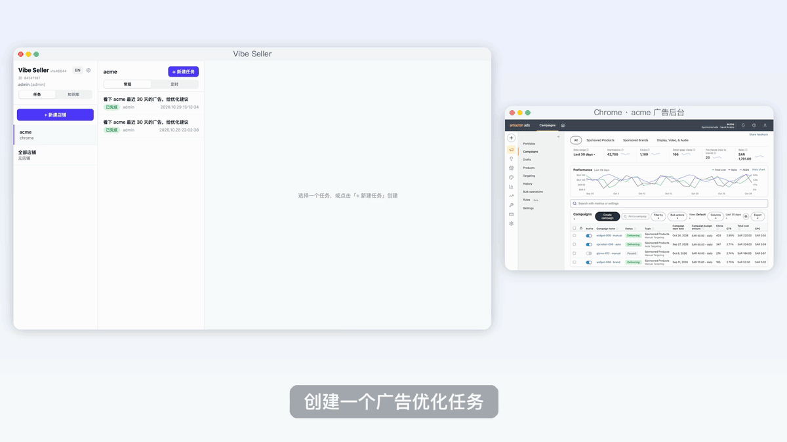
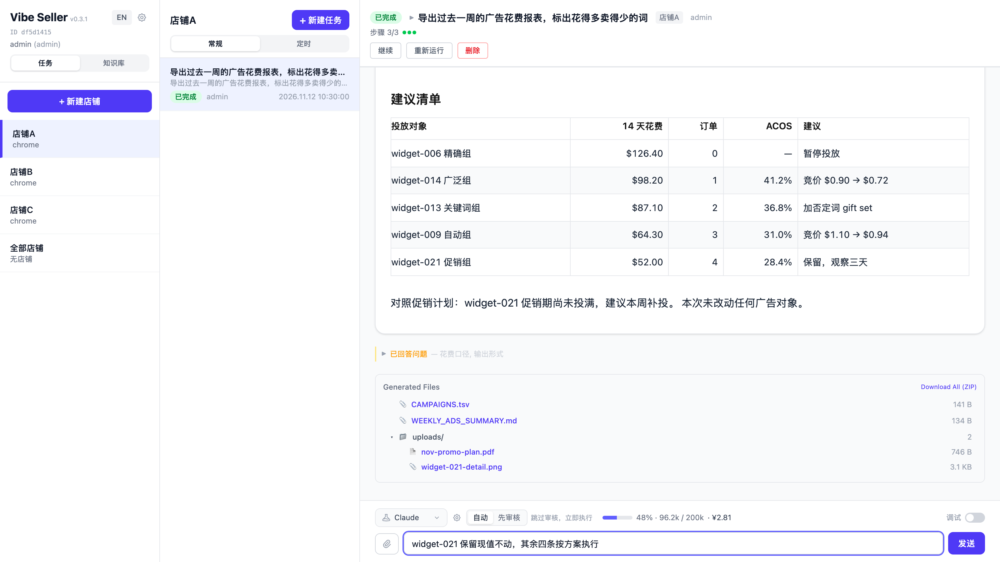
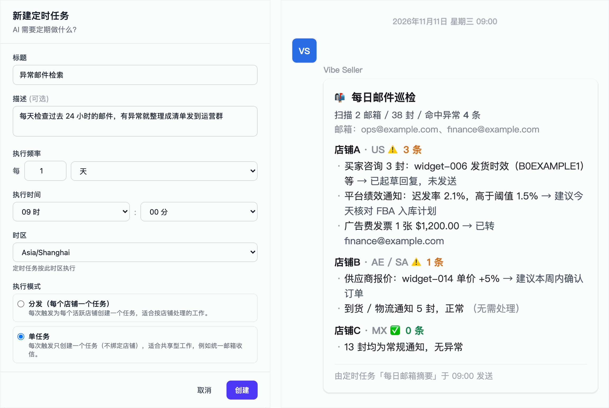
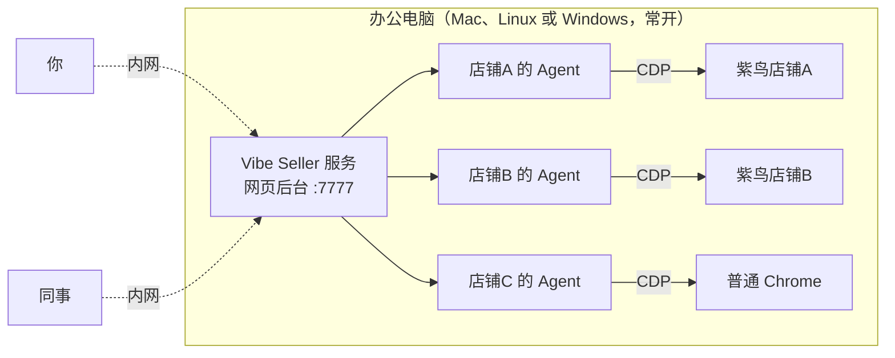

<!-- Generated from docs/index.md by scripts/gen_readme.py — edit those, not this file. -->

<h1 align="center">Vibe Seller</h1>

<p align="center">
  <b>跨境卖家的 AI 自动化框架（支持亚马逊、Noon、美客多、千牛等平台，紫鸟、Chrome 等浏览器），自由接入任意大模型</b><br/>
  支持 macOS、Linux、Windows（原生安装包）· 全程本地部署，代码和数据都在你自己机器上 · 兼容 Claude / DeepSeek / GLM / Qwen / Kimi / MiniMax 等主流模型
</p>

<p align="center">
  <a href="README_en.md">English</a> ·
  <a href="README.md">中文</a>
</p>

<p align="center">
  <a href="#加入社区"></a>
  <a href="https://join.slack.com/t/vibeseller/shared_invite/zt-4fjzkwkqs-L0pM6VS7~_2WsPCxTeLbew"></a>
</p>








🔥 *最新动态* 🔥

- [2026 年 11 月] **MCP 接入（Windows、macOS 都能在界面里配好）**：在 Claude、Codex、WorkBuddy、Qoder 等 AI 工具里，一句话就能让 Vibe Seller 执行任务：[**详情**](docs/mcp.md)
- [2026 年 11 月] **亚马逊广告直连 Ads API**：同一个广告优化任务从 147 分钟缩短到 11 分钟，人工介入更少：[**详情**](docs/ads-api.md)

---

## 这是什么

Vibe Seller 是面向跨境卖家的**浏览器自动化框架**，部署在你自己的电脑上。AI 通过 CDP（Chrome 底层远程控制协议）驱动紫鸟或普通 Chrome，在页面上的操作和你本人一样：广告调优、上架、Listing 巡检、库存检查、税票下载、建仓入库、物流跟踪……凡是浏览器里能完成的事，都可以交给 AI 执行。

每个店铺相互独立，**就像你请了几位各自负责的运营**：店铺 A 的 AI 只使用店铺 A 的紫鸟档案，有自己的记忆和工作区，与店铺 B、店铺 C 互不干扰，数据相互隔离。



部署方式二选一：

- 一台**常开的办公电脑**运行 Vibe Seller 服务；
- 或者直接在自己的电脑上使用。

部署完成后，你和同事在内网用任意设备打开网页后台即可。

## 为什么用 Vibe Seller

相比常见的自动化工具，Vibe Seller 更贴近跨境卖家的实际工作方式，也更贴近当前 AI 真正能做好的水平：从设计上就由 AI 驱动，内置 Skill，多店铺隔离，全程本地部署。浏览器操作基于 [browser-use](https://github.com/browser-use/browser-use)，而不是靠截图猜坐标——比让 AI 从零摸索页面快得多，也省 token 得多。

- **开箱即用，无需引导**——亚马逊（全站点）、Noon 等平台内置 Skill，覆盖卖家真正需要的操作：报表与对账单导出、Listing 上架与更新、广告调优。创建任务后，系统自动打开浏览器（紫鸟或普通 Chrome），AI 直接上手操作，通常一次就能完成，不需要逐步引导。
- **原生紫鸟支持**——通过 CDP 直接控制紫鸟，不是用 Playwright 驱动裸 Chrome，也不是按界面坐标点击，因此风控风险低、运行稳定。
- **不挑浏览器**——除紫鸟外，普通 Chrome 同样是一等公民，可以按店铺分别选择。
- **模型可自由切换**——底层使用 Claude Code CLI，凡是兼容 Anthropic 协议的供应商都能接入：Claude、DeepSeek、Kimi、MiniMax、智谱 GLM、通义千问。在设置里切换即可，不需要改代码；API Key 由你自己充值。
- **没有 SaaS 绑定**——代码在你机器上，数据在你硬盘里，不需要注册账号。
- **可审计**——每一步操作、每条 Prompt、每张截图都有日志，可以回放，出了问题能追溯原因。
- **天然多店隔离**——每个店铺有自己的平台、数据、SOP 和经验积累。店铺 A 运营 Amazon US，店铺 B 运营 Noon EG，店铺 C 运营 Shopify 独立站，三者可以同时执行，数据互不连通。

## 安装

**🪟 Windows（原生安装包，推荐）**：到 [最新 release](https://github.com/zpoint/vibe-seller/releases/latest) 下载 `VibeSeller-Setup.exe` 双击运行；或在 PowerShell 中执行一条命令完成安装：

```powershell
irm https://raw.githubusercontent.com/zpoint/vibe-seller/main/installer/windows/install.ps1 | iex
```

**🍎 macOS / 🐧 Linux**：在终端执行两行命令——

```bash
curl -sSL https://raw.githubusercontent.com/zpoint/vibe-seller/main/install.sh | bash
vibe-seller start
```

打开 <http://localhost:7777>；同事在浏览器里输入 `http://<这台电脑的IP>:7777` 即可一起使用。

> **⚠️ 用紫鸟之前**
>
> 紫鸟需要先由主账号（BOSS 账号）在[紫鸟开放平台](https://open.ziniao.com/docSupport?docId=99)开通开发者模式，并给子账号勾选「WebDriver 登录」，否则绑定店铺时会被紫鸟拒绝。
> 开通步骤，以及「无权限通过 webdriver 登录」「检测到您在新终端登录」这两个常见报错的解决办法，见 [紫鸟：开通与常见报错](docs/ziniao.md)。

完整说明（WSL2、源码安装、升级卸载、常驻服务）见 [安装](docs/install.md)；第一次使用请看 [快速开始](docs/quickstart.md)。

## 能干什么

Vibe Seller 是一个 **AI 自动化框架**，浏览器只是它的工具之一。AI 能浏览页面、读你的邮件、发企业微信、写滴答清单、改 Google 文档——只要一件事符合「看了 → 判断 → 操作」，能用浏览器就走浏览器，有接口就直接调用接口。

跨境场景里常见的几类任务：

| 任务 | AI 负责的操作 |
|---|---|
| **广告调优** | 在 Campaign Manager 中找出花费过高或不足的活动，给出调价、调预算建议，审批后一键应用。|
| **上架 Listing** | 按模板创建新 Listing：标题、卖点、图片、A+、变体一次完成。|
| **Listing 巡检** | 遍历所有店铺，标出下架、断货、异常的 SKU。|
| **库存检查** | 读取实时库存，低库存 SKU 自动推送到企业微信提醒。|
| **建仓 / 入库** | 创建入库单，分配 FBA / FBN，打印箱唛。|
| **物流数据查询** | 跟踪在途、查询头程到货和清关进度，异常单自动写入滴答清单待办。|
| **税票 & 报表** | 下载税票库、Business Reports 和广告报表，完成后自动归档到 Google Drive。|
| **邮件处理** | 给买家邮件分类，重要邮件转到企业微信，并起草回复。|
| **你想到的** | 写一个 Skill（markdown 步骤说明），或带着 AI 完整做一遍——它会自己记笔记，下次按你的习惯来。|

一次广告调优通常 3–5 分钟完成，模型费用约 1 元人民币（DeepSeek，10 组广告以内；广告组数越多费用越高）。

## 集成

除了浏览器，AI 还能直接调用这些外部服务，全部在「设置 → 集成」里配置，不需要写代码：

- **MCP 接入（Windows、macOS 都能在界面里配好）**——在 Claude、Codex、WorkBuddy、Qoder、Hermes Agent、Pi 等 AI 工具里直接指挥 Vibe Seller，[接入步骤](docs/mcp.md)
- **Amazon Ads API**——广告任务直连接口，不再逐页操作卖家后台；实测同一个任务从 147 分钟缩短到 11 分钟，[绑定步骤和实测对比](docs/ads-api.md)
- **邮件**（IMAP/SMTP）——读取绑定的店铺邮箱，分类、整理、起草并发送回复，支持 163、QQ、Gmail 等，[接入步骤](docs/email.md)
- **群机器人**（企业微信、钉钉、飞书、Slack）——让 AI 把结果、报表、提醒直接发到群里，企业微信还支持发送文件，[接入步骤](docs/chat-bots.md)
- **滴答清单 / TickTick**——自动创建待办（追单、跟进、定期检查），[接入步骤](docs/ticktick.md)
- **Google Workspace**——Gmail、Drive、Docs、Sheets、Slides、Calendar，支持读取、写入和修改，[接入步骤](docs/google-workspace.md)

一个任务可以同时使用浏览器和这些服务。例如“找出所有店铺滞销的 SKU”可以这样安排：浏览器读取库存 → 生成 Google Sheet 报表 → 把摘要发到企业微信 → 在滴答清单里创建「下周降价」待办。全部集成见 [集成总览](docs/integrations.md)。

## 支持的平台

### 内置 Skill 的平台

- **Amazon Seller Central**（US / EU / MENA 全部站点）
- **Noon Seller Lab**

这两个平台由开发者亲自实测过，Skill 里写明了页面机制、导航路径和界面陷阱。AI 读完 Skill 和你的任务 Prompt 后，查看广告、导出报表、调价、上架等常见操作基本**一次就能完成**。

### 其他浏览器能打开的电商后台

- 美客多（Mercado Libre）、速卖通（AliExpress）、Shopify
- Lazada、Shopee、TikTok Shop
- ……以及任何浏览器能打开的卖家后台。

开发者没有这些平台的测试账号，无法提前把操作机制写成 Skill。AI 第一次在新平台上执行任务时会有些曲折，可能需要试错几次才能摸清流程。

**框架内置「自我学习」**：执行任务的过程中，AI 会自己记笔记——点错的按钮、走通的路径、遇到的问题，都会自动存入该店铺的知识库。这个过程**不需要你盯着**，AI 自己执行、自己记录；你补充的几句人工提示，也会一并记下。下次执行同样的任务时直接调用之前的经验，不会重复踩坑。执行几轮之后，新平台上的常见操作也能稳定下来。

稳定之后，欢迎把这些经验整理成正式 Skill 提交给项目（PR 方式见下文「贡献代码」）。

## 文档导航

| | |
|---|---|
| **入门** | [安装](docs/install.md) · [快速开始](docs/quickstart.md) · [配置 AI 模型](docs/llm-keys.md) · [核心概念](docs/concepts.md) |
| **集成** | [集成总览](docs/integrations.md) · [MCP 接入](docs/mcp.md) · [广告 API 绑定](docs/ads-api.md) · [邮件](docs/email.md) · [群机器人](docs/chat-bots.md) · [滴答清单 / TickTick](docs/ticktick.md) · [Google Workspace](docs/google-workspace.md) |
| **使用示例** | [全部示例](docs/examples.md) · [每天把重要邮件发到企业微信](docs/example-email-wecom.md) · [每周检查广告 ACOS](docs/example-ads-acos.md) · [每周巡检 Listing](docs/example-listing-check.md) · [每天导出销售报表](docs/example-daily-report.md) · [在 Claude / Codex 里使用](docs/example-mcp.md) |
| **使用指南** | [店铺与浏览器](docs/stores.md) · [任务](docs/using-tasks.md) · [定时任务](docs/schedules.md) · [知识库与 Skill](docs/knowledge.md) |
| **常见问题** | [紫鸟：开通与常见报错](docs/ziniao.md) · [费用与模型选择](docs/faq-cost.md) · [登录与账号](docs/faq-login.md) · [部署与数据](docs/faq-data.md) · [全部问题](docs/faq.md) |
| **开发者文档（英文）** | [开发者指南](docs/dev-guide.md) · [任务内核](docs/tasks.md) · [浏览器内核](docs/browser.md) · [子系统](docs/subsystems.md) · [外部 Agent（MCP API）](docs/agents.md) · [Windows + WSL2 部署](docs/windows-setup.md) · [macOS 常驻服务](docs/macos-setup.md) |

架构设计见 [`DESIGN.md`](https://github.com/zpoint/vibe-seller/blob/main/DESIGN.md)，各子系统的深入说明都在 [`docs/`](https://github.com/zpoint/vibe-seller/tree/main/docs) 里。

## 贡献代码

欢迎提交 PR——自己写代码，或用 Claude Code / Cursor 等你常用的编程 AI 工具来写都可以。Python 侧遵循 Google 风格（ruff 强制），前端 TypeScript 严格模式 + ESLint。[`CLAUDE.md`](https://github.com/zpoint/vibe-seller/blob/main/CLAUDE.md) 是项目规范文档——主要写给 AI 看，人读起来也清楚。

## License

[Apache License 2.0](https://github.com/zpoint/vibe-seller/blob/main/LICENSE)。

## 加入社区

用微信扫码加入用户交流群（个人微信可直接扫，无需安装企业微信）：


海外用户也可以加入 [Slack](https://join.slack.com/t/vibeseller/shared_invite/zt-4fjzkwkqs-L0pM6VS7~_2WsPCxTeLbew)。遇到问题或有建议，见 [加入社区与问题反馈](docs/community.md)。
