<!-- Generated from docs/index.md by scripts/gen_readme.py — edit those, not this file. -->

<h1 align="center">Vibe Seller</h1>

<p align="center">
  <b>跨境卖家的 AI 自动化框架（支持亚马逊、Noon、美客多、千牛等平台，紫鸟、Chrome 等浏览器），自由接入任意大模型</b><br/>
  支持 macOS、Linux、Windows（原生安装包）· 全程本地部署，代码和数据都在你自己机器上 · 兼容 Claude / DeepSeek / GLM / Qwen / Kimi / MiniMax 等主流模型
</p>

<p align="center">
  <a href="README_en.md">English</a> ·
  <a href="README.md">中文</a>
</p>

<p align="center">
  <a href="#加入社区"></a>
  <a href="https://join.slack.com/t/vibeseller/shared_invite/zt-4fjzkwkqs-L0pM6VS7~_2WsPCxTeLbew"></a>
</p>


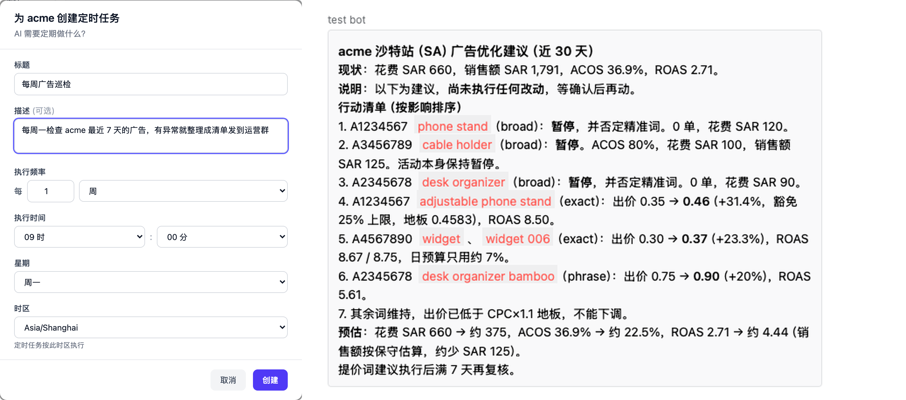


---

## 这是什么

Vibe Seller 是给跨境卖家用的**浏览器自动化框架**，本地部署。Agent 通过 CDP（Chrome 底层远程控制协议）驱动紫鸟（或普通 Chrome），跟你手动点页面一样——广告调优、上架、Listing 巡检、库存检查、税票下载、建仓入库、物流跟踪……凡是浏览器里能做的事，都能让 Agent 干。

每个店铺各跑各的——**就像你请了几个独立的运营**：店铺 A 的 Agent 只看店铺 A 的紫鸟档案，有它自己的记忆和工作区，跟店铺 B、店铺 C 的 Agent 互不打扰、互不串数据。

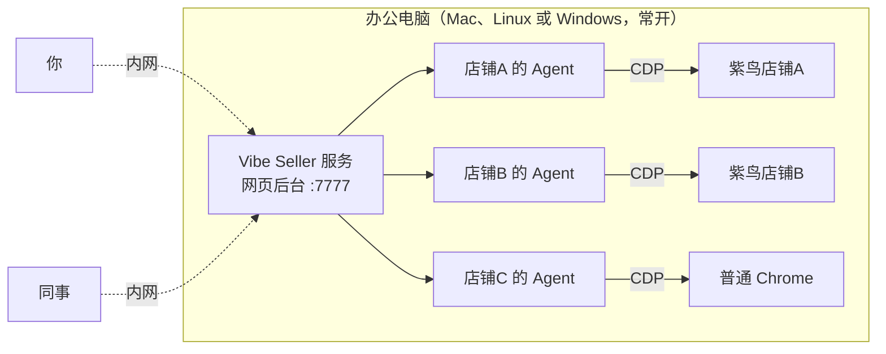

两种部署方式都可以：

- **一台办公电脑常开着**，跑 Vibe Seller 服务
- **或者就用自己的电脑**

你和同事在内网里用任意设备打开网页后台。

## 为什么用 Vibe Seller

比起现有的自动化工具，Vibe Seller 更贴近跨境卖家的实际需求，也更贴近当下 AI 技术真正能做到的水平：从设计上就是 AI 驱动——内置 Skill、多店铺隔离、全程本地部署。浏览器操作基于 [browser-use](https://github.com/browser-use/browser-use)，而不是靠截图瞎点——比让 Agent 从零摸索页面快得多，也省 token 得多。

- **开箱即用，无需引导**——亚马逊（全站点）、Noon 等平台内置 Skill，覆盖卖家真正要干的活：报表 / 对账单导出、Listing 上架与更新、广告调优。创建任务后，系统自动打开浏览器（紫鸟或普通 Chrome），Agent 直接上手操作——通常一次就成，不用一步步引导。
- **原生紫鸟支持**——通过 CDP 直接控制紫鸟，不是裸 Chrome 跑 Playwright，也不是 UI 坐标点击，所以风控风险低、稳定。
- **不挑浏览器**——除了紫鸟，普通 Chrome 也是一等公民，按店铺各自挑选。
- **支持大部分模型**——底层走 Claude Code CLI，凡是兼容 Anthropic 协议的供应商都能接：Claude、DeepSeek、Kimi、MiniMax、智谱 GLM、通义千问。设置里切一下就行，不用改代码。Key 是你自己充的。
- **没有 SaaS 绑定**——代码在你机器上，数据在你硬盘里，不用注册账号。
- **可审计**——每一步操作、每条 Prompt、每张截图都有日志，可回放，出问题能溯源。
- **天然多店隔离**——每个店铺各有自己的平台、数据、SOP、积累下来的经验。店铺 A 跑 Amazon US，店铺 B 跑 Noon EG，店铺 C 跑 Shopify 独立站——三个并行跑，互不串通。

## 安装

### 环境要求

- 任意一个 LLM API Key：Claude / DeepSeek / Kimi / MiniMax / GLM / Qwen
- 浏览器引擎——Chrome 或紫鸟

### 快速开始 —— 选你的系统

<details open>
<summary><b>🪟 Windows —— 原生安装包（推荐）</b></summary>

无需 WSL，无需配置 Python。从 [最新 release](https://github.com/zpoint/vibe-seller/releases/latest) 下载 **`VibeSeller-Setup.exe`** 双击运行。

> 需要 **Windows 10 1809 / Windows Server 2019 或更高版本**（64 位）。内置的 Claude Code 在更旧的系统（如 Server 2016）上无法启动，安装程序会直接拒绝安装。

或在 **PowerShell** 里：

```powershell
irm https://raw.githubusercontent.com/zpoint/vibe-seller/main/installer/windows/install.ps1 | iex
```

</details>

<details open>
<summary><b>🍎 macOS / 🐧 Linux</b></summary>

```bash
curl -sSL https://raw.githubusercontent.com/zpoint/vibe-seller/main/install.sh | bash
vibe-seller start
```

打开 <http://localhost:7777>。升级：`vibe-seller upgrade`（会一并升级它使用的 Claude Code）。卸载：`uv tool uninstall vibe-seller`。

<sub>想抢先用每日构建（夜间版，`main` 有新提交才发，可能不稳定）：`curl -sSL https://raw.githubusercontent.com/zpoint/vibe-seller/main/install.sh | bash -s -- --nightly`；Windows 用 `$env:VIBE_SELLER_CHANNEL='nightly'` 后再跑上面的 PowerShell 命令，或从 [nightly 发布](https://github.com/zpoint/vibe-seller/releases/tag/nightly) 下载安装包。夜间版只会收到更新的夜间版或正式版提示；正式版永远不会被提示升级到夜间版。回到正式版：`vibe-seller upgrade --stable`。</sub>

<sub>环境要求（<code>install.sh</code> 自动处理）：Python 3.11+（经 <a href="https://docs.astral.sh/uv/"><code>uv</code></a>）、Node.js 22+。</sub>

</details>

<details>
<summary>🪟 Windows 走 WSL2（进阶）</summary>

优先用上面的原生安装包。WSL2 方案是服务跑在 Ubuntu/WSL 里、浏览器在 Windows 宿主侧——需要 **mirrored 网络模式**（仅 Windows 11+ 支持）。完整步骤见 [开发者指南](docs/dev-guide.md)。

```bash
# 在 WSL2 Ubuntu 里
curl -sSL https://raw.githubusercontent.com/zpoint/vibe-seller/main/install.sh | bash
vibe-seller start
```

</details>

<details>
<summary>从源码 clone（贡献/二次开发用）</summary>

```bash
git clone https://github.com/zpoint/vibe-seller
cd vibe-seller
./install.sh --dev   # 装系统依赖 + venv + 编前端 + Playwright
./start.sh           # :7777 起服务
```

</details>

> `install.sh` 报错？把 GitHub 项目链接 <https://github.com/zpoint/vibe-seller> 丢给任意 Coding Agent（Claude Code / Codex / opencode / Cursor 都行），让它「读一下 README 帮我装」——它会自己看完文档、跑命令、绝大多数环境问题一两条就能修好。

## 首次配置

<details>
<summary><b>🪟 Windows —— 首次配置（4 步）</b></summary>

刚用[原生安装包](#安装)装完的话，跟着这 4 步走：

### 1. 装上

跑 [`VibeSeller-Setup.exe`](https://github.com/zpoint/vibe-seller/releases/latest)（或上面 PowerShell 那行一键命令）。装完会自动起服务——安装向导最后勾选**「现在打开 Vibe Seller」**，或者自己打开 <http://localhost:7777>。

### 2. 填 LLM Key

`设置 → AI` → 选一个供应商（DeepSeek 支持按 token 付费、Claude 上限高、Kimi/MiniMax/GLM/通义都行），粘 API Key 保存。Key 本地加密存储。

> **没有 Key？** 最省事的是 [DeepSeek](https://platform.deepseek.com/)——官网注册、充 15–20 块就能跑，按 token 付费（pay-as-you-go），单次任务消耗看任务大小。其他家通常需要预付月卡 token 包，按自己习惯买对应 plan 即可。

> 这台机器上的 Claude Code 已经登过 Anthropic 订阅？Vibe Seller 会直接复用那个会话，跳过这一步。

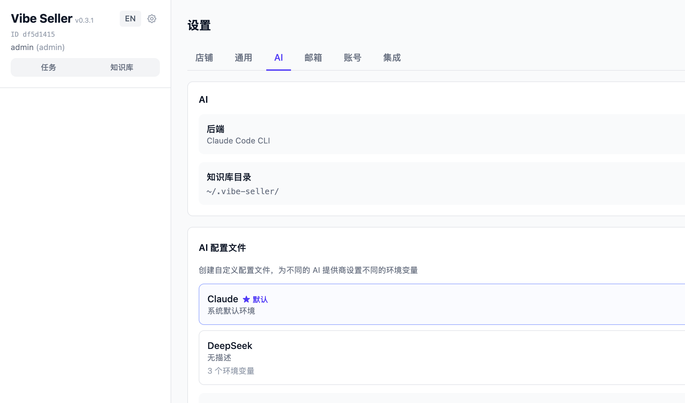

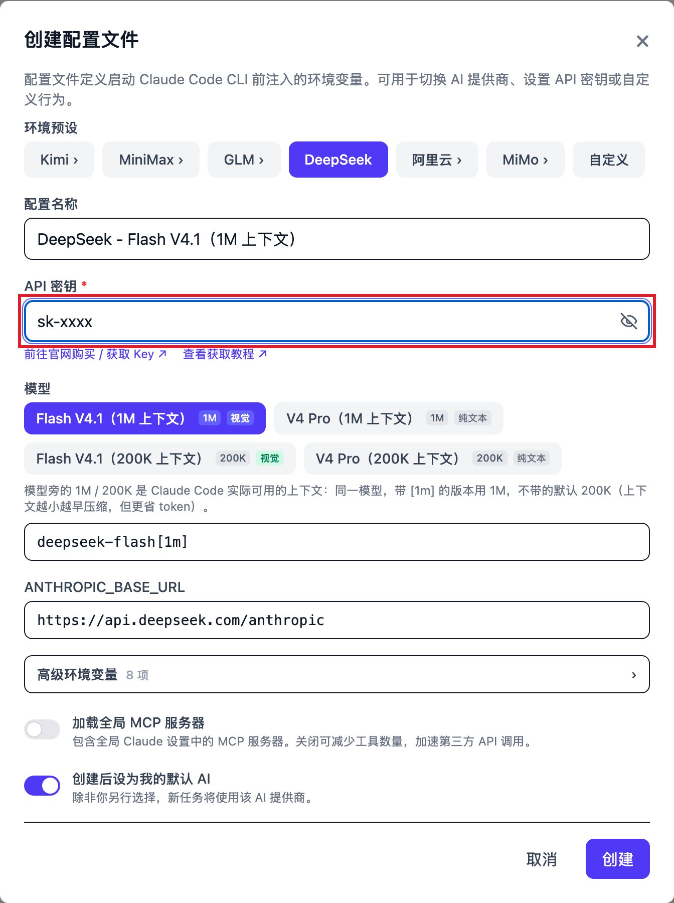

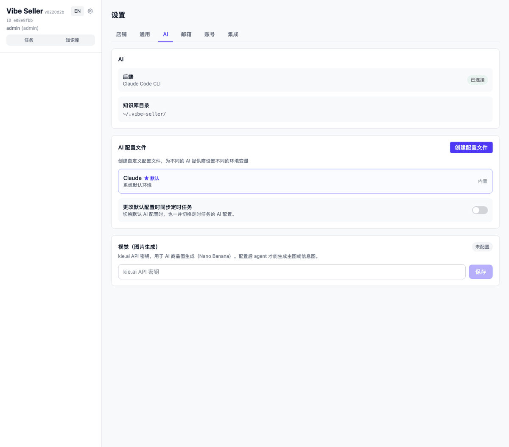

### 3. 绑定店铺

在首页侧栏点「**新建店铺**」，填店铺名称，浏览器后端选「**紫鸟（浏览器后端）**」：点「+」添加紫鸟账号（公司 / 用户名 / 密码），给店铺挑对应的紫鸟档案，点「**创建**」。不用紫鸟的话后端选「Chrome (Playwright)」。

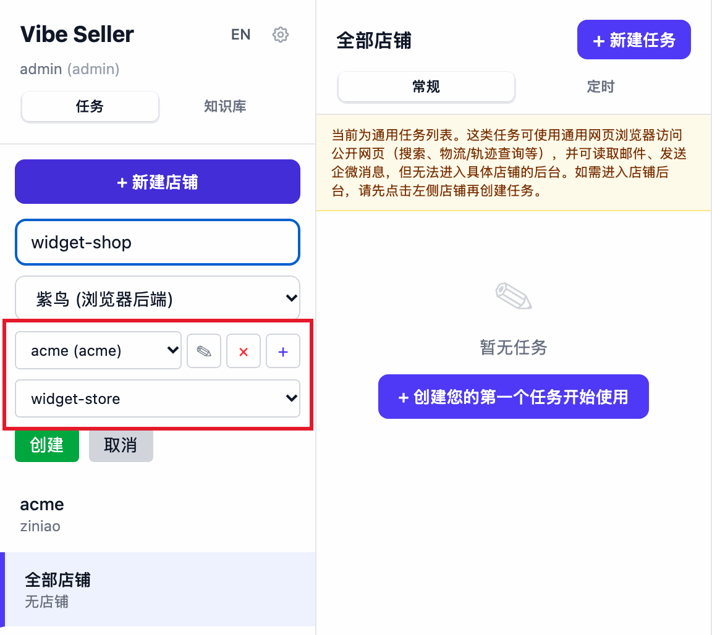

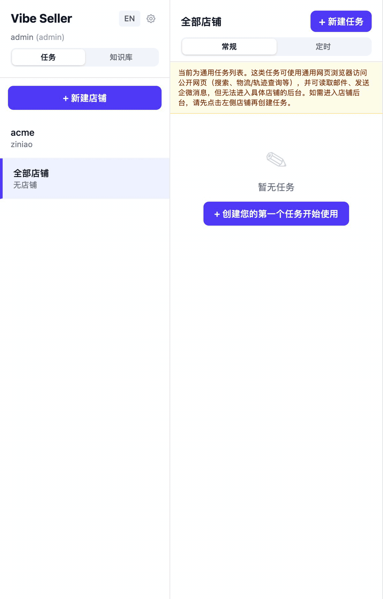

### 4. 创建第一个任务

首页「新建任务」→ 挑店铺 → 写一句话告诉 Agent 干嘛：

- 「检查广告，把 ACOS 超过 30% 的关键词暂停掉」
- 「把过去 7 天销售报表导出来」
- 「看看库存，估算下个月要补哪些 SKU」

Agent 自己规划步骤、操作浏览器、最后给你一份结果报告。默认 Auto 模式，直接跑就行；任务详情底部可以切到 Plan 模式让它先把计划交给你审。

> 还想接邮件 / 企业微信 / TickTick / Google Workspace？`设置 → 集成` 里随时都能配，不影响你先把第一个任务跑通。

> 想让 Amazon 广告操作直连 API（更稳、支持批量和历史数据）？可选，见下方 [Amazon Ads API](#amazon-ads-api)。

</details>

<details>
<summary><b>🍎 macOS / 🐧 Linux —— 首次配置（8 步）</b></summary>

完全没碰过命令行也能跟着做。一共 8 步：

### 1. 打开终端

Mac 按 ⌘ + 空格，输入「终端」，回车。Linux 打开你平时用的终端应用即可。

会出现一个黑底白字的窗口，里面有光标在闪——就是终端。

### 2. 装上

把下面整行**原样**复制，粘进终端，回车：

```bash
curl -sSL https://raw.githubusercontent.com/zpoint/vibe-seller/main/install.sh | bash
```

会自动跑几分钟（下载 Python 工具链、装 Vibe Seller、拉 Chromium）。看到最后写 `Vibe Seller installed!` 就成了。

中途卡住或者报错？把 GitHub 项目链接 <https://github.com/zpoint/vibe-seller> 丢给任意一个 Coding Agent（Claude Code、Codex、opencode、Cursor 都行），告诉它「读 README 装一下这个」，它会自己跑命令帮你修。

### 3. 启动

```bash
vibe-seller start
```

服务会在后台跑起来，终端打印 PID 和日志路径就完事——可以关掉终端窗口，服务不会停。需要停掉的时候用 `vibe-seller stop`。

### 4. 打开网页

浏览器输入：

```
http://localhost:7777
```

看到 Vibe Seller 首页就是装成功了（默认不需要登录）。

### 5. 填 LLM Key

`设置 → AI` → 选一个供应商（DeepSeek 支持按 token 付费、Claude 上限高、Kimi/MiniMax/GLM/通义都行），粘 API Key 保存。Key 本地加密存储。

> **没有 Key？** 最省事的是 [DeepSeek](https://platform.deepseek.com/)——官网注册、充 15–20 块就能跑，按 token 付费（pay-as-you-go），单次任务消耗看任务大小。其他家通常需要预付月卡 token 包，按自己习惯买对应 plan 即可。

> 这台机器上的 Claude Code 已经登过 Anthropic 订阅？Vibe Seller 会直接复用那个会话，跳过这一步。

> **装了 cc-switch 之类的 Claude 账号切换工具？这里请选默认。**
>
> 这类工具直接改你的全局配置文件 `~/.claude/settings.json` 来切换 AI 供应商，跟本项目自己的 AI 选择器会冲突。直接选默认就行，AI 切换交给 cc-switch 管。
>
> 想反过来让本项目管的话：退出 cc-switch，然后在终端里**原样复制粘贴**下面这一行回车——它会改你的 Claude Code 全局配置（`~/.claude/settings.json`），清掉 cc-switch 写进去的 `ANTHROPIC_*` 环境变量：
>
> ```bash
> python3 -c "import json,pathlib;p=pathlib.Path.home()/'.claude'/'settings.json';d=json.loads(p.read_text());env=d.get('env') or {};[env.pop(k,None) for k in list(env) if k.startswith('ANTHROPIC_')];d['env']=env;p.write_text(json.dumps(d,indent=2))"
> ```


### 6. 绑定店铺

在首页侧栏点「**新建店铺**」，填店铺名称，浏览器后端选「**紫鸟（浏览器后端）**」：点「+」添加紫鸟账号（公司 / 用户名 / 密码），给店铺挑对应的紫鸟档案，点「**创建**」。不用紫鸟的话后端选「Chrome (Playwright)」。


### 7. （可选）配置邮件 / 企业微信

想让 Agent 每天出邮件巡检报告、把异常推到企业微信群？`设置 → 集成` 里加：

- **邮件**：填店铺对应邮箱地址，IMAP 服务器会自动识别（gmail / outlook / 自建都支持），你只用填 secrets（应用密码 / app password）。不知道怎么生成？把邮箱供应商名字问任意 AI 就行。保存后 Agent 每天自动扫一遍。
- **企业微信**：建群机器人，把 webhook URL 粘进来。重要异常自动推到群。
- **TickTick / Google Workspace**：要把结果同步到日程或文档的话，这里也能接。

跳过没关系，先把第一个任务跑通再说。

> 想让 Amazon 广告操作直连 API（更稳、支持批量和历史数据）？可选，见下方 [Amazon Ads API](#amazon-ads-api)。

### 8. 创建第一个任务

首页「新建任务」→ 挑店铺 → 写一句话告诉 Agent 干嘛：

- 「检查广告，把 ACOS 超过 30% 的关键词暂停掉」
- 「把过去 7 天销售报表导出来」
- 「看看库存，估算下个月要补哪些 SKU」

Agent 自己规划步骤、操作浏览器、最后给你一份结果报告。默认 Auto 模式，直接跑就行；任务详情底部可以切到 Plan 模式让它先把计划交给你审。

</details>

<details>
<summary><b>🐧 Windows 走 WSL2 —— 首次配置（8 步）</b></summary>

完全没碰过命令行也能跟着做。一共 8 步。前提是你已经按 [WSL2 方案](#安装)装好了（需要 mirrored 网络模式，仅 Windows 11+ 支持）。

### 1. 打开终端

打开 WSL 里的 Ubuntu 终端——在开始菜单搜索「Ubuntu」，或者在 PowerShell 里输入 `wsl`。

会出现一个黑底白字的窗口，里面有光标在闪——就是终端。

### 2. 装上

把下面整行**原样**复制，粘进终端，回车：

```bash
curl -sSL https://raw.githubusercontent.com/zpoint/vibe-seller/main/install.sh | bash
```

会自动跑几分钟（下载 Python 工具链、装 Vibe Seller、拉 Chromium）。看到最后写 `Vibe Seller installed!` 就成了。

中途卡住或者报错？把 GitHub 项目链接 <https://github.com/zpoint/vibe-seller> 丢给任意一个 Coding Agent（Claude Code、Codex、opencode、Cursor 都行），告诉它「读 README 装一下这个」，它会自己跑命令帮你修。

### 3. 启动

```bash
vibe-seller start
```

服务会在后台跑起来，终端打印 PID 和日志路径就完事——可以关掉终端窗口，服务不会停。需要停掉的时候用 `vibe-seller stop`。

### 4. 打开网页

浏览器输入：

```
http://localhost:7777
```

看到 Vibe Seller 首页就是装成功了（默认不需要登录）。

### 5. 填 LLM Key

`设置 → AI` → 选一个供应商（DeepSeek 支持按 token 付费、Claude 上限高、Kimi/MiniMax/GLM/通义都行），粘 API Key 保存。Key 本地加密存储。

> **没有 Key？** 最省事的是 [DeepSeek](https://platform.deepseek.com/)——官网注册、充 15–20 块就能跑，按 token 付费（pay-as-you-go），单次任务消耗看任务大小。其他家通常需要预付月卡 token 包，按自己习惯买对应 plan 即可。

> 这台机器上的 Claude Code 已经登过 Anthropic 订阅？Vibe Seller 会直接复用那个会话，跳过这一步。

> **装了 cc-switch 之类的 Claude 账号切换工具？这里请选默认。**
>
> 这类工具直接改你的全局配置文件 `~/.claude/settings.json` 来切换 AI 供应商，跟本项目自己的 AI 选择器会冲突。直接选默认就行，AI 切换交给 cc-switch 管。
>
> 想反过来让本项目管的话：退出 cc-switch，然后在终端里**原样复制粘贴**下面这一行回车——它会改你的 Claude Code 全局配置（`~/.claude/settings.json`），清掉 cc-switch 写进去的 `ANTHROPIC_*` 环境变量：
>
> ```bash
> python3 -c "import json,pathlib;p=pathlib.Path.home()/'.claude'/'settings.json';d=json.loads(p.read_text());env=d.get('env') or {};[env.pop(k,None) for k in list(env) if k.startswith('ANTHROPIC_')];d['env']=env;p.write_text(json.dumps(d,indent=2))"
> ```


### 6. 绑定店铺

在首页侧栏点「**新建店铺**」，填店铺名称，浏览器后端选「**紫鸟（浏览器后端）**」：点「+」添加紫鸟账号（公司 / 用户名 / 密码），给店铺挑对应的紫鸟档案，点「**创建**」。不用紫鸟的话后端选「Chrome (Playwright)」。

紫鸟装在 Windows 侧，Vibe Seller 跑在 WSL 里。紫鸟同一时间只能跑一种模式，Vibe Seller 需要开发者模式（也叫 WebDriver 模式，这个模式才会开 CDP）。WSL 这边没法直接重启 Windows 上的紫鸟，所以要在 Windows 侧用启动器：

1. 选好紫鸟账号后会出现「紫鸟未运行或未处于 WebDriver 模式」的提示框，点里面的「**下载 ziniao_webdriver.bat**」。
2. 在 Windows 上双击运行。
3. 回到 WSL 里的 Vibe Seller，紫鸟页面点「**刷新**」按钮，账号自动出现，不用手填字段。

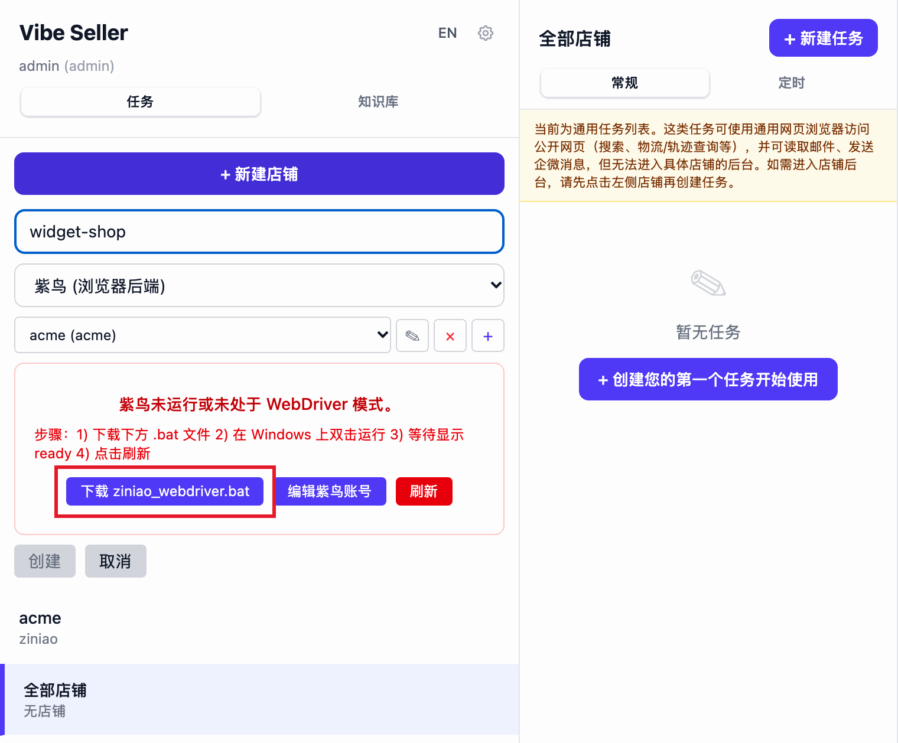

### 7. （可选）配置邮件 / 企业微信

想让 Agent 每天出邮件巡检报告、把异常推到企业微信群？`设置 → 集成` 里加：

- **邮件**：填店铺对应邮箱地址，IMAP 服务器会自动识别（gmail / outlook / 自建都支持），你只用填 secrets（应用密码 / app password）。不知道怎么生成？把邮箱供应商名字问任意 AI 就行。保存后 Agent 每天自动扫一遍。
- **企业微信**：建群机器人，把 webhook URL 粘进来。重要异常自动推到群。
- **TickTick / Google Workspace**：要把结果同步到日程或文档的话，这里也能接。

跳过没关系，先把第一个任务跑通再说。

> 想让 Amazon 广告操作直连 API（更稳、支持批量和历史数据）？可选，见下方 [Amazon Ads API](#amazon-ads-api)。

### 8. 创建第一个任务

首页「新建任务」→ 挑店铺 → 写一句话告诉 Agent 干嘛：

- 「检查广告，把 ACOS 超过 30% 的关键词暂停掉」
- 「把过去 7 天销售报表导出来」
- 「看看库存，估算下个月要补哪些 SKU」

Agent 自己规划步骤、操作浏览器、最后给你一份结果报告。默认 Auto 模式，直接跑就行；任务详情底部可以切到 Plan 模式让它先把计划交给你审。

</details>

## 能干什么

Vibe Seller 是个 **AI Agent 框架**，浏览器只是它的工具之一。Agent 能浏览页面、读你的邮件、发企业微信、写滴答清单、改 Google Doc ——只要符合「看了 → 判断 → 操作」的活，能用浏览器就走浏览器，能用集成接口就直接调接口。

跨境圈常见的几类场景：

| 任务 | Agent 干啥 |
|---|---|
| **广告调优** | 翻 Campaign Manager，找出花钱过多 / 不够的 Campaign，提出调价、调预算的建议，审批后一键应用。|
| **上架 Listing** | 按模板创建新 Listing：标题、卖点、图片、A+、变体一条龙。|
| **Listing 巡检** | 遍历所有店铺，标出下架 / 断货 / 异常的 SKU。|
| **库存检查** | 拉实时库存，低库存 SKU 直接推企微提醒。|
| **建仓 / 入库** | 创建入库单，分配 FBA / FBN，打印箱唛。|
| **物流数据查询** | 跟踪在途、查头程到货、清关进度；异常单自动写进滴答清单待办。|
| **税票 & 报表** | 抓税票库、Business Reports、广告报表；下完自动归档到 Google Drive。|
| **邮件处理** | 给买家邮件分类，重要的转企微，起草回复草稿。|
| **你想到的** | 写个 Skill（markdown 步骤说明），或者带 Agent 做一遍——它会自己记笔记，下次按你的习惯来。|

一次广告调优大概 3–5 分钟，LLM 费用几块钱人民币（DeepSeek，看具体广告数量浮动）。

## 集成的服务

除了浏览器，Agent 还能直接调用下面这些外部服务（首次配置里挂上权限就行，不用写代码）：

| 服务 | 干啥 |
|---|---|
| **邮件**（IMAP/SMTP） | 读你绑定的店铺邮箱，分类、转发、起草回复 |
| **群机器人**（企业微信 / 钉钉 / 飞书 / Slack） | 推送重要事件、跨群通知、买家询盘转发 |
| **滴答清单 / TickTick** | 自动建待办（追单、跟进、定期检查） |
| **Google Workspace** | Gmail、Drive、Docs、Sheets、Slides、Calendar——读、写、改都行 |

一个任务可以同时用浏览器 + 这些服务。比如「找出所有店铺滞销的 SKU」可以这样跑：浏览器抓库存 → 生成 Google Sheet 报表 → 把摘要发企微 → 在滴答清单里给你建个「下周降价」的待办。

### Amazon Ads API

绑定后，Agent 的亚马逊广告操作不再靠浏览器点卖家后台，而是**直连广告 API**——调优和批量操作更稳。**目前仅支持亚马逊店铺，每个店铺单独授权。**

#### 绑定能带来什么

|  | 浏览器方式（未绑定） | Ads API（绑定后） |
|---|---|---|
| 操作方式 | Agent 在店铺浏览器里点亚马逊广告后台 | Agent 直连 API，不开浏览器 |
| 稳定性 | 依赖页面，改版 / 加载慢会打断 | 接口调用，批量操作也稳 |
| 历史数据 | 只有页面当前展示的 | 历史出价与状态、否词、每次改动的前后对比（这些亚马逊报表都不给） |
| 改动留痕 | 无 | 服务端记录每次改动和结果 |

实测同一个广告任务从 **147 分钟变成 11 分钟**，出错和人工介入的次数都大幅减少。

任务走哪条路不需要你指定——按**店铺的授权状态**自动选择：绑定了就走 API，没绑定就走浏览器。

#### 实测对比

同一个店铺（acme，AE 站）、同一个只出报告的广告优化任务、同一个模型（MiniMax-M3.1-Flash），一遍走 Ads API，一遍走浏览器：

| 指标 | Ads API 路径 | 浏览器路径 | 对比 |
|---|---|---|---|
| 完整时间（从创建任务到任务完成） | **11.1 分钟** | 147 分钟 | 慢 13× |
| 净执行时间（不含用户等待与外部暂停） | **11.0 分钟** | 90.5 分钟 | 慢 8.2× |
| 助手轮数 | **130** | 710 | 5.5× |
| 工具调用（其中浏览器交互 / 广告 API） | 69（0 / **21**） | 361（**123** 次浏览器命令 / 0） | 5.2× |
| tokens（输入 / 输出 / 缓存读） | 0.68M / 0.19M / 15.4M | 2.34M / 0.99M / **151.6M** | 缓存读 9.8× |
| 估算模型成本 | **≈ ¥3** | ≈ ¥21 | 7× |
| 活动覆盖 | 全部活动（含零花费/已暂停） | 同一份完整清单，全部下钻 | **一致** |
| 报告产出 | 一份 24 KB 报告 | 103 KB 报告 + PDF（逐定向/逐搜索词全量表） | 更细 |
| 中途打断 | 无 | 1 次问操作员（盈亏线口径）+ 1 次模型配额暂停 36 分钟 | |

| 时间都花在哪 | Ads API 路径 | 浏览器路径 |
|---|---|---|
| LLM 思考与生成 | ■■■■■■■■■■■■■■■■■■ **96.3%**（10.6 分） | ■■■■■■■■■■■■■ **68.6%**（62.1 分） |
| 工具执行 | ▪ 2.3%（广告 API 调用 0.23 分） | ▪ **31.4%**（开页/点按 14.5% + 页面等待 16.5%） |
| 其余 | 1.4% | <0.1% |

浏览器路径的工具时间几乎全在「开页面、等页面」上；API 路径的 21 次调用合计只占 13.8 秒。

<details>
<summary><b>前提与绑定步骤（4 步）</b></summary>

**前提**

- vibe-seller 的**管理员**账号（授权 / 解绑只有 admin 能操作）。
- 本机网络能访问广告服务 `https://listwizard.cloud/ads-api`。
- 亚马逊店铺（目前只支持 Amazon）。
- **这个店铺的亚马逊卖家账号**——授权要在店铺自己的浏览器环境（紫鸟窗口，或这个店铺用的浏览器）里登录卖家账号完成。
- **不需要**填任何 API key / client id / secret：首次打开「设置 → 集成」时本机会自动向广告服务注册，安装密钥本地加密保存；亚马逊的授权同意全程在广告服务自己的域名上完成。

**1. 打开面板**

`设置 → 集成` → 「Vibe Seller 广告 API 服务」卡片。表格里每个店铺一行，显示各自的授权状态。

**2. 点「授权」，复制链接**

点店铺旁的「**授权**」：

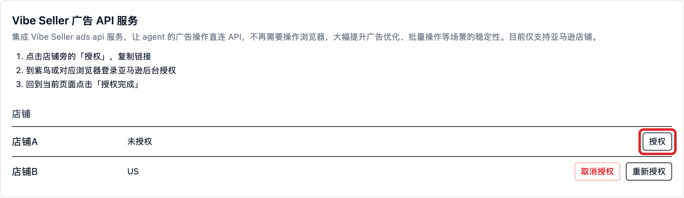

页面会展开授权区，链接会**自动复制到剪贴板**：

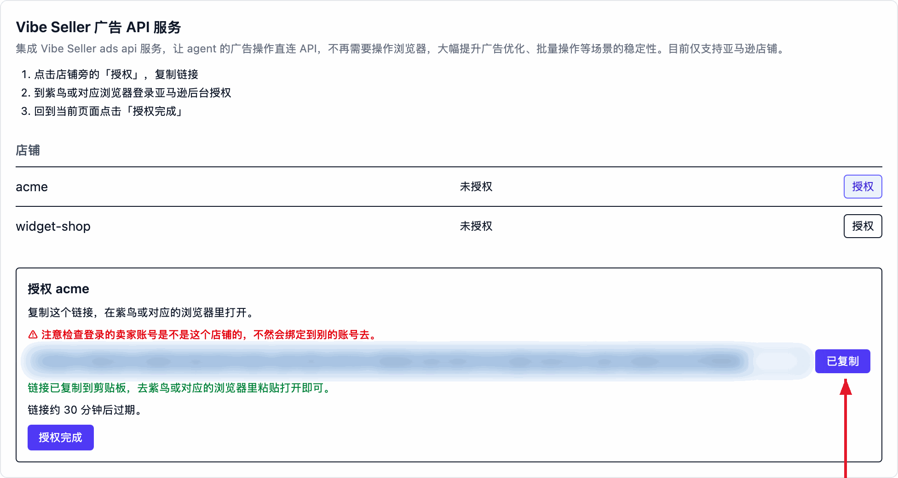

链接的有效期不长——页面会显示具体分钟数，过期就回来重点「授权」/「重新授权」拿新的。

**3. 在店铺的浏览器里完成亚马逊授权**

到**紫鸟（或这个店铺对应的浏览器）**里打开刚复制的链接，用**这个店铺的**亚马逊卖家账号登录并同意授权。

> ⚠ 注意检查登录的卖家账号是不是这个店铺的，不然会绑定到别的账号去。授权绑定的是你当时登录的那个账号——登错了界面照样显示成功，但绑错了对象。

这一步是亚马逊的授权页面（在广告服务的域名上），就不截图了：用店铺的卖家账号登录、点同意，看到授权成功页即可。

**4. 回到页面点「授权完成」**

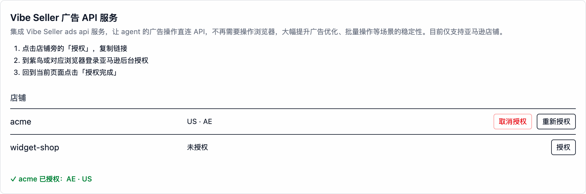

看到绿色的「✓ acme 已授权：US · AE」就成了——店铺行里会列出授权到的站点。如果提示「还没有看到这个店铺的授权」，说明亚马逊侧还没走完：回去补完、看到成功页后再点一次。

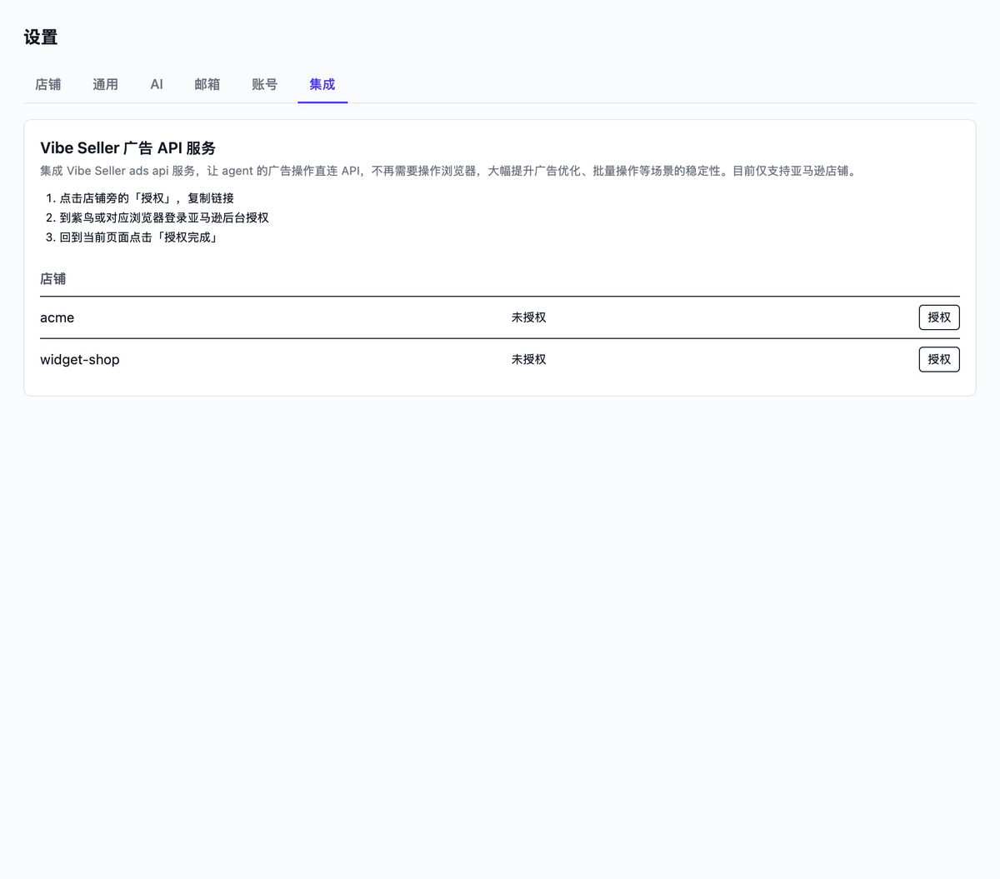

**怎么验证**

- 上面的绿色 ✓ 提示就是绑定成功。此后在店铺上创建的广告任务，Agent 会自动改用 `amazon-ads-api` 技能直连 API（任务提示词里会写明走哪条路）。
- **刚授权完的店铺，历史数据同步大约需要 30 分钟**——这期间问历史类数据会得到「同步中」的答复；实时数据不受影响。
- 回答里的数据都带 `as_of` / `window` / `data_through`，可以核对数据口径。

</details>

<details>
<summary><b>解除绑定</b></summary>

店铺行点「**取消授权**」，会在原地弹出确认框说明后果：

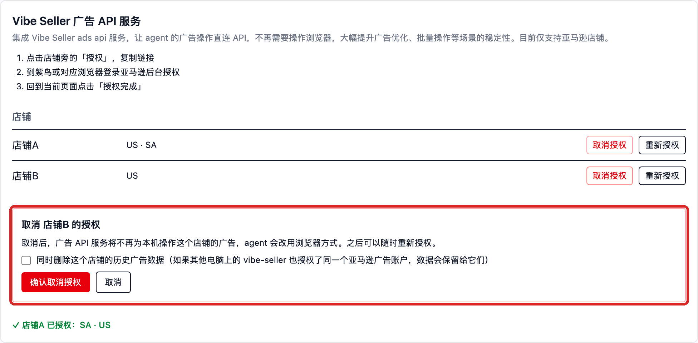

- 取消后，广告服务不再为本机操作这个店铺的广告，Agent **改回浏览器方式**；之后随时可以再点「授权」绑回来。
- 「同时删除这个店铺的历史广告数据」默认**不勾**——保留历史，重新授权时接着用；勾上才会删（如果其他电脑上的 vibe-seller 也授权了同一个亚马逊广告账户，数据会保留给它们）。
- 所有店铺都解绑后，`amazon-ads-api` 技能会从工作区移除。

</details>

<details>
<summary><b>Ads API 常见问题</b></summary>

**打开面板就红字报「Could not reach the ads service …」**
本机到广告服务的网络不通（防火墙 / 代理 / 服务临时不可用）。恢复后重新打开页面即可——面板每次打开都会自动同步和注册。

**点完「授权完成」提示「还没有看到这个店铺的授权」**
亚马逊那边的同意还没完成，或者没等到授权成功页。回店铺浏览器把授权走完，看到成功页回来再点一次。

**任务里提示「Store … is not authorized with the ads service」**
这个店铺还没绑定，或者授权已失效。到「设置 → 集成」点「授权」/「重新授权」。

**服务返回 502，提示需要重新授权**
服务端持有的授权失效了（比如卖家账号改了密码、或在亚马逊侧撤销了授权）。**人**到设置里重新授权——Agent 不能替你做这一步。

**服务返回 503**
亚马逊在限流。稍等再试，别反复重试烧配额。

**新授权的店铺，任务回答「数据同步中」（202）**
首次历史拉取大约要 30 分钟，稍后再问；实时接口不受影响。

**一个店铺开了多个站点（marketplace）**
调用时要指明站点（如 `US` / `AE`）；不指明时服务会拒绝而不是猜，免得把 A 站的数据当 B 站的用。

**授权链接打不开 / 过期**
链接的有效期以页面显示为准（不长），而且要**在店铺自己的浏览器环境里**打开（紫鸟窗口 / 这个店铺用的浏览器），别在日常浏览器里开——否则容易把别的卖家账号绑上去。过期就回来重点「授权」。

**安全相关**
Vibe Seller 不保存你的亚马逊账号密码；亚马逊的 OAuth 同意在广告服务的域名上完成，本机只保存一个加密的安装密钥，任何 HTTP 接口都不会把它读出去。

</details>

## 支持的平台

### 内置 Skill 的平台

- **Amazon Seller Central**（US / EU / MENA 全部站点）
- **Noon Seller Lab**

这两个平台开发者亲自跑过、踩过坑，Skill 里把页面机制、导航路径、UI 陷阱都写清楚了。Agent 读完 Skill + 你的任务 Prompt，常见操作（查看广告、导出报表、调价、上架……）基本**一次就能跑通**。

### 其他浏览器能打开的电商后台

- 美客多（Mercado Libre）、速卖通（AliExpress）、Shopify
- Lazada、Shopee、TikTok Shop
- ……以及任何浏览器能打开的卖家后台。

开发者没有这些平台的测试账号，没法预先把机制写成 Skill。Agent 第一次在新平台上跑会有点跌跌撞撞，可能要试错几次才能摸清流程。

**但框架内置了「自我学习」**：Agent 在跑的过程中会自己做笔记——点错的按钮、走通的路径、踩过的坑，都会自动存到该店铺的本地知识库。整个过程**不需要你盯着**，Agent 自己跑、自己记。你要是顺手给两句人工提示，那也一起记下。下次同样的任务，之前的经验直接调用，不会再撞同一面墙。跑几轮之后，新平台的常见操作也能稳定下来。

跑通之后欢迎你把经验整理成正式 Skill 反哺给项目（PR 通道见下面「贡献代码」）。

## 服务管理

```bash
./start.sh          # 默认 :7777
./start.sh 8080     # 指定端口
./stop.sh           # 停止
./restart.sh        # 重启
```

要让同事在内网访问？让他们打开 `http://<你的电脑IP>:7777`。

## 常见问题

<details>
<summary><b>要花多少钱？</b></summary>

Vibe Seller 本身免费开源，花钱的只有你自己的 LLM API Key——直接给供应商付费。粗略量级：用 DeepSeek 跑一次广告调优大概几块钱人民币。

</details>

<details>
<summary><b>该选哪个 LLM？</b></summary>

推荐用支持 1M 上下文、支持多模态（能看图）的模型，比如 Claude Opus、GLM-5.3-Flash。档位按任务难度挑：

| 任务类型 | 用什么档位 |
|---|---|
| **复杂任务** —— 探索新平台（没有内置 Skill）、广告优化、库存策略、跨页面长流程 | 各家的 **SOTA 旗舰模型** |
| **简单任务** —— 邮件分类、固定流程数据抽取、按字段填表 | **Flash 或便宜的档位**就够 |

复杂任务里 Agent 要边读 Skill、边判断页面状态、边调用工具、边记笔记，能力不够的模型容易跳步骤、工具参数出错、忘掉前面的判断。一次失败的复杂任务消耗的 token + 时间，比直接用 SOTA 一次跑通更多；简单任务用什么模型差别不大，能省就省。

</details>

<details>
<summary><b>紫鸟接入是怎么回事？开发者模式 vs 普通模式 / 需要的凭据 / 存哪</b></summary>

紫鸟同一时间只能跑一种模式：

- **普通模式**——你双击紫鸟图标启动的就是这个。只有 UI，给你日常手动用，外部程序进不来。
- **开发者模式（WebDriver）**——同一个紫鸟，启动时带了额外参数，会在 `127.0.0.1:16851` 开一个 HTTP API。这是 Vibe Seller（或者任何外部工具）能驱动紫鸟的**唯一**入口。

两个模式共用同一个紫鸟进程，不能同时跑。切换模式 = 重启紫鸟：

- **macOS / 原生 Windows**：Vibe Seller 自己来——打开店铺时它会先把普通模式的紫鸟杀掉，然后带 `--run_type=web_driver` 重新拉起，两个平台都一样自动接管，不用你操心。
- **Windows（WSL）**：WSL 这边没法跨虚拟机边界重启 Windows 上的紫鸟，所以 Windows 侧需要跑一个一行的 `.bat` 启动器（绑定店铺时紫鸟提示框里点「下载 ziniao_webdriver.bat」）来完成杀掉 + 重启。双击跑一次就行，之后 Vibe Seller 通过「**刷新**」按钮就能识别到开发者模式的会话。

**需要的凭据**——新建店铺（浏览器后端选「紫鸟」）时点「+」加一个「紫鸟账号」，填三个字段：

| 字段 | 是什么 |
|---|---|
| **公司名称** | 你的紫鸟企业账号公司标识 |
| **企业用户名** | 公司下面那个子账号的用户名 |
| **密码** | 那个子账号的密码 |

跟你平时登紫鸟用的是同一套——Vibe Seller 把这三个字段传给开发者模式的 HTTP API，用来列出你的浏览器档案、启动会话。

**主账号（BOSS 账号）需要先在紫鸟开放平台开通开发者模式**（一次性管理员配置，见 <https://open.ziniao.com/docSupport?docId=99>）。没开通的话紫鸟会拒绝登录（报错 `statusCode: -10003`——紫鸟自己的错误码，意思就是「这个公司没开通开发者模式」）。

**凭据存在哪**——全部在你本地 `~/.vibe-seller/data/vibe_seller.db`（SQLite）。没有上传，遥测通道也不带走。

- **密码**：落盘前加密，密钥从你本地安装派生，任何 HTTP 接口都不会把密码返回给前端——只在 Vibe Seller 要调紫鸟 HTTP API 那一刻才在内存里解密。
- **公司名称** 和 **用户名**：明文存储——这俩是身份标识，跟邮箱地址一个性质。

让你填密码这件事是没办法的：紫鸟开发者模式的 HTTP API 走的就是账号密码，没有 OAuth / token 替代。不能接受就走普通 Chrome：新建店铺时浏览器后端选「Chrome (Playwright)」。想看具体加密实现的可以翻 [`docs/dev-guide.md`](docs/dev-guide.md)。

</details>

<details>
<summary><b>绑定店铺时紫鸟提示「无权限通过 webdriver 登录」怎么办？</b></summary>

主账号（BOSS）还没给子账号开通 WebDriver 登录权限。按[紫鸟官方指南](https://open.ziniao.com/docSupport?docId=99#%E7%AC%AC%E4%B8%80%E6%AD%A5%EF%BC%9A%E7%99%BB%E5%BD%95%E5%BC%80%E6%94%BE%E5%B9%B3%E5%8F%B0%E6%8E%A7%E5%88%B6%E5%8F%B00)，在开放平台控制台里把 WebDriver 登录选项勾上：

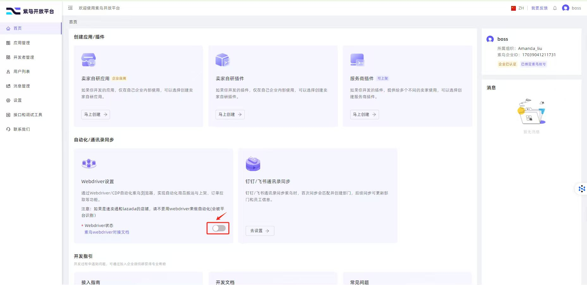

只需要主账号操作一次，保存之后子账号就能通过 WebDriver 登录，回到 Vibe Seller 点「刷新」就能绑上店铺。

</details>

<details>
<summary><b>绑定店铺时紫鸟提示「检测到您在新终端登录」怎么办？</b></summary>

这是紫鸟的新设备安全检测，不是 Vibe Seller 的问题。同一个账号第一次在某台机器上登录时，紫鸟要求人工审批一次：

1. 在这台机器上手动打开紫鸟（普通模式，不是 WebDriver），用同一个子账号登录。
2. 紫鸟会弹出新设备提示——按提示提交审批申请。
3. 主账号（BOSS）到紫鸟后台批准这台设备。

批准之后这台设备就被信任了，回到 Vibe Seller 点「刷新」，WebDriver 登录就能直接通过。

</details>

<details>
<summary><b>能不能跑在云服务器上？</b></summary>

可以，需要自己解决浏览器和 GUI 的问题。Vibe Seller 本身跑在无 GUI 的服务器上没问题；紫鸟（以及想看操作过程的 Chrome 后端）需要有地方渲染画面——虚拟显示（Xvfb）、云桌面 VM，或者 VNC 进一个真实 GUI 会话都行。不过更省事的常见做法还是本地摆一台常开的小机器——Mac mini、装了 WSL 的迷你 Windows 主机、或者一台闲置笔记本——团队通过内网连上去用。

</details>

<details>
<summary><b>我的店铺数据会不会泄露？</b></summary>

数据库、截图、日志全在你硬盘上的 `~/.vibe-seller/` 目录里。唯一出本地的流量是你发给 LLM 供应商的 Prompt（包含 Agent 要读的页面片段），其他什么都不外发。

</details>

<details>
<summary><b>Agent 的「记忆」存哪？</b></summary>

每个店铺的知识积累在 `~/.vibe-seller/stores/<店铺 slug>/` 下的纯 markdown 文件里——你能看、能改、能在不同机器之间拷贝。Skill 也是 markdown。没有任何东西锁在二进制里。

</details>

<details>
<summary><b>如何配置登录账号密码？</b></summary>

**默认不需要登录。** 全新装好打开就是主界面——登录是可选功能，只有在「设置 → 账号」里手动打开才生效。所以如果你看到登录页，说明这台机器上有人（多半是给你装机器的同事）主动开了登录。

默认账号是 `admin` / `admin`（邮箱 `admin@vibe-seller.local`），**但这套默认值只在「密码没被改过」的时候有效。** 只要有人在「设置 → 账号」里改过密码，默认值立刻作废——密码是 bcrypt 单向哈希存着的，没法从数据库里读回来，用户名也可能被改过（你这台机器上的管理员账号就未必叫 `admin`）。

不确定现状的话，一条命令看清楚：

```bash
vibe-seller reset-auth status
```

它会告诉你：现在要不要登录、默认密码还管不管用、哪些账号能登录、哪个是默认管理员。

忘了密码就用 `vibe-seller reset-auth password` 重置——不带参数时会交互询问新密码，重置的是「默认管理员」账号（它后来改成什么名字都算数）；命令直接改数据库，服务不用重启，正在跑的任务不会断。注意**重置密码不会把已登录的浏览器踢下线**：登录靠的是浏览器里的 JWT cookie（24 小时滚动有效），重置后旧会话照样能用。要强制所有人重新登录，得停服务 → 删 `~/.vibe-seller/data/jwt_secret` → 再启动（用 `JWT_SECRET` 环境变量固定密钥的装法，要改的是那个变量）。

**不想要登录页**（应急用）：

```bash
vibe-seller reset-auth disable    # 关掉登录页
vibe-seller reset-auth enable     # 想开回来的时候
```

关掉之后，任何能访问到这个端口的人都以默认管理员身份操作——内网自用没问题，别直接暴露到公网。

源码安装（clone 下来跑的）没有 `vibe-seller` 命令，改用 `scripts/reset_auth.sh`（Windows 是 `scripts\reset_auth.bat`），参数一样。

</details>

## 文档

- [`docs/dev-guide.md`](docs/dev-guide.md) —— 完整功能说明、API、项目结构、测试流程
- [`docs/agents.md`](docs/agents.md) —— 接入外部 Agent（Claude Code 插件 / Codex / WorkBuddy 的 MCP 配置）
- [`DESIGN.md`](https://github.com/zpoint/vibe-seller/blob/main/DESIGN.md) —— 架构设计
- [`docs/`](https://github.com/zpoint/vibe-seller/tree/main/docs) —— 各子系统的深入说明（浏览器、事件、调度、workspace 等）
- [`CLAUDE.md`](https://github.com/zpoint/vibe-seller/blob/main/CLAUDE.md) —— Claude Code 在本仓库的协作规范

## 贡献代码

欢迎 PR——自己写代码、或者让 Claude Code / Cursor / 你顺手的编程 Agent 来写都行。Python 侧 Google 风格（ruff 强制），前端 TypeScript 严格模式 + ESLint。[`CLAUDE.md`](https://github.com/zpoint/vibe-seller/blob/main/CLAUDE.md) 是项目规范文档——写给 AI Agent 看的，人读起来也清楚。

## License

[Apache License 2.0](https://github.com/zpoint/vibe-seller/blob/main/LICENSE)。

## 加入社区

用微信扫码加入用户交流群（个人微信可直接扫，无需安装企业微信）：


海外用户也可以加入 [Slack](https://join.slack.com/t/vibeseller/shared_invite/zt-4fjzkwkqs-L0pM6VS7~_2WsPCxTeLbew)。
