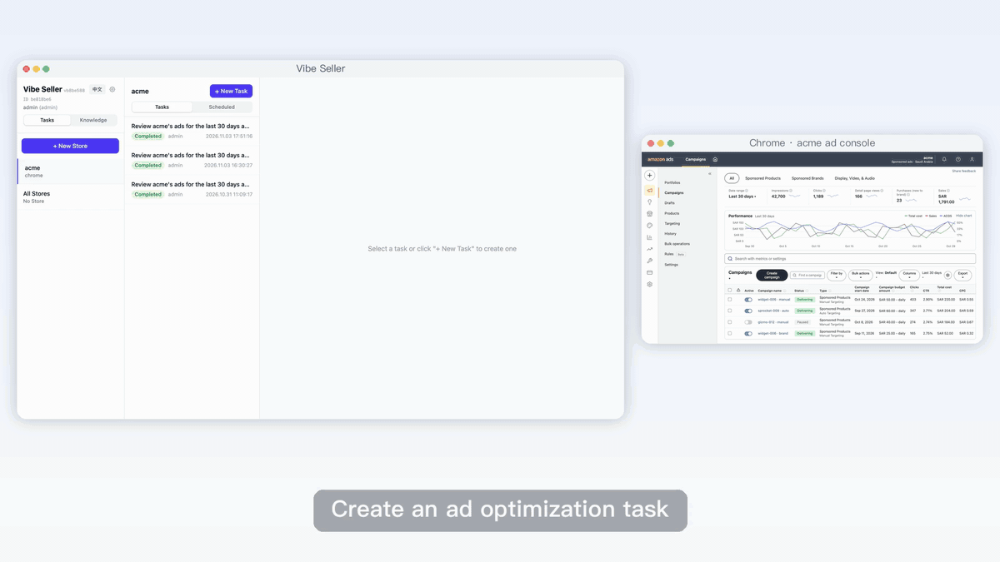
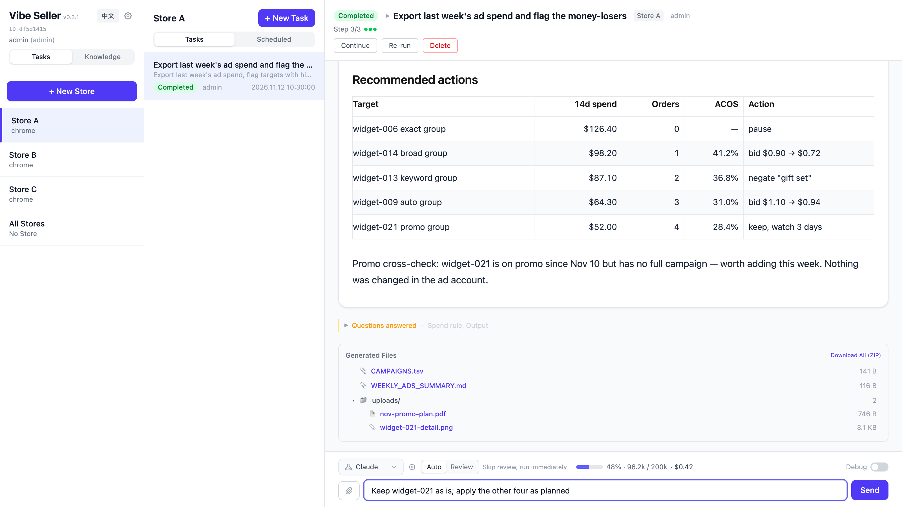
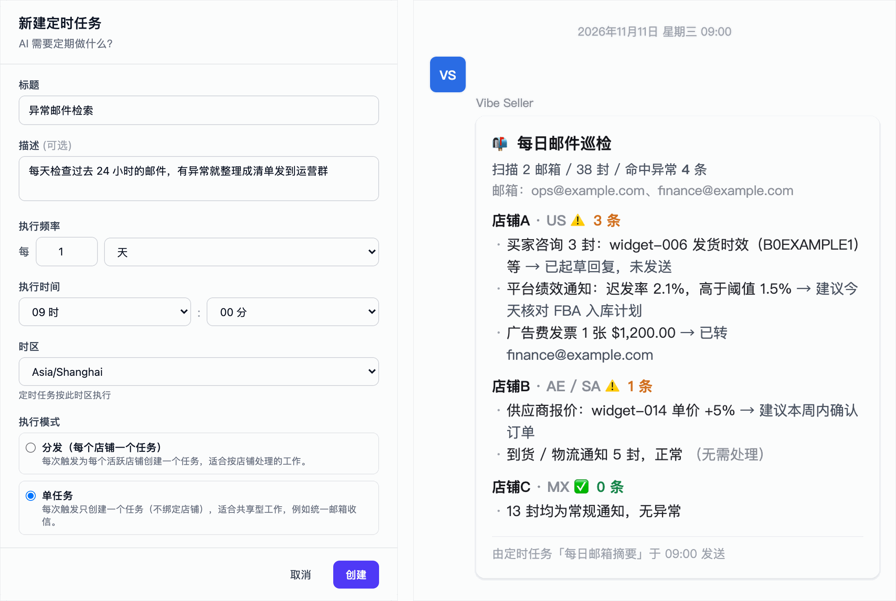
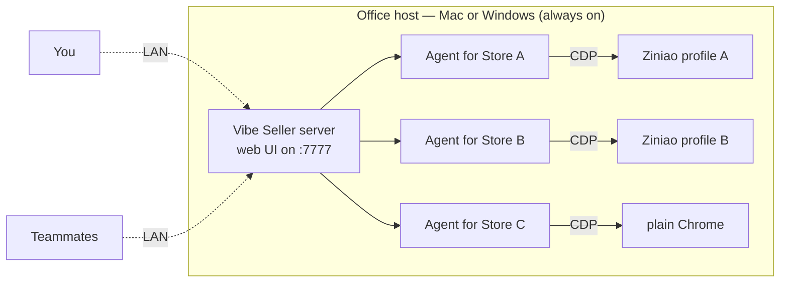

<!-- Generated from docs/index.en.md by scripts/gen_readme.py — edit those, not this file. -->

<h1 align="center">Vibe Seller</h1>

<p align="center">
  <b>AI automation framework for cross-border sellers (supports Amazon, Noon, Mercado Libre, Qianniu and more; Ziniao, Chrome and other browsers). Freely connect any LLM.</b><br/>
  Runs on macOS, Linux, or Windows (native installer). Local-first — code on your machine, data on your disk. Works with Claude, DeepSeek, GLM, Qwen, Kimi, MiniMax — any Anthropic-compatible provider.
</p>

<p align="center">
  <a href="https://docs.vibe-sellers.com/en/">English</a> ·
  <a href="https://docs.vibe-sellers.com/">中文</a>
</p>

<p align="center">
  <a href="https://join.slack.com/t/vibeseller/shared_invite/zt-4fjzkwkqs-L0pM6VS7~_2WsPCxTeLbew"></a>
  <a href="#community"></a>
</p>








🔥 *News* 🔥

- [Nov 2026] **MCP setup**: drive Vibe Seller from the AI tool you already use — Claude, Codex, WorkBuddy, Qoder: [**details**](https://docs.vibe-sellers.com/en/mcp/)
- [Nov 2026] **Amazon ads over the Ads API**: the same ad-optimization task went from 147 minutes to 11, with less need to step in: [**details**](https://docs.vibe-sellers.com/en/ads-api/)

---

## What is Vibe Seller?

A local-first **browser-automation framework**. AI agents drive your
real browser — Ziniao for fingerprint isolation, or plain Chrome —
through CDP (Chrome's low-level remote-control protocol), the same
way you'd click through pages yourself. Ad tuning, listing launches, inventory checks, invoicing,
returns, warehouse setup, logistics lookup — whatever you can do in
a browser, the agent can do too.

Each store gets its own agent — **think of it as hiring a different
ops person for each store**. The Store A agent only sees Store A's
profile, has its own memory and workspace, can't touch the other
stores' agents.



Either deployment works:

- **One always-on machine** (Mac, Linux, or Windows) hosts the
  server
- **Or just use your own computer**

You and your team open the web UI from any device on the same LAN.

## Why Vibe Seller?

Compared to existing automation tools, Vibe Seller is built around
what cross-border sellers actually need and what today's AI models
can actually do well: AI-driven by design, with built-in Skills,
per-store isolation, and fully local deployment. Browser control
runs on [browser-use](https://github.com/browser-use/browser-use)
instead of blind screenshot-clicking — faster, and far cheaper in
tokens, than an agent that has to feel out every page from
scratch.

- **Batteries-included, no hand-holding.** Amazon (every marketplace),
  Noon, and more ship with built-in Skills for the jobs sellers
  actually do — report / statement export, listing creation & updates,
  ad tuning. Create a task and the system opens the browser (Ziniao or
  Chrome) and the agent operates it directly — usually right on the
  first try, no step-by-step guidance needed.
- **Native Ziniao control.** CDP, not Playwright on vanilla Chrome,
  not UI-coordinate clicks. Lower risk-control risk, more stable.
- **Multi-browser by design.** Plain Chrome is a first-class backend
  alongside Ziniao — pick per store.
- **Multi-LLM by design.** Built on top of the Claude Code CLI, so
  any Anthropic-compatible provider works — Claude, DeepSeek, Kimi,
  MiniMax, GLM, Qwen. Switch in Settings, no code changes. Your key,
  your bill.
- **No SaaS lock-in.** Code on your machine, data on your disk, no
  account required.
- **Auditable.** Every step, every prompt, every screenshot is logged
  and replayable.
- **Multi-store from day one.** Each store keeps its own platform,
  data, SOPs, accumulated knowledge. Store A on Amazon US with its
  own listing strategy, Store B on Noon EG with totally different
  SOPs, Store C on Shopify DTC — they coexist without cross-talk.

## Install

**🪟 Windows — native installer (recommended)**: download
**`VibeSeller-Setup.exe`** from the [latest release](https://github.com/zpoint/vibe-seller/releases/latest)
and run it, or install in one PowerShell line:

```powershell
irm https://raw.githubusercontent.com/zpoint/vibe-seller/main/installer/windows/install.ps1 | iex
```

**🍎 macOS / 🐧 Linux**: two lines in a terminal —

```bash
curl -sSL https://raw.githubusercontent.com/zpoint/vibe-seller/main/install.sh | bash
vibe-seller start
```

Then open <http://localhost:7777>. Teammates on the same network just
browse to `http://<your-host-ip>:7777` — nothing to install.

> **⚠️ Before using Ziniao**
>
> The Ziniao main (BOSS) account must first enable developer mode on the [Ziniao Open Platform](https://open.ziniao.com/docSupport?docId=99) and tick "WebDriver login" for the sub-account, or Ziniao rejects the login when you bind a store.
> The setup steps, and fixes for the two common errors ("无权限通过 webdriver 登录" and "检测到您在新终端登录"), are on [Ziniao: Setup & Common Errors](https://docs.vibe-sellers.com/en/ziniao/).

Everything else — WSL2, installing from source, upgrade and
uninstall, running it as an always-on service — is on the
[Installation](https://docs.vibe-sellers.com/en/install/) page. First time using it? Follow the
[Quickstart](https://docs.vibe-sellers.com/en/quickstart/).

## Quickstart

Once it's installed, these four steps get your first task running; the
illustrated walkthrough is the [Quickstart](https://docs.vibe-sellers.com/en/quickstart/):

1. **Open the web app** at <http://localhost:7777> — no login by default;
2. **Configure an AI model**: in **Settings → AI**, click **Create Profile**,
   pick a provider and paste its API key (how to get one:
   [Configure AI Models](https://docs.vibe-sellers.com/en/llm-keys/));
3. **Bind a store**: click **+ New Store**, choose the Ziniao or Chrome browser
   backend and sign in to Seller Central once in the browser that opens (see
   [Stores and browsers](https://docs.vibe-sellers.com/en/stores/));
4. **Create your first task**: select the store, click **+ New Task** and say
   what you want in one sentence, e.g. “Export the last 7 days' sales report”.

## What you can do with it

Vibe Seller is an **AI agent framework** — the browser is one of
its tools, not the only one. The agent can browse pages, read your
email, send group chat messages (WeCom / DingTalk / Feishu / Slack), write to TickTick / Dida365, update
Google Docs. Anything that fits *observe → decide → act* — whether
a browser is involved or not.

A few cross-border scenarios it's commonly used for:

| Task | What happens |
|---|---|
| **Ad tuning** | Reads Campaign Manager, finds under- and over-spenders, proposes bid / budget changes, applies them with your approval. |
| **Listing publication** | Creates new listings from a template — title, bullets, photos, A+ content, variations. |
| **Listing audit** | Walks every store's catalog, flags suppressed / out-of-stock / inactive items. |
| **Inventory check** | Pulls stock levels; low-stock SKUs get pushed to the group chat automatically. |
| **Warehouse / inbound setup** | Creates inbound shipments, allocates SKUs to FBA / FBN, prints box labels. |
| **Logistics lookup** | Tracks in-transit shipments, freight delivery, customs clearance; flagged shipments get filed as TickTick todos. |
| **Invoices & reports** | Crawls tax docs, business reports, advertising reports; downloads are archived to Google Drive. |
| **Email handling** | Sorts buyer messages, forwards important ones to the group chat, drafts replies. |
| **Anything you add** | Write a Skill (a markdown file with steps) or teach the agent once — it'll remember next time. |

A single ad-tuning run is ≈ 3–5 minutes and costs about 0.15 USD in LLM tokens
(DeepSeek, 10 or fewer campaigns; more campaigns cost more).

## Docs

| | |
|---|---|
| **Getting started** | [Installation](https://docs.vibe-sellers.com/en/install/) · [Quickstart](https://docs.vibe-sellers.com/en/quickstart/) · [Configure AI Models](https://docs.vibe-sellers.com/en/llm-keys/) · [Core Concepts](https://docs.vibe-sellers.com/en/concepts/) |
| **Integrations** | [Overview](https://docs.vibe-sellers.com/en/integrations/) · [MCP setup](https://docs.vibe-sellers.com/en/mcp/) · [Amazon Ads API](https://docs.vibe-sellers.com/en/ads-api/) · [Email](https://docs.vibe-sellers.com/en/email/) · [Chat bots](https://docs.vibe-sellers.com/en/chat-bots/) · [TickTick / Dida365](https://docs.vibe-sellers.com/en/ticktick/) · [Google Workspace](https://docs.vibe-sellers.com/en/google-workspace/) |
| **Examples** | [All Examples](https://docs.vibe-sellers.com/en/examples/) · [Daily email digest to WeCom](https://docs.vibe-sellers.com/en/example-email-wecom/) · [Weekly ad ACOS review](https://docs.vibe-sellers.com/en/example-ads-acos/) · [Weekly listing check](https://docs.vibe-sellers.com/en/example-listing-check/) · [Daily sales report](https://docs.vibe-sellers.com/en/example-daily-report/) · [Export a Ziniao store's finances with Codex](https://docs.vibe-sellers.com/en/example-mcp/) |
| **User guide** | [Stores & Browsers](https://docs.vibe-sellers.com/en/stores/) · [Tasks](https://docs.vibe-sellers.com/en/using-tasks/) · [Schedules](https://docs.vibe-sellers.com/en/schedules/) · [Knowledge & Skills](https://docs.vibe-sellers.com/en/knowledge/) |
| **FAQ** | [Ziniao: Setup & Common Errors](https://docs.vibe-sellers.com/en/ziniao/) · [Cost & Model Choice](https://docs.vibe-sellers.com/en/faq-cost/) · [Login & Accounts](https://docs.vibe-sellers.com/en/faq-login/) · [Deployment & Data](https://docs.vibe-sellers.com/en/faq-data/) · [All Questions](https://docs.vibe-sellers.com/en/faq/) |
| **Community** | [Community & Feedback](https://docs.vibe-sellers.com/en/community/): the WeCom group, Slack, and how to report a problem or suggest a feature |
| **Developer (English)** | [Developer Guide](https://docs.vibe-sellers.com/en/dev-guide/) · [Task Internals](https://docs.vibe-sellers.com/en/tasks/) · [Browser Internals](https://docs.vibe-sellers.com/en/browser/) · [Subsystems](https://docs.vibe-sellers.com/en/subsystems/) · [External Agents (MCP API)](https://docs.vibe-sellers.com/en/agents/) · [Windows + WSL2 service](https://docs.vibe-sellers.com/en/windows-setup/) · [macOS service](https://docs.vibe-sellers.com/en/macos-setup/) |

Architecture lives in [`DESIGN.md`](https://github.com/zpoint/vibe-seller/blob/main/DESIGN.md);
deeper subsystem notes are in the [`docs/`
tree](https://github.com/zpoint/vibe-seller/tree/main/docs).

## Integrations

Beyond the browser, the agent can call these external services
directly — everything is hooked up under **Settings → Integrations**,
no code:

- **MCP** — drive Vibe Seller from the AI tool you already use — Claude, Codex, WorkBuddy, Qoder, Hermes Agent, Pi: create tasks, follow them, answer questions, review plans. [Setup guide](https://docs.vibe-sellers.com/en/mcp/)
- **Amazon Ads API** — Amazon ad tasks call the API instead of clicking through the seller console; in our test the same ad task went from 147 minutes to 11. [Setup and measured comparison](https://docs.vibe-sellers.com/en/ads-api/)
- **Email** (IMAP/SMTP) — read your linked store mailboxes, sort and summarize, draft and send replies (sending can be turned off per mailbox). Works with 163 / QQ / Gmail and more. [Setup guide](https://docs.vibe-sellers.com/en/email/)
- **Group chat bots** (WeCom / DingTalk / Feishu / Slack) — have the AI post results, reports and reminders straight into a group; WeCom bots can send files too. [Setup guide](https://docs.vibe-sellers.com/en/chat-bots/)
- **TickTick / Dida365** — auto-create todos (follow-ups, order tracking, periodic checks). [Setup guide](https://docs.vibe-sellers.com/en/ticktick/)
- **Google Workspace** — Gmail, Drive, Docs, Sheets, Slides, Calendar — read, write, edit. [Setup guide](https://docs.vibe-sellers.com/en/google-workspace/)

A single task can mix browser + service calls. e.g. *“Find all
slow-moving SKUs across stores”* → browser pulls inventory →
generates a Google Sheet → posts a chat summary → drops a "price
review next week" todo into TickTick. Start at the
[Integrations overview](https://docs.vibe-sellers.com/en/integrations/).

## Platforms

### Built-in Skills

- **Amazon Seller Central** (every marketplace — US / EU / MENA, etc.)
- **Noon Seller Lab**

These are the platforms the project was dogfooded against. The
Skills capture page mechanics, navigation paths, UI gotchas. With
the Skill in hand, the agent typically completes common operations
(view ads, export reports, adjust bids, launch listings, ...) **on
the first try**.

### Anything else browser-based

- Mercado Libre (美客多), AliExpress (速卖通), Shopify
- Lazada, Shopee, TikTok Shop
- … and any other browser-accessible seller portal.

No pre-written Skill for these — the maintainers don't have test
accounts, so the mechanics aren't documented upfront. The agent
will fumble its first runs and need a few attempts to find the full
flow.

**The framework's built-in self-learning handles most of this on
its own.** As it runs, the agent takes notes — which button didn't
work, which path succeeded, which dead ends to avoid — and saves
them to that store's local knowledge. This happens **without you
needing to supervise**; the agent records its own mistakes as it
goes. Optional human hints get recorded too if you happen to drop
any. Next run, prior experience is pulled in automatically, so it
doesn't hit the same wall. After a few rounds, common operations
on a new platform stabilize.

Once you've ironed something out, please consider upstreaming it as
a proper Skill — see *Contributing* below.

## Contributing

PRs welcome — whether you write the code yourself or let Claude
Code / Cursor / your coding agent do it. Python side is Google
style (ruff-enforced); frontend is TypeScript strict + ESLint.
[`CLAUDE.md`](https://github.com/zpoint/vibe-seller/blob/main/CLAUDE.md) is the project conventions doc — it's
written for AI agents and reads cleanly as a contributor guide.

## License

[Apache License 2.0](https://github.com/zpoint/vibe-seller/blob/main/LICENSE).

## Community

- **Slack** — [join the VibeSeller workspace](https://join.slack.com/t/vibeseller/shared_invite/zt-4fjzkwkqs-L0pM6VS7~_2WsPCxTeLbew)
- **WeChat** — scan to join the user group (works from a personal WeChat account; no WeCom install needed):


Found a problem or have an idea? See [Community & Feedback](https://docs.vibe-sellers.com/en/community/).
