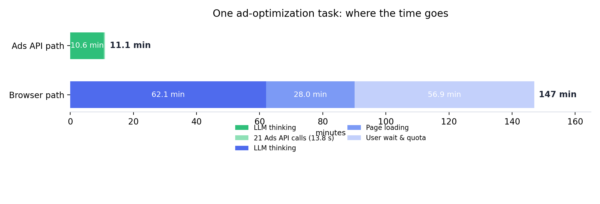
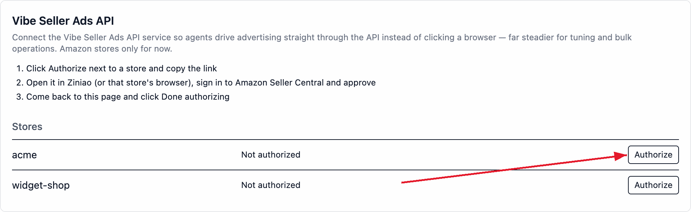
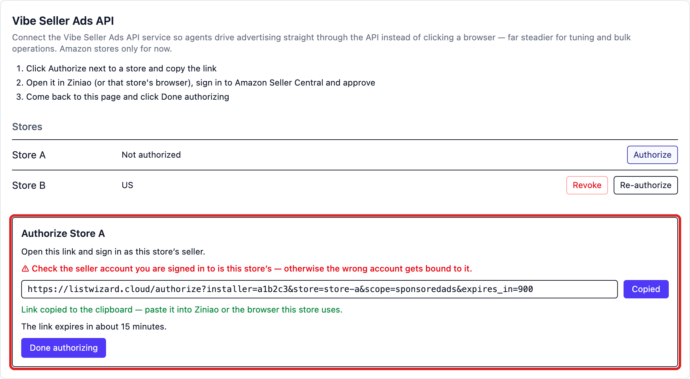
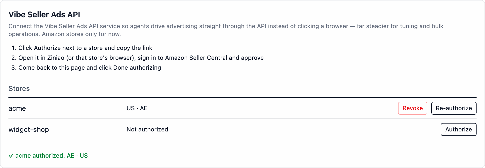
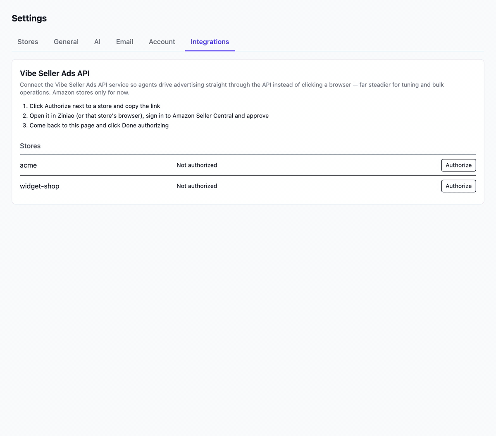
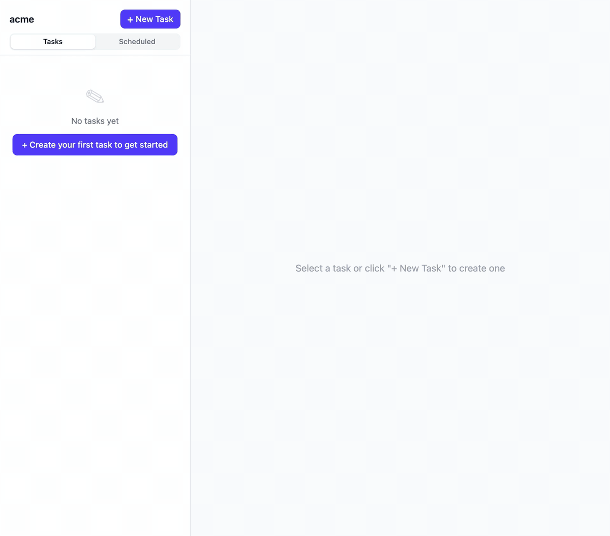
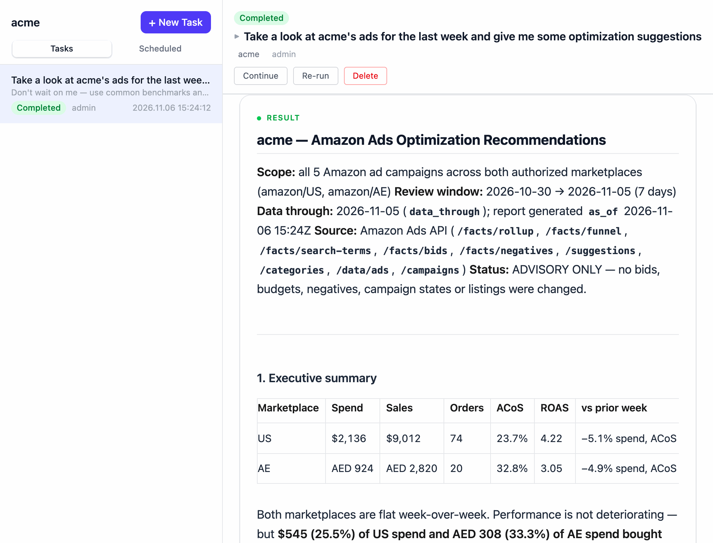
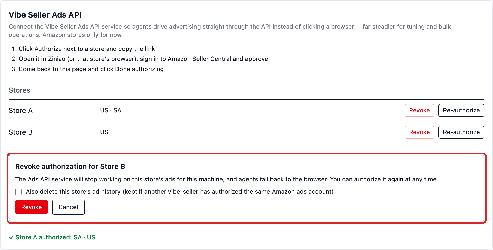

# Amazon Ads API setup

Once bound, the agent's Amazon ad work stops clicking through the seller console in a browser and goes **straight to the Ads API** — steadier for tuning and bulk operations. **Amazon stores only, for now. Each store authorizes separately.**

## What binding buys you

|  | Browser path (unbound) | Ads API (bound) |
|---|---|---|
| How work runs | The agent clicks through the ad console in the store's browser | The agent calls the API — no browser |
| Stability | Depends on pages; redesigns and slow loads break it | Plain API calls; bulk operations stay steady |
| History | Only what the page shows right now | Historical bids and states, negatives, before/after of every change (no Amazon report carries these) |
| Change log | None | The service records every write and its outcome |

In our test the same ad task went from **147 minutes to 11**, with far fewer errors and far less need for a person to step in.

You never pick the path per task — the routing follows the **store's binding state**: authorized stores go over the API, unbound ones stay on the browser.

## Measured comparison

One store (acme, AE marketplace), one report-only ad-optimization task, one model (MiniMax-M3.1-Flash) — run once over the Ads API and once through the browser:

| Metric | Ads API path | Browser path | Ratio |
|---|---|---|---|
| Total time (task created → done) | **11.1 min** | 147 min | 13× |
| Net execution (excl. user-wait & external pause) | **11.0 min** | 90.5 min | 8.2× |
| Assistant turns | **130** | 710 | 5.5× |
| Tool calls (of which browser / ads API) | 69 (0 / **21**) | 361 (**123** browser commands / 0) | 5.2× |
| Tokens (in / out / cache-read) | 0.68M / 0.19M / 15.4M | 2.34M / 0.99M / **151.6M** | cache-read 9.8× |
| Estimated model cost | **≈ $0.45** | ≈ $3.2 | 7× |
| Campaign coverage | every campaign (incl. zero-spend/paused) | same complete list, all drilled | **equal** |
| Report output | one 24 KB report | 103 KB report + PDF (full per-target / per-term tables) | richer |
| Interruptions | none | 1 operator question (breakeven-ACOS) + 1 model-quota pause (36 min) | |

Cost is estimated at MiniMax-M3.1-Flash's official pay-as-you-go prices (per
1M tokens: $0.15 input, $0.60 output, $0.015 cache read). On a MiniMax
subscription plan, the run uses plan quota instead of being billed per token.

This was a heavy run: the store has 20-plus campaigns and about 450 search
terms, and the task drilled into every campaign and every term over the past
14 days. Cost grows roughly with the number of campaigns and terms; for a
typical store with 10 campaigns or fewer, one API-path run comes to roughly
$0.20 at the same prices.

The browser path loses time in two places: **28 minutes opening and waiting for pages**, against 13.8 seconds for all 21 API calls; and because it reads the console page by page, it takes 5.5× the turns, so **LLM time grows from 10.6 to 62.1 minutes** too.

## Prerequisites and binding (4 steps)

### Prerequisites

- A vibe-seller **admin** account (authorize / unbind are admin-only).
- An Amazon store (only Amazon is supported so far).
- **That store's Amazon Seller Central login** — the consent has to be completed inside the store's own browser environment (the Ziniao window, or whatever browser the store uses).
- **Nothing to type or configure**: no API key, client id or secret. The first time the Integrations page opens, this machine registers itself with the ads service and keeps the returned key encrypted locally; the whole Amazon consent round trip happens on the service's own domain.

### 1. Open the panel

`Settings → Integrations` → the **Vibe Seller Ads API** card. The table lists every store, one row each, with its authorization status.

### 2. Click Authorize, copy the link

Click **Authorize** next to the store:

The link section opens and the link is **copied to the clipboard automatically**:

The link is short-lived — the page shows how many minutes are left. Expired: click Authorize / Re-authorize for a fresh one.

### 3. Complete the Amazon consent in the store's browser

Open the copied link **in Ziniao (or the browser this store uses)**, sign in as **this store's** Amazon seller, and approve.

> ⚠ Check the seller account you are signed in to is this store's — otherwise the wrong account gets bound to it. The consent binds whichever account is signed in there, and a wrong one looks exactly like a success.

Sign in as the store's seller, approve, and wait for the success page. The consent page is on listwizard.cloud — the service-provider domain Vibe Seller registered with Amazon.

### 4. Come back and click Done authorizing

A green "✓ acme authorized" means it worked — the marketplaces it covers are listed after it. If you get "No authorization for this store yet", the Amazon consent isn't finished: complete it in the store's browser, wait for the success page, and click again.

### After binding: ad tasks run over the Ads API

Once bound, **just create ad tasks on that store as usual** — e.g. "Take a look at acme's ads for the last week and give me some optimization suggestions". A task on a bound store automatically gets its data through the Ads API; an unbound store keeps going through the browser. Nothing to choose or specify — the store's binding state decides, automatically.

**A freshly bound store needs about 30 minutes to sync its history** — history questions answer "syncing" until then and are fine afterwards; live data is unaffected.

## Troubleshooting

<b>How do I choose which store uses the Ads API?</b>

You don't — it's automatic. The path follows the **store's binding state**: a store bound to the Ads API gets its ad data through the API, an unbound store keeps going through the browser. Just create tasks as usual.

<b>The panel opens with a red "Could not reach the ads service …"</b>

This machine cannot reach the ads service (firewall / proxy / the service is briefly down). Reopen the page once connectivity is back — every open re-runs the sync and registration.

<b>"Done authorizing" says "No authorization for this store yet"</b>

The Amazon consent hasn't finished, or you clicked before the success page. Finish the consent in the store's browser, then click again.

<b>A task says the store isn't bound, or its authorization died</b>

Click Authorize / Re-authorize in Settings → Integrations.

<b>A task says the store has to be re-authorized</b>

The grant the service held is dead (password changed, or the authorization was revoked on Amazon's side). A **person** re-authorizes in Settings — the agent cannot do it for you.

<b>A task says Amazon is rate-limiting</b>

Wait and try again later rather than burning the quota on retries.

<b>A freshly bound store answers "syncing"</b>

The first history pull takes ~30 minutes; ask again later. Live data is unaffected.

<b>One store advertising on several marketplaces</b>

Numbers are kept per marketplace (e.g. `US` / `AE`). Say which marketplace you mean when you ask — nothing gets guessed, so marketplace A's numbers never get read as marketplace B's.

<b>The link won't open / has expired</b>

Link lifetime is whatever the page shows (not long), and the link must be opened **inside the store's own browser environment** (the Ziniao window, or the store's browser) — not your everyday browser, or you may bind the wrong seller account. Expired links: click Authorize again.

<b>How do I unbind a store?</b>

Click **Revoke** on the store's row; an inline confirm section spells out the consequences:

- After revoking, the ads service stops working on this store's ads for this machine and agents **fall back to the browser**. You can authorize again at any time.
- "Also delete this store's ad history" is **off by default** — history is kept so a later re-authorization carries on where it stopped. Check it to delete the history too (it is kept for other machines if another vibe-seller has authorized the same Amazon ads account).
- Once no store remains authorized, the ads API skill is removed from the workspace.

<b>Security</b>

Vibe Seller never stores your Amazon password. The OAuth consent happens on the ads service's own domain; this machine keeps one encrypted installation key, which no HTTP endpoint ever returns.

