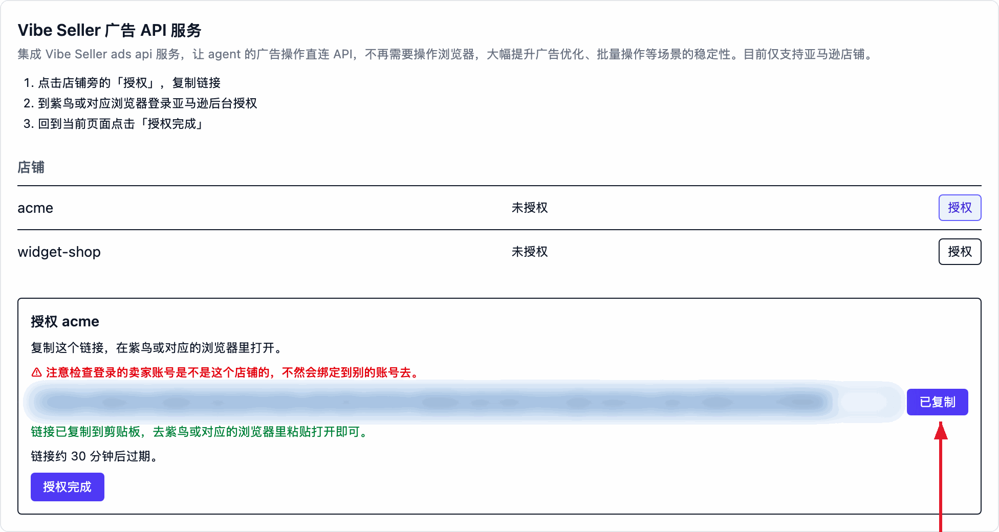
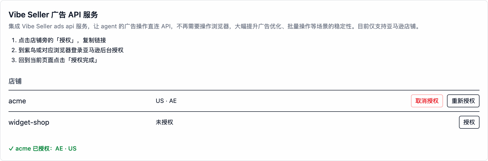
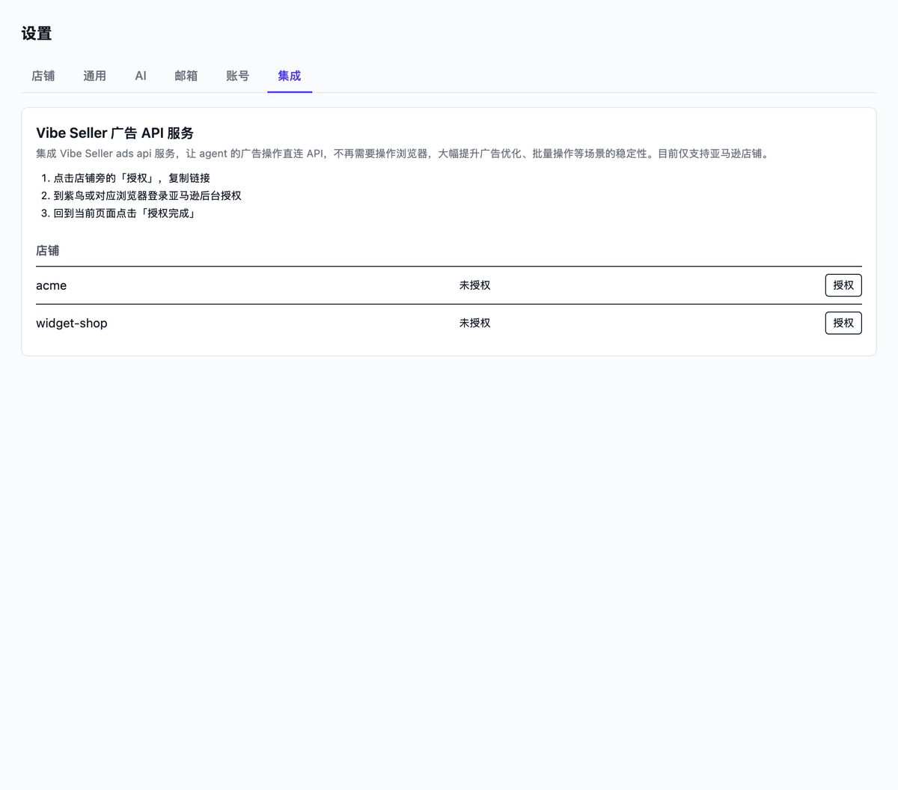
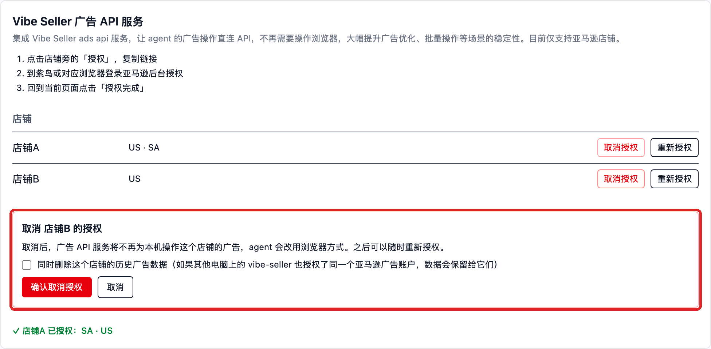

# Amazon Ads API 绑定

绑定后，Agent 的亚马逊广告操作不再靠浏览器点卖家后台，而是**直连广告 API**——调优和批量操作更稳。**目前仅支持亚马逊店铺，每个店铺单独授权。**

## 绑定能带来什么

|  | 浏览器方式（未绑定） | Ads API（绑定后） |
|---|---|---|
| 操作方式 | Agent 在店铺浏览器里点亚马逊广告后台 | Agent 直连 API，不开浏览器 |
| 稳定性 | 依赖页面，改版 / 加载慢会打断 | 接口调用，批量操作也稳 |
| 历史数据 | 只有页面当前展示的 | 历史出价与状态、否词、每次改动的前后对比（这些亚马逊报表都不给） |
| 改动留痕 | 无 | 服务端记录每次改动和结果 |

实测同一个广告任务从 **147 分钟变成 11 分钟**，出错和人工介入的次数都大幅减少。

任务走哪条路不需要你指定——按**店铺的授权状态**自动选择：绑定了就走 API，没绑定就走浏览器。

## 实测对比

同一个店铺（acme，AE 站）、同一个只出报告的广告优化任务、同一个模型（MiniMax-M3.1-Flash），一遍走 Ads API，一遍走浏览器：

| 指标 | Ads API 路径 | 浏览器路径 | 对比 |
|---|---|---|---|
| 完整时间（从创建任务到任务完成） | **11.1 分钟** | 147 分钟 | 慢 13× |
| 净执行时间（不含用户等待与外部暂停） | **11.0 分钟** | 90.5 分钟 | 慢 8.2× |
| 助手轮数 | **130** | 710 | 5.5× |
| 工具调用（其中浏览器交互 / 广告 API） | 69（0 / **21**） | 361（**123** 次浏览器命令 / 0） | 5.2× |
| tokens（输入 / 输出 / 缓存读） | 0.68M / 0.19M / 15.4M | 2.34M / 0.99M / **151.6M** | 缓存读 9.8× |
| 估算模型成本 | **≈ ¥3** | ≈ ¥21 | 7× |
| 活动覆盖 | 全部活动（含零花费/已暂停） | 同一份完整清单，全部下钻 | **一致** |
| 报告产出 | 一份 24 KB 报告 | 103 KB 报告 + PDF（逐定向/逐搜索词全量表） | 更细 |
| 中途打断 | 无 | 1 次问操作员（盈亏线口径）+ 1 次模型配额暂停 36 分钟 | |

| 时间都花在哪 | Ads API 路径 | 浏览器路径 |
|---|---|---|
| LLM 思考与生成 | ■■■■■■■■■■■■■■■■■■ **96.3%**（10.6 分） | ■■■■■■■■■■■■■ **68.6%**（62.1 分） |
| 工具执行 | ▪ 2.3%（广告 API 调用 0.23 分） | ▪ **31.4%**（开页/点按 14.5% + 页面等待 16.5%） |
| 其余 | 1.4% | <0.1% |

浏览器路径的工具时间几乎全在「开页面、等页面」上；API 路径的 21 次调用合计只占 13.8 秒。

## 前提与绑定步骤（4 步）

### 前提

- vibe-seller 的**管理员**账号（授权 / 解绑只有 admin 能操作）。
- 本机网络能访问广告服务 `https://listwizard.cloud/ads-api`。
- 亚马逊店铺（目前只支持 Amazon）。
- **这个店铺的亚马逊卖家账号**——授权要在店铺自己的浏览器环境（紫鸟窗口，或这个店铺用的浏览器）里登录卖家账号完成。
- **不需要**填任何 API key / client id / secret：首次打开「设置 → 集成」时本机会自动向广告服务注册，安装密钥本地加密保存；亚马逊的授权同意全程在广告服务自己的域名上完成。

### 1. 打开面板

`设置 → 集成` → 「Vibe Seller 广告 API 服务」卡片。表格里每个店铺一行，显示各自的授权状态。

### 2. 点「授权」，复制链接

点店铺旁的「**授权**」：

页面会展开授权区，链接会**自动复制到剪贴板**：

链接的有效期不长——页面会显示具体分钟数，过期就回来重点「授权」/「重新授权」拿新的。

### 3. 在店铺的浏览器里完成亚马逊授权

到**紫鸟（或这个店铺对应的浏览器）**里打开刚复制的链接，用**这个店铺的**亚马逊卖家账号登录并同意授权。

> ⚠ 注意检查登录的卖家账号是不是这个店铺的，不然会绑定到别的账号去。授权绑定的是你当时登录的那个账号——登错了界面照样显示成功，但绑错了对象。

这一步是亚马逊的授权页面（在广告服务的域名上），就不截图了：用店铺的卖家账号登录、点同意，看到授权成功页即可。

### 4. 回到页面点「授权完成」

看到绿色的「✓ acme 已授权：US · AE」就成了——店铺行里会列出授权到的站点。如果提示「还没有看到这个店铺的授权」，说明亚马逊侧还没走完：回去补完、看到成功页后再点一次。

### 怎么验证

- 上面的绿色 ✓ 提示就是绑定成功。此后在店铺上创建的广告任务，Agent 会自动改用 `amazon-ads-api` 技能直连 API（任务提示词里会写明走哪条路）。
- **刚授权完的店铺，历史数据同步大约需要 30 分钟**——这期间问历史类数据会得到「同步中」的答复；实时数据不受影响。
- 回答里的数据都带 `as_of` / `window` / `data_through`，可以核对数据口径。

## 解除绑定

店铺行点「**取消授权**」，会在原地弹出确认框说明后果：

- 取消后，广告服务不再为本机操作这个店铺的广告，Agent **改回浏览器方式**；之后随时可以再点「授权」绑回来。
- 「同时删除这个店铺的历史广告数据」默认**不勾**——保留历史，重新授权时接着用；勾上才会删（如果其他电脑上的 vibe-seller 也授权了同一个亚马逊广告账户，数据会保留给它们）。
- 所有店铺都解绑后，`amazon-ads-api` 技能会从工作区移除。

## 常见问题

**打开面板就红字报「Could not reach the ads service …」**
本机到广告服务的网络不通（防火墙 / 代理 / 服务临时不可用）。恢复后重新打开页面即可——面板每次打开都会自动同步和注册。

**点完「授权完成」提示「还没有看到这个店铺的授权」**
亚马逊那边的同意还没完成，或者没等到授权成功页。回店铺浏览器把授权走完，看到成功页回来再点一次。

**任务里提示「Store … is not authorized with the ads service」**
这个店铺还没绑定，或者授权已失效。到「设置 → 集成」点「授权」/「重新授权」。

**服务返回 502，提示需要重新授权**
服务端持有的授权失效了（比如卖家账号改了密码、或在亚马逊侧撤销了授权）。**人**到设置里重新授权——Agent 不能替你做这一步。

**服务返回 503**
亚马逊在限流。稍等再试，别反复重试烧配额。

**新授权的店铺，任务回答「数据同步中」（202）**
首次历史拉取大约要 30 分钟，稍后再问；实时接口不受影响。

**一个店铺开了多个站点（marketplace）**
调用时要指明站点（如 `US` / `AE`）；不指明时服务会拒绝而不是猜，免得把 A 站的数据当 B 站的用。

**授权链接打不开 / 过期**
链接的有效期以页面显示为准（不长），而且要**在店铺自己的浏览器环境里**打开（紫鸟窗口 / 这个店铺用的浏览器），别在日常浏览器里开——否则容易把别的卖家账号绑上去。过期就回来重点「授权」。

**安全相关**
Vibe Seller 不保存你的亚马逊账号密码；亚马逊的 OAuth 同意在广告服务的域名上完成，本机只保存一个加密的安装密钥，任何 HTTP 接口都不会把它读出去。
