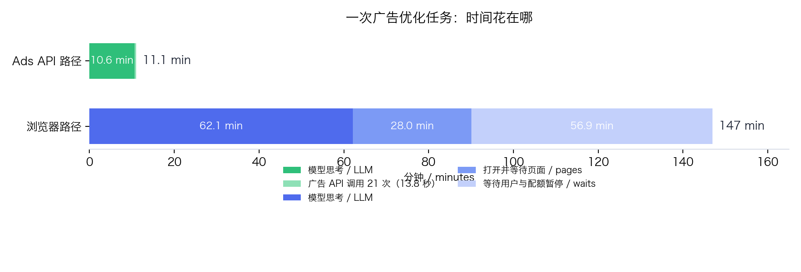
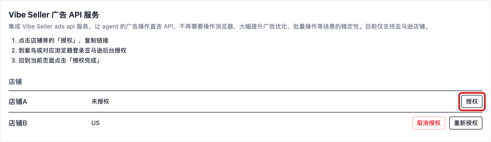
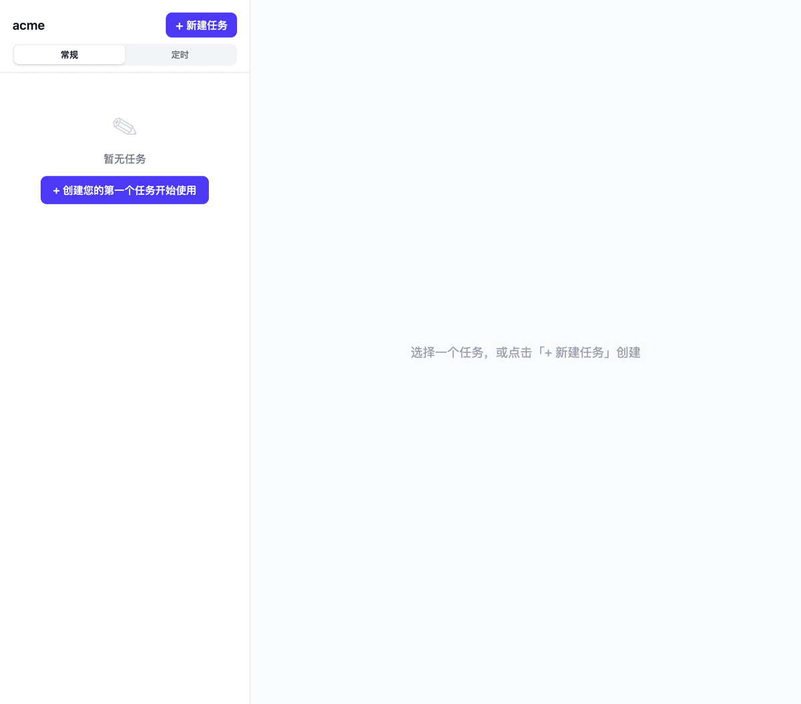
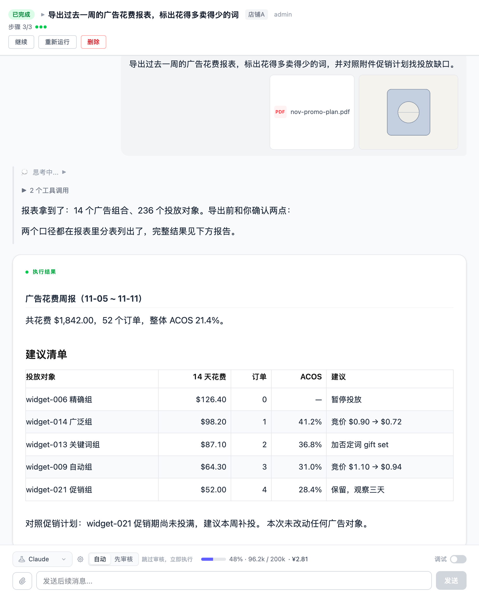

# Amazon Ads API 绑定

绑定后，AI 的亚马逊广告操作不再依赖浏览器点卖家后台，而是**直连 Ads API**，调优和批量操作更稳定。**目前仅支持亚马逊店铺，每个店铺单独授权。**

各集成分别配在哪里、彼此怎么分工，见[集成总览](integrations.md)。

## 绑定能带来什么

如果你希望广告任务执行得更快、更稳、可追溯，绑定 Ads API 是最直接的方式。绑定前后的差别：

|  | 浏览器方式（未绑定） | Ads API（绑定后） |
|---|---|---|
| 操作方式 | AI 在店铺浏览器里点亚马逊广告后台 | AI 直连 API，不打开浏览器 |
| 稳定性 | 依赖页面，页面改版或加载慢会中断任务 | 接口调用，批量操作也稳定 |
| 历史数据 | 只有页面当前展示的内容 | 可查历史出价与状态、否定词、每次改动的前后对比（这些亚马逊报表都不提供） |
| 改动留痕 | 无 | 服务端记录每次改动和结果 |

实测同一个广告任务从 **147 分钟缩短到 11 分钟**，出错和人工介入的次数都大幅减少。

任务走哪条路径不需要你指定：系统按**店铺的授权状态**自动选择——已绑定走 API，未绑定走浏览器。

## 实测对比

同一个店铺（店铺A，AE 站）、同一个只输出报告的广告优化任务、同一个模型（MiniMax-M3.1-Flash），分别走 Ads API 和浏览器各执行一次：

| 指标 | Ads API 路径 | 浏览器路径 | 对比 |
|---|---|---|---|
| 完整时间（从创建任务到任务完成） | **11.1 分钟** | 147 分钟 | 慢 13× |
| 净执行时间（不含用户等待与外部暂停） | **11.0 分钟** | 90.5 分钟 | 慢 8.2× |
| AI 助手轮数 | **130** | 710 | 5.5× |
| 工具调用（其中浏览器交互 / 广告 API） | 69（0 / **21**） | 361（**123** 次浏览器命令 / 0） | 5.2× |
| tokens（输入 / 输出 / 缓存读） | 0.68M / 0.19M / 15.4M | 2.34M / 0.99M / **151.6M** | 缓存读 9.8× |
| 估算模型成本 | **≈ 3 元** | ≈ 21 元 | 7× |
| 活动覆盖 | 全部活动（含零花费、已暂停） | 同一份完整清单，全部下钻 | **一致** |
| 报告产出 | 一份 24 KB 报告 | 103 KB 报告 + PDF（逐定向、逐搜索词全量表） | 更细 |
| 中途打断 | 无 | 1 次询问操作员（盈亏线口径）+ 1 次模型配额暂停 36 分钟 | |

成本按 MiniMax-M3.1-Flash 当时的官方按量价折算。使用 MiniMax 订阅套餐的话，扣的是套餐额度，不按 token 单独计费。

这次测试的是一个偏重的场景：店铺有 20 多个广告活动、约 450 个搜索词，任务要把
过去 14 天里每个活动、每个搜索词都逐一下钻。费用大致随活动和搜索词的数量增长；
常见的 10 个活动以内的店铺，走 API 执行一次，按同样方式估算在 1 元上下
（使用 Token Plan 套餐的综合价格更低，只要几毛钱）。

浏览器路径多花的时间来自两块：**打开页面、等待页面加载共 28 分钟**，而 API 路径的
21 次调用合计只有 13.8 秒；另外浏览器需要逐页读取，AI 助手轮数达到 5.5 倍，
**模型思考时间也从 10.6 分钟增加到 62.1 分钟**。

## 前提与绑定步骤（4 步）

### 前提

- Vibe Seller 的**管理员**账号（授权 / 解绑只有管理员能操作）。
- 亚马逊店铺（目前只支持 Amazon）。
- **这个店铺的亚马逊卖家账号**——授权要在店铺自己的浏览器环境（紫鸟窗口，或这个店铺使用的浏览器）里登录卖家账号完成。
- **不需要**填写任何 API key、client id 或 secret：首次打开「设置 → 集成」时，本机自动向广告服务注册，安装密钥在本地加密保存；亚马逊的授权同意全程在广告服务自己的域名上完成。

### 1. 打开面板

进入「设置 → 集成」→「Vibe Seller 广告 API 服务」卡片。表格里每个店铺一行，显示各自的授权状态。

### 2. 点「授权」，复制链接

点击店铺旁的「**授权**」：

页面展开授权区，链接会**自动复制到剪贴板**：

链接的有效期不长——页面会显示具体分钟数；过期后回来重新点击「授权」或「重新授权」获取新的。

### 3. 在店铺的浏览器里完成亚马逊授权

到**紫鸟（或这个店铺对应的浏览器）**里打开刚复制的链接，用**这个店铺的**亚马逊卖家账号登录并同意授权。

> ⚠ 请确认登录的卖家账号属于这家店铺，否则会绑定到其他账号。授权绑定的是当时登录的那个账号——即使登错账号，界面照样显示成功，但绑定的对象错了。

用店铺的卖家账号登录、点击同意，看到授权成功页即可。授权页面在 listwizard.cloud 上——这是 Vibe Seller 在亚马逊官方注册备案的服务商域名。

### 4. 回到页面点「授权完成」

看到绿色的「✓ 店铺A 已授权」就完成了——后面会列出授权到的站点。如果提示「还没有看到这个店铺的授权」，说明亚马逊侧还没走完：回去补完，看到成功页后再点一次。

### 绑定之后：广告任务自动走 Ads API

绑定完成后，**照常在这家店铺创建广告任务即可**——比如“看看店铺A最近一周的广告，ACOS 超过 30% 的给出优化建议”。店铺绑定了 Ads API，任务就自动通过 API 获取数据；未绑定的店铺仍然走浏览器。不需要选择、不需要指定，系统按店铺的绑定状态自动处理。

**刚绑定的店铺，历史数据大约需要 30 分钟同步完成**——这期间查询历史类数据会得到「同步中」的回答，之后就正常了；实时数据不受影响。

## 常见问题

<b>怎么指定哪个店铺用 Ads API？</b>

不用指定，它是自动的：任务走哪条路径看**店铺的绑定状态**——绑定了 Ads API 的店铺，广告任务自动通过 API 获取数据；未绑定的店铺仍然走浏览器。照常创建任务即可。

<b>打开面板就红字报「Could not reach the ads service …」</b>

本机到广告服务的网络不通（防火墙、代理，或服务临时不可用）。恢复后重新打开页面即可——面板每次打开都会自动同步和注册。

<b>点完「授权完成」提示「还没有看到这个店铺的授权」</b>

亚马逊那边的同意还没完成，或者没等到授权成功页。回店铺浏览器把授权走完，看到成功页后再点一次。

<b>任务里说这个店铺还没绑定，或者授权已失效</b>

到「设置 → 集成」点击「授权」或「重新授权」。

<b>任务说店铺需要重新授权</b>

服务端持有的授权失效了（比如卖家账号改了密码，或在亚马逊侧撤销了授权）。需要**人工**到设置里重新授权——AI 不能替你做这一步。

<b>任务说亚马逊在限流</b>

稍后再试；不要反复重试消耗配额。

<b>新绑定的店铺，任务回答「数据同步中」</b>

首次历史拉取大约需要 30 分钟，稍后再查询即可；实时数据不受影响。

<b>一个店铺开了多个站点（marketplace）</b>

数据按站点（如 `US`、`AE`）分开。提问时说清楚要看哪个站点；AI 不会自己猜，以免把 A 站点的数据当成 B 站点使用。

<b>授权链接打不开 / 过期</b>

链接的有效期以页面显示为准（不长），而且必须**在店铺自己的浏览器环境里**打开（紫鸟窗口或这个店铺使用的浏览器），不要在日常浏览器里打开——否则容易把别的卖家账号绑定上去。过期就回来重新点击「授权」。

<b>怎么解除绑定？</b>

在店铺行点击「**取消授权**」，会在原地弹出确认框说明后果：

- 取消后，广告服务不再为本机操作这个店铺的广告，AI **改回浏览器方式**；之后随时可以再点「授权」重新绑定。
- 「同时删除这个店铺的历史广告数据」默认**不勾选**——保留历史数据，重新授权时接着使用；勾选才会删除（如果其他电脑上的 Vibe Seller 也授权了同一个亚马逊广告账户，数据会保留给它们）。
- 所有店铺都解绑后，广告 API 的技能会从工作区移除。

<b>安全相关</b>

Vibe Seller 不保存你的亚马逊账号密码；亚马逊的 OAuth 同意在广告服务的域名上完成，本机只保存一个加密的安装密钥，任何 HTTP 接口都不会把它读出去。

