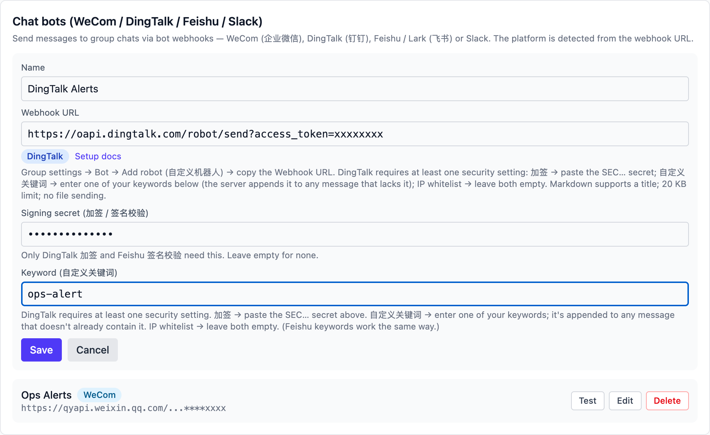
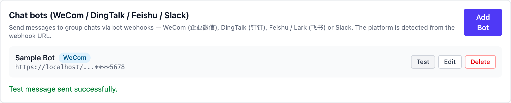
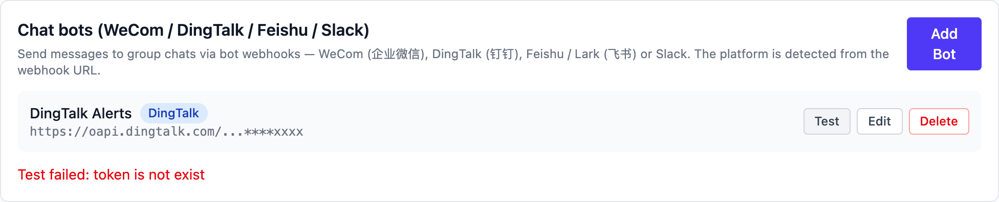

# DingTalk (钉钉)

## Create the bot in DingTalk

1. Open DingTalk, enter the group and click the **group settings** gear
   at the top right → **Robots → Add robot**, choose the **custom
   robot** (some clients call the entry "Smart group assistant").
   Normal and external groups both work; the bot posts to the group
   only, never to one-to-one chats.
2. Name it (an avatar is optional), then set up **security** — DingTalk
   requires at least one of:
    - **Custom keyword**: up to 10; every message must contain at least
      one of them. Note one down for the Vibe Seller "Keyword" field —
      Vibe Seller appends it to any message that lacks it.
    - **Signing (加签)**: copy the `SEC…` secret into Vibe Seller's
      "Signing secret" field; every message is signed automatically.
    - **IP range**: only these public egress IPs may call the webhook.
      Leave both fields empty if you don't use this one.
3. Accept the terms, click **Done** and copy the **Webhook URL**:

    ```
    https://oapi.dingtalk.com/robot/send?access_token=xxxxxxxx
    ```

Official docs: [Custom robot access](https://open.dingtalk.com/document/group/custom-robot-access) · [Custom robot security settings](https://open.dingtalk.com/document/robots/customize-robot-security-settings)

Good to know:

- At most **20 messages per minute** per bot; going over throttles the
  bot for 10 minutes.
- Markdown messages get a title derived from the first line — that is
  what notifications and the chat list show.
- No file sending; keep messages under ~20 KB.

## Add it in Vibe Seller

1. Open Vibe Seller, go to **Settings → Integrations → Chat bots**, and
   click **Add Bot**;
2. Enter a **name** (e.g. "Ops alerts") and paste the **Webhook URL** you
   just copied — the platform is detected as DingTalk, and two extra fields
   appear. Fill them per the security setting you chose in the group:
   - **Signing secret (加签)**: paste the `SEC…` secret;
   - **Keyword**: one of your keywords (messages without it are appended
     automatically by the server);
   - IP whitelist: leave both fields empty.

   

3. Click **Save** — the list row shows the platform badge, whether the bot
   is signed, and its keyword;
4. Click **Test** on the bot's row: a green line appears and the group
   receives the test message:

   

When a test fails, DingTalk's real error shows under the row — the
`token is not exist` in the screenshot (error 300005) means the
access_token is wrong or the bot was removed; re-copy the address in the
group and save again:



Other error codes are explained in [Chat bots](chat-bots.md#faq).
