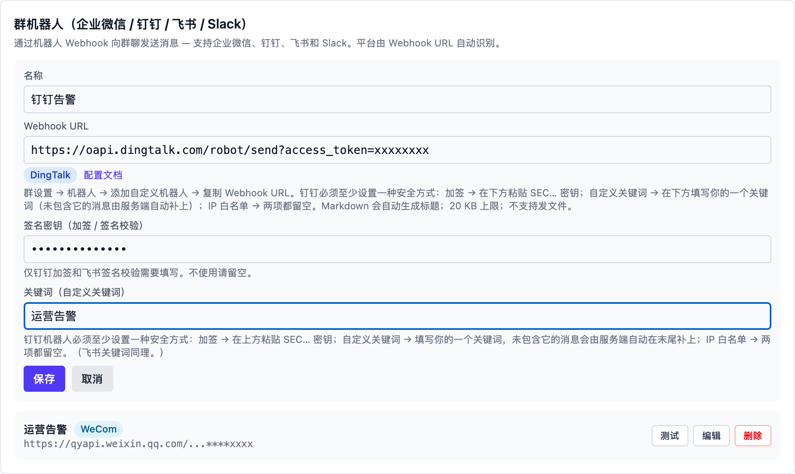
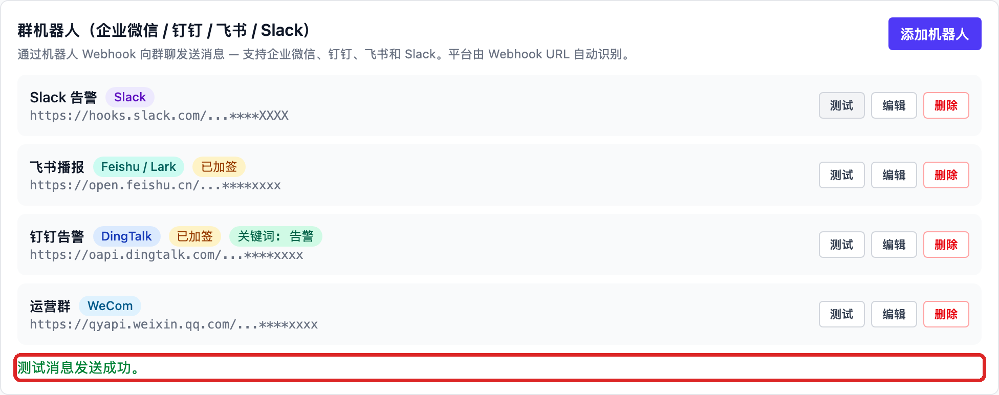
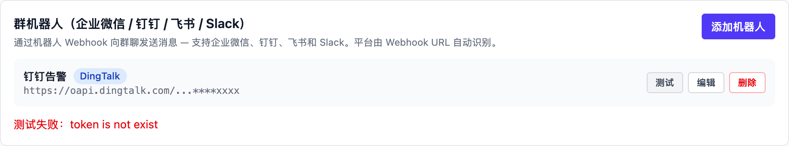

# 钉钉（DingTalk）

## 在钉钉里创建机器人

1. 打开钉钉，进入群聊，点击右上角**群设置**（齿轮图标）→「机器人 →
   添加机器人」，选择**自定义机器人**（有的版本入口叫「智能群助手」）。
   普通群和外部群都可以；机器人只发群消息，不发单聊。
2. 起一个名字（可选头像），然后完成**安全设置**——钉钉要求至少选择一种：
    - **自定义关键词**：最多 10 个，发出的消息必须包含其中至少一个。
      记下其中一个，稍后填进 Vibe Seller 的「关键词」栏——未包含
      关键词的消息，Vibe Seller 会自动在末尾补上。
    - **加签**：复制 `SEC` 开头的密钥，稍后填进 Vibe Seller 的
      「签名密钥」栏，每条消息的签名由 Vibe Seller 自动带上。
    - **IP 地址（段）**：只允许指定出口 IP 调用。填写 Vibe Seller 所在
      机器的公网出口 IP；不使用这种方式的就留空。
3. 勾选《自定义机器人服务及免责条款》，点击**完成**，复制 **Webhook 地址**：

   ```
   https://oapi.dingtalk.com/robot/send?access_token=xxxxxxxx
   ```

官方说明：[自定义机器人接入](https://open.dingtalk.com/document/group/custom-robot-access) · [自定义机器人安全设置](https://open.dingtalk.com/document/robots/customize-robot-security-settings)

使用时注意：

- 每个机器人**每分钟最多 20 条**，超过会被限流 10 分钟；
- Markdown 消息会自动用正文首行做标题（会话列表和通知里显示的就是它）；
- 不支持发文件；消息过长可能被拒，建议控制在 20 KB 以内。

## 在 Vibe Seller 里添加

1. 打开 Vibe Seller，进入「设置 → 集成 → 群机器人」，点击「添加机器人」；
2. 填写**名称**（例如「运营告警」），把刚才复制的 **Webhook 地址**整段粘贴进去，
   平台会自动识别为钉钉（DingTalk），并多出两个输入栏，按你在群里的安全设置填：
   - **签名密钥（加签）**：粘贴 `SEC` 开头的密钥；
   - **关键词**：填写你设置的关键词之一（不含它的消息由服务端自动补上）；
   - 用 IP 白名单的话，两项都留空。

   

3. 点击「保存」，列表里能看到平台标签、是否已加签和关键词；
4. 点击这条机器人上的「测试」，行下方出现绿色提示、群里收到测试消息即为接通：

   

失败时行下方显示钉钉返回的真实原因——截图里的 `token is not exist`（错误码
300005）表示 access_token 不对或机器人已被删除，回群里重新复制地址即可：



其他报错的含义见[群机器人](chat-bots.md#常见问题)。
