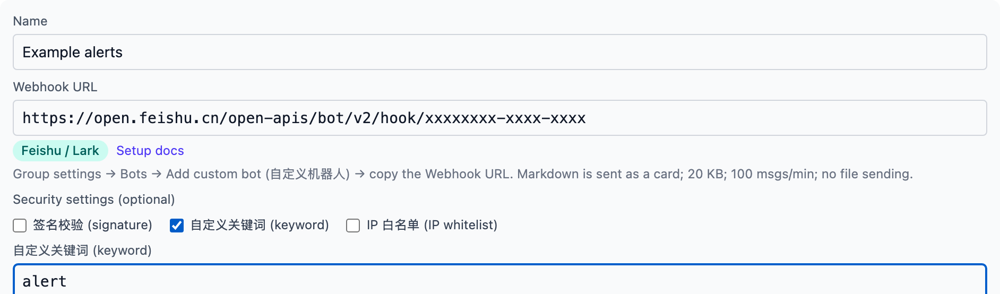
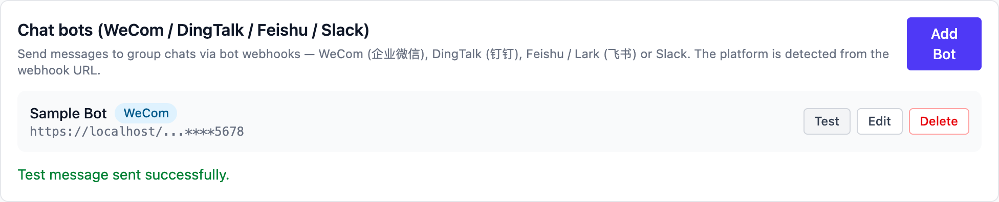

# Feishu / Lark (飞书)

## Create the bot in Feishu

1. In the group, click **More → Settings → Group bots → Add bot** at
   the top right and pick the **custom bot**.
2. Set avatar, name and description, click **Add**, copy the
   **Webhook URL** and click **Done**:

    ```
    https://open.feishu.cn/open-apis/bot/v2/hook/xxxxxxxx
    ```

    A custom bot works in that one group only and needs no admin
    approval.

3. In the bot's detail page, set up **security** (you can combine
   them):
    - **Custom keyword**: up to 10; the message must contain at least
      one. Put one of them into Vibe Seller's 自定义关键词 (keyword)
      field.
    - **Signature check**: copy the secret into Vibe Seller's 签名校验
      (signature) field — Vibe Seller computes the signature for you.
    - **IP allowlist**: only these IPs / ranges may call the webhook,
      up to 10 entries. Leave empty for none; in Vibe Seller just tick
      IP 白名单 (IP whitelist) — nothing to fill in.

Official docs: [Custom bot guide](https://open.feishu.cn/document/client-docs/bot-v3/add-custom-bot)

Good to know:

- Rate limit: **100 messages per minute, 5 per second**. Around exact
  hours and half hours the platform is busy and may answer 11232
  (throttled) — avoid those moments for important messages.
- The request body must stay under 20 KB.
- Markdown is sent as a **card**.
- No file sending.

## Add it in Vibe Seller

1. Open Vibe Seller, go to **Settings → Integrations → Chat bots**, and
   click **Add Bot**;
2. Enter a **name** (e.g. "Ops alerts") and paste the **Webhook URL** you
   just copied — the platform is detected as Feishu / Lark and a "Security
   settings (optional)" section appears with only the three options Feishu
   supports. Tick the ones you actually turned on and the form reveals
   their field (turn none on and tick nothing — Save works as is):
   - **签名校验 (signature)**: paste the signing key;
   - **自定义关键词 (keyword)**: one of your keywords — the server appends
     it to messages that lack it;
   - **IP 白名单 (IP whitelist)**: nothing to fill in — the allowlist is
     set in Feishu; this only records that you use it.

   

3. Click **Save** — the bot appears in the list;
4. Click **Test** on the bot's row: a green line appears and the group
   receives the test message:

   

When a test fails, Feishu's real error shows under the row — fix it and
test again; error meanings are in [Chat bots](chat-bots.md#faq).
