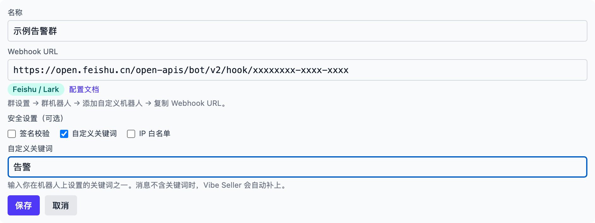
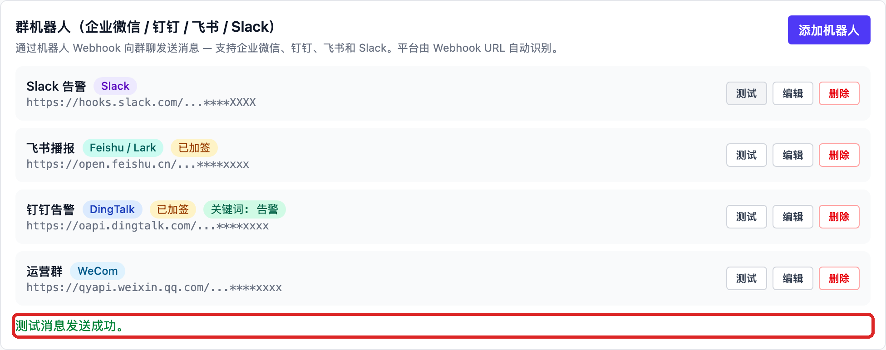

# 飞书（Feishu / Lark）

## 在飞书里创建机器人

1. 进入群聊，点击右上角「更多 → 设置 → 群机器人 → 添加机器人」，选择
   **自定义机器人**。
2. 设置头像、名称和描述，点击**添加**，复制 **Webhook 地址**并点击**完成**
   （自定义机器人只能用在这一个群里，不需要管理员审批）：
   ```
   https://open.feishu.cn/open-apis/bot/v2/hook/xxxxxxxx
   ```

3. 建议接着在机器人详情页配置**安全设置**（可以多选）：
    - **自定义关键词**：最多 10 个，消息要包含至少一个。把其中一个填进
      Vibe Seller 的「自定义关键词」栏。
    - **签名校验**：复制密钥填进 Vibe Seller 的「签名校验」栏，签名由
      Vibe Seller 自动计算。
    - **IP 白名单**：只允许指定 IP 或网段调用，最多 10 条。留空表示不使用；
      Vibe Seller 侧勾选即可，无需填写。

官方说明：[自定义机器人使用指南](https://open.feishu.cn/document/client-docs/bot-v3/add-custom-bot)

使用时注意：

- 频率限制为**每分钟 100 条、每秒 5 条**；整点、半点系统繁忙，容易触发
  限流（11232），重要消息尽量避开这些时刻；
- 请求体不超过 20 KB；
- Markdown 以**卡片**形式发送；
- 不支持发文件。

## 在 Vibe Seller 里添加

1. 打开 Vibe Seller，进入「设置 → 集成 → 群机器人」，点击「添加机器人」；
2. 填写**名称**（例如「运营告警」），把刚才复制的 **Webhook 地址**整段粘贴进去，
   平台会自动识别为飞书（Feishu / Lark），下方是「安全设置（可选）」——
   只显示飞书支持的三项，勾选你实际开启的，表单才显示对应输入栏
   （都没开就都不勾，直接保存）：
   - **签名校验**：粘贴飞书给出的密钥；
   - **自定义关键词**：填写你设置的关键词之一（不含它的消息由服务端自动补上）；
   - **IP 白名单**：什么都不用填——白名单在飞书侧设置，这里只做记录。

   

3. 点击「保存」，机器人出现在列表里；
4. 点击这条机器人上的「测试」，行下方出现绿色提示、群里收到测试消息即为接通：

   

失败时行下方会显示飞书返回的真实原因，对照修正后重新测试；报错含义见
[群机器人](chat-bots.md#常见问题)。
