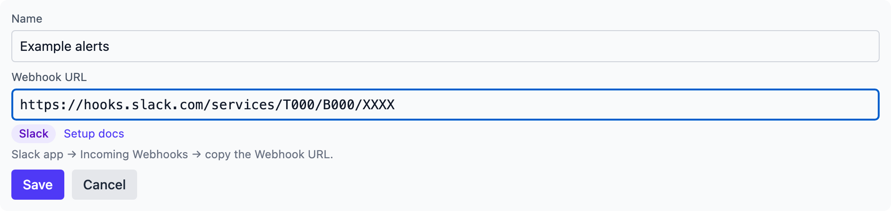
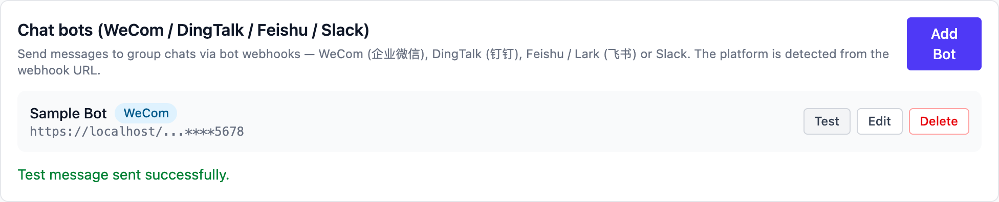

# Slack

## Create the bot in Slack

1. Open [api.slack.com/apps](https://api.slack.com/apps) and **Create
   New App** for your workspace.
2. In the app settings open **Incoming Webhooks** and toggle it on.
3. Click **Add New Webhook to Workspace**, pick the channel, and
   **Authorize**.
4. Copy the **Webhook URL** from the settings page:

    ```
    https://hooks.slack.com/services/T00000000/B00000000/xxxxxxxxxxxx
    ```

Official docs: [Sending messages using incoming webhooks](https://api.slack.com/messaging/webhooks)

Good to know:

- Messages always go to the channel chosen when the webhook was
  created; it cannot be changed later.
- Posted messages cannot be deleted. The URL is the credential — Slack
  revokes leaked ones.
- Plain text up to 40,000 characters, markdown (Block Kit) up to
  12,000 characters.
- No file sending; beyond the Webhook URL there is no security setting
  at all (no secret, keyword or IP allowlist).

## Add it in Vibe Seller

1. Open Vibe Seller, go to **Settings → Integrations → Chat bots**, and
   click **Add Bot**;
2. Enter a **name** (e.g. "Ops alerts") and paste the **Webhook URL** you
   just copied — the platform is detected as Slack; the URL alone is the
   credential, so the form has no security section.

   

3. Click **Save** — the bot appears in the list;
4. Click **Test** on the bot's row: a green line appears and the channel
   receives the test message:

   

When a test fails, Slack's real error shows under the row — the usual one
is a revoked URL; generate a fresh webhook and paste it back. More error
meanings are in [Chat bots](chat-bots.md#faq).
