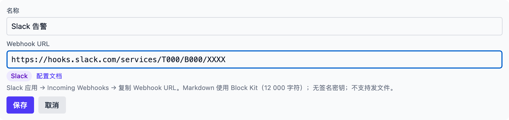
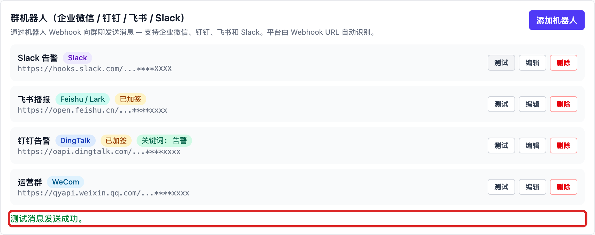

# Slack

## 在 Slack 里创建机器人

1. 打开 [api.slack.com/apps](https://api.slack.com/apps)，点击 **Create New
   App**，选择一个 workspace。
2. 在应用设置里打开 **Incoming Webhooks**，把开关打开。
3. 点击 **Add New Webhook to Workspace**，选择要发消息的频道，点击
   **Authorize**。
4. 回到设置页复制 **Webhook URL**：

   ```
   https://hooks.slack.com/services/T00000000/B00000000/xxxxxxxxxxxx
   ```

官方说明：[Sending messages using incoming webhooks](https://api.slack.com/messaging/webhooks)

使用时注意：

- 消息固定发送到创建 Webhook 时选择的那个频道，事后不能更改；
- 发出去的消息不能撤回；URL 本身就是凭证，泄露后 Slack 会撤销它；
- 纯文本不超过 40 000 字符，Markdown（Block Kit）不超过 12 000 字符；
- 不支持发文件；没有签名密钥，「签名密钥」栏不要填写。

## 在 Vibe Seller 里添加

1. 打开 Vibe Seller，进入「设置 → 集成 → 群机器人」，点击「添加机器人」；
2. 填写**名称**（例如「运营告警」），把刚才复制的 **Webhook URL** 整段粘贴进去，
   平台会自动识别为 Slack。Slack 没有签名密钥——密钥与关键词栏留空即可：

   

3. 点击「保存」，机器人出现在列表里；
4. 点击这条机器人上的「测试」，行下方出现绿色提示、频道里收到测试消息即为接通：

   

失败时行下方会显示 Slack 返回的真实原因（常见的是 URL 已被吊销，重新生成一条
粘回来即可）；报错含义见[群机器人](chat-bots.md#常见问题)。
