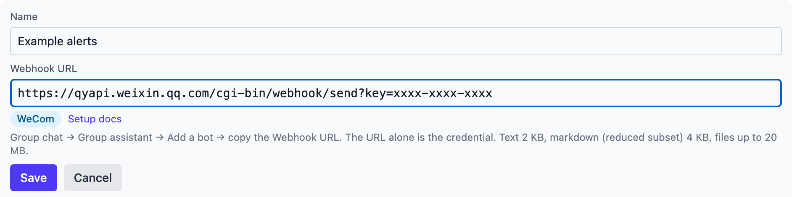
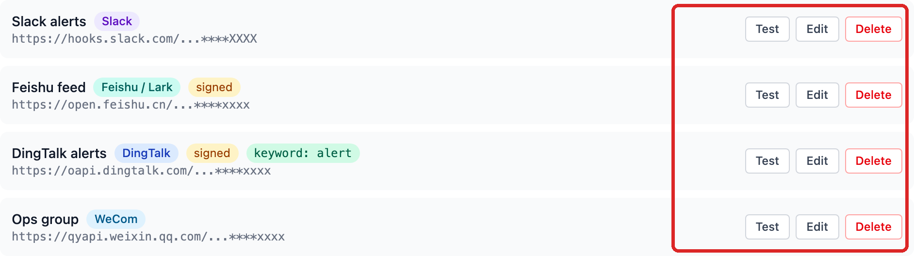
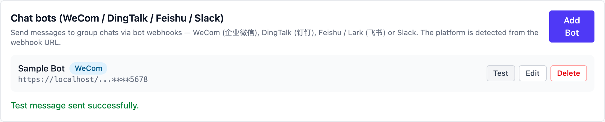

# WeCom (企业微信)

## Create the bot in WeCom

1. Open the WeCom **desktop** client (mobile works too) and enter the
   group that should receive the messages. Only **internal groups**
   support bots — external groups (ones with WeChat contacts) have no
   add entry at all, and a group set to "managed solely by the group
   owner" hides the entry from regular members.
2. Click **··· (More) → Message Push → Add** at the top right and
   choose "create a new bot" (older clients call it "Add group bot").
3. Name it, click add, then **copy the address**. It looks like:

    ```
    https://qyapi.weixin.qq.com/cgi-bin/webhook/send?key=xxxxxxxx
    ```

4. Optional: "publish to the company" so colleagues can add the same
   bot to their own groups.

Official docs: [How to set up Message Push](https://open.work.weixin.qq.com/help2/pc/14931) · [Message Push configuration](https://developer.work.weixin.qq.com/document/path/91770)

Good to know:

- Each bot sends at most **20 messages per minute**.
- Text up to 2 KB, markdown up to 4 KB (a reduced syntax: headings,
  bold, links, inline code, quotes, three font colours — no tables).
- Files from 5 bytes up to 20 MB (uploaded first, the material is valid
  for 3 days).
- If the group has "mute all" enabled, messages are accepted but **never
  shown**.

## Add it in Vibe Seller

1. Open Vibe Seller, go to **Settings → Integrations → Chat bots**, and
   click **Add Bot**;
2. Enter a **name** (e.g. "Ops alerts") and paste the **Webhook URL** you
   just copied — the platform is detected as WeCom automatically; the URL
   alone is the credential, so the form has no security section:

   

3. Click **Save** — the bot appears in the list, its URL masked:

   

4. Click **Test** on the bot's row: the group receives
   `Vibe Seller: chat bot connection test ✅` and a green line appears under
   the row:

   

When a test fails, the platform's real error shows under the row — fix it
and test again; meanings of common errors are in
[Chat bots](chat-bots.md#faq). All four platforms are added the same way
from **Settings → Integrations**; see the
[Chat bots overview](chat-bots.md).
