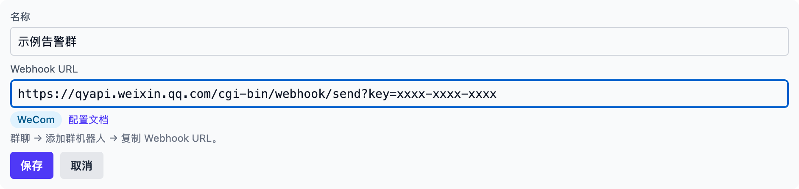
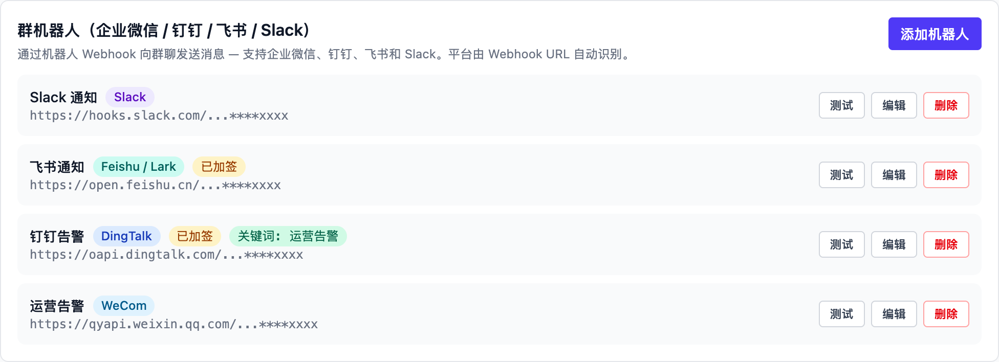
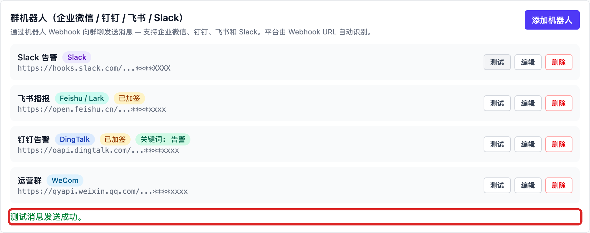

# 企业微信（WeCom）

## 在企业微信里创建机器人

1. 打开企业微信**电脑端**（手机端也可以），进入要接收消息的群。
   只有**内部群**支持群机器人：含微信联系人的外部群没有添加入口；
   群如开启了「仅群主管理」，普通成员也看不到入口。
2. 点击右上角「···（更多）→ 消息推送 → 添加」，选择「新创建一个机器人」
   （老版本的入口叫「添加群机器人」）。
3. 起一个名字，点击「添加机器人」，然后**复制地址**。地址形如：
   ```
   https://qyapi.weixin.qq.com/cgi-bin/webhook/send?key=xxxxxxxx
   ```

4. （可选）把机器人「发布到企业」后，同事可以在别的群里直接添加它。

官方说明：[如何设置消息推送](https://open.work.weixin.qq.com/help2/pc/14931) · [消息推送配置说明](https://developer.work.weixin.qq.com/document/path/91770)

使用时注意：

- 每个机器人**每分钟最多 20 条**消息；
- 文本不超过 2 KB，Markdown 不超过 4 KB（支持标题、加粗、链接、行内代码、
  引用、三种字体颜色的精简语法，不支持表格）；
- 文件 5 字节 ～ 20 MB，先上传再发送，素材 3 天内有效；
- 群开启「全员禁言」时，机器人消息会显示发送成功但**不出现**在群里。

## 在 Vibe Seller 里添加

1. 打开 Vibe Seller，进入「设置 → 集成 → 群机器人」，点击「添加机器人」；
2. 填写**名称**（例如「运营告警」），把刚才复制的 **Webhook 地址**整段粘贴进去，
   平台会自动识别为企业微信（WeCom）——Webhook 地址本身就是凭证，
   表单没有安全设置一栏：

   

3. 点击「保存」，机器人出现在列表里，Webhook 地址默认打码显示：

   

4. 点击这条机器人上的「测试」，群里出现
   `Vibe Seller: chat bot connection test ✅`，行下方显示绿色提示：

   

失败时行下方会显示平台返回的真实原因，对照修正后重新测试；各平台的报错含义见
[群机器人](chat-bots.md#常见问题)。四个入口都在「设置 → 集成」，全部机器人
都支持同样的四类消息，见[群机器人总览](chat-bots.md)。
