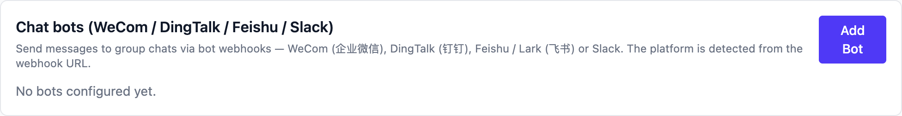
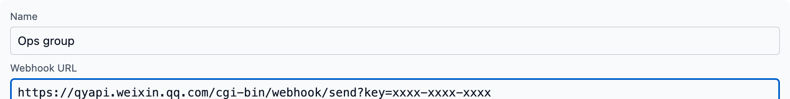
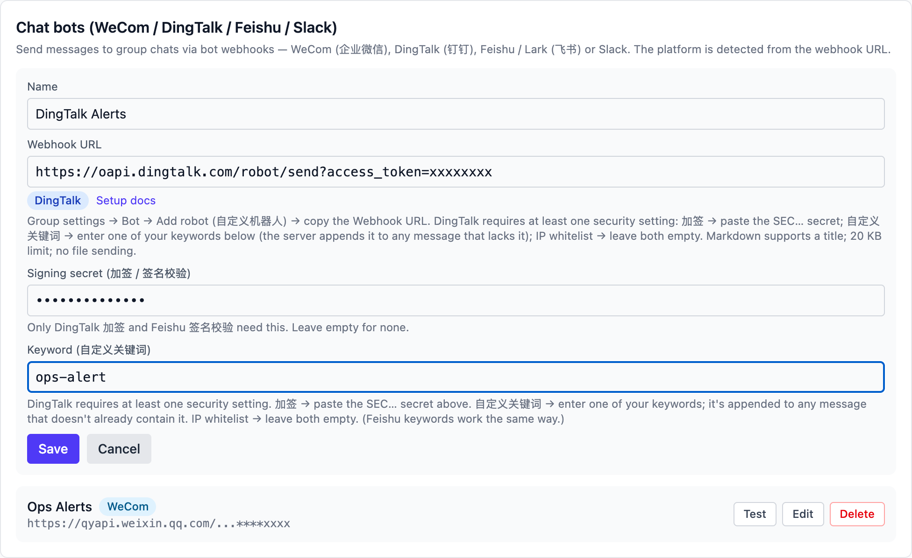
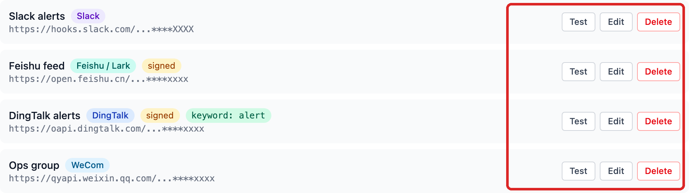
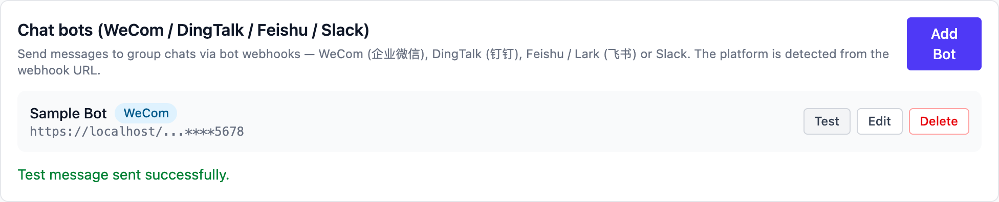
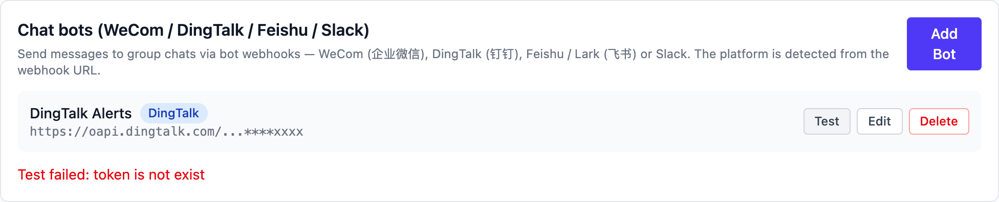

# Chat bots (WeCom / DingTalk / Feishu / Slack)

Connect a group chat bot in Vibe Seller and task results, reports and
alerts land in the group chat — no more copy-pasting. WeCom (企业微信),
DingTalk (钉钉), Feishu / Lark (飞书) and Slack are all supported.

Once it is connected, say "send this weekly report to the ops group" —
to a task, or as a follow-up — and the message goes out. To check a
setup any time, hit **Test**.

> The screenshots here were taken on macOS; the steps are the same on
> Windows and Linux.

## What you get

- Task results, alerts and reports posted to the group. The WeCom bot
  can also send **files** (PDF, images, spreadsheets, up to 20 MB).
- Nothing is posted automatically. A message goes out when you press
  **Test**, or when an agent sends one because you asked it to. Task
  completion notices still only appear in the Vibe Seller web UI.
- One bot belongs to one group. To post into several groups, add
  several bots.

The four platforms differ slightly:

| | WeCom | DingTalk | Feishu / Lark | Slack |
|---|---|---|---|---|
| Where | internal groups only | normal + external groups | group chats | channels |
| Security | none (the URL is the credential) | keyword / signing / IP range | keyword / signature / IP allowlist | none (the URL is the credential) |
| Text | 2 KB | ~20 KB | 20 KB | 40,000 characters |
| Markdown | 4 KB (reduced subset) | ~20 KB (title derived) | 20 KB (as a card) | 12,000 characters |
| Files | ✔ up to 20 MB | ✘ | ✘ | ✘ |
| Rate limit | 20 msgs/min | 20 msgs/min | 100 msgs/min | see Slack's docs |

## What to prepare

1. A group you are allowed to add bots to (per-platform rules below).
2. The bot's **Webhook URL** — steps below. The URL *is* the credential;
   never post it anywhere public.
3. For DingTalk and Feishu: the **signing secret** and/or **keyword**
   if you turn those security settings on.

## WeCom (企业微信)

### Create the bot in WeCom

1. Open the WeCom **desktop** client (mobile works too) and enter the
   group that should receive the messages. Only **internal groups**
   support bots — external groups (ones with WeChat contacts) have no
   add entry at all, and a group set to "managed solely by the group
   owner" hides the entry from regular members.
2. Click **··· (More) → Message Push → Add** at the top right and
   choose "create a new bot" (older clients call it "Add group bot").
3. Name it, click add, then **copy the address**. It looks like:

   ```
   https://qyapi.weixin.qq.com/cgi-bin/webhook/send?key=xxxxxxxx
   ```

4. Optional: "publish to the company" so colleagues can add the same
   bot to their own groups.

"Official guide: [How to set up Message Push](https://open.work.weixin.qq.com/help2/pc/14931) ·
[Message Push configuration](https://developer.work.weixin.qq.com/document/path/91770)"

Good to know:

- Each bot sends at most **20 messages per minute**.
- Text up to 2 KB, markdown up to 4 KB (a reduced syntax: headings,
  bold, links, inline code, quotes, three font colours — no tables).
- Files from 5 bytes up to 20 MB (uploaded first, the material is valid
  for 3 days).
- If the group has "mute all" enabled, messages are accepted but **never
  shown**.

Then add the bot in Vibe Seller — see [Add the bot in Vibe Seller](#add-the-bot-in-vibe-seller).

## DingTalk (钉钉)

### Create the bot in DingTalk

1. Open DingTalk, enter the group and click the **group settings** gear
   at the top right → **Robots → Add robot**, choose the **custom
   robot** (some clients call the entry "Smart group assistant").
   Normal and external groups both work; the bot posts to the group
   only, never to one-to-one chats.
2. Name it (an avatar is optional), then set up **security** — DingTalk
   requires at least one of:
   - **Custom keyword**: up to 10; every message must contain at least
     one of them. Note one down for the Vibe Seller "Keyword" field —
     Vibe Seller appends it to any message that lacks it.
   - **Signing (加签)**: copy the `SEC…` secret into Vibe Seller's
     "Signing secret" field; every message is signed automatically.
   - **IP range**: only these public egress IPs may call the webhook.
     Leave both fields empty if you don't use this one.
3. Accept the terms, click **Done** and copy the **Webhook URL**:

   ```
   https://oapi.dingtalk.com/robot/send?access_token=xxxxxxxx
   ```

"Official guide: [Custom robot access](https://open.dingtalk.com/document/group/custom-robot-access) ·
[Custom robot security settings](https://open.dingtalk.com/document/robots/customize-robot-security-settings)"

Good to know:

- At most **20 messages per minute** per bot; going over throttles the
  bot for 10 minutes.
- Markdown messages get a title derived from the first line — that is
  what notifications and the chat list show.
- No file sending; keep messages under ~20 KB.

Then add the bot in Vibe Seller — see [Add the bot in Vibe Seller](#add-the-bot-in-vibe-seller).

## Feishu / Lark (飞书)

### Create the bot in Feishu

1. In the group, click **More → Settings → Group bots → Add bot** at
   the top right and pick the **custom bot**.
2. Set avatar, name and description, click **Add**, copy the
   **Webhook URL** and click **Done**:

   ```
   https://open.feishu.cn/open-apis/bot/v2/hook/xxxxxxxx
   ```

   A custom bot works in that one group only and needs no admin
   approval.
3. In the bot's detail page, set up **security** (you can combine
   them):
   - **Custom keyword**: up to 10; the message must contain at least
     one. Put one of them into Vibe Seller's "Keyword" field.
   - **Signature check**: copy the secret into Vibe Seller's "Signing
     secret" field — Vibe Seller computes the signature for you.
   - **IP allowlist**: only these IPs / ranges may call the webhook,
     up to 10 entries. Leave empty for none.

"Official guide: [Custom bot guide](https://open.feishu.cn/document/client-docs/bot-v3/add-custom-bot)"

Good to know:

- Rate limit: **100 messages per minute, 5 per second**. Around exact
  hours and half hours the platform is busy and may answer 11232
  (throttled) — avoid those moments for important messages.
- The request body must stay under 20 KB.
- Markdown is sent as a **card**.
- No file sending.

Then add the bot in Vibe Seller — see [Add the bot in Vibe Seller](#add-the-bot-in-vibe-seller).

## Slack

### Create the bot in Slack

1. Open [api.slack.com/apps](https://api.slack.com/apps) and **Create
   New App** for your workspace.
2. In the app settings open **Incoming Webhooks** and toggle it on.
3. Click **Add New Webhook to Workspace**, pick the channel, and
   **Authorize**.
4. Copy the **Webhook URL** from the settings page:

   ```
   https://hooks.slack.com/services/T00000000/B00000000/xxxxxxxxxxxx
   ```

"Official guide: [Sending messages using incoming webhooks](https://api.slack.com/messaging/webhooks)"

Good to know:

- Messages always go to the channel chosen when the webhook was
  created; it cannot be changed later.
- Posted messages cannot be deleted. The URL is the credential — Slack
  revokes leaked ones.
- Plain text up to 40,000 characters, markdown (Block Kit) up to
  12,000 characters.
- No file sending and no signing secret — leave the secret field empty.

Then add the bot in Vibe Seller as below.

## Add the bot in Vibe Seller

1. Open the Vibe Seller web UI at **Settings → Integrations → Chat
   bots** and click **Add Bot**:

   

2. Give it a **name** (e.g. "Ops Alerts") and paste the whole
   **Webhook URL**. The platform is detected from the URL and shown as
   a badge, with a link to the platform's docs:

   

3. **DingTalk** and **Feishu** show two extra fields matching their
   security settings:
   - **Signing secret (加签 / 签名校验)**: the `SEC…` secret (DingTalk)
     or the signature secret (Feishu). Leave empty if unused.
   - **Keyword (自定义关键词)**: one of the keywords you configured on
     the platform. Leave empty if unused.

   

4. Click **Save**. The bot appears in the list with its platform badge,
   a "signed" tag and its keyword; the webhook URL is masked:

   

5. Click **Test** on the bot. A green confirmation means it works (the
   sample bot here uses a local test address; real setups show the
   platform's webhook):

   

   On failure, the platform's real reason appears under the bot row.
   `token is not exist` (DingTalk error 300005) here means the
   access_token is wrong or the bot was deleted — copy the address
   from the group again. See the [FAQ](#faq) for the other errors:

   

To change a bot later, click **Edit**. The full webhook URL is only
revealable by an admin — everyone else always sees the masked form.

To remove a bot, click **Delete** and confirm. It disappears from Vibe
Seller; the bot itself is still in the group chat, so remove it there
too if you no longer want it.

## Verify

1. Press **Test** — the group shows
   `Vibe Seller: chat bot connection test ✅`.
2. Then run a real task: when creating it, say "when done, send the
   result to the ops group", or send the same as a follow-up message
   once the task finishes. The task's agent posts through the bot (on
   WeCom it can attach report files too).

## What the bot posts

- **Only what is asked for**: your test message, a message the task's
  agent sends because you told it to, or one sent by a connected
  external AI tool. Vibe Seller never pushes task notices to the group
  on its own.
- The task's agent can send text and markdown (WeCom can also send
  files — task captures and downloads, up to 20 MB each). It never
  sees your webhook secret; the secret stays inside Vibe Seller.
- Markdown renders differently per platform:

  | Platform | Markdown |
  |---|---|
  | WeCom | reduced subset: headings, bold, links, inline code, quotes — no tables |
  | DingTalk | headings, bold, links, images, lists, quotes; the notification title comes from the first line |
  | Feishu | sent as a card; common markdown supported |
  | Slack | standard markdown (Block Kit) |

## FAQ

<details markdown="1"><summary><b>What do the test errors mean?</b></summary>

The Test button shows the platform's own reply; the platform's error
code is in parentheses. The common ones:

| Message (error code) | Cause | Fix |
|---|---|---|
| `invalid webhook url` (WeCom 93000) | bad URL, or the bot was deleted | copy the address from the group again |
| `token is not exist` (DingTalk 300005) | bad access_token, or the bot was deleted | copy the address from the group again |
| `param invalid: incoming webhook access token invalid` (Feishu 19001) | bad URL, or the bot was deleted | copy the address from the group again |
| `no_team` (Slack) | bad webhook URL, or it was revoked | copy it again from the app settings |
| `Key Words Not Found` (Feishu 19024) | keyword check on, message lacks the keyword | fill the Keyword field, or switch to signature check |
| `keywords not in content` (DingTalk 310000) | keyword check on, message lacks the keyword | fill the Keyword field with one of the platform's keywords |
| `sign not match` / `invalid timestamp` (DingTalk 310000) | signing on, wrong secret | check the Signing secret is this bot's SEC… key |
| `sign match fail or timestamp is not within one hour` (Feishu 19021) | signature check failed | check the secret; then the system clock of the Vibe Seller host |
| `ip … not in whitelist` (DingTalk 310000) / `Ip Not Allowed` (Feishu 19022) | IP allowlist on, your egress IP is not listed | switch to keyword / signing, or add the egress IP |

WeCom's error text also carries your egress IP (`from ip: …`) so you
can check allowlists against it.

</details>

<details markdown="1"><summary><b>It says sent, but nothing appears in the group?</b></summary>

Three usual causes:

1. The WeCom group has **mute all** enabled — bot messages are accepted
   but never displayed. Ask the group owner to turn mute off (the
   official guide documents this).
2. Wrong group: one webhook belongs to one group (for Slack, the
   channel picked at creation). Add another bot for the other group.
3. Make sure you are looking at the group the bot was added to, not a
   similarly named one.

</details>

<details markdown="1"><summary><b>How is the keyword appended?</b></summary>

DingTalk and Feishu keyword security requires every message to contain
a keyword. You only fill in **one** of the platform's keywords in the
Keyword field: when a message lacks it, Vibe Seller appends it on its
own last line, so the task's agent never needs to know the keyword. If
the message already contains it, nothing is added.

</details>

<details markdown="1"><summary><b>Feishu keyword on, and markdown fails with Key Words Not Found?</b></summary>

Feishu's official guide says the keyword check "only applies to text
parameters such as text and title", and markdown is delivered as a
card whose body is not in those fields. If you see this error, switch
the security setting to **signature check**, or include the keyword in
the card's heading. (We have not re-verified this combination on a
live group; handle it as the error suggests.)

</details>

<details markdown="1"><summary><b>How do I fill the IP allowlist?</b></summary>

Use the **public egress IP** of the machine that runs Vibe Seller (not
its LAN address) — any "what is my IP" page shows it. Home broadband
IPs change regularly and break allowlists; prefer **keyword** or
**signing** there. DingTalk accepts CIDR ranges (`1.1.1.0/24`), Feishu
accepts wildcards (`123.12.1.*`).

</details>

<details markdown="1"><summary><b>The message is too long?</b></summary>

See the limits in the table above. Oversized messages are stopped
before sending, with a message like `WeCom limit is 2048 bytes;
message is 3000 — split it into several messages.` Ask the task's
agent to split a long report into several messages, or send it as a
WeCom file.

</details>

<details markdown="1"><summary><b>Can one bot post to several groups?</b></summary>

No. One webhook belongs to the group it was created in (for Slack, the
chosen channel). Add one bot per group in each group chat, then one
row per bot in Vibe Seller.

</details>

<details markdown="1"><summary><b>The webhook URL leaked — what now?</b></summary>

The webhook URL is the credential to post into your group: anyone who
has it can. Delete and recreate the bot in the group chat (DingTalk
and Feishu can also just reset the secret), then replace the URL under
**Edit** in Vibe Seller, or delete the row and add it again. The list
only ever shows a masked URL and only an admin can reveal the full
one; check screenshots before sharing them.

</details>

<details markdown="1"><summary><b>DingTalk says the bot is throttled?</b></summary>

DingTalk allows 20 messages per minute per bot and throttles the bot
for 10 minutes when exceeded (error 410100, "发送速度太快而限流"). For
bursts of alerts, merge them into one markdown digest.

</details>
