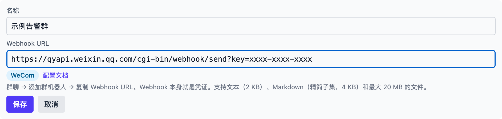
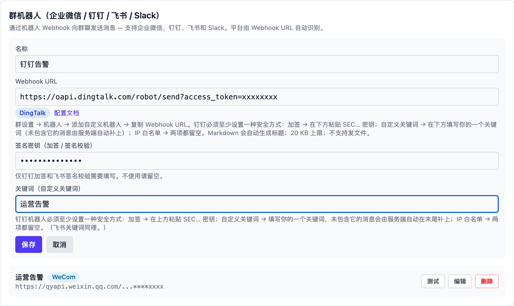
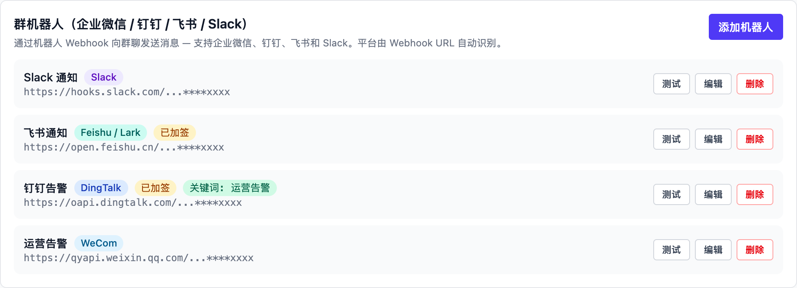
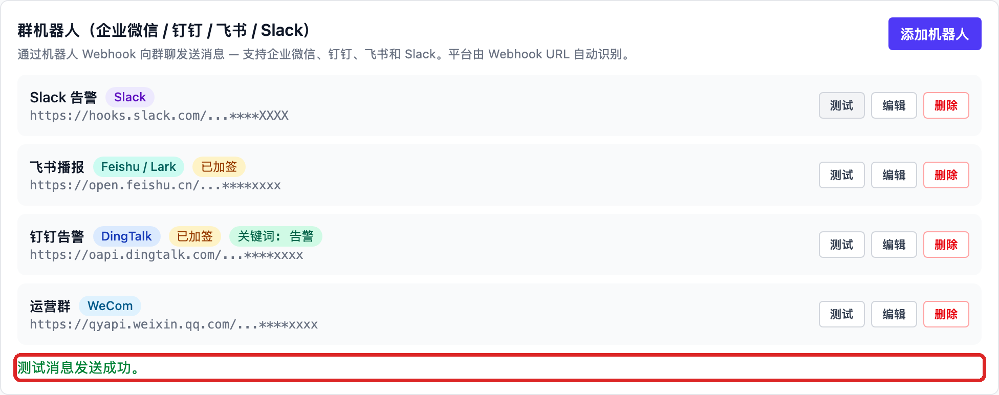
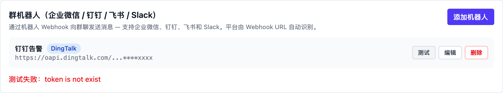

# 群机器人（企业微信 / 钉钉 / 飞书 / Slack）

在 Vibe Seller 里接入群机器人后，任务完成得到的结论、报表和提醒可以
直接发送到群里，不再需要手工复制粘贴。企业微信、钉钉、飞书（Lark）和
Slack 都支持。

接入后，你（或者任务里的 AI）说一句“把这份周报发到运营群”，消息就
进群了。想确认是否连通，随时点击「测试」。机器人只负责向外发送，
读取群消息的能力目前尚未提供。

各集成分别配在哪里、彼此怎么分工，见[集成总览](integrations.md)。

> 下文的截图在 macOS 上完成，Windows、Linux 的步骤一样。文中的 `~` 指你的
> 用户目录，Windows 上就是 `C:\Users\<你的用户名>`。

## 常见需求

- **想让任务结果自动发到群里**：按下方步骤添加机器人，之后在任务里
  说一句“完成后把结论发到运营群”即可；
- **想把报表文件发到群里**：目前只有企业微信机器人支持发送文件；
- **想让 AI 读取群里的消息**：目前不支持，机器人只能发不能收；
- **想让多个群都收到消息**：一个机器人只对应一个群，需要逐个群添加。

## 能做什么

- 把任务结果、告警、报表发送到群里；企业微信机器人还能发**文件**
  （PDF、图片、表格等，最大 20 MB）。
- 发什么、什么时候发完全由你决定：手动点击「测试」，或在任务里让 AI
  发送。系统没有任何自动推送——任务完成通知仍然只在 Vibe Seller
  网页里显示。
- 一个机器人对应一个群。要发多个群，就添加多个机器人。

四个平台的能力略有差别：

| | 企业微信 | 钉钉 | 飞书 / Lark | Slack |
|---|---|---|---|---|
| 群类型 | 仅内部群 | 普通群、外部群 | 群聊 | 频道 |
| 安全设置 | 无（URL 即凭证） | 关键词 / 加签 / IP 段 | 关键词 / 签名 / IP 白名单 | 无（URL 即凭证） |
| 文本 | 2 KB | 约 20 KB | 20 KB | 40 000 字符 |
| Markdown | 4 KB（精简子集） | 约 20 KB（自动带标题） | 20 KB（卡片形式） | 12 000 字符 |
| 发文件 | ✔ ≤ 20 MB | ✘ | ✘ | ✘ |
| 频率限制 | 20 条/分钟 | 20 条/分钟 | 100 条/分钟 | 以官方为准 |

## 接入前准备

1. 一个你有权限添加机器人的群（各平台对群类型的要求见上表）。
2. 群机器人的 **Webhook 地址**——按[你所在平台的页面](#选择你的平台)获取。
   这个地址本身就是凭证，不要发到公开的地方。
3. 钉钉、飞书如开启了**加签**或**自定义关键词**，把密钥、关键词一起
   记下来，添加机器人时需要填写。

## 选择你的平台

先在群里创建机器人，复制它的 Webhook 地址，再回到 Vibe Seller 添加：

- [企业微信（WeCom）](chat-bots-wecom.md)
- [钉钉（DingTalk）](chat-bots-dingtalk.md)
- [飞书（Feishu / Lark）](chat-bots-feishu.md)
- [Slack](chat-bots-slack.md)

四个平台都要做同样的三步：在群里创建机器人、复制 Webhook 地址、回到
Vibe Seller 粘贴并测试。差别只在入口位置和安全设置。

## 在 Vibe Seller 里添加

1. 打开 Vibe Seller 网页，进入「设置 → 集成 → 群机器人」，点击「添加机器人」：
   

2. 填写**名称**（例如「运营告警」，方便日后一眼认出）；把获取到的
   **Webhook URL** 整段粘贴进去。平台会根据 URL 自动识别并显示标签，
   旁边还有该平台的说明链接：
   

3. **钉钉**和**飞书**会多出两个输入栏，按你在平台上的安全设置填写：
   
    - **签名密钥（加签 / 签名校验）**：把 `SEC` 开头的密钥（钉钉）或
      签名密钥（飞书）填进来。没开签名就留空。
    - **关键词（自定义关键词）**：填写你在平台上设置的关键词之一。没开
      关键词就留空。

4. 点击「保存」。列表里会出现这个机器人：平台标签、是否已加签、关键词
   一目了然，Webhook 地址默认打码显示：
   

5. 点击这条机器人上的「测试」。看到绿色提示，群机器人就接好了（示例里
   的机器人使用的是本地测试地址，实际使用时这里是各平台的 Webhook
   地址）：
   
   失败时，机器人行下方会显示平台返回的真实原因。比如截图里的
   `token is not exist`（钉钉错误码 300005）表示 access_token 不对
   或机器人已被删除——回到群里重新复制地址即可。其他错误的含义见
   [常见问题](#常见问题)：
   

编辑：点击「编辑」可以修改名称、Webhook、密钥和关键词。完整的 Webhook
地址只有管理员能显示查看，其他人看到的始终是打码地址。

删除：点击「删除」并确认。Vibe Seller 里不再有这个机器人；群里那个机器人
本身还在，不想要了记得去群里把它移除。

## 验证

1. 点击「测试」，群里出现 `Vibe Seller: chat bot connection test ✅`；
2. 再执行一次真实任务：创建任务时说“完成后把结论发到运营群”，或者
   在任务结束后发一条跟进消息“把结果发到运营群”。任务里的 AI 会用
   群机器人把结果发过去（企业微信还可以让它把报表文件一起发）。

## 机器人会发什么

- **只在你要求时发送**：包括你点击「测试」、任务里的 AI 按你的要求
  发送、接入的外部 AI 工具发送。Vibe Seller 不会自动往群里推送任务通知。
- 任务里的 AI 可以发送文本和 Markdown（企业微信还可以发送文件，任务
  产出和下载的文件都可以，单个不超过 20 MB）。它看不到你的 Webhook
  密钥，密钥只保存在 Vibe Seller 里。
- Markdown 的效果各平台不同：

  | 平台 | Markdown 表现 |
  |---|---|
  | 企业微信 | 精简子集：标题、加粗、链接、行内代码、引用；不支持表格 |
  | 钉钉 | 标题、加粗、链接、图片、列表、引用；通知标题取首行 |
  | 飞书 | 以卡片发送，支持常用 Markdown |
  | Slack | 标准 Markdown（Block Kit） |

## 常见问题

<b>测试失败，提示是什么意思？</b>

测试失败时，页面会显示平台返回的原文，括号里是平台的错误码。常见的有：

| 提示（错误码） | 原因 | 怎么办 |
|---|---|---|
| `invalid webhook url`（企业微信 93000） | 地址不对或机器人已删除 | 回群里重新复制地址 |
| `token is not exist`（钉钉 300005） | access_token 不对或机器人已删除 | 回群里重新复制地址 |
| `param invalid: incoming webhook access token invalid`（飞书 19001） | 地址不对或机器人已删除 | 回群里重新复制地址 |
| `no_team`（Slack） | Webhook URL 不对或已被撤销 | 回应用设置重新复制 |
| `Key Words Not Found`（飞书 19024） | 开启了关键词校验，消息里没有关键词 | 在「关键词」栏填对关键词，或改用签名校验 |
| `keywords not in content`（钉钉 310000） | 开启了关键词校验，消息里没有关键词 | 在「关键词」栏填你在平台上设置的关键词之一 |
| `sign not match` / `invalid timestamp`（钉钉 310000） | 开启了加签但密钥不对 | 核对「签名密钥」是否是这个机器人的 SEC… 密钥 |
| `sign match fail or timestamp is not within one hour`（飞书 19021） | 签名校验未通过 | 核对密钥；仍不行则检查 Vibe Seller 所在机器的系统时间 |
| `ip … not in whitelist`（钉钉 310000）/ `Ip Not Allowed`（飞书 19022） | 开启了 IP 白名单，出口 IP 不在其中 | 改用关键词或加签，或把出口 IP 加入白名单 |

企业微信的报错里还会带出口 IP（`from ip: …`），方便你核对白名单。

<b>提示发送成功，群里却没有消息？</b>

三种常见情况：

1. 企业微信群开启了**全员禁言**——机器人消息会显示发送成功但不出现，
   请群主关闭禁言后再试（官方说明里明确写了这一条）；
2. 发错了群：一个 Webhook 只对应一个群（Slack 对应创建时选的频道），
   想发别的群，就为那个群再添加一个机器人；
3. 确认看的是不是机器人所在的那个群，而不是同名的其他群。

<b>关键词是怎么自动补上的？</b>

钉钉、飞书的安全关键词要求每条消息都包含关键词。你只需要在「关键词」
栏填写平台上设置的关键词**之一**：任务发出的消息如果没有包含它，Vibe
Seller 会自动在末尾补上一行，不需要任务里的 AI 知道关键词是什么；
消息本来就包含关键词时不会重复添加。

<b>飞书开了关键词，Markdown 消息报 Key Words Not Found？</b>

飞书官方说明里写明，关键词校验「只对 text、title 这类文本参数值生效」，
而 Markdown 是以卡片形式发送的，卡片正文不在这些字段里。遇到这个报错，
建议把安全设置改为**签名校验**，或者在卡片正文的标题里也带上关键词。
（这一条我们没有在真实群里复测过，按报错提示处理即可。）

<b>IP 白名单怎么填？</b>

填写 Vibe Seller 所在机器访问公网时的**出口 IP**（不是局域网 IP）。在那台
机器上打开任意一个查询「我的 IP」的网页即可查看。家用宽带的出口 IP 会
定期变化，白名单容易失效——这种情况建议改用**关键词**或**加签**。
钉钉支持网段（`1.1.1.0/24`），飞书支持通配（`123.12.1.*`）。

<b>消息太长发不出去？</b>

各平台的上限见开头的表格。超长的消息，Vibe Seller 会在发送前拦下来并
提示拆分（例如 `WeCom limit is 2048 bytes; message is 3000 — split it
into several messages.`）。可以让任务里的 AI 把长报告拆成几条发送，或者
用企业微信发送文件。

<b>一个机器人能发多个群吗？</b>

不能。一个 Webhook 固定对应创建它的那个群（Slack 是创建时选的频道）。
要发多个群，就在每个群里各创建一个机器人，在 Vibe Seller 里各添加一条。

<b>Webhook 地址泄露了怎么办？</b>

Webhook 地址就是发消息的凭证：持有地址的人都能往你的群里发消息。处理
办法：到群里**删除并重建机器人**（钉钉、飞书也可以只**重置**密钥），然后
在 Vibe Seller 的「编辑」里换成新地址，或删除后重新添加。平时列表里只显示
打码地址，完整地址只有管理员能查看；分享截图前也记得检查画面里没有
完整地址。

<b>钉钉提示被限流？</b>

钉钉每个机器人每分钟最多 20 条，超过会限流 10 分钟（错误码 410100，
`发送速度太快而限流`）。大量告警建议合并成一条 Markdown 摘要再发送。

