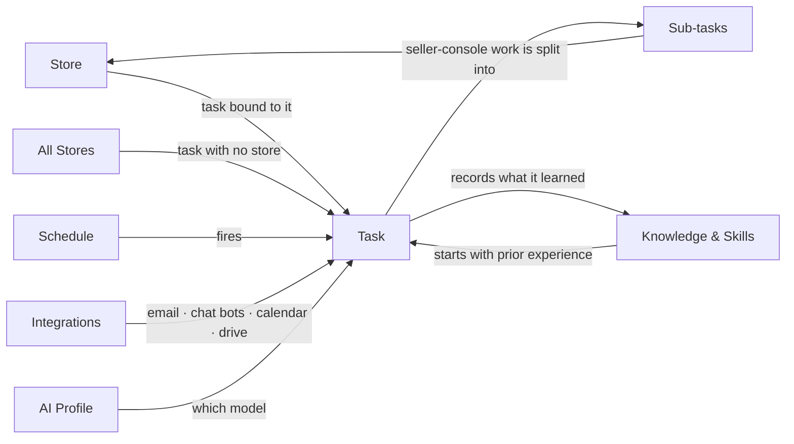

# Core Concepts

Six things to know. Here's how they fit together:

The task is the centre: the **store** decides which logged-in browser it can use, a **schedule** decides when it runs by itself, **knowledge & Skills** decide how well it knows your shop, **integrations** decide what it can call besides the browser, and the **AI profile** decides which model does the work.

## Store

One store = one logged-in browser + one memory. The login is either a Ziniao browser profile or a dedicated Chrome instance Vibe Seller keeps just for it; the memory is a folder of markdown files.

An agent works inside its own store's browser and never borrows another store's login, and writes that clearly belong to another store get rejected — so Store A's hard-won experience doesn't leak into Store B's notes. Three stores can run at the same time without interfering.

Choosing between the two backends: [Which browser backend](stores.en.md#which-browser-backend); which credentials Ziniao needs and where they live: [Ziniao: Setup & Common Errors](ziniao.en.md); how parallel stores are arranged: [Running several stores at once](stores.en.md#running-several-stores-at-once).

## Task

You write one sentence; the agent plans the steps, drives the browser itself and hands back a report. Every step and screenshot stays in the task detail and can be replayed.

There are two scopes — the only choice you need to think about up front. Pick a store in the sidebar, or pick the last row, **All Stores** (subtitled "No Store"):

| | Task bound to a store | Task created under **All Stores** |
|---|---|---|
| Which browser | That store's own logged-in browser (Ziniao profile / its own Chrome) | A generic Chrome with no store logged in — public pages only |
| Good for | Work inside one shop: ad tuning, listings, report exports, stock checks | Cross-store and public-web work: tracking shipments, looking things up, comparing shops |
| Opening a seller console | Do it directly | Not allowed — it splits the work into **sub-tasks**, each bound to one store, which use that store's login |
| Execution mode | Follows your default (a fresh install defaults to **Auto**) | Always **Review plan first** — can't be turned off |
| Where notes are written | That store's own folder | Shared cross-store knowledge, then each sub-task writes back to its own store |

The app says it itself: "This is the cross-store task list. These tasks have a general web browser for public pages (search, tracking/logistics) plus email and messaging — but not a specific store's backend."

**Auto / Review** — the picker in the task footer: **Auto** means "Skip review, run immediately", **Review** means "Draft a plan, run after approval". Changing it once also saves it as your default (you can set it up front in **Settings → General → Task Defaults → Default Execution Mode**). For anything hard to roll back — bid changes, budget moves, bulk listing changes — review first. After reading the plan, hit **Confirm & Execute**, or **Request Changes** to keep talking.

A **parent task and its sub-tasks** form a tree: the parent decides what needs doing and merges the findings, the children do the in-store work. When the parent finishes dispatching it doesn't complete — it parks in **Waiting** until every child has ended, then closes itself with a combined summary of the results. The default shape is one sub-task per store; different country sites of one store are handled inside that same sub-task rather than split up. Deleting a parent deletes the whole tree.

How many tasks run at once is set in **Settings → General → Max Concurrent Agents** (default 2). Tasks on the same platform in different countries take turns to avoid clashing; everything else runs in parallel in new tabs.

Day-to-day usage: [Tasks](using-tasks.en.md#two-scopes-where-you-create-a-task-decides-what-it-can-do).

## Schedule

Turns a one-off sentence into "do this every Monday". A schedule creates ordinary tasks when it fires and keeps their history attached to itself.

A store-bound schedule fires exactly one task. An **All Stores** schedule picks its shape once, when you create it: **Fan out (one task per store)** or **Single (one task)**, with an optional **Run stores one at a time** so no two shops share the browser at the same moment.

For schedules you create yourself, **the plan is produced once, at creation**: after you save it the agent runs the planning pass and freezes the result on the schedule — **there's no approval click** — and every later fire copies that plan instead of re-planning ("A plan is frozen on this schedule and will be reused for every fire."). You can read the frozen plan any time; to change it, edit the schedule's text — the plan is then marked "Plan stale" and the schedule won't fire until you hit **Re-plan**.

What suits a schedule and how to revise a frozen plan: [Schedules](schedules.en.md#the-plan-is-authored-once-at-creation).

## Knowledge & Skills

The agent's memory is plain markdown on your disk — readable, editable, copyable between machines — all under `~/.vibe-seller/` (that's the **Knowledge Directory** line in **Settings → AI**). The page is called **Knowledge** and has two modes: **Files** for editing by hand, **AI Chat** for telling it in words and letting it file things.

- **Project Knowledge** — the platform knowledge that ships with the release, read-only;
- **Local Knowledge** — experience, rules and tips shared across all stores;
- **one folder per store** — that shop's page mechanics, dead ends it already hit, your own requirements;
- **Skills** — operation manuals written for the agent. Amazon, Noon and friends ship built-ins (read-only); ones you write or import are yours to edit.

Files the agent downloads while working (reports, statements) go under **Run Data**, filed by store and month, instead of mixing into the knowledge. After a run the agent updates what it learned, so the next one starts smarter. Where the files are and how to write a Skill: [Knowledge & Skills](knowledge.en.md#three-layers-of-knowledge).

## Integrations

Besides driving the browser, the agent can call external services directly: **Email** (read store mailboxes, draft replies), **Chat bots** (WeCom / DingTalk / Feishu / Slack), **Dida365 / TickTick**, **Google Workspace**, the **Amazon Ads API** (ad tasks hit the API instead of clicking through the console) — and, pointing the other way, **MCP**, which lets Claude, Codex and similar tools drive Vibe Seller.

One task can mix them: pull stock in the browser → build a Google Sheet → post the summary to a group chat → drop a todo into TickTick. Everything is hooked up under **Settings → Integrations**, no code. See [Several integrations in one task](integrations.en.md#several-integrations-in-one-task) in the [Integrations overview](integrations.en.md).

## AI Profile

One AI profile = one provider + one model + one API key, stored on this machine. Use DeepSeek for cheap routine checks and switch to Claude when something needs the big model — you just pick a different profile, nothing else changes. The task footer has a profile picker.

**Schedules have no picker of their own**: each fire uses whatever your default profile is at that moment, so changing your default changes the model for every schedule that follows the default. The "Sync schedules when default changes" switch under **Settings → AI** additionally moves schedules that were pinned to a specific profile. Out of the box that default is the built-in **Claude** profile ("System default environment" — it rides this machine's Claude Code session, so a signed-in subscription works with no key to enter).

Where to get keys and which preset to pick: [Configure AI Models](llm-keys.md).

---

Ready? Go on to the [Quickstart](quickstart.md); if something breaks, the [FAQ](faq.md).
