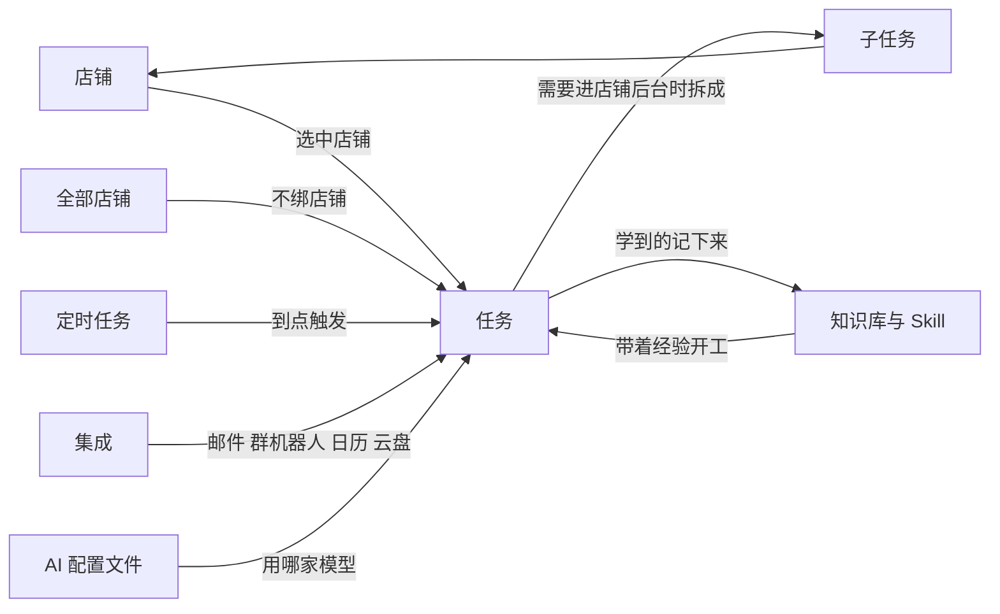

# 核心概念

Vibe Seller 只需要认识六个概念，它们的关系一张图就能看完：

任务是中心：**店铺**决定它能使用哪套登录状态，**定时任务**决定它什么时候自动执行，**知识库与 Skill** 决定它有多了解你的店，**集成**决定它除了浏览器还能调用什么，**AI 配置文件**决定它用哪个模型工作。

## 店铺

想让每家店有独立的登录状态和记忆，就为它建一个店铺。**一个店铺 = 一套登录状态 + 一份记忆。** 登录状态要么是紫鸟里的一个浏览器档案，要么是 Vibe Seller 为它单独打开的一个 Chrome 实例；记忆是这个店铺目录下的那批 markdown 文件。

AI 执行任务时只使用自己店铺的浏览器，不会用到其他店铺的登录状态；需要写入跨店铺内容时会经过检查，因此店铺 A 的经验不会写进店铺 B。三个店铺同时运行互不影响。

紫鸟和 Chrome 怎么选，见 [选哪个浏览器后端](stores.md#选哪个浏览器后端)；紫鸟需要哪些凭据、存在哪，见 [紫鸟：开通与常见报错](ziniao.md)；多店铺同时运行怎么调度，见 [多个店铺同时运行](stores.md#多个店铺同时运行)。

## 任务

你用一句话说明要做什么，AI 自己规划步骤、打开浏览器操作，最后交给你一份结果报告。每一步操作和每一张截图都留在任务详情里，可以回放。

任务有两种范围，这是唯一一个需要你先想清楚的选择：在左侧店铺列表里选中某个店铺，或者选择最后一行「全部店铺」（副标题「无店铺」）。

| | 绑定店铺的任务 | 「全部店铺」的任务 |
|---|---|---|
| 用哪个浏览器 | 这个店铺自己的浏览器 | 通用 Chrome，只能访问公开网页 |
| 适合做什么 | 一家店内的工作 | 跨店铺的工作、公开网页上的工作 |
| 要进卖家后台 | 可以直接操作 | 拆成子任务，各店铺分别操作 |
| 执行模式 | 跟随你的默认设置 | 固定「先审方案」，不能关闭 |
| 记忆写在哪 | 该店铺自己的目录 | 跨店铺共用，子任务再写回各自店铺 |

绑定店铺的任务使用这个店铺绑定的登录状态浏览器（紫鸟档案或独立 Chrome），适合调广告、上架商品、导报表、查库存这类一家店内的工作，执行模式默认跟随你的设置（新装默认「自动」）。「全部店铺」的任务使用一台不带任何店铺登录状态的通用 Chrome，只能访问公开网页，适合查物流轨迹、搜索信息、汇总各家情况；界面上对这类任务的说明是：「当前为通用任务列表。这类任务可使用通用网页浏览器访问公开网页（搜索、物流/轨迹查询等），并可读取邮件、发送企微消息，但无法进入具体店铺的后台。」需要进卖家后台时，它会把这部分拆成**子任务**，每个子任务绑定一个店铺，用那个店铺的登录状态去操作。

「自动」和「先审核」在任务详情底部的开关切换：「自动」即「跳过审核，立即执行」，「先审核」即「先生成方案，确认后执行」。切换一次就会记住为你的默认设置（也可以在「设置 → 通用 → 任务默认设置 → 默认执行模式」里提前设好）。调价、改预算、批量上下架这类改动大、不好回滚的工作，建议先用「先审核」。审核后点击「确认并执行」，不满意就点「修改计划」继续对话。

**父任务与子任务**是一棵树：父任务负责判断和汇总，子任务分别进入各店铺操作。父任务交代完不会立刻结束，它会停在「等待中」，等所有子任务完成后自动收工，把各店铺的结果合并成一份总结。默认一个店铺一个子任务；同一店铺的不同站点（国家）在同一个子任务里切换，不拆成多个子任务。删除父任务会连同整棵树一起删除。

同一时间能运行几个任务由「设置 → 通用 → 最大并发数」决定（默认 2）；同一个平台不同国家的任务会排队错开，其他情况并行打开新标签页运行。

具体用法见 [任务的两种范围](using-tasks.md#任务的两种范围在哪里创建决定了它能做什么)。

## 定时任务

想让一件事定期自动发生，就把它写成定时任务，例如“每周一检查所有店铺的广告”。定时任务到点自动创建任务并执行，历次记录都挂在这一条定时任务下面。

绑定店铺的定时任务每次触发创建一个任务。**全部店铺**的定时任务有两种形式，创建时选择一次：**分发（每个店铺一个任务）**或**单任务**；还可以勾选「店铺逐个运行」，让各店铺排队执行，不同时占用浏览器。

你自己创建的定时任务，**方案在创建时生成一次**：保存之后 AI 会自动执行一次规划，把写好的方案冻结在这条定时任务上。这一步不需要你确认，之后每次到点直接按这份方案执行（计划面板上写着「计划已冻结在此定时任务上，每次执行时都会复用」）。方案随时能在详情页查看；要改方案就修改定时任务的文字，方案会被标成「计划需更新」，在你点击「重新规划」之前它不会到点触发。

哪些工作适合定时执行、方案怎么修改，见 [定时任务](schedules.md#计划只在创建时写一次)。

## 知识库与 Skill

AI 的记忆是磁盘上的 markdown 文件：你能查看、能编辑，也能在机器之间拷贝，全部位于 `~/.vibe-seller/` 下面（「设置 → AI」里「知识库目录」那一行就是它）。界面里这个页签叫「知识库」，有两种用法：「文件」用于手工编辑，「AI 对话」用于你说一句、它整理进对应的文件。

- **项目知识**：随版本发布的内置平台知识，只读，不能修改；
- **本地知识**：跨店铺共用的经验、规则和技巧；
- **每个店铺自己的目录**：这家店的页面机制、踩过的坑、你的要求；
- **Skill**：写给 AI 看的操作手册，亚马逊、Noon 这些平台已内置（只读），你自己编写或导入的可以修改。

任务执行时下载的报表、对账单这类文件属于**运行数据**，按店铺和月份归档，不与知识混在一起。AI 完成一个任务后会把学到的内容一并更新进这些文件，下次带着经验开始工作。文件在哪里、怎么写 Skill，见 [三层知识](knowledge.md#三层知识)。

## 集成

除了操作浏览器，AI 还能直接调用外部服务：**邮件**（读取店铺邮箱、起草回复）、**群机器人**（企业微信、钉钉、飞书、Slack）、**滴答清单 / TickTick**、**Google Workspace**、**亚马逊广告 Ads API**（广告任务直连接口，不需要点击后台），以及反向的 **MCP 接入**——让 Claude、Codex 这类外部 AI 工具来使用 Vibe Seller。

一个任务里可以组合使用：浏览器采集库存 → 生成 Google Sheet → 摘要发送到企业微信 → 在滴答清单里创建一条待办。这些都在「设置 → 集成」里配置权限，不需要写代码，见 [一个任务里同时用几个集成](integrations.md#一个任务里同时用几个集成)。

## AI 配置文件

一个 AI 配置文件 = 一家供应商 + 一个模型 + 一个 Key，保存在本机。例行检查用 DeepSeek 节省费用，攻坚复杂任务时换成 Claude，换一个配置文件即可，其他设置都不用改。任务详情底部就有配置文件选择器，随时可以更换。

**定时任务上没有单独的配置文件选择器**：它每次触发都使用你当时的默认配置文件，因此修改默认配置，就等于修改了所有「跟随默认」的定时任务使用的模型。「设置 → AI」里还有一个「更改默认配置时同步定时任务」开关，打开后切换默认配置时，那些单独指定过配置文件的定时任务也会一起换成新的默认配置。刚安装完成时，这个默认配置就是内置的「Claude」——它使用本机 Claude Code 的环境，订阅已经登录就能直接使用。

怎么获取 Key、各家该选哪个预设，见 [配置 AI 模型](llm-keys.md)。

---

概念清楚了，动手操作见 [快速开始](quickstart.md)；过程中遇到卡点，查 [常见问题](faq.md)。
