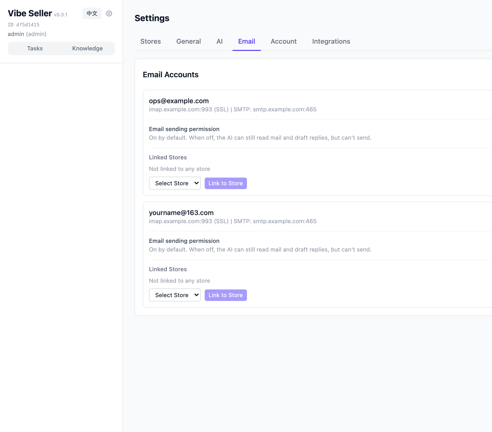
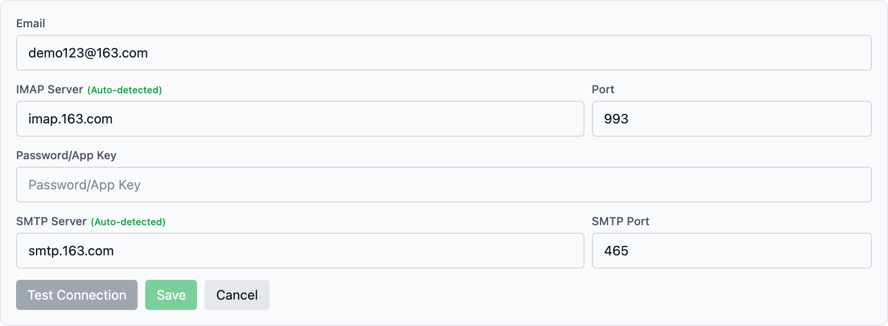
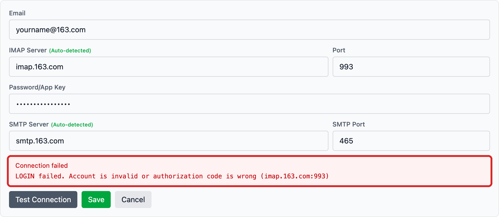
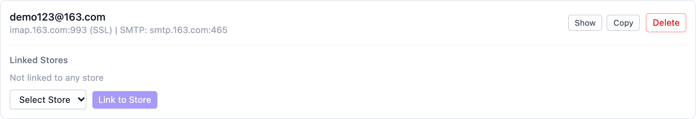
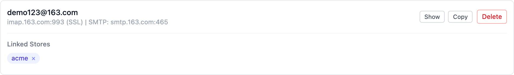
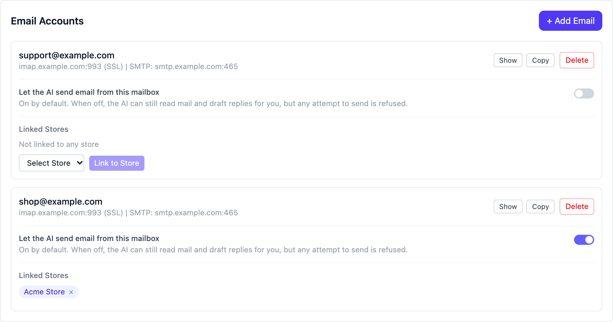

# Email Integration

Connect your customer-service mailbox to Vibe Seller and the AI can pull
up the inbox while running a task, sort messages the way you want, and
draft and send replies — no more copying and pasting between windows.
If you don't want the AI sending from a mailbox, turn sending off for
that mailbox.

Everything runs over standard IMAP / SMTP. **You never type your email
password** — 163 and QQ Mail use an *authorization code*, Gmail uses an
*app password*. Each provider section below shows exactly how to get one.

> The screenshots were taken on macOS; the steps look the same on
> Windows and Linux.

## What you need

- A mailbox you use (163 / 126 / yeah.net, QQ Mail and Gmail are all
  supported);
- Its **authorization code** (or Gmail app password) — one short section
  per provider below;
- Outlook / Hotmail is **not supported** — see the
  [FAQ](#faq).

## NetEase Mail (163 / 126 / yeah.net)

The steps are the same for all three domains — the server settings get
filled in automatically, so you only deal with the authorization code.

### Step 1: Get the client authorization code

1. Sign in to the [web mail](https://email.163.com/) (126: [email.126.com](https://email.126.com/),
   yeah.net likewise), click **Settings → POP/SMTP/IMAP** at the top;
2. Turn **IMAP/SMTP service** on (IMAP is recommended — it stays in
   sync with the web mail);
3. Click "Continue" in the dialog and verify by SMS (scan the QR code
   or send the message manually);
4. A **16-character authorization code** appears — it is shown **once**,
   so copy it right away. One code can serve several clients; use
   "Add authorization password" whenever you need a fresh one.

Full illustrated steps: NetEase help
[How to enable client protocols](https://help.mail.163.com/faqDetail.do?code=d7a5dc8471cd0c0e8b4b8f4f8e49998b374173cfe9171305fa1ce630d7f67ac2a5feb28b66796d3b)
([official guide](https://help.mail.163.com/faqDetail.do?code=d7a5dc8471cd0c0e8b4b8f4f8e49998b374173cfe9171305fa1ce630d7f67ac2a5feb28b66796d3b)).

### Step 2: Add it in Vibe Seller

Open **Settings → Email** in Vibe Seller:

Click **+ Add Email**:

1. Type the full address (e.g. `yourname@163.com`) — when the field
   loses focus, the IMAP / SMTP servers are **auto-detected**
   (`imap.163.com`, `smtp.163.com`);
2. Paste the 16-character authorization code into "Password/App Key";
3. Click **Test Connection**. Once it says "Connection successful",
   click **Save**.

If the code is wrong or the service is off, the provider's real error
appears in the red box — fix it and test again:

The mailbox now appears in the list. Click **Link to Store** to attach
it to a store — only linked mailboxes are visible to the AI in that
store's tasks.

## QQ Mail

### Step 1: Enable the service and get the code

1. Sign in to [QQ Mail on the web](https://mail.qq.com/), open
   **Settings → Account & Security** at the top;
2. Find "POP3/IMAP/SMTP/Exchange/CardDAV service" and turn
   **IMAP/SMTP** on;
3. Verify by SMS with your bound phone number, then click "I have sent
   it";
4. A **16-character authorization code** pops up — this, **not your QQ
   password**, is what third-party clients sign in with. Copy and save
   it.

Forgot or leaked it? Reset under **Settings → Account & Security →
Device management → Authorization codes** — old codes stop working
immediately. ([official guide](https://help.mail.qq.com/detail/0/1087))

!!! note "Corporate mail (exmail)"
    Tencent Exmail addresses (`you@yourcompany.com`) use different
    servers (`imap.exmail.qq.com` / `smtp.exmail.qq.com`). An
    administrator must first open IMAP/SMTP in the admin console, then
    you generate a client code under **Settings → Email Associating**
    in the web mail. Enter those two servers manually when adding the
    account. See the
    [Tencent guide](https://open.work.weixin.qq.com/help2/pc/19886).

### Step 2: Add it in Vibe Seller

Same as NetEase: **Settings → Email → + Add Email**, address
`yourname@qq.com`, paste the 16-character code, **Test Connection**,
save, link to a store. QQ servers are auto-detected too (`imap.qq.com`,
`smtp.qq.com`).

## Gmail

Gmail uses an **app password** instead of your login password, and
requires 2-Step Verification first.

### Step 1: Turn on 2-Step Verification

1. Open your [Google Account security page](https://myaccount.google.com/security);
2. Under "How you sign in to Google", start **2-Step Verification**
   and follow the prompts
   ([official guide](https://support.google.com/mail/answer/185839)).

### Step 2: Create an app password

1. With 2-Step Verification on, open the
   [App passwords](https://myaccount.google.com/apppasswords) page;
2. Pick "Other (custom name)", name it something recognisable (e.g.
   `vibe-seller`) and click **Generate**;
3. Google shows a **16-character password** in four groups — copy it.
   When you paste it into Vibe Seller, **ignore the spaces** and enter
   it as one unbroken string.

([official guide](https://support.google.com/mail/answer/185833))

!!! note "Google Workspace (work / school) accounts"
    Personal @gmail.com accounts have had IMAP always-on since January
    2025 — nothing to enable. But on a managed Google Workspace
    account the administrator may have **disabled IMAP or app
    passwords**. If you cannot find the "App passwords" page or the
    "Forwarding and POP/IMAP" tab, ask your administrator.

### Step 3: Add it in Vibe Seller

**Settings → Email → + Add Email**, address `yourname@gmail.com`, paste
the 16-character app password (no spaces), **Test Connection**, save,
link to a store. Servers auto-detect to `imap.gmail.com` /
`smtp.gmail.com`.

## Outlook / Hotmail: not supported

**Outlook.com, Hotmail and Live mailboxes cannot be connected.**
Microsoft retired password sign-in (Basic Authentication) in September
2024 — those accounts require OAuth2, while Vibe Seller connects with
an authorization code / password. Clicking "Test Connection" with an
Outlook mailbox shows the provider's own error
(`Basic authentication is disabled.`); it is not a configuration
problem. Microsoft's
[announcement](https://techcommunity.microsoft.com/blog/outlook/keeping-our-outlook-personal-email-users-safe-reinforcing-our-commitment-to-secu/4164184).
If you need those messages, forward Outlook mail to a supported
mailbox first.

## Verify

Three quick checks:

1. **Test Connection** says "Connection successful" — this checks
   incoming (IMAP) access;
2. After **Save**, the mailbox is in the list and **linked to a store**;
3. Create a task asking "what's the latest mail in this mailbox?" —
   if the AI reports recent subjects and senders, you are done.

## Turn off AI sending

Every mailbox **can send** by default: the AI can read, sort, draft and
send. If you don't want the AI sending from a mailbox (say, read and
draft only), turn it off **per mailbox**:

1. Go to **Settings → Email** and find the mailbox in the list;
2. Turn off the **"Let the AI send email from this mailbox"** switch on
   its card (grey means off);
3. Each mailbox is separate: turning it off for mailbox A leaves
   mailbox B sending as usual.

To allow sending again, turn the same switch back on.

**Verify**: create a task asking the AI to "send a test email from this
mailbox to me" (give it another inbox of yours). With the switch on, the
mail arrives within a few minutes; with it off, the AI tells you sending
from that mailbox has been turned off and shows you the draft instead.

Changes take effect immediately. The rule is enforced on the server, not
left to the AI: a mailbox with sending turned off cannot send, whatever
the task says.

Only you can change the switch, signed in to the web UI: neither the AI
inside a task nor an external AI client using an API key can. **This
holds while login is turned on** — if you turn login off in Settings,
the server cannot tell the web UI apart from an AI's request that
carries no credential, so the switch cannot stop an AI that sets out to
get around it. Keep login on if several people use the instance or this
matters to you.

## What the AI can do with it

- **Read mail**: search the inbox by subject / sender / time, read
  bodies and attachment lists. Mail syncs to a local database every
  5 minutes, and a task can trigger an immediate sync;
- **Sort and summarise**: group messages by your rules, extract the
  key points, turn threads into tables or lists;
- **Send mail**: draft replies and send them as instructed. Each
  mailbox's "Let the AI send email from this mailbox" switch is on by
  default and you can turn it off per mailbox (see
  [Turn off AI sending](#turn-off-ai-sending)). While it is off, the AI
  shows you the drafted email so you can send it yourself or turn the
  switch back on and ask again. Asking "show me before sending" in
  the task keeps you in the loop.

Mail stays inside your own deployment: the mailbox password is stored
encrypted, messages sync into a local database, and the AI accesses
them through controlled tools.

## FAQ

<b>"Test Connection" fails with "LOGIN Login error or password error"?</b>

The mail server rejected the sign-in. Almost always one of:

- **Wrong authorization code** — or you entered the login password.
  For 163 / QQ Mail the field must hold the 16-character code;
- **IMAP/SMTP is switched off** — check the provider's web settings.

Fix it and test again — the exact reason is shown in the red box.

<b>It says "This mailbox is already added"?</b>

The mailbox is already in the list. To rotate the authorization code,
delete the old entry first, then add it again with the new code.

<b>QQ Mail only shows the last 30 days?</b>

QQ Mail hands third-party clients the last 30 days by default. In the
web mail under **Settings → Account & Security**, change the fetch
option from "Last 30 days" to "All".

<b>What if the servers are not auto-detected?</b>

Auto-detection covers the common providers (163 / 126 / yeah.net, QQ,
Gmail, …). For other domains it guesses `imap.yourdomain.com`, which is
often wrong — fill in the servers your provider documents instead.
IMAP is usually port 993 (SSL); SMTP is 465 (SSL) or 587.

<b>The AI says it found no new mail?</b>

Mail syncs automatically every 5 minutes — wait a moment or ask the
task to "sync now" and check again. Also make sure the mailbox is
**linked to the store**: unlinked mailboxes are invisible to that
store's tasks.

<b>The AI says it can't send email?</b>

If the AI replies that sending from a mailbox has been turned off, that
mailbox's **"Let the AI send email from this mailbox"** switch was
turned off (mailboxes start with it on, so someone switched it off in
Settings). Go to **Settings → Email**, turn it back on on that mailbox's
card, and ask the task to send again.

If the switch is on and sending still fails, check two things: the card
shows an SMTP server (with "No SMTP" it cannot send), and the
authorization code / app password is still valid (sending uses it too).

<b>How do I rotate the code or remove a mailbox?</b>

When the code changes: **delete** the old entry, then add the mailbox
again with the new code. Deleting also unlinks its stores; the mail
itself is untouched.

<b>Does Outlook / Hotmail work?</b>

Not at the moment — see
[Outlook / Hotmail](#outlook--hotmail-not-supported). Microsoft requires OAuth2 now
that password sign-in is gone.

