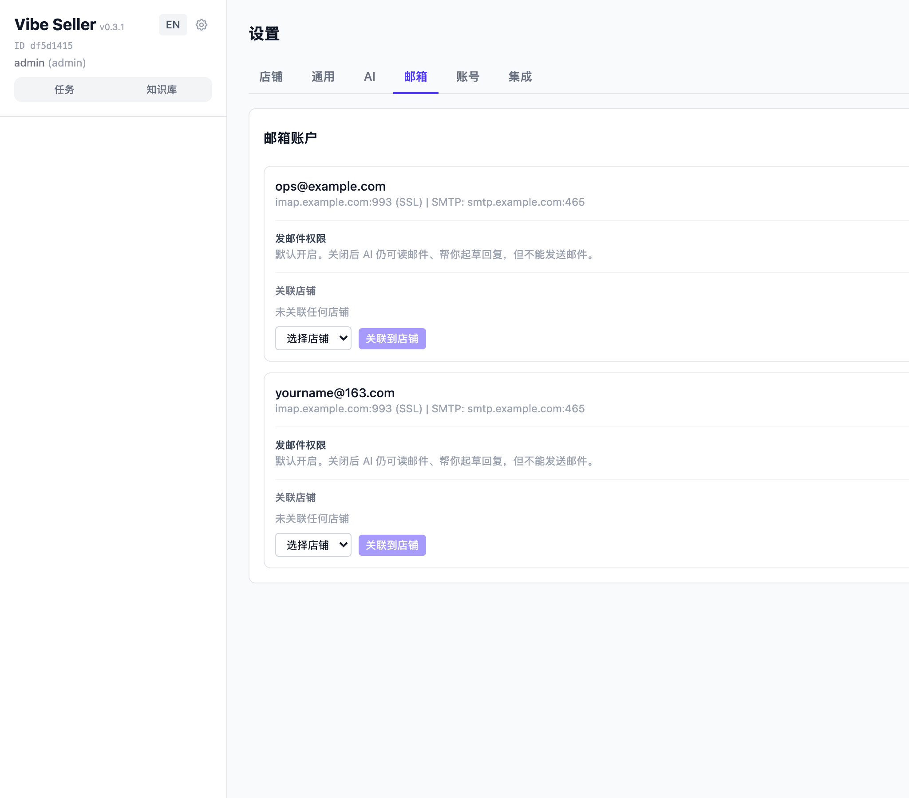
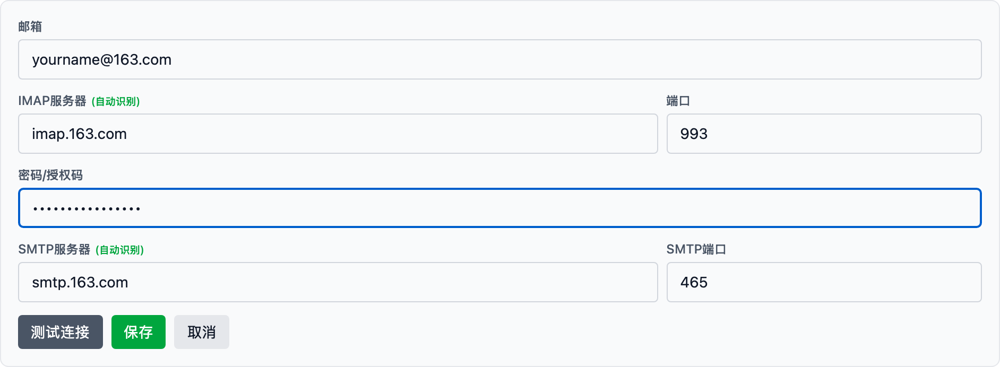
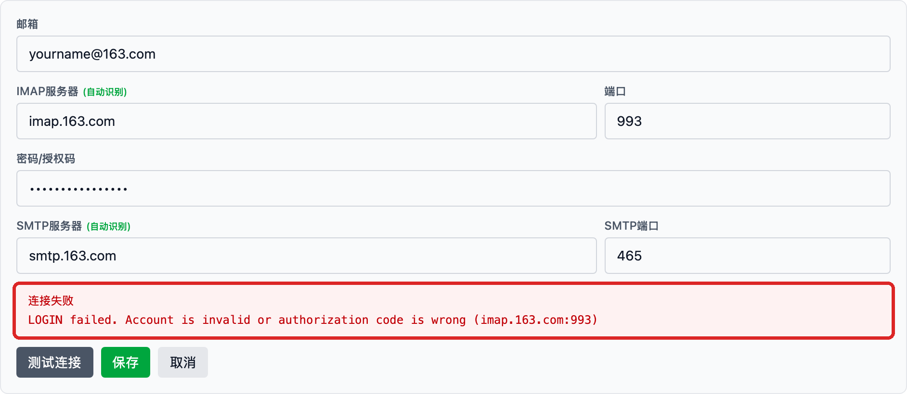
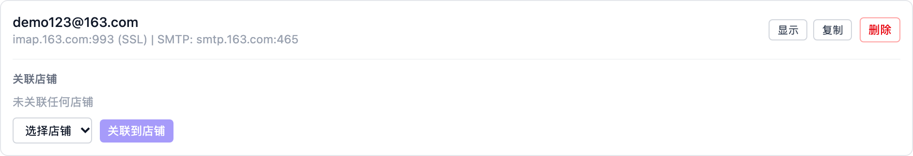
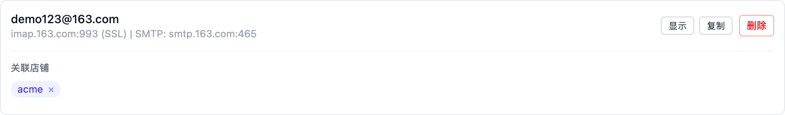
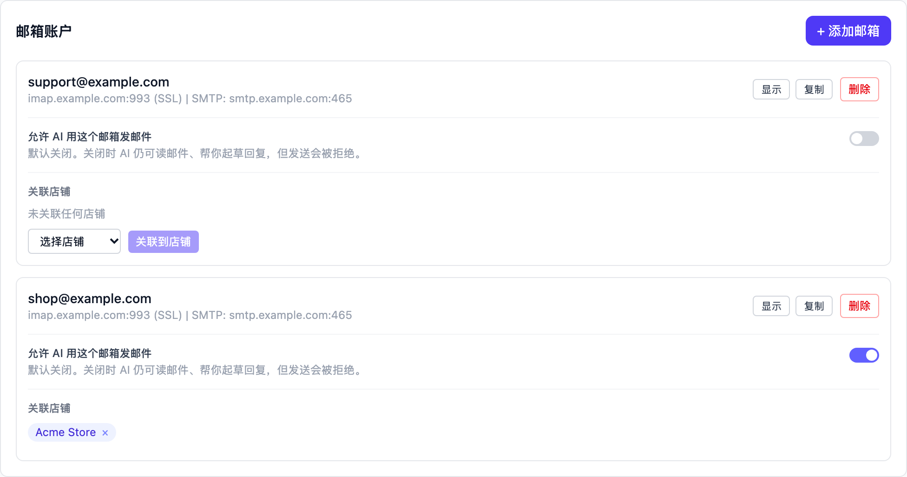

# 邮件接入

把客服邮箱接入 Vibe Seller 后，AI 执行任务时可以直接查询收件箱、按你的
要求归类整理、起草回复，还能直接把邮件发送出去，不需要再来回复制粘贴。
收发都走标准的 IMAP / SMTP 协议。

**不需要填写邮箱登录密码**：163、QQ 邮箱要填的是「授权码」，Gmail 要填
的是「应用专用密码」，下文按邮箱分别说明获取方法。

各集成分别配在哪里、彼此怎么分工，见[集成总览](integrations.md)。

## 常见需求

- **想让 AI 读取、整理客户邮件**：按下方对应邮箱的步骤添加邮箱，并关联
  到店铺，该店铺的任务即可读取邮件；
- **想让 AI 直接回复客户**：邮箱添加后即可发送——「发邮件权限」默认开启；
- **只想让 AI 读信和起草、不发送**：按[关闭发邮件权限](#关闭发邮件权限)
  关掉对应邮箱的开关；
- **在用 Outlook / Hotmail**：目前不支持接入，原因和替代办法见
  [Outlook / Hotmail：暂不支持](#outlook--hotmail暂不支持)。

## 接入前准备

- 一个你常用的邮箱（163 / 126 / yeah.net、QQ 邮箱、Gmail 都支持）；
- 该邮箱的**授权码**（或 Gmail 的应用专用密码）——各邮箱一节有图文步骤；
- Outlook / Hotmail 邮箱**暂不支持**，原因见
  [常见问题](#常见问题)。

## 网易邮箱（163 / 126 / yeah.net）

163、126、yeah.net 三个后缀的步骤相同：服务器会被自动识别，只需在网页
邮箱的「设置 → POP/SMTP/IMAP」入口完成开通操作。

### 第一步：获取客户端授权码

1. 登录[网页版邮箱](https://email.163.com/)（126 登录
   [126.com](https://email.126.com/)，yeah.net 同理），点击上方
   「设置 → POP/SMTP/IMAP」；
2. 在客户端协议页面，开启 **IMAP/SMTP 服务**（推荐开启 IMAP，
   它与网页版完全同步）；
3. 弹窗中点击「继续开启」，按提示用手机扫码或手动发送短信完成验证；
4. 验证通过后，页面会显示一串 **16 位客户端授权码**——
   **只显示这一次**，请立即复制保存。同一个授权码可以给多个客户端使用；
   以后要添加新客户端，点击「新增授权密码」再生成一个即可。

完整图文步骤见网易官方帮助「如何开启客户端协议？」——
[官方说明](https://help.mail.163.com/faqDetail.do?code=d7a5dc8471cd0c0e8b4b8f4f8e49998b374173cfe9171305fa1ce630d7f67ac2a5feb28b66796d3b)。

### 第二步：在 Vibe Seller 里添加

打开 Vibe Seller，进入「设置 → 邮箱」：

点击「+ 添加邮箱」：

1. 「邮箱」填写完整地址，如 `yourname@163.com`——光标离开输入框后，
   IMAP / SMTP 服务器会**自动识别**并填好（`imap.163.com`、`smtp.163.com`）；
2. 「密码/授权码」粘贴上一步获取的 16 位授权码；
3. 点击「测试连接」，看到「连接成功」后再点击「保存」。

授权码填错或服务未开启时，红框里会直接显示服务商的真实报错，
对照修正后重新测试：

保存后，邮箱出现在列表里；点击「关联到店铺」把它关联到店铺——
只有完成关联后，该店铺的任务中 AI 才能读取这个邮箱的邮件。

## QQ 邮箱

### 第一步：开启服务并获取授权码

1. 登录 [QQ 邮箱网页版](https://mail.qq.com/)，点击顶部「设置 → 账号与安全」；
2. 找到「POP3/IMAP/SMTP/Exchange/CardDAV 服务」区域，开启 **IMAP/SMTP
   服务**；
3. 按提示用绑定的手机号发送短信验证，点击「我已发送」；
4. 验证通过后弹出一串 **16 位授权码**——这是以后登录第三方客户端使用的
   专属密码，**不是 QQ 密码**，请复制保存。

授权码遗忘或泄露时，在「设置 → 账号与安全 → 设备管理 → 授权码管理」
中重置，旧的立即失效。（[官方说明](https://help.mail.qq.com/detail/0/1087)）

!!! note "企业邮箱（exmail）"
    腾讯企业邮箱的地址形如 `you@yourcompany.com`，服务器不同
    （`imap.exmail.qq.com` / `smtp.exmail.qq.com`），需要管理员先在
    管理后台开放 IMAP/SMTP 服务，再在网页版「设置 → 邮箱关联」中生成
    客户端授权码。添加时把自动识别的服务器改成上面两个地址即可。
    参见[腾讯官方说明](https://open.work.weixin.qq.com/help2/pc/19886)。

### 第二步：在 Vibe Seller 里添加

和网易邮箱相同：「设置 → 邮箱 → + 添加邮箱」，地址填
`yourname@qq.com`，密码栏粘贴 16 位授权码，点击「测试连接」通过后保存、
关联店铺。QQ 邮箱的服务器也会自动识别（`imap.qq.com`、`smtp.qq.com`）。

## Gmail

Gmail 使用的不是登录密码，而是**应用专用密码**（App Password），
前提是先开启两步验证。

### 第一步：开启两步验证

1. 打开 [Google 账号安全设置](https://myaccount.google.com/security)；
2. 在「您登录 Google 的方式」下点击 **两步验证**，按向导开启
   （[官方说明](https://support.google.com/mail/answer/185839)）。

### 第二步：生成应用专用密码

1. 开启两步验证后，打开
   [应用专用密码](https://myaccount.google.com/apppasswords) 页面；
2. 应用选择「其他（自定义名称）」，起一个容易识别的名字（如 `vibe-seller`），
   点击「生成」；
3. Google 会显示一个 **16 位密码**（分四组显示）——复制它。
   填入 Vibe Seller 时**忽略空格**，连成一串输入。

（[官方说明](https://support.google.com/mail/answer/185833)）

!!! note "Google Workspace（公司/学校）账号"
    公司或学校管理的 Google Workspace 账号，管理员可能**关闭了 IMAP
    或应用专用密码**——如果找不到「应用专用密码」入口或
    「转发和 POP/IMAP」标签，请联系管理员开启。

### 第三步：在 Vibe Seller 里添加

「设置 → 邮箱 → + 添加邮箱」，地址填 `yourname@gmail.com`，
密码栏粘贴 16 位应用专用密码（去掉空格），点击「测试连接」通过后保存、
关联店铺。服务器自动识别为 `imap.gmail.com`、`smtp.gmail.com`。

## Outlook / Hotmail：暂不支持

**Outlook.com、Hotmail、Live 邮箱目前无法接入。** 微软已全面停用这些邮箱的
密码登录（Basic Authentication），这类邮箱必须走 OAuth2 授权，
而 Vibe Seller 的接入方式是授权码或密码。用 Outlook 邮箱点击「测试连接」
会看到明确的报错（`Basic authentication is disabled.`），这不是配置问题。
如有需要，可以先把 Outlook 邮件转发到一个支持的邮箱再接入。

## 验证

按顺序确认三件事：

1. 「测试连接」显示「连接成功」——这一步验证的是收信（IMAP）；
2. **保存**后邮箱出现在列表里，且已**关联到店铺**；
3. 创建一个任务问 AI：“看看这个邮箱最近有什么邮件”，它能报出
   最近的邮件主题和发件人，就说明接入成功了。

## 关闭发邮件权限

邮箱**默认可以发邮件**：AI 能读取、整理、起草，也能直接发送。
如果不想让 AI 用某个邮箱发邮件（比如只想让它读和起草），可以**按邮箱**
单独关闭它的发邮件权限：

1. 进入「设置 → 邮箱」，在邮箱列表里找到那个邮箱；
2. 关闭卡片上的「**发邮件权限**」开关（变为灰色即为关闭）；
3. 各邮箱互不影响：关闭 A 邮箱后，B 邮箱仍可正常发送。

想恢复发邮件，把同一个开关重新打开即可。

**验证方法**：创建一个任务，让 AI「从这个邮箱给我自己（填你自己的另一个
邮箱）发一封测试邮件」。开关打开时，几分钟内你的邮箱会收到这封信；开关
关闭时，AI 会告诉你「这个邮箱的发送已被关闭」，并把起草好的邮件内容展示给你。

开关的改动立即生效。这个限制在服务器上执行，不依赖 AI 自觉：关闭发邮件
权限的邮箱，无论任务怎么写，都发不出邮件。

开关只能由你登录网页界面后亲自修改：任务里的 AI、通过 API Key 接入的外部
AI 客户端都无法改动它。**前提是你开启了登录验证**——如果在设置里关闭了
登录，服务器就无法区分「网页界面的操作」和「AI 不带凭证直接发出的请求」，
此时这个开关挡不住有意绕过的 AI。多人使用或在意这一点时，请保持登录开启。

## 接入后 AI 能做什么

- **读邮件**：查询收件箱，按主题、发件人或时间检索，读取正文和附件清单。
  邮件每 5 分钟自动同步到本地，任务里也可以让它立刻同步一次；
- **归类整理**：按你的规则把邮件分组、提取要点、汇总成表格或清单；
- **发邮件**：起草回复并按你的要求发送。每个邮箱的「发邮件权限」开关
  默认开启，可以按邮箱关闭（见[关闭发邮件权限](#关闭发邮件权限)）。
  关闭后，AI 会把起草好的邮件展示给你，由你自己发送，或重新打开开关后
  再让 AI 发送。
  想发送前先过目，在任务里加一句“发前给我看”即可。

邮件只在你的本地部署里收发和存储：邮箱密码加密保存，邮件同步到本机的
数据库，任务里的 AI 通过受控的工具读写，不会把邮件内容发送到别处。

## 常见问题

<b>「测试连接」失败，提示 "LOGIN Login error or password error"？</b>

这是邮箱服务器拒绝了登录，通常是这两种情况：

- **授权码填错了**（或填成了登录密码）。163、QQ 邮箱的密码栏必须填
  16 位授权码，不是登录密码；
- **IMAP/SMTP 服务没有开启**。回到邮箱网页版的设置，确认服务处于开启状态。

修正后重新点击「测试连接」，具体原因会直接显示在红框里。

<b>提示「这个邮箱已经添加过了」？</b>

回到列表里找到这个邮箱即可；想更换授权码，先删除旧的，再重新添加。

<b>QQ 邮箱只能收到最近 30 天的邮件？</b>

QQ 邮箱默认只向第三方客户端开放最近 30 天的邮件。在邮箱网页版
「设置 → 账号与安全」的服务区域，把「收取选项」从「最近 30 天」
改为「全部」即可。

<b>添加时没有自动识别服务器怎么办？</b>

自动识别覆盖了常见邮箱（163、126、yeah.net、QQ、Gmail 等）。
没有识别出的域名会按 `imap.你的域名` 猜测一个地址，通常不正确——
请按邮箱服务商提供的服务器地址手动填写。IMAP 一般是 993 端口
（SSL），SMTP 一般是 465（SSL）或 587。

<b>为什么 AI 说没找到新邮件？</b>

邮件每 5 分钟自动同步一次；刚收到的邮件稍等即可，或在任务里让它
「立刻同步一次」再查询。另外确认邮箱已经**关联到对应店铺**——
未关联的邮箱，店铺任务里的 AI 读取不到。

<b>AI 说不能发邮件？</b>

AI 回复「某某邮箱的发送已被关闭」这类话，说明这个邮箱的
「**发邮件权限**」开关被关闭了（邮箱默认是开启的，一定是有人在设置里
关过）。到「设置 → 邮箱」，在对应邮箱的卡片上重新打开，再让任务
重新发送即可。

开关是开着的却仍发不出去，再看两点：卡片上有没有配置 SMTP 服务器
（显示「未配置SMTP」就发不出去）；授权码是否有效（163、QQ 发信同样使用
授权码）。

<b>怎么更换授权码 / 移除邮箱？</b>

授权码更换后：先在邮箱列表里**删除**旧账户，再用新授权码重新添加。
删除会同时解除和店铺的关联，不会删除邮箱里的邮件。

<b>Outlook / Hotmail 能用吗？</b>

目前不支持，详见上面的
[Outlook / Hotmail 一节](#outlook--hotmail暂不支持)。
微软已停用密码登录，接入需要 OAuth2 支持。

