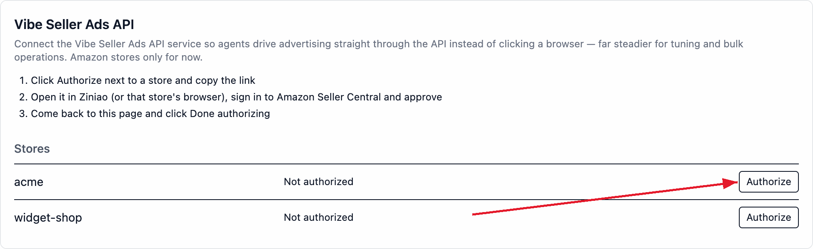
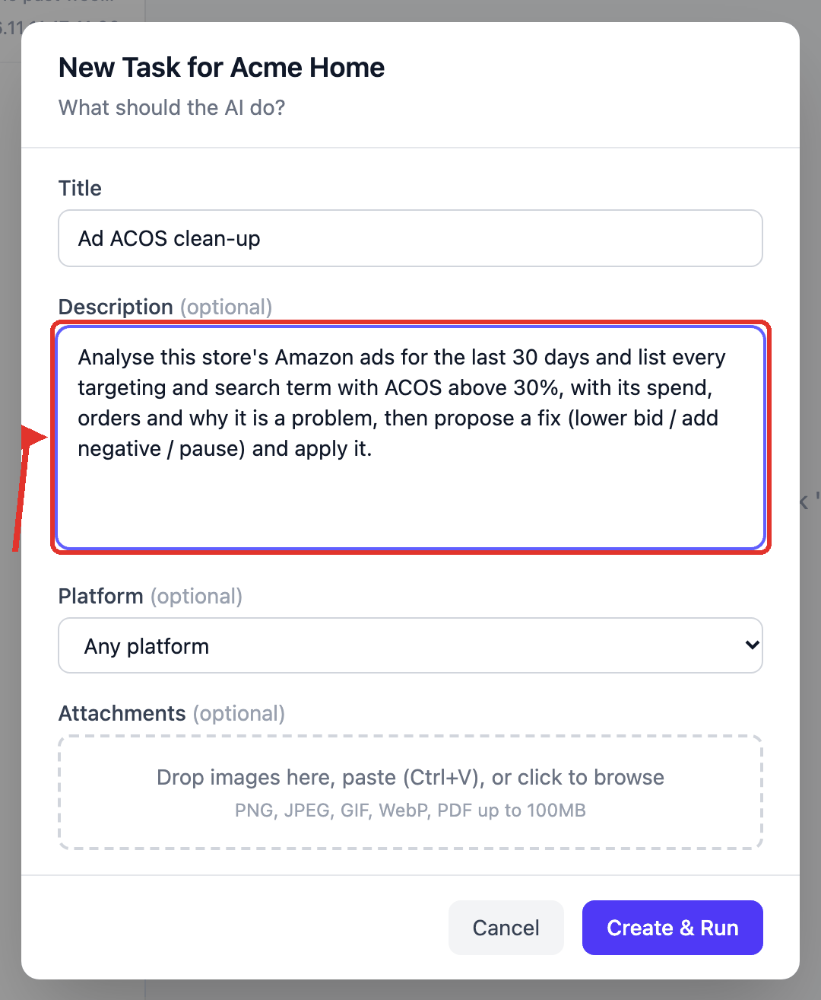

# Analyse ad ACOS, get optimisation advice for anything above 30%, and apply it

Create one task under a store and have it read that store's Amazon ads for the
last 30 days: every targeting and search term above 30% ACOS goes into a table —
spend, orders, current bid, what to do about it — and it then applies the rows
you approve.

**Saying "and apply it" in the description does not let it edit the account on
the spot**: it shows you the list of changes first and stops. It touches the
account only after you reply with which rows to run, and it runs exactly those.

This is a one-off task: create it, and it runs once. Setup takes about 15
minutes (not counting the Amazon ad authorization).

## What you need first

- A store with its browser backend bound (see [Stores & Browsers](stores.md));
- Optional but strongly recommended: this store's **Amazon Ads authorization**.
  Reading the numbers over the API is far faster and steadier than having the AI
  click through pages.

## 1. (Optional) Authorize the Ads API for this store

Open **Settings → Integrations → Vibe Seller Ads API**. The table lists every
store, one row each; click **Authorize** next to this store and the link is
copied to your clipboard.

Open that link in **this store's own browser** (its Ziniao window, or the Chrome
it uses), sign in with that store's seller account and consent, then come back
and click **Done authorizing**. The authorization belongs to the store, not to
you, and only an admin can authorize or revoke it.

It also runs without the authorization: the AI drives the store's browser into
the ad console and reads it page by page — just slower. The measured comparison
and how to authorize several marketplaces are in
[Amazon Ads API setup](ads-api.md).

## 2. Create the task in the store

**Tasks** in the sidebar → **select this store** on the left → **New Task**. The
dialog is titled "New Task for {store}" — a store task acts on that one store, so
there is no execution mode to pick.

**Title**: "Ad ACOS clean-up"

**Description** (copy this block, and replace 30% with your own line):

> Analyse this store's Amazon ads for the last 30 days and list every targeting
> and search term with ACOS above 30%, with its spend, orders and why it is a
> problem, then propose a fix (lower bid / add negative / pause) and apply it.

Click **Create & Run** and the task starts right away. Store tasks default to
**auto mode**: it plans and executes without a separate approval step (to see the
plan first, flip the **Auto / Review** switch at the bottom of the task detail —
see [Auto mode vs Review mode](using-tasks.md#auto-mode-vs-review-mode)).

It starts by reading the store's ad data: over the API when the store is
authorized, through the store's browser when it isn't. The analysis window is the
last 30 days by default, and the window you write in the description wins.

## 3. Write the store's rules into its notes

The 30% in the description governs this task only; what the store lives by for
good goes in its `notes.md` — **Knowledge** → pick the store → `notes.md`. **This
is your note to the AI**: every task on this store reads it before it starts and
then follows it.

Write anything, in plain language: which SKU is a new launch, what ACOS it takes
before it needs touching, what not to do in the week before a big sale. The AI
reads and applies it as part of its own judgement — there's no format to fit.

The same file has a second use: a few `key: value` lines that override the
built-in defaults the server checks per store. The two you'll use most:

| Key | Default | What it governs |
|---|---|---|
| `acos_no_lower` | 25 | don't propose bid cuts on rows whose ACOS is under this |
| `margin` | 25 | your store's margin; the AI derives target ACOS and cut-off lines from it |

Those lines have to be in the store's **top-level `notes.md`**, one entry per
line — a key buried in a sentence doesn't count. All keys and their rules:
[Store notes and parameter overrides](knowledge.md#store-notes-and-parameter-overrides).
Where the notes and this task's description disagree, the description wins.

## What you get when it finishes

The task holds a table sorted by ACOS first: every row with its spend, orders,
current bid and one proposal, and under the table a line saying the ad account
was not touched.

That is where it waits for you. Type one line in the box below saying which rows
to run, and it continues:

Only the rows your reply names get executed — "all of them", "the first 3 as
proposed", "not the two pauses yet" all work. When it starts executing it
**freezes** that approved list, then re-reads the console row by row; a change
outside the list, or at a value the list doesn't say, is refused. Reply "nothing"
and it just keeps the report.

If it shows a choice card asking which ones to change, still answer in the
message box — a pick on the card doesn't count as your go-ahead.

## Questions this example gets

**Will it edit my ads on its own?**
No. The analysis phase only produces the list; execution needs your reply in the
task, naming the rows. After that it works through that exact list, and a change
outside the list is refused.

**What does one run cost?**
Cost grows with the number of campaigns and search terms. A store with 20-plus
campaigns and about 450 search terms, over the Ads API, came to roughly 0.45 USD
for one run; a typical store with 10 campaigns or fewer works out to about
0.20 USD. The same task without the API, driving the browser instead, costs
several times more — see the [Measured comparison](ads-api.md#measured-comparison).

**Is the result kept?**
The table and the data files stay in this task's working folder and download from
the panel at the bottom of the task; conclusions worth keeping across tasks go
into the store's knowledge. Ask "run the last 90 days too" and it continues in the
same task — statuses and Continue vs Re-run are in
[Continue, retry, stop, delete](using-tasks.md#continue-retry-stop-delete).

---

Want it every week instead? Turn the same description into a schedule: **Tasks**
in the sidebar → **Scheduled** → **New Schedule**, frequency every 1 weeks —
see [Scheduled Tasks](schedules.md).
