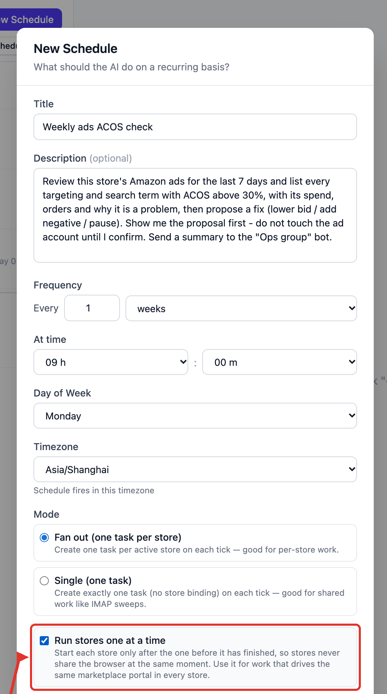
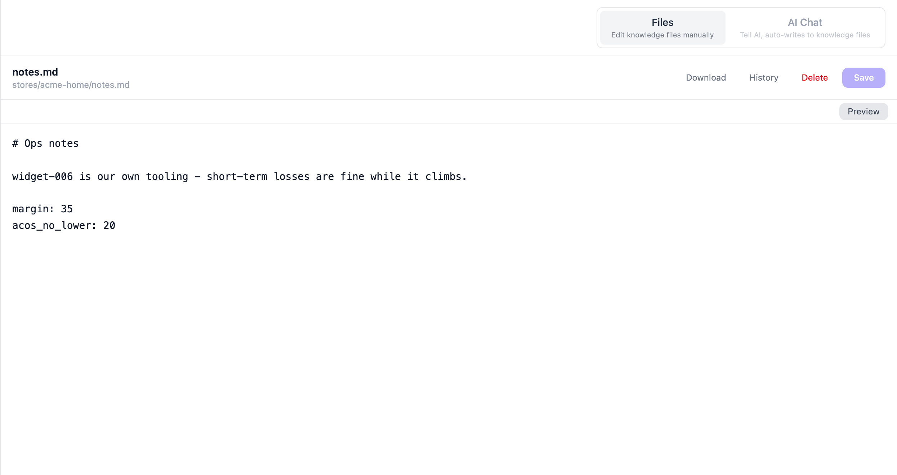
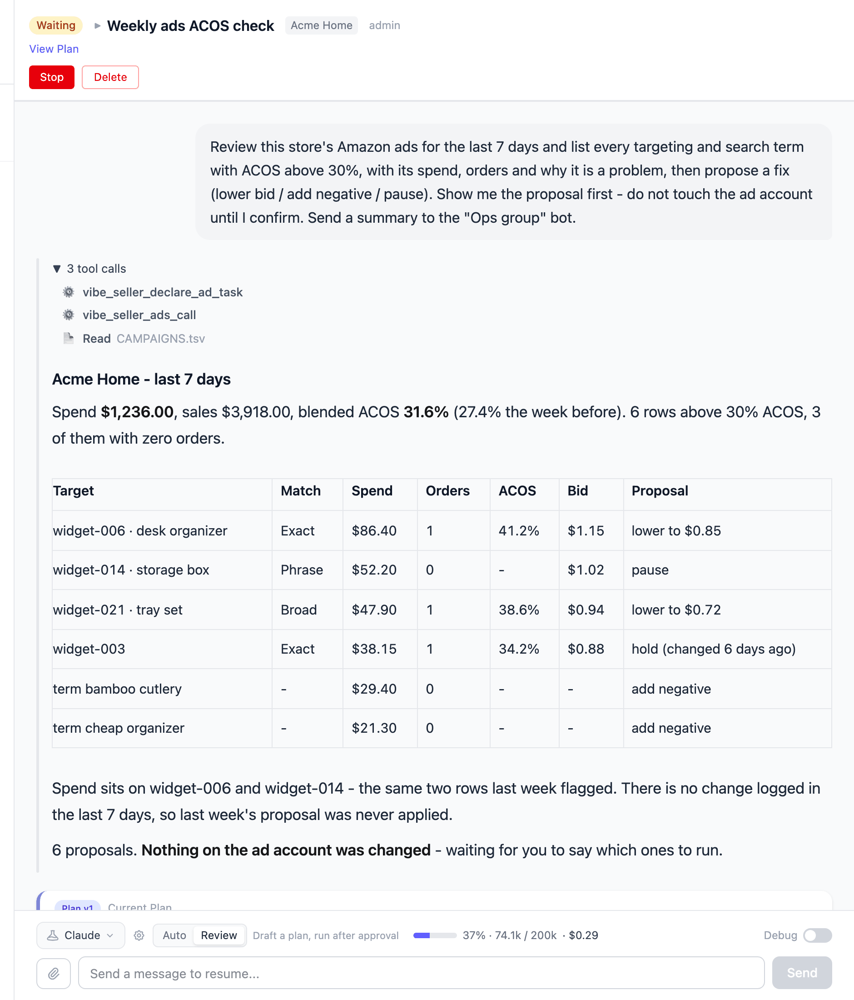
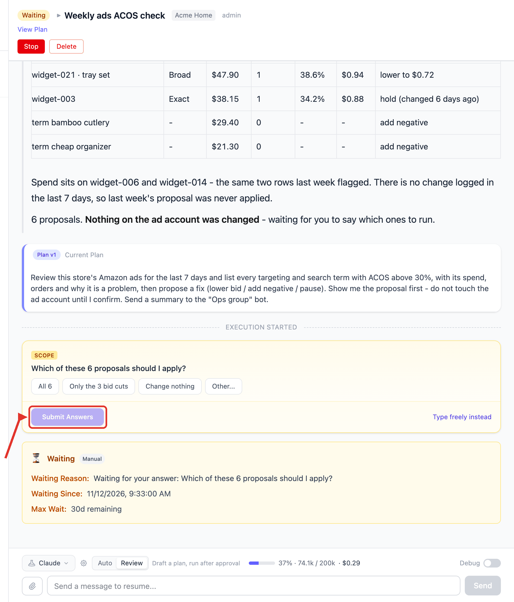

# Check ads every week, propose fixes above 30% ACOS, and alert me

Every Monday morning Vibe Seller looks over this store's Amazon ads for the last
7 days and puts everything with ACOS above 30% into one table: spend, orders,
current bid, and what to do about it. The list goes to your WeCom group, and
**nothing on the ad account changes** — it touches the account only after you
reply with which proposals to run.

Setup takes about 15 minutes (not counting the Amazon ad authorization); after
that it runs weekly by itself.

## What you need first

- A store with its browser backend bound (see [Stores & Browsers](stores.md));
- A group bot (see [Chat bots](chat-bots.md) — the same one the
  [mailbox example](example-email-wecom.md) uses);
- Optional but strongly recommended: this store's **Amazon Ads authorization**.
  Reading the numbers over the API is far faster and steadier than having the AI
  click through pages.

## 1. (Optional) Authorize the Ads API for this store

Open **Settings → Integrations → Vibe Seller Ads API**. The table lists every
store, one row each; click **Authorize** next to this store and the link is
copied to your clipboard.

Open that link in **this store's own browser** (its Ziniao window, or the Chrome
it uses), sign in with that store's seller account and consent, then come back
and click **Done authorizing**. The authorization belongs to the store, not to
you, and only an admin can authorize or revoke it.

It also runs without the authorization: the AI drives the store's browser into
the ad console and reads it page by page — just slower. The measured comparison
and how to authorize several marketplaces are in
[Amazon Ads API setup](ads-api.md).

## 2. Create the schedule

Checking one store only? **Select that store** on the left before creating the
schedule. Every store? Stay on **All Stores** and use **Fan out** (next section).

**Tasks** in the sidebar → **Scheduled** → **New Schedule**.

**Title**: "Weekly ads ACOS check"

**Description** (copy this block, and replace 30% with your own line):

> Review this store's Amazon ads for the last 7 days and list every targeting
> and search term with ACOS above 30%, with its spend, orders and why it is a
> problem, then propose a fix (lower bid / add negative / pause). Show me the
> proposal first - do not touch the ad account until I confirm. Send a summary
> to the "Ops group" bot.

**Frequency**: every 1 weeks, **Day of Week** "Monday", **At time** 09:00,
**Timezone** your own zone.

**Which mode under All Stores**:

| Situation | Pick |
|---|---|
| Every store needs the ad console logged in | **Fan out** + tick **Run stores one at a time** |
| Very few stores, or the Ads API is authorized | **Fan out**, no need to tick it |
| You only want one cross-store summary | **Fan out**; the AI registers a finalize step when it needs the merge |

**Run stores one at a time** finishes one store before starting the next, so
browser profiles on the same machine don't push each other out; a store that
fails in the middle doesn't stop the ones after it. The two scopes and both modes
are laid out in [Two scopes and the execution modes](schedules.md#two-scopes-and-the-execution-modes).

## 3. When one store should live by different numbers

The 30% in the description governs this task only. Some thresholds are checked by
the server per store, and to change those for good, open this store's `notes.md`
under **Knowledge** and add one `key: value` per line:

The two you'll use most:

| Key | Default | What it governs |
|---|---|---|
| `acos_no_lower` | 25 | don't propose bid cuts on rows whose ACOS is under this |
| `margin` | 25 | your store's margin; the AI derives target ACOS and cut-off lines from it |

It has to be the store's **top-level `notes.md`**, one entry per line — a key
buried in a sentence doesn't count. All keys and their rules:
[Store notes and parameter overrides](knowledge.md#store-notes-and-parameter-overrides).
Whatever you write in the task description always outranks these defaults.

## What you get after it runs

After 09:00 on Monday, that round's task holds a table sorted by ACOS:

Under the table it says it changed nothing on the ad account and is waiting for
you. The conversation shows a question card whose options are "All 6 / Only the 3
bid cuts / Change nothing":

Pick one, click **Submit Answers**, and only then does it make the changes — each
result lands in the same run record. Choose "Change nothing" and it just keeps the
report.

## Questions this example gets

**Will it edit my ads on its own?**
No. The check phase only produces a proposal; execution needs your reply in the
task. After you reply it works through that exact list, and a change outside the
list is refused.

**The summary didn't reach the group?**
First check that **Test** on the bot works, then compare the group name in the
description with the bot's name. Chat bots only send out: the AI can't read group
replies, so "go ahead and apply it" has to be said in this task in Vibe Seller,
not in the group.

**What does one run cost?**
Cost grows with the number of campaigns and search terms. A store with 20-plus
campaigns and about 450 search terms, over the Ads API, came to roughly 0.45 USD
for one run; a typical store with 10 campaigns or fewer works out to about
0.20 USD. The same task without the API, driving the browser instead, costs
several times more — see the [Measured comparison](ads-api.md#measured-comparison).
