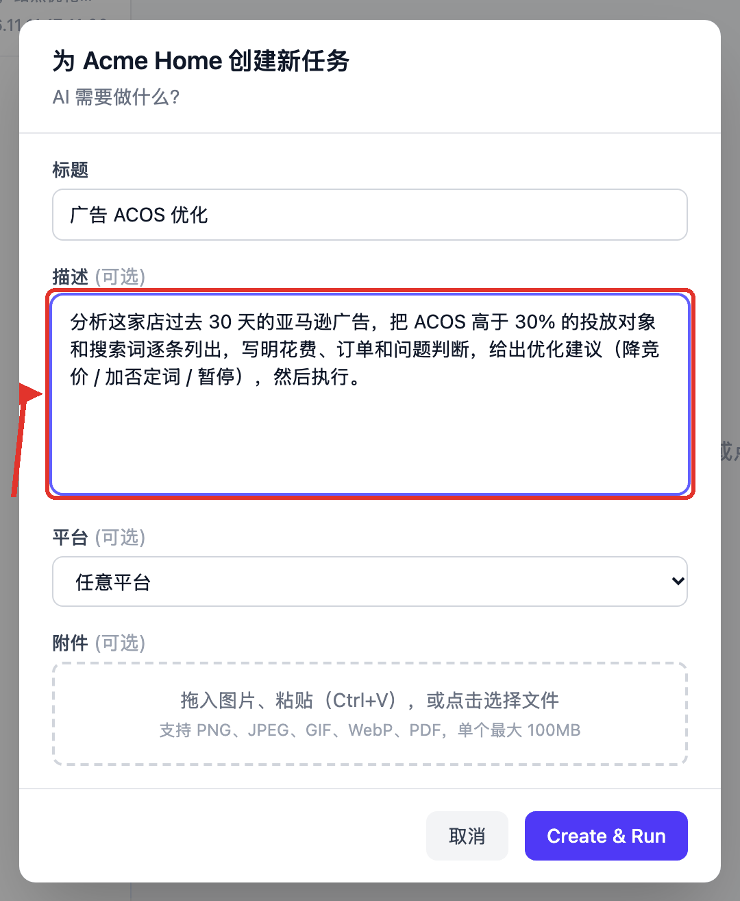

# 分析广告 ACOS，高于 30% 的给出优化建议并执行

在店铺里建一个任务，让它把这家店过去 30 天的广告看一遍：ACOS 高于 30% 的投放对象
和搜索词列成一张表，写明花费、订单、当前竞价和建议怎么改，然后照你的确认去执行。

**描述里写了「然后执行」，广告账户也不会当场被改**：它先把要改的清单摆在你面前并
停下来，你回一句要执行哪几条，它才动手，而且只改你点名那几条。

这是一次性任务，建完就跑一次。设置约 15 分钟（不含亚马逊广告授权）。

## 需要准备

- 一个店铺，浏览器后端已经绑好（见[店铺与浏览器](stores.md)）；
- 可选但强烈建议：这个店铺的**亚马逊广告授权**。走接口比让 AI 一格一格点
  网页快得多，也更稳。

## 1.（可选）给店铺授权广告 API

打开「设置 → 集成 → Vibe Seller 广告 API 服务」，在店铺列表里找到这家店，
点它旁边的「授权」，链接会自动复制到剪贴板。

到**这家店自己的浏览器**（紫鸟窗口或它用的 Chrome）里打开链接，用这家店的
卖家账号登录并同意，回到页面点「授权完成」。授权记在店铺上，不记在人上，
只有管理员能授或撤。

没授权也能跑：AI 会用店铺浏览器进广告后台一页页读，只是慢。两种方式的实测
对比、多站点怎么授权，见[广告 API 接入](ads-api.md)。

## 2. 在店铺里新建任务

侧栏「任务」→ 左边**选中这家店** →「新建任务」。弹窗标题会写明
「为 {店铺} 创建新任务」——店铺任务只作用于这一家店，不用挑执行模式。

**标题**：「广告 ACOS 优化」

**描述**（复制这段，把 30% 换成你的红线）：

> 分析这家店过去 30 天的亚马逊广告，把 ACOS 高于 30% 的投放对象和搜索词逐条列出，
> 写明花费、订单和问题判断，给出优化建议（降竞价 / 加否定词 / 暂停），然后执行。

点「Create & Run」，任务立刻开始跑。店铺任务默认是**自动模式**：建完就执行，
不再中途等你审计划（想先看方案，把任务详情底部的「自动 / 先审核」开关切到
「先审核」，见[自动模式与先审核模式](using-tasks.md#自动模式与先审核模式)）。

它会先读这家店的广告数据：授权过的走接口，没授权的用店铺浏览器进广告后台读。
默认按最近 30 天算，你在描述里写的窗口优先。

## 3. 想让这家店长期按别的口径来

描述里的 30% 只管这一次任务。有些阈值是服务器按店铺校验的默认值，想长期改掉，
在「知识库」里打开这家店的 `notes.md`，一行一个 `键: 值`：

常用的两个：

| 键 | 默认 | 管什么 |
|---|---|---|
| `acos_no_lower` | 25 | ACOS 低于这个数的词，不建议降竞价 |
| `margin` | 25 | 你店的毛利，AI 用它推目标 ACOS 和止损线 |

必须是店铺根目录的 `notes.md`，一行一条；写在句子中间不算。全部键和取值规则见
[店铺笔记与参数覆盖](knowledge.md#店铺笔记与参数覆盖)。你在任务描述里写的标准，
永远优先于这些默认值。

## 跑完你会看到

任务里先是一张按 ACOS 排好的表：每一行带着花费、订单、当前竞价和一条建议，
表下面写明它没有改动广告账户。

这就是等你回话的地方。你在下面输入框里写一句，说清要执行哪几条，它就继续：

回复里点名要改的行才会被执行——「都改」「前 3 条照建议改」「暂停那两条先不动」
都行。它进入执行阶段时会把你批准的这份清单**冻结**下来，改完逐条回查，
超出清单的行、和清单上不一致的数值都会被拦下。你回「都不改」，它就只把报告留着。

如果它顺手用选项卡片问你要改哪几条：**卡片上的选择不算这条确认**。改动要花你的钱，
服务器只认你在任务里发出的那句话——卡片上的点选不是一条消息。

## 常见问题

**它会不会自己把广告改了？**
不会。分析阶段只出清单；要执行，得你在任务里回一句，回复里点名哪几条。之后它按
当时那份清单逐条执行，改动超出清单会被拦下。

**跑一次大概花多少？**
花费随广告活动和搜索词的数量增长。二十多个活动、约 450 个搜索词的店，
走广告 API 一次约 3 元；活动不超过 10 个的常见店铺，粗算 1 元上下。
没授权 API、走浏览器的同一任务会贵出数倍，见[实测对比](ads-api.md#实测对比)。

**结果能存下来吗？**
表和数据文件都留在这个任务的工作目录里，任务详情底部可以直接下载；跨任务要用的
结论由 AI 写进这家店的知识库。追问一句「把过去 90 天也跑一遍」就在同一个任务里
接着做，各状态和「继续 / 重试」的区别见
[继续、重试、停止和删除](using-tasks.md#继续重试停止和删除)。

---

想每周都跑一遍？把它变成定时任务：侧栏「任务」→ 定时 →「新建定时任务」，
描述照抄上面那段，频率选每 1 周，见[定时任务](schedules.md)。
