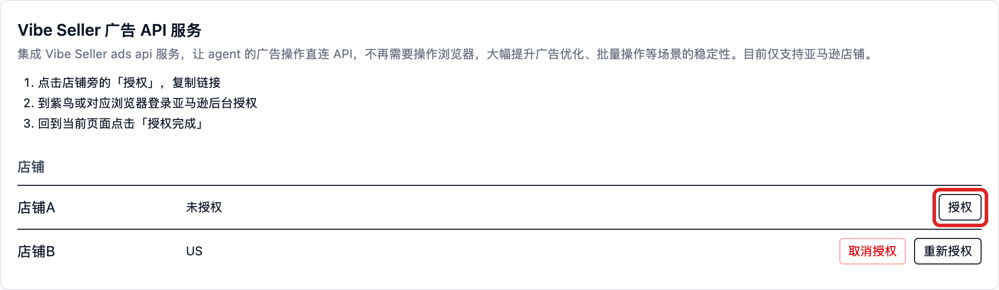
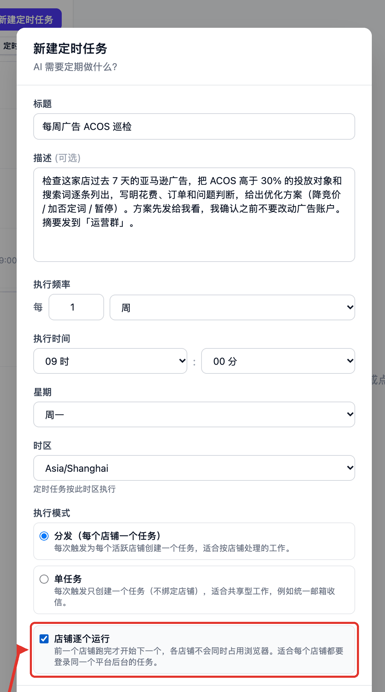
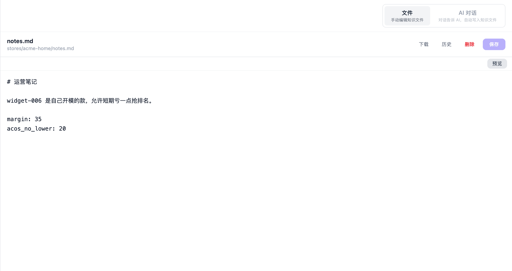
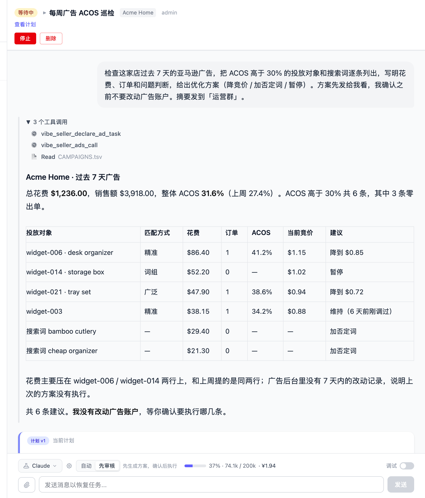
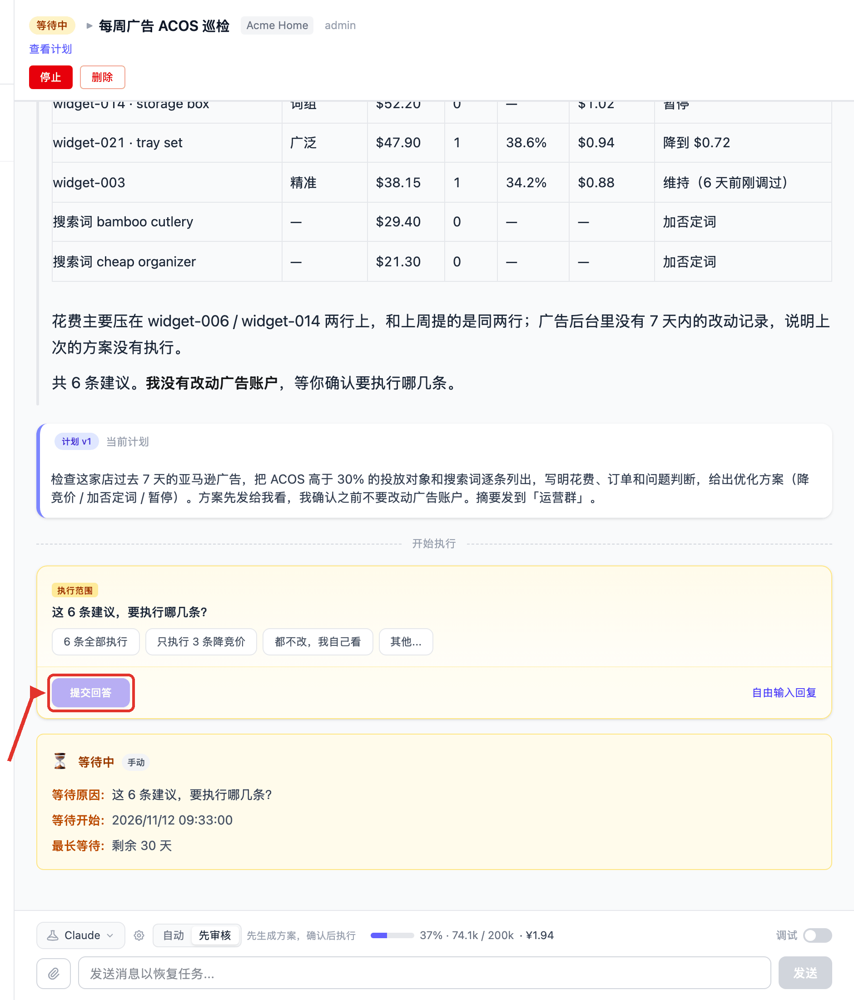

# 每周检查广告，ACOS 超过 30% 的给出优化方案并提醒

每周一早上，Vibe Seller 自己看一遍这家店过去 7 天的广告，把 ACOS 高于 30% 的
投放对象和搜索词列成一张表：花费、订单、当前竞价、建议怎么改。清单发到企业微信
群，**广告账户不会有任何改动**——你回复要执行哪几条，它才动那几条。

配置一次约 15 分钟（不含亚马逊广告授权），之后每周自动跑。

## 需要准备

- 一个店铺，浏览器后端已经绑好（见[店铺与浏览器](stores.md)）；
- 一个群机器人（见[群机器人](chat-bots.md)，和
  [邮箱示例](example-email-wecom.md) 用的是同一个）；
- 可选但强烈建议：这个店铺的**亚马逊广告授权**。走接口比让 AI 一格一格点
  网页快得多，也更稳。

## 1.（可选）给店铺授权广告 API

打开「设置 → 集成 → Vibe Seller 广告 API 服务」，在店铺列表里找到这家店，
点它旁边的「授权」，链接会自动复制到剪贴板。

到**这家店自己的浏览器**（紫鸟窗口或它用的 Chrome）里打开链接，用这家店的
卖家账号登录并同意，回到页面点「授权完成」。授权记在店铺上，不记在人上，
只有管理员能授或撤。

没授权也能跑：AI 会用店铺浏览器进广告后台一页页读，只是慢。两种方式的实测
对比、多站点怎么授权，见[广告 API 接入](ads-api.md)。

## 2. 创建定时任务

只巡检一家店，就在左边**选中这家店**再建任务；每家店都要查，就留在
「全部店铺」，用「分发」（下一节）。

侧栏「任务」→ 定时 → 「新建定时任务」。

**标题**：「每周广告 ACOS 巡检」

**描述**（复制这段，把 30% 换成你的红线）：

> 检查这家店过去 7 天的亚马逊广告，把 ACOS 高于 30% 的投放对象和搜索词逐条
> 列出，写明花费、订单和问题判断，给出优化方案（降竞价 / 加否定词 / 暂停）。
> 方案先发给我看，我确认之前不要改动广告账户。摘要发到「运营群」。

**执行频率**：每 1 周，**星期**选「周一」，**执行时间** 09:00，
**时区**选你所在时区。

**全部店铺时怎么选执行模式**：

| 情况 | 怎么选 |
|---|---|
| 每家店都要登录广告后台看数据 | 「分发」+ 勾「店铺逐个运行」 |
| 店铺很少，或者已授权广告 API | 「分发」，不用勾逐个运行 |
| 只想看一份跨店汇总，不在意逐店细节 | 「分发」，AI 需要汇总时会自己注册汇总步骤 |

「店铺逐个运行」让一家店跑完再跑下一家，避免同一台机器上的浏览器档案互相挤兑；
中间某家店失败不影响后面的店继续。两种范围的区别见
[定时任务](schedules.md#选哪种范围与执行模式)。

## 3. 想让这家店长期按别的口径来

描述里的 30% 只管这一次任务。有些阈值是服务器按店铺校验的默认值，想长期改掉，
在「知识库」里打开这家店的 `notes.md`，一行一个 `键: 值`：

常用的两个：

| 键 | 默认 | 管什么 |
|---|---|---|
| `acos_no_lower` | 25 | ACOS 低于这个数的词，不建议降竞价 |
| `margin` | 25 | 你店的毛利，AI 用它推目标 ACOS 和止损线 |

必须是店铺根目录的 `notes.md`，一行一条；写在句子中间不算。全部键和取值规则见
[店铺笔记与参数覆盖](knowledge.md#店铺笔记与参数覆盖)。你在任务描述里写的标准，
永远优先于这些默认值。

## 运行后你会看到

每周一 09:00 之后，这一轮的任务里是一张按 ACOS 排好的表：

表下面写着它没有改动广告账户，等你确认。这时对话里会出现一张问题卡片，
选项就是「全部执行 / 只执行降竞价的那几条 / 都不改」：

选完点「提交回答」，它才去改，改完在同一份执行记录里留下每一条的结果。
你选「都不改」，它就只把报告留着，什么都不做。

## 常见问题

**它会不会自己把广告改了？**
不会。巡检阶段只出方案；要执行，得你在任务里回复。你回复之后它按当时那份
清单逐条执行，改动超出清单的行会被拦下。

**摘要没进群？**
先确认机器人「测试」能通，再看描述里的群名和机器人名称是不是同一个。
群机器人只出不进：AI 读不到群里的回复，所以「确认执行」要在 Vibe Seller
的这条任务里做，不是在群里回一句。

**跑一次大概花多少？**
花费随广告活动和搜索词的数量增长。二十多个活动、约 450 个搜索词的店，
走广告 API 一次约 3 元；活动不超过 10 个的常见店铺，粗算 1 元上下。
没授权 API、走浏览器的同一任务会贵出数倍，见[实测对比](ads-api.md#实测对比)。
