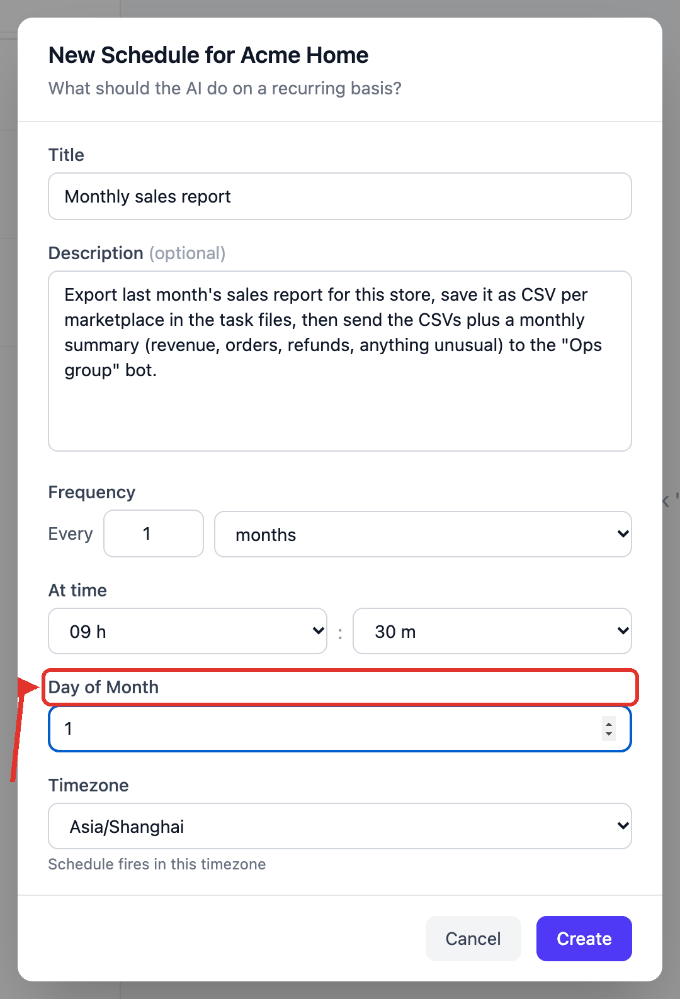
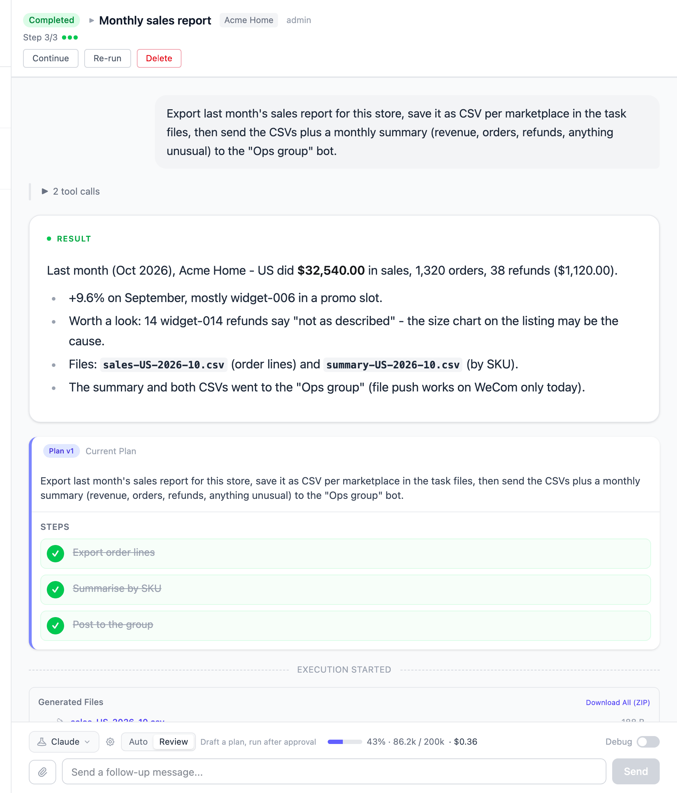

# Export last month's sales report every month and post it to the group

At 09:30 on the 1st of each month Vibe Seller uses this store's own browser to
get into Seller Central, exports **last month's** sales data, saves it as CSV per
marketplace in the task files, and sends the monthly summary — revenue, orders,
refunds, anything unusual — together with those CSVs to your WeCom group.

Setup takes about 5 minutes; after that it runs once a month by itself.

## What you need first

- A store with its browser backend bound and able to sign in to the seller
  console (see [Stores & Browsers](stores.md));
- A **WeCom** group bot: file delivery works on WeCom only today — DingTalk,
  Feishu and Slack bots can send text but not files (see
  [Chat bots](chat-bots.md)).

## 1. Add the group bot

Exactly the same as [step 1 of the mailbox example](example-email-wecom.md#1-add-the-group-bot):
**Settings → Integrations → Chat bots** → **Add Bot**, paste the Webhook URL,
**Save**, then **Test**.

## 2. Create the schedule

On the **Tasks** page in the sidebar, **select this store** on the left (reports
are exported per store, and a store task has no mode to choose), switch to the
**Scheduled** sub-tab and click **New Schedule** — the dialog is titled "New
Schedule for {store}".

**Title**: "Monthly sales report"

**Description** (copy this block, and replace the group name with yours):

> Export last month's sales report for this store, save it as CSV per marketplace
> in the task files, then send the CSVs plus a monthly summary (revenue, orders,
> refunds, anything unusual) to the "Ops group" bot.

**Frequency**: every 1 months; **Day of Month**: 1; **At time**: 09:30;
**Timezone**: the zone you work in — the schedule fires in that zone. The report
always covers the **previous calendar month**, so any of the first few days works.

Click **Create**. The AI drafts the plan right away (export order lines →
summarise by SKU → post to the group), freezes it on the schedule, and the status
becomes **Ready**; every later month runs that plan — see
[The plan is authored once, at creation](schedules.md#the-plan-is-authored-once-at-creation).

You don't restate "last month" each time: on every fire it works out the previous
calendar month from the date then. Exporting Amazon reports is something the
built-in report skill already knows: Business Reports, FBA, tax documents and ad
reports — the entry points and the download steps are covered, so you don't have
to teach it.

## 3. Several stores: one schedule each

Per-store schedules are the clearest way to do reports: create a "Monthly sales
report" under each store and each posts its own files to the group. **All Stores ·
Fan out** covers every store in one schedule too, but each store's task sends its
own files, so the group gets N messages — with many stores, separate schedules
read better. Scopes are compared in
[Two scopes and the execution modes](schedules.md#two-scopes-and-the-execution-modes).

## What you get after it runs

Open that round's run on the **Tasks** page: the result is numbers, and a file
list.

At the same time the WeCom group gets the summary with those CSVs under it. You
can also take them from the **Generated Files** panel at the bottom of the task,
or click **Download All (ZIP)**.

## Where the files live

- **This run's files** are in the task's working directory (on the server:
  `~/.vibe-seller/tasks/<task id>/`); the result report usually names the paths;
- **Important outputs are archived by the AI** into this store's **Run Data**,
  bucketed by month — open the **Knowledge** page, pick the store, and browse or
  download from there. When a later run needs the same data, it reads the files
  already there instead of scraping page by page again; that's why report tasks
  get faster over time, see [Run Data](knowledge.md#run-data).

## Questions this example gets

**DingTalk / Feishu / Slack groups don't get the files?**
File delivery is WeCom-only today (5 bytes to 20 MB per file). On other platforms
the summary still arrives; take the files from the task or from the store's Run
Data.

**Weekly instead, or a month I missed?**
For weekly, set the frequency to every 1 weeks, pick a day and say the window in
the description ("the previous calendar week"). To back-fill a month you skipped,
don't touch the schedule — open any run and ask "also export the 2026-09 one"; it
repeats the same recipe for that month. Between runs of the same schedule the AI
keeps its own cursor — which day the report got to — and picks up where it
stopped, with nothing for you to configure: see
[Memory across runs](schedules.md#memory-across-runs).

**Is the data complete on the 1st?**
Not everything Amazon publishes is out by then: some reports (monthly storage
fees, for one) land later in the month. A missing file is never substituted with
another one — the result report says which file it could not get, and the next run
or a follow-up fills it in.

**Does Re-run throw away the report it already downloaded?**
Yes. **Re-run** clears this task's conversation and working directory, and the
files it produced go with it. To build on the last result, use **Continue** or
just send a follow-up, e.g. “re-summarise the US file by SKU”.
[Continue, retry, stop, delete](using-tasks.md#continue-retry-stop-delete) covers
the difference.

**The report didn't export, or the numbers look wrong?**
The result report says which step it didn't complete. The usual causes: the store's
browser lost its login, the report page changed, or the date range wasn't what you
wanted. First confirm you can get into the console with that store's browser, then
ask in the same task to redo that step.

**I want the whole month-end set, not only the sales report**
Say "this month's full report set" in the description. The transaction report, ad
reports, returns and storage fees are then delivered per marketplace in their own
folders, and the server checks the run against what this store's report list
should contain: a gap comes back once to be fixed, and what still can't be had is
stated in the result. If you only want one file, don't say "full set" — it won't
be held to the whole list.
