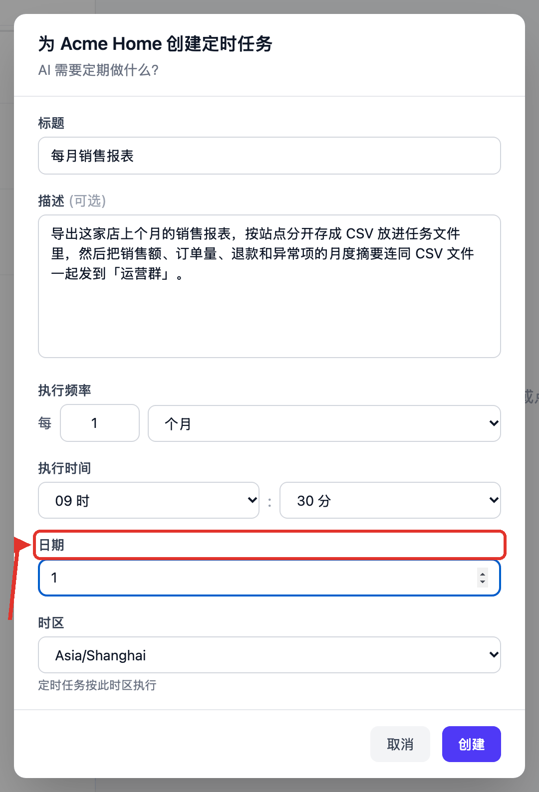
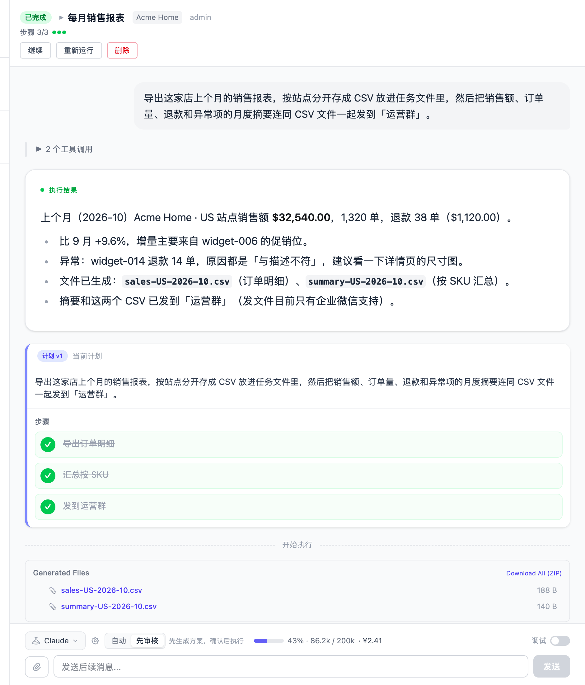

# 每月把上个月的销售报表导出来，发到群里

每月 1 日早上 09:30，Vibe Seller 用这家店自己的浏览器进卖家后台，把**上个月**的销售
数据导出来，按站点存成 CSV 放进任务文件，再把「销售额、订单量、退款、异常项」的月度
摘要连同这几份 CSV 一起发到企业微信群。

配置一次约 5 分钟，之后每月自动执行一次。

## 需要准备

- 一个店铺，浏览器后端已经绑好、能登进卖家后台（见[店铺与浏览器](stores.md)）；
- 一个**企业微信**群机器人：发文件目前只有企业微信支持，钉钉、飞书、Slack 的
  机器人只能发文字（见[群机器人](chat-bots.md)）。

## 1. 添加群机器人

和[邮箱示例的第 1 步](example-email-wecom.md#1-添加群机器人)完全一样：
「设置 → 集成 → 群机器人」→「添加机器人」，粘 Webhook 地址、保存、点「测试」。

## 2. 创建定时任务

在侧栏「任务」页，左边**选中这家店**（报表是按店导的，店铺任务不用挑执行模式），
切到「定时」子页，点「新建定时任务」——弹窗标题会写明「为 {店铺} 创建定时任务」。

**标题**：「每月销售报表」

**描述**（直接复制这一段，把群名换成你自己的）：

> 导出这家店上个月的销售报表，按站点分开存成 CSV 放进任务文件里，然后把销售额、
> 订单量、退款和异常项的月度摘要连同 CSV 文件一起发到「运营群」。

**执行频率**：每 1 个月；**日期**：1；**执行时间**：09:30；**时区**：选你上班的
时区，到点按这个时区算——报表算的是**上一个自然月**，所以日期选月初几天都行。

点「创建」。AI 会立刻起草一份执行计划（导出订单明细 → 按 SKU 汇总 → 发群），写完
冻结在定时任务上，状态变「就绪」，之后每月照这份计划执行，详见
[定时任务](schedules.md#计划只在创建时写一次)。

「上个月」不用每月改：每轮触发时它都按当时的日期算上一个自然月。导出亚马逊报表这件
事，内置的报表 Skill 已经覆盖：Business Reports、FBA、税务、广告报表这些入口和下载
操作它都熟，不用你教。

## 3. 几家店都要，就每家建一个

报表按店铺分开导最清楚：每家店各建一个「每月销售报表」，各自发群。用「全部店铺 ·
分发」也能一次覆盖所有店，但每家店的任务各自发一次文件，群里会是 N 条消息，
店铺多的时候不如分开建。两种范围的区别见
[定时任务](schedules.md#选哪种范围与执行模式)。

## 运行后你会看到

在「任务」页点开这一轮的执行记录，结果里是数字，也是文件清单：

同一时间，企业微信群里收到摘要，下面跟着那几份 CSV。任务详情底部的
「Generated Files」面板也能直接下载，或者点「Download All (ZIP)」一次取走。

## 文件存在哪里

- **这一轮的文件**在任务的工作目录里（服务器本机 `~/.vibe-seller/tasks/<任务 id>/`），
  结果报告通常会写明路径；
- **重要产物由 AI 归档**到这家店的「运行数据」，按月份存放，在「知识库」页面选这家
  店就能浏览下载。下一轮需要同一批数据时，它会先来读已有的文件，而不是重新一页页
  抓——报表类任务越跑越快就是这个原因，见
  [运行数据](knowledge.md#运行数据)。

## 常见问题

**钉钉 / 飞书 / Slack 的群收不到文件？**
目前发文件只有企业微信机器人支持（单个 5 字节 ～ 20 MB）。用其他平台的，摘要照常
进群，文件到任务详情或者店铺「运行数据」里下载。

**想按周来，或者补导以前的月份？**
按周就把频率选成每 1 周、挑一天，描述里把窗口写清（比如「上一个自然周」）。补导
以前某个月不用改定时任务：在任意一轮的执行记录里追一句「把 2026-09 那份也导出来」，
它就照同一个口径再做一个月。同一个定时任务的各次执行之间 AI 会自己留游标，记住上次
的报表做到哪，下一轮从断点接着补，这部分不用你配置，见
[跨次运行的记忆](schedules.md#跨次运行的记忆)。

**月初 1 号跑，上个月的数字齐了吗？**
亚马逊不是所有报表在 1 号都已发布：个别报表（比如月度仓储费）要等到月中。缺的文件
不会拿别的东西顶上，结果报告会写明哪一份没拿到，下一轮或你追一句再补。

**点「重新运行」会把已经下载好的报表弄丢吗？**
会。「重新运行」清空这个任务的对话和工作目录，跑出来的文件一起没了。只想在上次的
成果上再补一步，用「继续」或者直接追问，比如“只把 US 那份按 SKU 再汇总一次”。

**报表没导出来，或者数字对不上？**
结果报告会写明哪一步没做到。常见原因是后台登录态掉了、报表页改版、日期口径和你要
的不一样。先确认这家店的浏览器能进店，然后在同一个任务里追问一句让它重跑那一步。

**我要的是整套月结报表，不只销售报表**
在描述里说清「这个月的一整套报表」：交易报表、广告报表、退款、仓储费会按站点
分文件夹交付，服务器会照着这家店的报表清单核对有没有缺，缺的会退回一次让它补齐，
补不上的在结果里标出来。只要其中一份的话别说「整套」，它不会被按整套要求检查。
