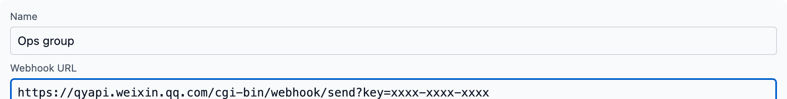
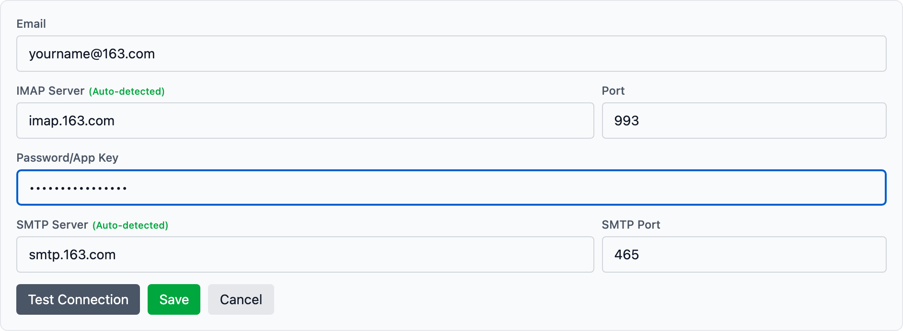
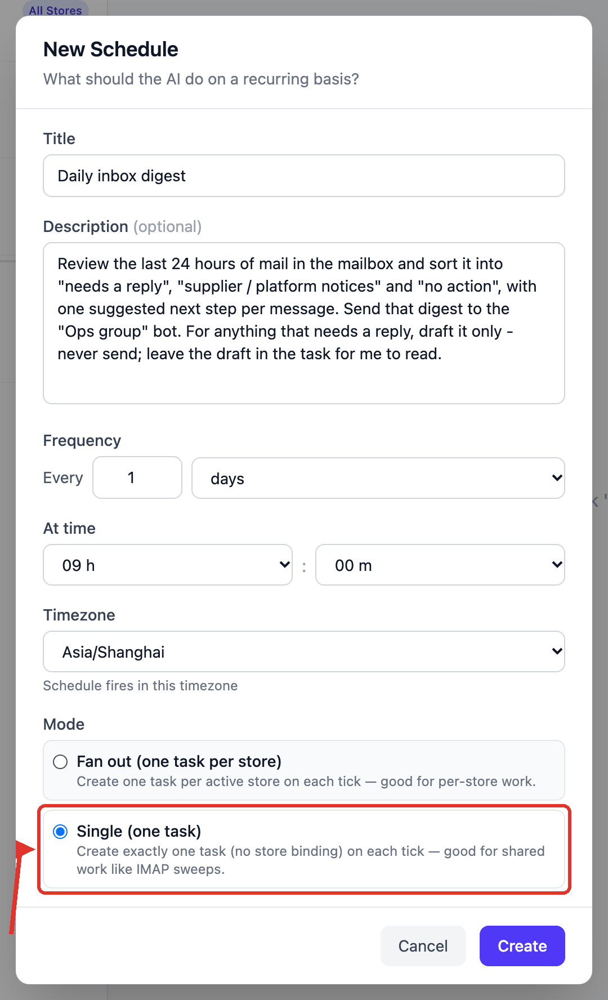
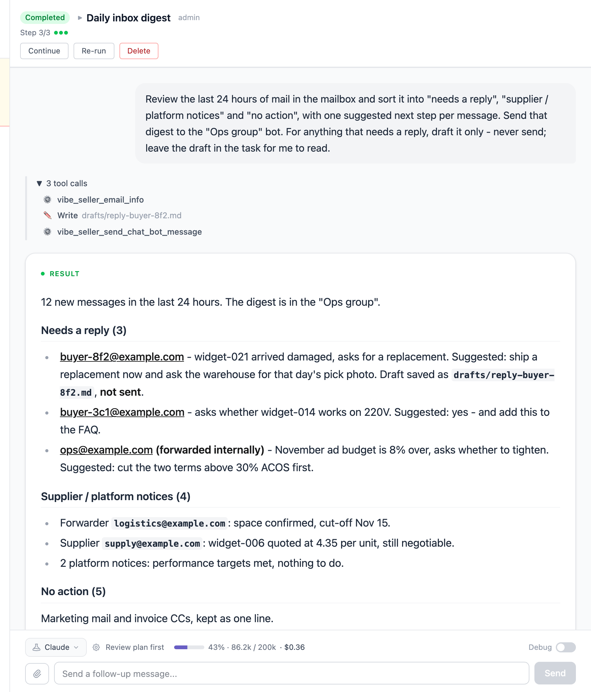

# Check the mailbox every day and send what matters to the WeCom group

No more digging through the inbox first thing. Every day at 09:00 Vibe Seller
reads the mailbox on its own, sorts the mail into "needs a reply", "supplier /
platform notices" and "no action", writes one suggested next step per message,
and posts the digest to your WeCom group. Messages that need a reply are drafted
only — the draft stays in the task for you to read.

Setup takes about 10 minutes; after that it runs every day by itself.

## What you need first

- A working AI profile (first time? Start with the [Quickstart](quickstart.md));
- A mailbox and its **authorization code**: 163 / QQ Mail need IMAP turned on and
  the 16-character code, Gmail needs an app password, Outlook / Hotmail can't be
  added today — steps in [Email integration](email.md);
- A WeCom group and that group's **bot Webhook URL** (in the group:
  **··· (More) → Message Push → Add**) — steps in [WeCom bot](chat-bots-wecom.md).

If the mailbox belongs to one store (a store's customer-service address, say),
decide that up front: link it to that store and create the schedule under that
store too. A shared inbox (purchasing and operations both use it) stays
unlinked, and the schedule runs as **All Stores · Single (one task)**.

## 1. Add the group bot

Open **Settings → Integrations → Chat bots** and click **Add Bot**.

- **Name**: something you'll recognize later, e.g. "Ops group";
- **Webhook URL**: paste the whole address you copied from the group — the
  platform is detected from it and shown as a WeCom badge.

Click **Save**, then **Test** on that bot. The group receives
`Vibe Seller: chat bot connection test ✅`, which means the address works.

DingTalk, Feishu and Slack bots need two extra fields (signing secret, keyword)
— see [Add the bot in Vibe Seller](chat-bots.md#add-the-bot-in-vibe-seller).

## 2. Add the mailbox

Open **Settings → Email** and click **+ Add Email**.

- **Email**: the full address, e.g. ops@example.com. When the field loses
  focus, the IMAP / SMTP servers are auto-detected and filled in;
- **Password/App Key**: the authorization code — **not** your login password;
- Click **Test Connection**, and once it says "Connection successful", click
  **Save**.

A store's own mailbox does one more thing at this step: after saving, click
**Link to Store** on that mailbox card and pick the store. Only a linked mailbox
is visible to the AI in that store's tasks.

## 3. Create the schedule

On the **Tasks** page in the sidebar, select **All Stores** on the left (a shared
inbox isn't tied to a store), switch to the **Scheduled** sub-tab and click
**New Schedule**.

**Title**: "Daily inbox digest"

**Description** (copy this block, and replace the group name with yours):

> Review the last 24 hours of mail in the mailbox and sort it into "needs a
> reply", "supplier / platform notices" and "no action", with one suggested next
> step per message. Send that digest to the "Ops group" bot. For anything that
> needs a reply, draft it only - never send; leave the draft in the task for me
> to read.

**Frequency**: every 1 days; **At time**: 09:00; **Timezone**: pick the
zone you work in — the schedule fires in that zone, whatever timezone the server
is in.

**Mode**: choose **Single (one task)**. A shared inbox belongs to no store, so one
task reading the whole mailbox is enough; **Fan out** would create a task per
store and read the same mail several times.

Click **Create**. The AI drafts an execution plan right away: the list shows
**Planning** first, then **Ready** when the plan is written — you don't approve
this step. From then on it runs that plan every day at 09:00, see
[The plan is authored once, at creation](schedules.md#the-plan-is-authored-once-at-creation).

## What you get after it runs

After 09:00 the next day, open that round's run on the **Tasks** page. The
conversation shows which messages it read and which drafts it wrote, and then the
digest, sorted into three buckets:

At the same moment the digest lands in the WeCom group. To look at one message
closely, ask in that same task — “show me the draft for the second one”, or “make
the suggestion for the buyer email more specific”. A follow-up continues the same
task, so the mail it already read is still there.

## Questions this example gets

**Will the AI send mail on my behalf?**
By default it can: the **"Email sending permission"** switch on each mailbox card
is on. The description above already tells it to draft and not send. To close the
door completely, turn that switch off under **Settings → Email**: afterwards the
AI can read and draft, and you press send. Only a person can change the switch —
the AI cannot, see [Turn off the email sending permission](email.md#turn-off-the-email-sending-permission).

**It says it didn't see a message that just arrived?**
Mail syncs to this machine every 5 minutes. Add “sync the mailbox first, then
check” to the description, or wait for the next run. Also confirm the mailbox is
linked to the store the task runs under — an unlinked mailbox is invisible to that
store's tasks.

**Can it message the group only when something urgent comes in?**
Yes — put the bar in the description, e.g. “post to the group only for buyer
complaints and platform notices; keep everything else in the task result.” The AI
applies the standard you wrote, and explains its reasoning when a message is a
judgement call, so for the first week read the full daily digest before tightening
the rule.
