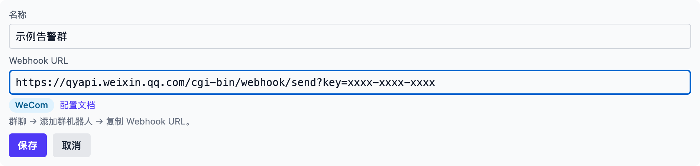
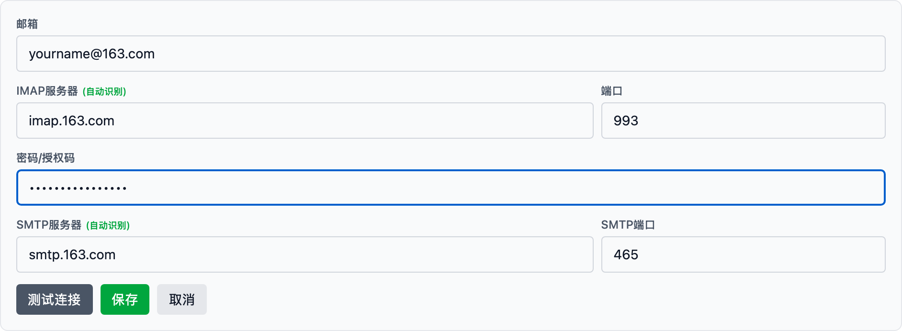
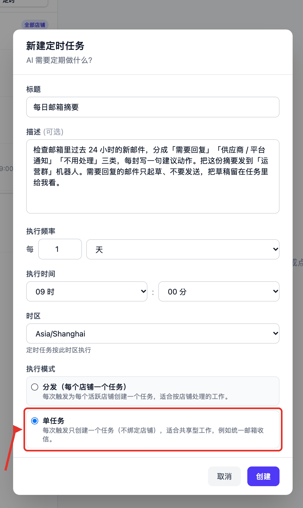
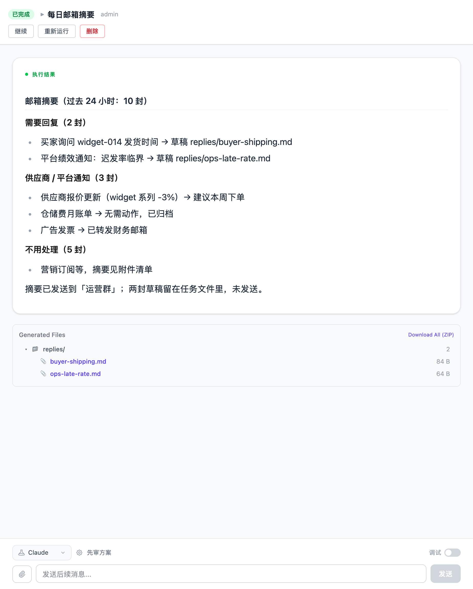

# 每天检查邮箱，把需要关注的邮件发到企业微信群

到工位不用先翻收件箱。Vibe Seller 每天 09:00 自己读一遍邮箱，把邮件分成
「需要回复」「供应商 / 平台通知」「不用处理」三类，每封写一句建议动作，
摘要发到企业微信群。需要回复的邮件只起草，草稿留在任务里等你看。

配置一次约 10 分钟，之后每天自动执行。

## 需要准备

- 一个能用的 AI 配置（第一次使用见[快速开始](quickstart.md)）；
- 一个邮箱，以及它的**授权码**：163 / QQ 要开 IMAP 并拿 16 位授权码，
  Gmail 要用应用专用密码，Outlook / Hotmail 目前接不进来，
  步骤见[邮件接入](email.md)；
- 一个企业微信群，和这个群的**群机器人 Webhook 地址**（在群里
  「··· → 消息推送 → 添加」拿到），步骤见[企业微信机器人](chat-bots-wecom.md)。

邮箱如果是某家店铺专用的（比如店铺客服邮箱），先想清楚：它要关联到那家店，
后面的定时任务也建在那家店下面。共享邮箱（采购、运营都在用）不关联店铺，
定时任务用「全部店铺 · 单任务」。

## 1. 添加群机器人

打开「设置 → 集成 → 群机器人」，点「添加机器人」。

- **名称**：填一个以后一眼认得出的名字，比如「运营群」；
- **Webhook URL**：把群里复制的地址整段粘进去，平台会自动识别成 WeCom。

点「保存」，再点这条机器人上的「测试」，群里出现
`Vibe Seller: chat bot connection test ✅` 就说明通了。

用钉钉或飞书的，表单还会显示对应平台的安全设置——钉钉至少选一项、
飞书都是可选，见[群机器人](chat-bots.md#在-vibe-seller-里添加)。

## 2. 添加邮箱

打开「设置 → 邮箱」，点「+ 添加邮箱」。

- **邮箱**：填完整地址，例如 ops@example.com。光标离开输入框，
  IMAP / SMTP 服务器会自动识别填好；
- **密码 / 授权码**：填授权码，**不是登录密码**；
- 点「测试连接」，看到「连接成功」再点「保存」。

店铺专用邮箱在这一步多做一个动作：保存后在这张邮箱卡片上点「关联到店铺」，
选中那家店。只有关联过，这家店的任务才读得到它的邮件。

## 3. 创建定时任务

在侧栏「任务」页，先在左边选「全部店铺」（共享邮箱不绑店），切到「定时」
子页，点「新建定时任务」。

**标题**：「每日邮箱摘要」

**描述**（直接复制这一段，把里面的群名换成你自己的）：

> 检查邮箱里过去 24 小时的新邮件，分成「需要回复」「供应商 / 平台通知」
> 「不用处理」三类，每封写一句建议动作。把这份摘要发到「运营群」机器人。
> 需要回复的邮件只起草、不要发送，把草稿留在任务里给我看。

**执行频率**：每 1 天；**执行时间**：09:00；
**时区**：选你上班的时区，到点按这个时区算，和服务器在哪个时区无关。

**执行模式**：选「**单任务**」。共享邮箱不属于任何一家店，一个任务读整个
邮箱就够了；选「分发」会给每家店都建一个任务，同一批邮件被读好几遍。

点「创建」。AI 会立刻起草一份执行计划，列表上先是「规划中」，写完变「就绪」
——这一步不用你点批准。之后每天 09:00 照这份计划执行，
详见[定时任务](schedules.md#计划只在创建时写一次)。

## 运行后你会看到

第二天 09:00 之后，在「任务」页点开这一轮的执行记录，对话里能看到它读了哪些
邮件、写了哪几份草稿，最后是分类摘要：

同一时间，企业微信群里收到这条摘要。想细看某一封邮件，直接在这个任务里
追问，比如“第二封的草稿给我看”或“把买家那封的建议再具体一点”——
追问是在同一个任务里继续，之前读过的邮件还在。

## 常见问题

**AI 会不会替我把邮件发出去？**
默认有这个能力：每张邮箱卡片上的「发邮件权限」是开着的。本示例的描述已经
要求它只起草不发送；想彻底堵住这条路，到「设置 → 邮箱」把那个邮箱的开关
关掉，之后 AI 只能读和起草，发送由你来点。这个开关只能人在界面上改，
AI 自己改不了，见[关闭发邮件权限](email.md#关闭发邮件权限)。

**刚收到的邮件，任务说没看到？**
邮件每 5 分钟同步一次到本机。在描述里加一句“先立刻同步一次再查”，
或者等下一轮。另外确认这个邮箱已经关联到任务所在的店铺——没关联的邮箱，
店铺任务读不到。

**能不能只在有要紧邮件时才发消息？**
可以，把判断标准写进描述，比如“只有买家投诉和平台通知才发群，其余的
只写在任务结果里”。标准由 AI 按你写的执行，它判不准时会在结果里说明理由，
所以第一周建议先看看每天的完整摘要，再收紧标准。
