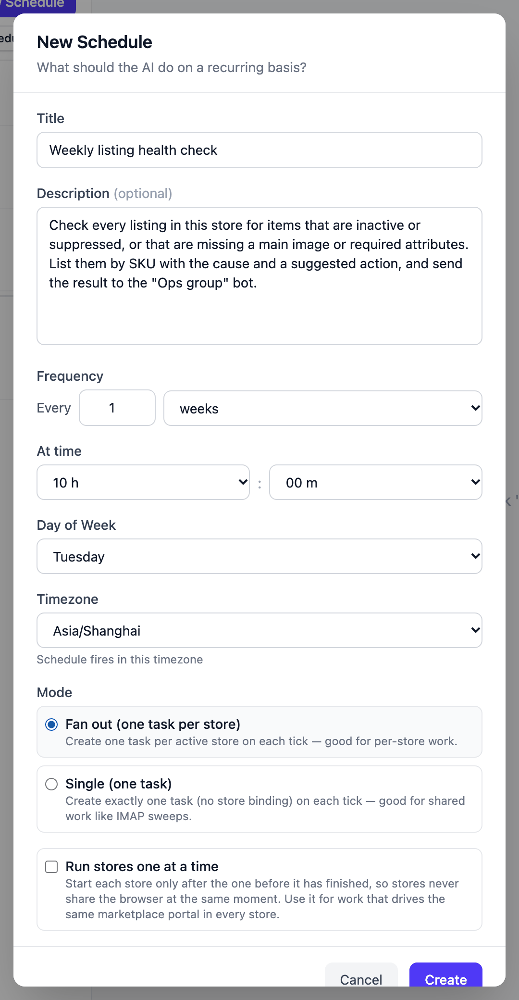
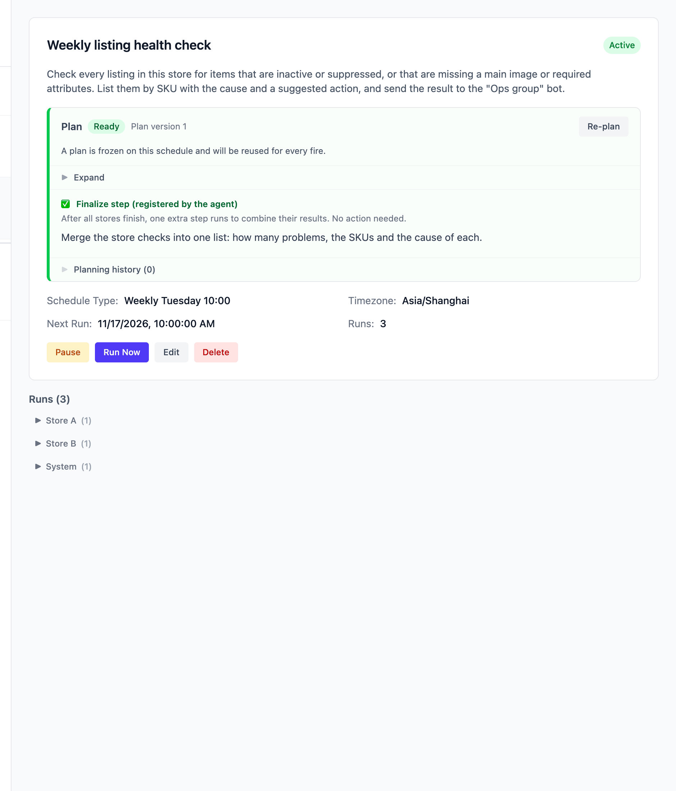
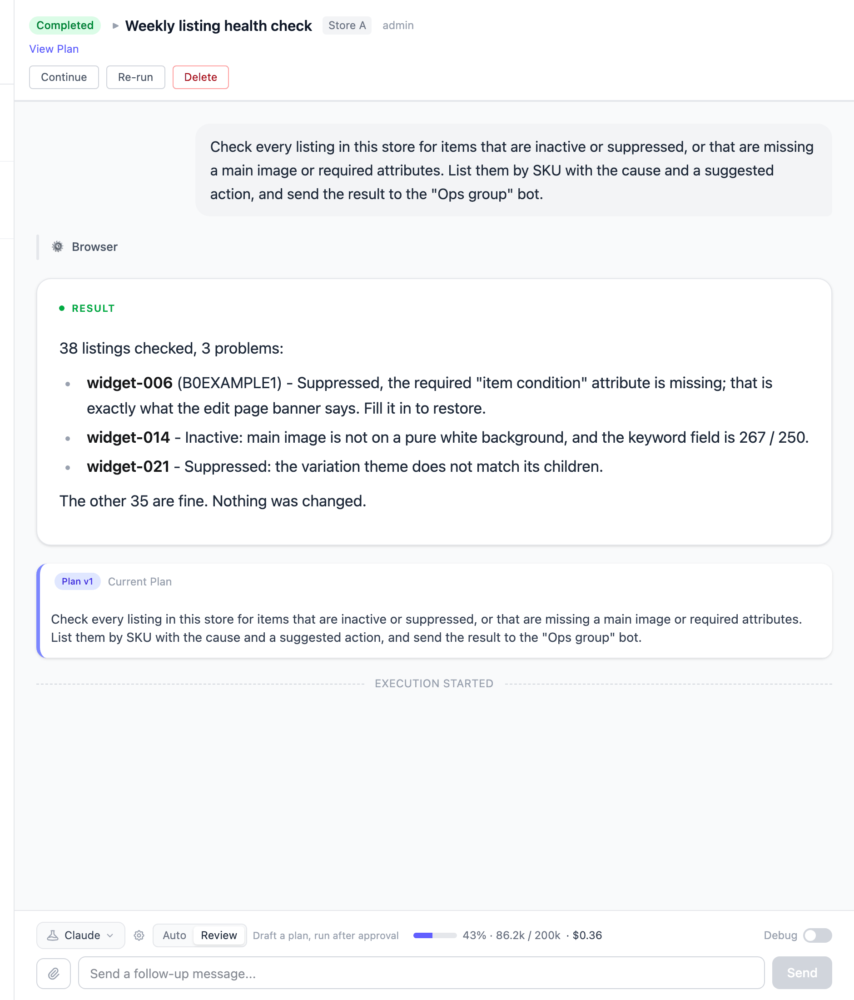

# Sweep every store's listings once a week

Every Tuesday at 10:00 Vibe Seller creates one task per store, goes into each
store and walks its listings: inactive items, suppressed items, missing main
images and missing required attributes, listed by SKU with the cause and a
suggested action. When every store is done, it merges one cross-store list.
**It only reports — no listing is changed**; which ones to fix is your call.

Setup takes about 5 minutes; after that it runs weekly by itself.

## What you need first

- Every store's browser backend bound and able to sign in to the seller console
  (see [Stores & Browsers](stores.md)): the sweep has to get into the store to
  read listing status, so a store it can't sign in to will fail;
- Optional: a group bot, so results land in the group (see
  [Chat bots](chat-bots.md) — the same one the
  [mailbox example](example-email-wecom.md) uses).

If every store logs in to the same marketplace portal, tick **Run stores one at
a time** when you create the schedule (step 2 below).

## 1. Create the schedule

On the **Tasks** page in the sidebar, select **All Stores** on the left, switch
to the **Scheduled** sub-tab and click **New Schedule**.

**Title**: "Weekly listing health check"

**Description** (copy this block, and replace the group name with yours):

> Check every listing in this store for items that are inactive or suppressed,
> or that are missing a main image or required attributes. List them by SKU with
> the cause and a suggested action, and send the result to the "Ops group" bot.

Leave "this store" as it is in the description: each task Fan out creates is bound
to one store, so that's the store the AI reads.

**Frequency**: every 1 weeks, **Day of Week** "Tuesday", **At time** 10:00;
**Timezone** your own zone — the schedule fires in that zone.

**Mode**: choose **Fan out (one task per store)**.

Click **Create**. The AI drafts an execution plan right away and freezes it on the
schedule, and every later fire runs that same plan — see
[The plan is authored once, at creation](schedules.md#the-plan-is-authored-once-at-creation).

## 2. Tick "Run stores one at a time" when every store logs in to the same portal

**Fan out** runs the batch's stores in parallel by default. When every store has
to sign in to the same platform, parallel runs push the browser profiles on one
machine against each other — tick **Run stores one at a time** and each store
finishes before the next starts, and a store that fails in the middle doesn't
stop the ones after it. The screenshot above doesn't have it ticked: when each
store has its own separate browser, parallel runs don't push each other out and
you can leave it alone.

The full comparison of scopes and modes:
[Two scopes and the execution modes](schedules.md#two-scopes-and-the-execution-modes).

## 3. You don't have to arrange the cross-store list

Merging the stores at the end is something the AI plans for itself: it registers a
**finalize step** for this schedule, shown in the plan panel as "**Finalize step
(registered by the agent)**" with the text it intends to merge by. When the time
comes, the system adds one more task — it takes no store browser — that combines
the stores' results into the overall report. No action on your side.

Runs are grouped by store: one entry per store, and the merge task sits in the
**System** group because it isn't bound to any store.

## What you get after it runs

Each store's result is a list of problems by SKU, with the cause and the action:

The description asks for a group message, so each store posts its own result when
it finishes. The merged cross-store list is in the merge task's result — open the
**System** group to read it.

To look at one store more closely, or to have it explain one listing's cause, ask
in **that store's task**: same task, same working directory, the data it already
read is still there.

## Questions this example gets

**Will it fix a listing on its own?**
No. The description asks it to find problems and list suggested actions, so it
reports. Which listing to change is something you say in that store's task — the
edit is a separate step.

**One store failed. What happens to the rest?**
The other stores are unaffected. Once the whole batch has finished — completed or
failed — the merge task still fires: every store reaches it with its own status
and result, so the failed one is simply reported as not having produced anything.
Open the failed record and see where it stopped
— usually it couldn't sign in to the console (the browser profile lost its
session). Open that store's browser from the web UI, confirm you can get in, then
**Re-run** that record.

**Can it check only some of the stores?**
Not today: **Fan out** creates a task for **every** store on this server, with no
exceptions. If it's always the same few stores you care about, create a store
schedule under each of those stores instead.

**How long and how much with many stores?**
Both grow with the number of stores. Fire it once with **Run Now**, watch how long
each store actually takes and what the **Usage** strip at the bottom of the task
says it cost, and only then decide whether weekly is right.
