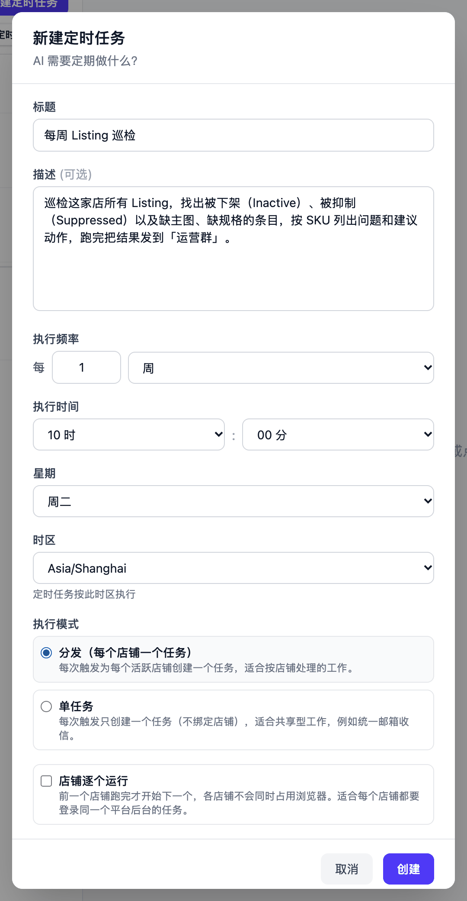
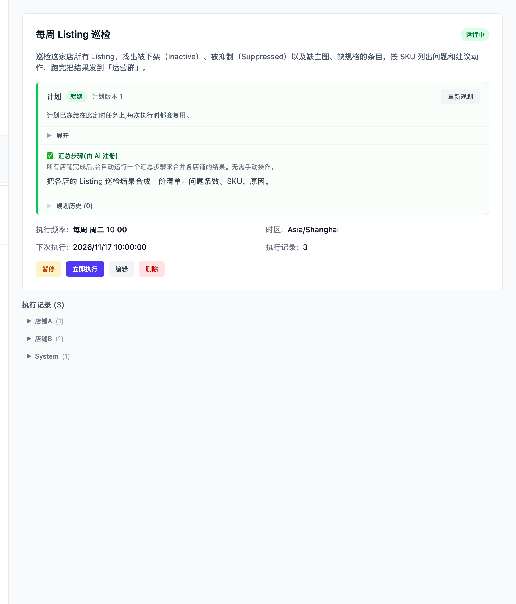
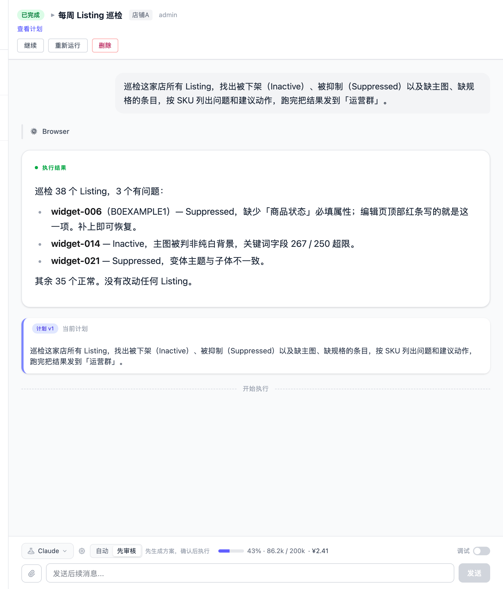

# 每周巡检所有店铺的 Listing

每周二 10:00，Vibe Seller 给每家店各建一个任务，进店把这家店的 Listing 过一遍：
被下架（Inactive）、被抑制（Suppressed）、缺主图、缺必填属性的条目，按 SKU 列出
问题、原因和建议动作。所有店跑完，它再合一份跨店总清单。**只报告，不动任何
Listing**——要改哪条，由你在任务里说。

配置一次约 5 分钟，之后每周自动跑。

## 需要准备

- 每家店的浏览器后端已经绑好，能登进卖家后台（见[店铺与浏览器](stores.md)）：
  巡检要进店读 Listing 状态，登不进去的那家店会失败；
- 可选：一个群机器人，把结果发进群（见[群机器人](chat-bots.md)，和
  [邮箱示例](example-email-wecom.md) 用的是同一个）。

## 1. 创建定时任务

在侧栏「任务」页，左边选「**全部店铺**」，切到「定时」子页，点「新建定时任务」。

**标题**：「每周 Listing 巡检」

**描述**（直接复制这一段，把群名换成你自己的）：

> 巡检这家店所有 Listing，找出被下架（Inactive）、被抑制（Suppressed）以及缺主图、
> 缺规格的条目，按 SKU 列出问题和建议动作，跑完把结果发到「运营群」。

描述里的「这家店」不用改：分发建出来的每个任务都绑定一家店，AI 读到的就是自己
那一家。

**执行频率**：每 1 周，**星期**选「周二」，**执行时间** 10:00；
**时区**选你所在时区，到点按这个时区算。

**执行模式**：选「**分发（每个店铺一个任务）**」。

点「创建」。AI 会立刻起草一份执行计划，写完就冻结在这个定时任务上，之后每次触发
照同一份计划执行，详见[定时任务](schedules.md#计划只在创建时写一次)。

## 2. 每家店都要登录同一个后台时，勾上「店铺逐个运行」

「分发」默认让同批店铺并行。每家店都要登同一个平台后台时，并行会让同一台机器上
的浏览器档案互相挤兑——这时勾上「**店铺逐个运行**」：一家跑完再跑下一家，中间
某家店失败不影响后面的店继续。截图里没勾：各店用的是各自独立的浏览器时，并行不
会互相挤，不用勾。

两种范围、两种模式的完整对比见[定时任务](schedules.md#选哪种范围与执行模式)。

## 3. 跨店总清单不用你安排

各店跑完后合一份总结，这件事 AI 在起草计划时就会安排：给这个定时任务注册一个
「汇总步骤」，计划面板里显示「**汇总步骤(由 AI 注册)**」，后面写着它打算怎么合。
到点系统自动追加一个不占店铺浏览器的汇总任务，拿着各店结果合出总报告，不需要你
手动操作。

执行记录按店铺分组：每家店一条，汇总任务在「**System**」这一组里——它不绑定
任何店铺。

## 运行后你会看到

每家店的结果是一张按 SKU 列好的问题清单，写明原因和建议动作：

描述里要求了发群，所以每家店跑完，群里各收到一条。跨店那份总清单在汇总任务的结果
里，点开「System」那一组就能看到。

想细看某家店，或者让它把某条 Listing 的原因说清楚，直接在**那家店的任务**里追问：
同一个任务、同一份工作目录，它已经读过的数据还在。

## 常见问题

**它会不会顺手把 Listing 改了？**
不会。描述只让它“找出问题、列出建议动作”，它就只报告。要改哪条，在那家店的任务
里说清楚，改的活是另一步。

**一家店失败了怎么办？**
不影响其余的店。同批任务全部结束（完成或失败）后，汇总任务照样触发——它拿到的
每家店都带着自己的状态和结果，失败的那家会写明没跑出来。点开失败的记录看它卡在
哪一步：多数是这家店的浏览器登不进后台。先在网页上把这家店的浏览器打开、确认能
进店，再在这条记录上「重新运行」。

**能不能只巡检其中几家店？**
目前不能：「分发」每次触发给这台服务器上的**每一家**店铺建一个任务，没有例外。
只想固定查几家店，就在那些店下面各建一个店铺定时任务。

**店铺很多，一次要跑多久、花多少？**
耗时和花费都按店铺数量增长。第一次先手动点「立即执行」跑一轮，看看每家店实际用
多久、任务详情底部「用量」里写了多少钱，再决定要不要设成每周。
