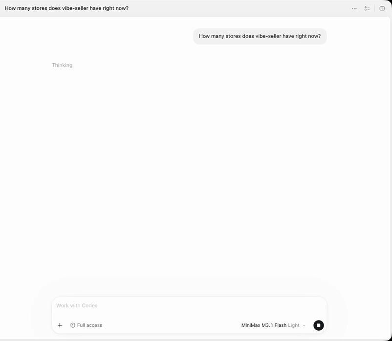

# Export a Ziniao store's financial data with Codex and analyse it

At month-end you want to know how much Store A actually made over the last few
months and where the money went. **One sentence in Codex is all it takes:**

!!! tip "What this example shows"
    - **Vibe Seller goes into the seller center**: it signs in with Store A's
      **Ziniao browser** and downloads the last **3 monthly transaction
      reports**. An outside AI tool can't touch your browser — only Vibe Seller
      can do this part;
    - **Codex does the analysis**: it fetches the reports and works out
      **sales, each fee, refunds and net payout per month**, then points out
      **which fee grew the most, and when**;
    - **It all happens in the Codex chat**: no need to open the Vibe Seller web
      app — questions and plan approvals from the task show up in the chat too.

About 5 minutes to set up. Claude, WorkBuddy, Qoder and the other tools work the
same way.

## Before you start

- Store A is bound to a Ziniao browser and can sign in to Seller Central (see
  [Stores and browsers](stores.md));
- Codex is connected to Vibe Seller (see [Connect Codex](mcp-codex.md)).

## 1. Say it in Codex

Start a new chat and paste this, with your own store name:

> Use Vibe Seller to open Store A and download the last 3 monthly transaction
> reports (Monthly Transaction under Payments). Once they're downloaded, fetch
> the files and, per month, total sales, each Amazon fee (referral, FBA
> fulfilment, storage, advertising), refunds and net payout; show each fee as a
> share of sales and point out which fee grew the most, and in which month.

## 2. What happens while it runs

1. **Creates the task**: Codex finds Store A in Vibe Seller and creates a task
   on that store;
2. **Downloads the reports**: the task signs in to Seller Central with Store A's
   Ziniao browser, opens **Payments → Reports Repository**, picks each month and
   downloads the 3 monthly transaction reports into the task's files. Finding
   the report, picking the month and downloading are already covered by the
   built-in reports skill — you don't have to teach it;
3. **Waits**: Codex waits in the chat until the task finishes. If the task needs
   an answer from you or a plan approved, the question shows up in the chat;
4. **Fetches the files and analyses them**: when the task is done, Codex pulls
   the 3 reports, reads every transaction, totals them by month and gives you a
   comparison table and its findings in the chat.

## 3. Keep analysing

Codex already has the reports, so for a different angle just keep asking in the
same chat — no new task needed:

- “Which SKUs spent the most on ads?”
- “Group the refunds by reason.”
- “Put it in an Excel workbook, one sheet per month.”

The task also shows up on the Vibe Seller **Tasks** page, just like one you
created by hand. Open it to see the run and the result; the **Generated Files**
panel at the bottom holds the 3 downloaded reports — download one, or take
everything with **Download All (ZIP)**.

## FAQ

**It answered, but didn't actually create a task?**

It answered from its own knowledge. Say “create a Vibe Seller task” explicitly.

**One month's report is missing — how do I get it?**

In the same chat, ask Codex to send a follow-up to the **same task**, e.g.
“download the August report too”; the task continues from its last result.
Don't **Re-run** — that clears the task's workspace and the reports already
downloaded go with it.

**Can the AI skip my confirmation and change my store directly?**

No. It can only work by creating tasks, and plan approval and the other checks
are exactly the same as in the web UI.

**Can't connect, or getting 401?**

See [MCP setup · Troubleshooting](mcp.md#troubleshooting).
