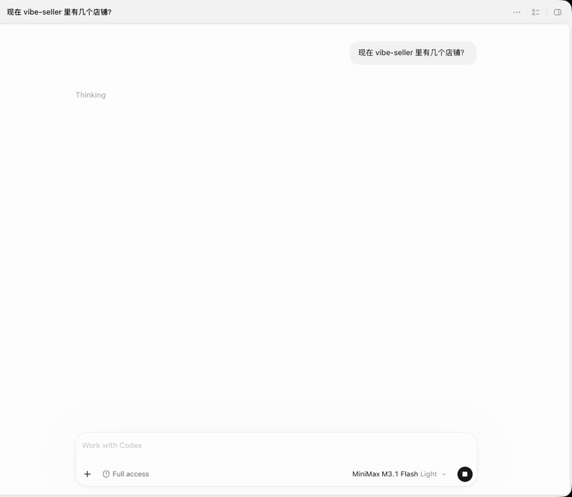

# 在 Codex 里让 Vibe Seller 导出报表，再接着分析

你在 Codex 的对话里说一句，Codex 就调用 Vibe Seller 给这家店建一个任务：任务用
这家店自己的浏览器进卖家后台，把上个月的销售报表下载下来。任务完成后，Codex 把
报表文件取回来，读出里面的数据，按你的要求做分析。

进后台、下报表这一段由 Vibe Seller 完成；拿到文件之后怎么分析，交给 Codex。

配置一次约 5 分钟。Claude、WorkBuddy、Qoder 等工具用法相同。

## 需要准备

- 一个店铺，浏览器后端已经绑好、能登进卖家后台（见[店铺与浏览器](stores.md)）；
- Codex 已经接入 Vibe Seller（见[在 Codex 里接入](mcp-codex.md)）。

## 1. 在 Codex 里说一句

新建一个对话，直接复制这一段，把店铺名换成你自己的：

> 用 Vibe Seller 给店铺A建一个任务，把上个月的销售报表下载下来。任务完成后把报表
> 文件取回来，按 SKU 汇总销售额和订单数，列出前十名。

## 2. 运行时发生了什么

1. **建任务**：Codex 先在 Vibe Seller 里找到店铺A，然后在这家店下建一个任务；
2. **任务执行**：任务进卖家后台，找到报表页，把上个月的报表下载到任务文件里。
   下载亚马逊报表这件事，内置的报表 Skill 已经覆盖，不用你教；
3. **等结果**：Codex 在对话里等任务跑完。任务中途要问你问题、要你确认计划，问题
   会直接出现在对话里；
4. **取回文件并分析**：任务完成后，Codex 取回报表文件，读出数据，按 SKU 汇总，
   把前十名列在对话里。

## 运行后你会看到

- **Codex 的对话里**：分析结果，以及它用到的报表文件；
- **Vibe Seller 的「任务」页**：多了一条店铺任务，和你手动建的一样。点开能看到执行
  过程和结果，底部「Generated Files」里是下载的报表，可以单个下载，也可以点
  「Download All (ZIP)」一次取走。

想换个分析方式，比如按周汇总、和前一个月对比，在同一个对话里接着说就行，文件已经在
Codex 手里，不用再建任务。

## 常见问题

**它答了话，但没有真的去建任务？**

说明它凭自己的知识直接回答了。明确说一句「用 Vibe Seller 建个任务」就行。

**报表没下载全，怎么补？**

在同一个对话里让 Codex 给**同一个任务**追加一句要求，比如「把漏掉的那份补下载」，
任务会在上次的结果上继续。别「重新运行」——那会清空任务的工作目录，已经下载好的
文件会一起没了。

**AI 会不会绕过我的确认直接改店铺？**

不会。它只能通过建任务来干活，计划审批等确认步骤和你在网页上操作时完全一样。

**连不上、提示 401？**

见 [MCP 接入 · 常见问题](mcp.md#常见问题)。
