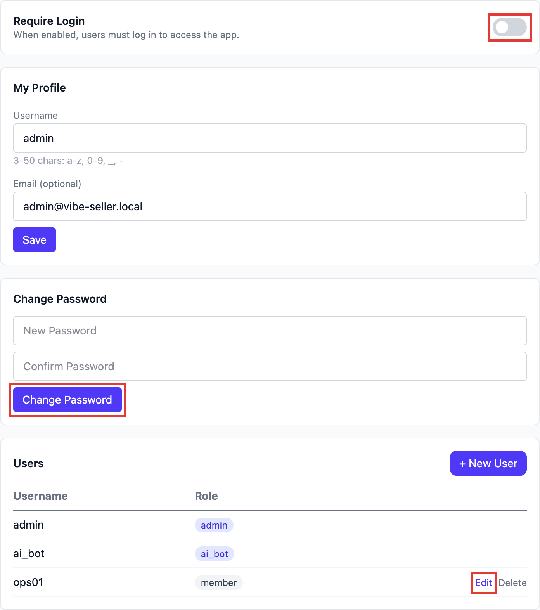

# Login & Accounts

## How do I set up or recover the login password?

**There's no login by default.** A fresh install opens straight into the main UI. To make people
log in first, set it up in **Settings → Account**:



1. **Change the password first**: type a new one under **Change Password** and click **Change
   Password**. While login is still off, you don't need the old one;
2. **Then turn on Require Login**: from now on the web app asks for a login; the username is the
   one under **My Profile**;
3. **Accounts for colleagues**: **+ New User** in the **Users** list. If a colleague forgets their
   password, an admin clicks **Edit** on that row, types a new password and saves.

The factory account is `admin` / `admin`, valid only until the password is first changed; after
that the old one stops working and can't be looked up.

**Locked out and forgot the password?** Recover it from a terminal on the machine running Vibe
Seller:

```bash
vibe-seller reset-auth status
vibe-seller reset-auth password
vibe-seller reset-auth disable
```

- `status`: whether login is on, which accounts can log in, whether the default still works;
- `password`: reset the default admin's password — it prompts for the new one;
- `disable`: emergency — turn the login page off, get in, then fix the password in **Settings → Account**.

Changes apply immediately — no restart, running tasks unaffected. Another account: add
`--user <name>`. With the login page off, anyone who can open the address gets in; fine on your own
network, never expose it to the internet. Turn **Require Login** back on in **Settings → Account**
afterwards, or run `vibe-seller reset-auth enable`.

A source install (cloned and run from the repo) has no `vibe-seller` command; use
`scripts/reset_auth.sh` (`scripts\reset_auth.bat` on Windows) with the same arguments.

!!! note "Changing a password doesn't log anyone out"
    Browsers that are already logged in stay in, for up to 24 hours. To force everyone back to the
    login page: stop the server, delete `~/.vibe-seller/data/jwt_secret`, start it again. That file
    also encrypts the Ziniao, mailbox and Ads API credentials you've saved, so they'll all need to be
    entered again; to lock out one person, just change their password.

## Why is there no vibe-seller command on Windows?

Because the native installer doesn't put it on your PATH — and on Windows **you don't need it**: the tray owns the server (right-click the icon → Restart server / Quit), it starts when you log in, and upgrades run from tray → Check for updates.

If you do want the command line (for the `reset-auth` commands above, say), the executable is inside the install:

```powershell
& "$env:LOCALAPPDATA\Programs\VibeSeller\.venv\Scripts\vibe-seller.exe" reset-auth status
```

`vibe-seller start` / `stop` / `upgrade` live on that same file, but the installer handles autostart and upgrades on Windows, so you rarely reach for it.

The `vibe-seller` command is the entry point for the macOS / Linux (and WSL2 Ubuntu) install, where `install.sh` puts it in `~/.local/bin`.
