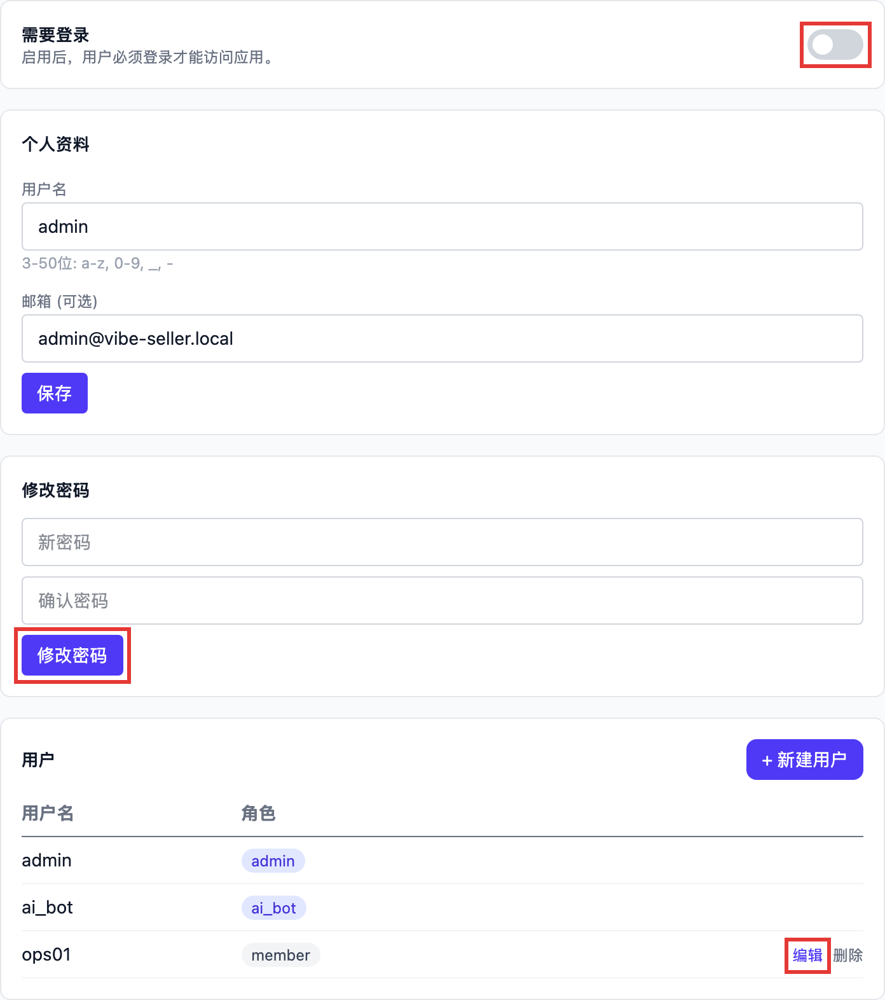

# 登录与账号

## 登录密码怎么设置和找回？

**默认不需要登录。** 全新安装后打开就是主界面。想让别人打开网页时先登录，在「设置 → 账号」里配置：



1. **先改密码**：在「修改密码」里填新密码，点「修改密码」。还没开启登录时，不需要输入旧密码；
2. **再打开「需要登录」**：之后打开网页要先登录，用户名就是「个人资料」里的那个；
3. **给同事开账号**：在「用户」里点「+ 新建用户」；同事忘了密码，由管理员点那一行的「编辑」，
   填一个新密码保存即可。

默认账号是 `admin` / `admin`，只在密码从没改过时有效；改过之后旧密码立即失效，也查不回来。

**进不去网页、又忘了密码时**，在装 Vibe Seller 的那台电脑上用命令找回：

```bash
vibe-seller reset-auth status
vibe-seller reset-auth password
vibe-seller reset-auth disable
```

- `status`：查看是否需要登录、哪些账号能登录、默认密码还有没有效；
- `password`：重置默认管理员的密码，会提示你输入新密码；
- `disable`：应急用，先关掉登录页，进去之后再到「设置 → 账号」里改密码。

重置立即生效，不用重启服务，正在跑的任务也不受影响。给其他账号重置加 `--user <用户名>`。
关掉登录页后，任何能打开这个地址的人都能直接进来，内网自用没问题，别直接暴露到公网；用完记得在
「设置 → 账号」里重新打开「需要登录」，或运行 `vibe-seller reset-auth enable`。

源码安装（clone 下来运行的）没有 `vibe-seller` 命令，改用 `scripts/reset_auth.sh`（Windows 上是
`scripts\reset_auth.bat`），参数相同。

!!! note "改了密码，已经登录的人不会被踢下线"
    已登录的浏览器会继续有效，最长 24 小时。要让所有人马上重新登录：停止服务，删除
    `~/.vibe-seller/data/jwt_secret`，再启动。注意这份文件也用来加密你保存的紫鸟、邮箱、广告 API
    凭据，删除后这些都要重新填写一遍；只是想让某个人进不来，改掉他的密码就够了。

## Windows 上为什么没有 vibe-seller 命令？

因为原生安装包不会把它加入 PATH——在 Windows 上你不需要它：服务由托盘管理（右键图标 → 重启服务 / 退出），登录 Windows 时自动启动，升级走托盘的「检查更新」。

需要在命令行完成操作时（比如上面的 `reset-auth`），可执行文件就在安装目录里，用完整路径调用：

```powershell
& "$env:LOCALAPPDATA\Programs\VibeSeller\.venv\Scripts\vibe-seller.exe" reset-auth status
```

`vibe-seller start`、`stop`、`upgrade` 等命令也都在同一个文件上，只是 Windows 的自动启动和升级由安装包负责，通常用不到。

`vibe-seller` 这个命令是 macOS / Linux（以及 WSL2 里的 Ubuntu）安装方式的入口，那边由 `install.sh` 把它放进 `~/.local/bin`。
