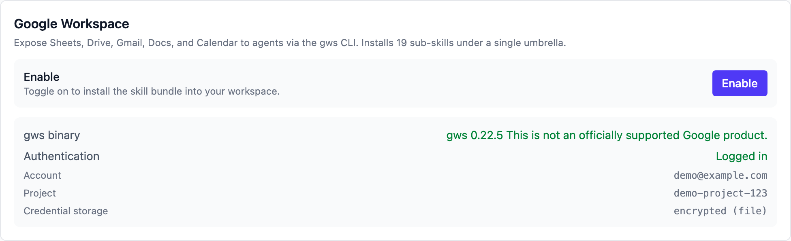
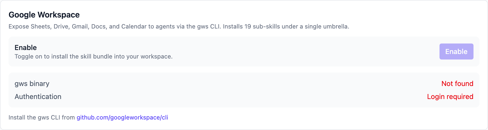
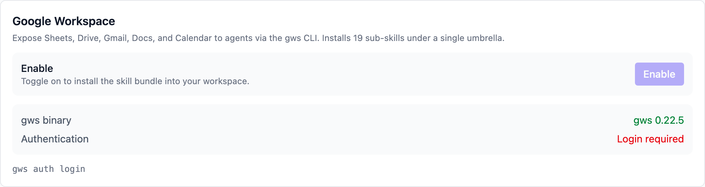
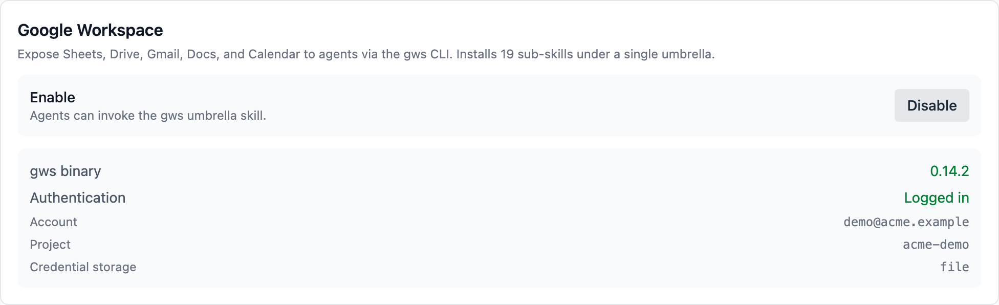

# Google Workspace

Once enabled, the AI can read and write your Google Sheets, Drive files,
Gmail, Docs and Calendar while running a task — filling ad data into a
weekly-report sheet, filing invoices into the right folder, chasing a
supplier by email, putting a launch schedule on the calendar.

Under the hood this uses **gws**, the Google Workspace command-line tool
that covers every Workspace API with one binary. Vibe Seller packages it
into skills the AI can use; you install gws, sign in to Google once,
then flip the toggle in Settings.

Where each integration is configured and how they divide up: see the
[Integrations overview](integrations.en.md).

> The screenshots were taken on macOS; the steps look the same on
> Windows and Linux.

## What you need

- The **gws CLI** (step 1);
- A Google account that can reach Google Workspace (a plain
  @gmail.com account works too — you just won't use the
  organisation-level features);
- A Google Cloud project — step 2 shows how to create one.

## Step 1: Install gws

Any of these ([official README](https://github.com/googleworkspace/cli)):

- **Prebuilt binary** (recommended): download the package for your OS
  from [GitHub Releases](https://github.com/googleworkspace/cli/releases),
  extract it and put `gws` on your PATH;
- **npm**: `npm install -g @googleworkspace/cli`;
- **Homebrew** (macOS / Linux): `brew install googleworkspace-cli`.

Confirm with `gws --version` in a terminal. The Vibe Seller settings
card shows the detected version too.

## Step 2: Sign in to Google

gws needs OAuth credentials from a Google Cloud project before it can
touch your data. Two ways to get them:

**A. With gcloud (fastest)** — in a terminal:

```bash
gws auth setup    # wizard: pick account, create/select project, enable APIs, create OAuth client
gws auth login    # finish the Google sign-in in your browser
```

**B. Manual, without gcloud**:

1. Open the [Google Cloud Console](https://console.cloud.google.com/apis/credentials)
   and create a project;
2. Configure the OAuth consent screen — app type **External**
   (Testing mode is fine);
3. **Add your own Google account under "Test users"** — skip this and
   login fails with "Access blocked";
4. Create an OAuth client of type **Desktop app**, download the JSON
   and save it as `~/.config/gws/client_secret.json`;
5. Run `gws auth login` and pick the services you need.

You are signed in when `gws auth status` says so — and the card's
"Authentication" row in Vibe Seller turns green ("Logged in").

Full docs: [gws CLI README](https://github.com/googleworkspace/cli/blob/main/README.md).

!!! note "'Google hasn't verified this app'?"
    This appears for apps in Testing mode. Click **Continue** →
    **Go to … (unsafe)** — it is your own app, so the warning is part
    of the normal flow. Unverified apps are also limited to ~25 OAuth
    scopes; if `gws auth login` complains there are too many, select
    fewer services: `gws auth login -s drive,gmail,sheets`.

## Step 3: Enable in Vibe Seller

Open **Settings → Integrations → Google Workspace**:

1. The card runs two checks first: **gws binary** (shows the version
   once installed) and **Authentication** ("Logged in" after signing
   in);
2. When both pass, click **Enable** on the right of the "Enable" row.
   The first run takes 20–30 seconds — gws generates documentation for
   every API and the bundle is installed into your workspace;
3. "Enabled — 19 sub-skills installed" means you are done.



The three states side by side:


*No gws yet: follow the download link in the hint*


*Installed but not signed in: run `gws auth login` in a terminal*


*Enabled: the button becomes "Disable", and you can turn it off any time*

## Verify

1. Back on this card, the hint under the "Enable" row now reads
   "Agents can invoke the gws umbrella skill." and the button says
   "Disable";
2. Try a task: “Summarise the last column of this Google Sheet”
   (give it the sheet link);
3. If the AI reads the sheet and gives you the summary, the
   integration works.

## What the AI can do with it

Skills are grouped by Google product and loaded on demand:

| Product | What it covers |
|---|---|
| Sheets | Read/write cells, append rows, update inventory and reports |
| Drive | Find files, upload invoices and certificates, tidy folders |
| Gmail | Read and write mail, forward, reply, summarise the unread |
| Docs | Append text, update listing copy and SOPs |
| Calendar | Look up the schedule, create launch and promo events |

Every action runs as the Google account you signed in with, limited to
the scopes you approved. To take it away, click **Disable** on the card
— the skills are removed from the workspace.

## FAQ

<details markdown="1"><summary><b>"gws binary" says "Not found"?</b></summary>

gws is not on the PATH. Reinstall it (step 1) and **restart Vibe
Seller** so it re-checks. On Windows, restarting is needed after
putting gws.exe on the PATH as well.
</details>

<details markdown="1"><summary><b>"Authentication" says "Login required" but I signed in to Google in the browser?</b></summary>

gws has its own sign-in: run `gws auth login` in a terminal once —
a browser Google session doesn't count. The `gws auth login` line
under the card is there to copy.
</details>

<details markdown="1"><summary><b>Enabling fails with "gws is installed but not authenticated"?</b></summary>

Finish step 2 (`gws auth login`) first, then click Enable again. The
toggle only works once gws is installed **and** signed in.
</details>

<details markdown="1"><summary><b>Is enabling slow?</b></summary>

The first run takes 20–30 seconds while gws generates documentation
for all APIs. After that, enable/disable is quick.
</details>

<details markdown="1"><summary><b>"Access blocked" or 403 during login?</b></summary>

Your OAuth app is in Testing mode and the account is missing from
Test users. In the Cloud Console, OAuth consent screen →
**Test users → Add users**, add your address, then run
`gws auth login` again.
</details>

<details markdown="1"><summary><b>Any limits for a company Google Workspace account?</b></summary>

Administrators can switch off APIs or restrict third-party apps. If
some operations fail with permission errors after connecting, ask
your admin to check the corresponding service in the admin console.
Personal @gmail.com accounts have no such layer.
</details>

<details markdown="1"><summary><b>Is my data still there after disabling?</b></summary>

Disabling only removes the skill bundle — your Google data and the
gws sign-in credentials are untouched. Re-enable whenever you want
it back.
</details>
