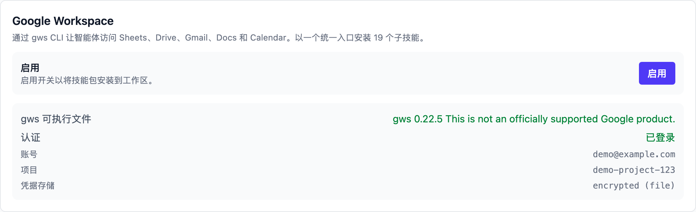
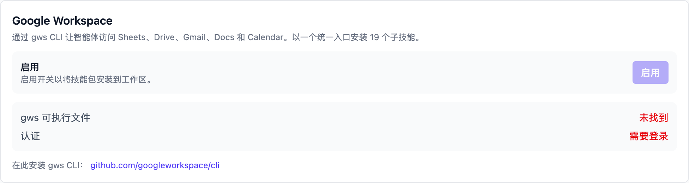
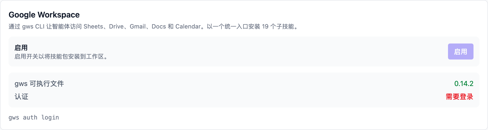
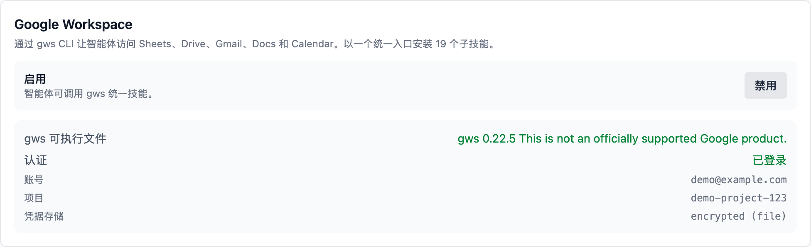

# Google Workspace

启用后，AI 执行任务时可以直接读写你的 Google 表格、云盘文件、
Gmail、文档和日历——例如把广告数据填进周报表格、把发票归档到
指定文件夹、给供应商发送跟进邮件、把上新排期写进日历。

底层使用 Google Workspace 官方命令行工具 **gws**（一个命令覆盖
全部 Workspace API）。Vibe Seller 负责把它整理成 AI 能用的技能；
你要做的是装好 gws、登录一次 Google 账号，然后在设置里点击「启用」。

各集成分别配在哪里、彼此怎么分工，见[集成总览](integrations.md)。

## 接入前准备

- **gws 命令行工具**（见下面第一步）；
- 一个能访问 Google Workspace 的 Google 账号（普通 @gmail.com
  账号也可以，只是部分企业功能用不了）；
- 一个 Google Cloud 项目——没有的话第二步会引导你创建。

## 第一步：安装 gws

按 gws 的[官方 README](https://github.com/googleworkspace/cli) 把命令行工具装好。

安装完成后在终端运行 `gws --version` 确认可用。Vibe Seller 的设置卡片
也会显示检测到的版本号。

## 第二步：登录 Google 账号

gws 需要一个 Google Cloud 项目的 OAuth 凭据才能访问你的数据。
两种做法：

**A. 有 gcloud（最省事）**——在终端运行：

```bash
gws auth setup    # 向导：选账号、建/选项目、开 API、建 OAuth 客户端
gws auth login    # 在浏览器里完成 Google 登录授权
```

**B. 不装 gcloud，手动创建**：

1. 打开 [Google Cloud Console](https://console.cloud.google.com/apis/credentials)
   创建一个项目；
2. 配置 OAuth 同意屏幕：类型选 **External**（Testing 模式即可）；
3. 在 **Test users** 里**加上你自己的 Google 账号**——漏了这一步
   登录时会报 "Access blocked"；
4. 创建一个 OAuth 客户端：类型选 **Desktop app**，下载 JSON 保存为
   `~/.config/gws/client_secret.json`；
5. 在终端运行 `gws auth login`，按提示勾选需要的服务完成授权。

登录成功的标志是 `gws auth status` 显示已登录。Vibe Seller 设置
卡片里的「认证」一栏也会变成绿色的「已登录」。

官方文档：[gws CLI README](https://github.com/googleworkspace/cli/blob/main/README.md)。

!!! note "「Google 尚未验证此应用」？"
    Testing 模式的应用都会出现这个提示，点击 **继续**（高级）→
    **转到...（不安全）** 即可；这是你自己的应用，出现「风险自负」
    类的提示属于正常流程。另外，未验证应用的授权范围上限约 25 个，
    如果 `gws auth login` 报 scope 太多，改用
    `gws auth login -s drive,gmail,sheets` 只勾选需要的服务。

## 第三步：在 Vibe Seller 里启用

打开「设置 → 集成 → Google Workspace」：

1. 卡片会先显示两项检查：**gws 可执行文件**（安装后显示版本号）
   和 **认证**（登录后显示「已登录」）；
2. 两项都通过后，点击「启用」一行右侧的 **启用** 按钮。第一次
   需要 20–30 秒——gws 要为所有 API 生成文档，生成完自动装入工作区；
3. 看到「已启用 — 已安装 19 个子技能」就完成了。



三态对照：


*还没装 gws：点击提示里的链接去下载*


*已安装但没登录：按提示在终端运行 `gws auth login`*


*启用后：按钮变为「禁用」，随时可以关闭*

## 验证

1. 回到这块设置：「启用」一行下面的提示变为「智能体可调用 gws
   统一技能。」，按钮也变成了「禁用」；
2. 创建一个任务试试：“把这张 Google 表格的最后一列汇总一下”
   （附上表格链接）；
3. AI 能读出表格内容并给出汇总，就说明接入成功了。

## 接入后 AI 能做什么

技能按 Google 的产品分组，任务里 AI 按需取用：

| 产品 | 能做的事 |
|---|---|
| 表格 Sheets | 读写单元格、追加行、更新库存和报表 |
| 云盘 Drive | 查找文件、上传发票和资质、整理文件夹 |
| Gmail | 读写邮件、转发、回复、汇总未读 |
| 文档 Docs | 追加文字、更新 listing 文案和 SOP |
| 日历 Calendar | 查询日程、创建上新和促销日程 |

这些操作都以你登录的 Google 账号身份进行，权限范围就是你在
授权时勾选的那些。不想让 AI 继续使用，随时在设置卡片点击 **禁用**——
技能会从工作区移除。

## 常见问题

<details markdown="1"><summary><b>「gws 可执行文件」显示「未找到」？</b></summary>

gws 不在 PATH 里。按第一步重新安装，然后**重启 Vibe Seller**
（让它重新检测）。Windows 上把 gws.exe 放进 PATH 后同样需要重启。
</details>

<details markdown="1"><summary><b>「认证」显示「需要登录」，但我在浏览器登录过 Google？</b></summary>

gws 的登录是独立的——需要在终端里运行 `gws auth login` 完成一次
授权，浏览器里的 Google 登录状态不算数。卡片下方显示的
`gws auth login` 就是复制到终端里运行的。
</details>

<details markdown="1"><summary><b>点「启用」报错 gws is installed but not authenticated？</b></summary>

先完成第二步的登录（`gws auth login`），再回来点击启用。启用
开关只有在 gws 装好**且**登录之后才可以点击。
</details>

<details markdown="1"><summary><b>启用要多久？会不会很慢？</b></summary>

第一次 20–30 秒——gws 在为所有 API 生成文档。之后的启用、禁用
都很快。
</details>

<details markdown="1"><summary><b>登录时报 "Access blocked" 或 403？</b></summary>

OAuth 应用处于 Testing 模式，而你的账号没有加入 Test users。回到
Cloud Console 的 OAuth 同意屏幕 → **Test users → Add users**
加上自己的邮箱，重新运行 `gws auth login`。
</details>

<details markdown="1"><summary><b>公司 Google Workspace 账号有什么限制？</b></summary>

管理员可以关闭部分 API 或限制第三方应用访问。如果授权后
某些操作报权限错误，请管理员在管理控制台检查对应的
服务开关。个人 @gmail.com 账号没有这个层级的管控。
</details>

<details markdown="1"><summary><b>禁用后数据还在吗？</b></summary>

禁用只移除技能包，不会改动你的 Google 数据，也不会删除 gws 的登录
凭据。想再使用时随时重新启用。
</details>
