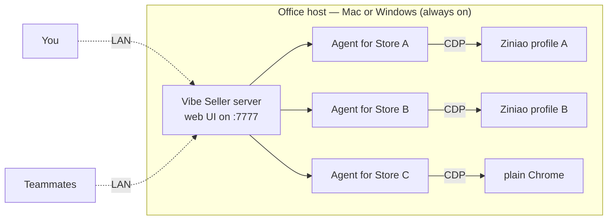

<h1 align="center">Vibe Seller</h1>

<p align="center">
  <b>AI automation framework for cross-border sellers (supports Amazon, Noon, Mercado Libre, Qianniu and more; Ziniao, Yuehulian, Chrome and other browsers). Freely connect any LLM.</b><br/>
  Runs on macOS, Linux, or Windows (native installer). Local-first — code on your machine, data on your disk. Works with Claude, DeepSeek, GLM, Qwen, Kimi, MiniMax — any Anthropic-compatible provider.
</p>

<p align="center">
  <a href="/en/">English</a> ·
  <a href="/">中文</a>
</p>

<p align="center">
  <a href="https://join.slack.com/t/vibeseller/shared_invite/zt-4fjzkwkqs-L0pM6VS7~_2WsPCxTeLbew"></a>
  <a href="#community"></a>
</p>


[▶ Watch the full video](videos/demo_en.mp4)


🔥 *News* 🔥

- [Nov 2026] **Let the AI use WeCom / Feishu / DingTalk**: click Connect, scan or authorize, and the AI writes docs and sheets, sends messages and schedules events: [**details**](workplace-cli.en.md)
- [Nov 2026] **MCP setup**: drive Vibe Seller from the AI tool you already use — Claude, Codex, WorkBuddy, Qoder: [**details**](mcp.en.md)
- [Nov 2026] **Amazon ads over the Ads API**: the same ad-optimization task went from 147 minutes to 11, with less need to step in: [**details**](ads-api.en.md)

---

## What is Vibe Seller?

A local-first **browser-automation framework**. AI agents drive your
real browser — Ziniao for fingerprint isolation, or plain Chrome —
through CDP (Chrome's low-level remote-control protocol), the same
way you'd click through pages yourself. Ad tuning, listing launches, inventory checks, invoicing,
returns, warehouse setup, logistics lookup — whatever you can do in
a browser, the agent can do too.

Each store gets its own agent — **think of it as hiring a different
ops person for each store**. The Store A agent only sees Store A's
profile, has its own memory and workspace, can't touch the other
stores' agents.



Either deployment works:

- **One always-on machine** (Mac, Linux, or Windows) hosts the
  server
- **Or just use your own computer**

You and your team open the web UI from any device on the same LAN.

## Why Vibe Seller?

Compared to existing automation tools, Vibe Seller is built around
what cross-border sellers actually need and what today's AI models
can actually do well: AI-driven by design, with built-in Skills,
per-store isolation, and fully local deployment. Browser control
runs on [browser-use](https://github.com/browser-use/browser-use)
instead of blind screenshot-clicking — faster, and far cheaper in
tokens, than an agent that has to feel out every page from
scratch.

- **Batteries-included, no hand-holding.** Amazon (every marketplace),
  Noon, and more ship with built-in Skills for the jobs sellers
  actually do — report / statement export, listing creation & updates,
  ad tuning. Create a task and the system opens the browser (Ziniao or
  Chrome) and the agent operates it directly — usually right on the
  first try, no step-by-step guidance needed.
- **Native Ziniao control.** CDP, not Playwright on vanilla Chrome,
  not UI-coordinate clicks. Lower risk-control risk, more stable.
- **Multi-browser by design.** Ziniao, Yuehulian and plain Chrome are
  all first-class backends — pick per store. Downloads, setup and how to
  choose: [Browsers](browsers.en.md).
- **Multi-LLM by design.** Built on top of the Claude Code CLI, so
  any Anthropic-compatible provider works — Claude, DeepSeek, Kimi,
  MiniMax, GLM, Qwen. Switch in Settings, no code changes. Your key,
  your bill.
- **No SaaS lock-in.** Code on your machine, data on your disk, no
  account required.
- **Auditable.** Every step, every prompt, every screenshot is logged
  and replayable.
- **Multi-store from day one.** Each store keeps its own platform,
  data, SOPs, accumulated knowledge. Store A on Amazon US with its
  own listing strategy, Store B on Noon EG with totally different
  SOPs, Store C on Shopify DTC — they coexist without cross-talk.

## Install

**🪟 Windows**: download [VibeSeller-Setup.exe](https://github.com/zpoint/vibe-seller/releases/latest),
double-click it, and when it's done your default browser opens
<http://localhost:7777>. Later, click Vibe Seller in the Start menu, or go to
that address in your browser yourself.

**🍎 macOS / 🐧 Linux**: open a terminal, run these two lines, then open
<http://localhost:7777> in your browser:

```bash
curl -sSL https://raw.githubusercontent.com/zpoint/vibe-seller/main/install.sh | bash
vibe-seller start
```

Step-by-step pictures, upgrading and uninstalling, WSL2 and installing
from source: [Installation](install.en.md).

## Quickstart

Once it's installed, three steps get your first task running; the
illustrated walkthrough is the [Quickstart](quickstart.en.md):

1. **Set up AI**: in **Settings → AI**, click **Add Model**, pick a
   provider, paste its API key and click **Create**. No key yet? DeepSeek
   is the easiest first choice; how to get one from each provider:
   [Configure AI Models](llm-keys.en.md);
2. **Add a store**: click **+ New Store**. If your store uses Ziniao or
   Yuehulian, pick that browser; otherwise pick Chrome. Using Ziniao? Its
   main account has to grant access first; see
   [Ziniao: Prerequisites](ziniao.en.md#prerequisites-developer-mode-and-webdriver-login);
3. **Create a task**: select the store, click **+ New Task**, say what you
   want in one sentence, e.g. “Export the last 7 days' sales report”, and
   click **Create & Run**.

## What you can do with it

Vibe Seller is an **AI agent framework** — the browser is one of
its tools, not the only one. The agent can browse pages, read your
email, send group chat messages (WeCom / DingTalk / Feishu / Slack), write to TickTick / Dida365, update
Google Docs. Anything that fits *observe → decide → act* — whether
a browser is involved or not.

A few cross-border scenarios it's commonly used for:

| Task | What happens | Example |
|---|---|---|
| **Ad tuning** | Reads Campaign Manager, finds under- and over-spenders, proposes bid / budget changes, applies them with your approval. | [Analyse ad ACOS and apply fixes](example-ads-acos.en.md) |
| **Listing audit** | Walks every store's catalog, flags suppressed / out-of-stock / inactive items. | [Weekly listing check](example-listing-check.en.md) |
| **Invoices & reports** | Crawls tax docs, business reports, advertising reports; downloads are archived to Google Drive. | [Monthly sales report](example-daily-report.en.md) |
| **Email handling** | Sorts buyer messages, forwards important ones to the group chat, drafts replies. | [Daily email digest to WeCom](example-email-wecom.en.md) |
| **From other AI tools** | Say it in Codex, Claude and the like — Vibe Seller fetches the data from Seller Central, that tool's AI analyses it. | [Export a Ziniao store's finances with Codex](example-mcp.en.md) |
| **Listing publication** | Creates new listings from a template — title, bullets, photos, A+ content, variations. | |
| **Inventory check** | Pulls stock levels; low-stock SKUs get pushed to the group chat automatically. | |
| **Warehouse / inbound setup** | Creates inbound shipments, allocates SKUs to FBA / FBN, prints box labels. | |
| **Logistics lookup** | Tracks in-transit shipments, freight delivery, customs clearance; flagged shipments get filed as TickTick todos. | |
| **Anything you add** | Write a Skill (a markdown file with steps) or teach the agent once — it'll remember next time. | |

A single ad-tuning run is ≈ 3–5 minutes and costs about 0.15 USD in LLM tokens
(DeepSeek, 10 or fewer campaigns; more campaigns cost more). Every example has a
description to copy, the settings screenshots and the finished result — see
[All Examples](examples.en.md).

## Docs

| | |
|---|---|
| **Getting started** | [Installation](install.en.md) · [Quickstart](quickstart.en.md) · [Configure AI Models](llm-keys.en.md) · [Core Concepts](concepts.en.md) |
| **Browsers** | [Browsers Overview](browsers.en.md) · [Ziniao: Setup & Common Errors](ziniao.en.md) · [Yuehulian: Setup Guide](yuehulian.en.md) |
| **Integrations** | [Overview](integrations.en.md) · [MCP setup](mcp.en.md) · [Amazon Ads API](ads-api.en.md) · [Email](email.en.md) · [Chat bots](chat-bots.en.md) · [WeCom / Feishu / DingTalk](workplace-cli.en.md) · [TickTick / Dida365](ticktick.en.md) · [Google Workspace](google-workspace.en.md) |
| **Examples** | [All Examples](examples.en.md) · [Daily email digest to WeCom](example-email-wecom.en.md) · [Analyse ad ACOS and apply fixes](example-ads-acos.en.md) · [Weekly listing check](example-listing-check.en.md) · [Monthly sales report](example-daily-report.en.md) · [Export a Ziniao store's finances with Codex](example-mcp.en.md) |
| **User guide** | [Stores & Browsers](stores.en.md) · [Tasks](using-tasks.en.md) · [Schedules](schedules.en.md) · [Knowledge & Skills](knowledge.en.md) |
| **FAQ** | [About Vibe Seller](faq-about.en.md) · [Cost & Model Choice](faq-cost.en.md) · [Login & Accounts](faq-login.en.md) · [Deployment & Data](faq-data.en.md) · [All Questions](faq.en.md) |
| **Community** | [Community & Feedback](community.en.md): the WeChat group, Slack, and how to report a problem or suggest a feature |
| **Developer (English)** | [Developer Guide](dev-guide.md) · [Task Internals](tasks.md) · [Browser Internals](browser.md) · [Subsystems](subsystems.md) · [External Agents (MCP API)](agents.md) · [Windows + WSL2 service](windows-setup.md) · [macOS service](macos-setup.md) |

Architecture lives in [`DESIGN.md`](https://github.com/zpoint/vibe-seller/blob/main/DESIGN.md);
deeper subsystem notes are in the [`docs/`
tree](https://github.com/zpoint/vibe-seller/tree/main/docs).

## Integrations

Beyond the browser, the agent can call these external services
directly — everything is hooked up under **Settings → Integrations**,
no code:

- **MCP** — drive Vibe Seller from the AI tool you already use — Claude, Codex, WorkBuddy, Qoder, Hermes Agent, Pi: create tasks, follow them, answer questions, review plans. [Setup guide](mcp.en.md)
    - The other way round: connect an outside MCP service such as Xiyou Insight to Vibe Seller, and the AI in your tasks uses its tools directly. [Add a custom MCP server](mcp-custom.en.md)
- **Amazon Ads API** — Amazon ad tasks call the API instead of clicking through the seller console; in our test the same ad task went from 147 minutes to 11. [Setup and measured comparison](ads-api.en.md)
- **Email** (IMAP/SMTP) — read your linked store mailboxes, sort and summarize, draft and send replies (sending can be turned off per mailbox). Works with 163 / QQ / Gmail and more. [Setup guide](email.en.md)
- **Group chat bots** (WeCom / DingTalk / Feishu / Slack) — have the AI post results, reports and reminders straight into a group; WeCom bots can send files too. [Setup guide](chat-bots.en.md)
- **WeCom / Feishu / DingTalk** — with each vendor's official program, the AI writes docs and sheets, sends messages, schedules events and creates to-dos; connect by scanning or authorizing. [Setup guide](workplace-cli.en.md)
- **TickTick / Dida365** — auto-create todos (follow-ups, order tracking, periodic checks). [Setup guide](ticktick.en.md)
- **Google Workspace** — with Google's official program, the AI reads and sends Gmail, edits Sheets and Docs, uploads to Drive and schedules Calendar events; click Connect and sign in with Google. [Setup guide](google-workspace.en.md)

A single task can mix browser + service calls. e.g. *“Find all
slow-moving SKUs across stores”* → browser pulls inventory →
generates a Google Sheet → posts a chat summary → drops a "price
review next week" todo into TickTick. Start at the
[Integrations overview](integrations.en.md).

## Platforms

Any marketplace you can work in a browser — Amazon, Noon, Mercado Libre, Qianniu (Taobao /
Tmall), AliExpress, Shopee, TikTok Shop… **If it runs in a browser, Vibe Seller can work it.**
At its core it is **an AI agent + the Ziniao browser (or plain Chrome) + built-in tools**: the
agent opens the store's back office and storefront the way you would — clicking, reading,
filling in forms, downloading.

Amazon and Noon get the most built-in tools:

- **Amazon** (every marketplace): built-in Skills for ads, reports, listings, FBA inbound,
  invoices and product images, plus the [Amazon Ads API](ads-api.en.md) connection so ad work
  goes through the API — faster and steadier;
- **Noon**: built-in Skills for ads, report exports, listings and FBN;
- **Qianniu**: built-in Skills for ads and listings.

Other platforms have no dedicated Skill, and the agent still does back-office and storefront
work through Ziniao or a plain browser. The first runs may take a few extra tries; the paths
that work go into that store's knowledge, so the next run follows them and it settles down
after a few rounds. You can also write your own steps as a Skill and import it (see
[Import an existing Skill](knowledge.en.md#import-an-existing-skill)), or polish it and
contribute it to the project (see *Contributing* below).

## Contributing

PRs welcome — whether you write the code yourself or let Claude
Code / Cursor / your coding agent do it. Python side is Google
style (ruff-enforced); frontend is TypeScript strict + ESLint.
[`CLAUDE.md`](https://github.com/zpoint/vibe-seller/blob/main/CLAUDE.md) is the project conventions doc — it's
written for AI agents and reads cleanly as a contributor guide.

## License

[Apache License 2.0](https://github.com/zpoint/vibe-seller/blob/main/LICENSE).

## Community

- **Slack** — [join the VibeSeller workspace](https://join.slack.com/t/vibeseller/shared_invite/zt-4fjzkwkqs-L0pM6VS7~_2WsPCxTeLbew)
- **WeChat** — scan to join the user group:


Found a problem or have an idea? See [Community & Feedback](community.en.md).
