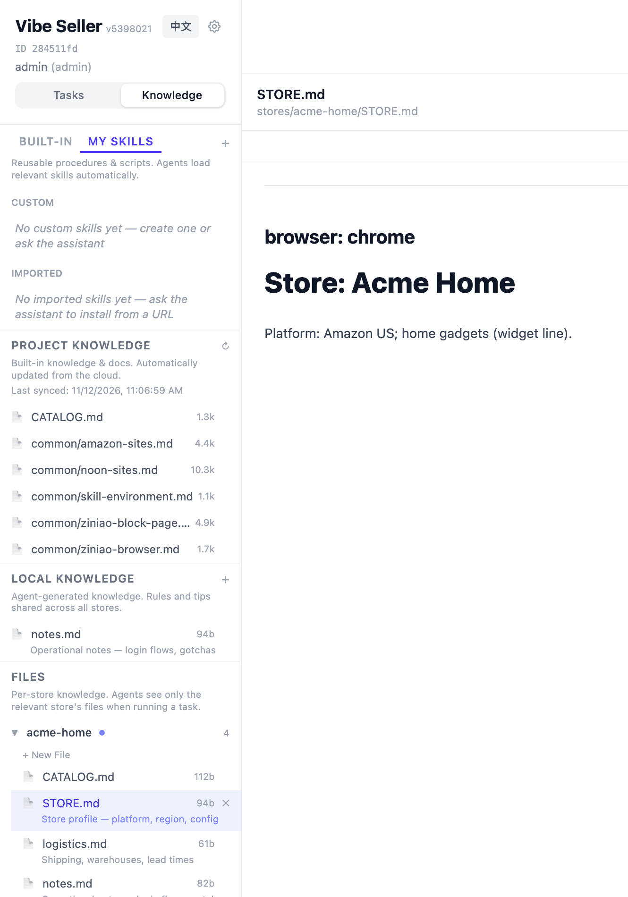
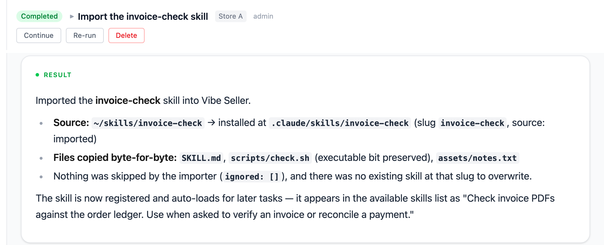
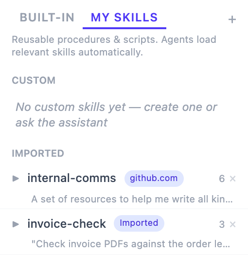

# Knowledge & Skills

The AI doesn't start each task from amnesia: it remembers how you ship, where
your ads were tuned to last time, and how each platform's pages work. That
memory lives **entirely in plain markdown files on your own machine** — you can
read them, edit them, copy them to another machine; nothing is locked inside
the program. The **Knowledge** page in the sidebar is its management UI.

The page has two modes (switch at the top): **Files** — browse and edit
knowledge files directly; **AI Chat** — treat the workspace assistant as a
dictation pad: just tell it things and it writes them into the right file for
you.

## Three layers of knowledge

The sidebar sections (and the three directories on disk) are:

| Layer | Called | Location (on the server) | Who can change it | What it holds |
|---|---|---|---|---|
| Built-in | **Project Knowledge** | `~/.vibe-seller/knowledge/project/` | read-only; updated from the cloud | preset platform know-how and universal rules |
| Cross-store | **Local Knowledge** | `~/.vibe-seller/knowledge/` | you and the AI, freely | rules and tricks shared across stores: piggyback listings, shared brands / suppliers, your general SOPs |
| Per-store | **Files** under each store | `~/.vibe-seller/stores/<slug>/` | you and the AI, freely | everything belonging to one shop: store profile, operational notes, logistics, per-platform / per-country page experience |

Working notes:

- Store knowledge is **isolated**: while running a task for store A, the agent
  sees only store A's files — nothing crosses between shops;
- Project Knowledge is badged built-in, read-only, and refreshed from the
  cloud — edits there get overwritten. Put your own lessons in Local Knowledge
  or store files;
- Local Knowledge and store files are yours: never overwritten;
- Every file has **History** — you can restore an earlier version.

**The easiest habit is the AI Chat mode**: tell the assistant things like
“our US store ships with FedEx, DHL for international” or “Store A's
seller account email is ops@example.com” and it saves them into the right
file, then uses them in every relevant task. Prefer typing it yourself?
Switch to Files mode and edit the markdown directly.

## Store notes and parameter overrides

A new store folder starts with `STORE.md` (profile), `notes.md` (operational
notes) and `logistics.md`; the agent adds finer notes (e.g. per-platform,
per-country page know-how) as it works. `notes.md` has one extra job: some
built-in capabilities (currently mainly Amazon Ads) read their default
thresholds from it — one `key: value` line per setting in the store's
**top-level `notes.md`**, and for a repeated key **the last line wins**.

The ad audit/tuning defaults (overridable in `notes.md`; `:` or `=`, the key
is case-insensitive, and an explanation may follow after a dash or an opening
bracket):

| Key | Default | What it governs |
|---|---|---|
| `acos_no_lower` | 25 | don't propose bid cuts on targets whose ACOS is under this percent |
| `scale_roas` | 5 | a "hold" on a row with ROAS above this must carry an explicit reason |
| `change_cooldown_days` | 7 | targets changed within this many days are left alone by default |
| `cpc_floor_multiplier` | 1.1 | never cut a bid below the row's actual CPC × this — under the price it already clears, serving stops |
| `reconcile_tolerance` | 0.15 | allowed relative deviation when reconciling report totals |
| `noon_reconcile_floor` | 0.85 | minimum share of targeting spend that search terms must cover |

Example: a low-ticket store that tolerates more aggressive bid cuts just adds
`acos_no_lower: 20` to that store's `notes.md`. Only the **top-level
`notes.md`** of the store is read for overrides — a key inside a subfolder
note does nothing, and a mention inside a sentence ("20 would be fine")
doesn't count either: it must be its own `key: value` line.

Margin (`margin`) is not a server-checked rule but the AI's breakeven input:
untold, it assumes 25% and flags that in the report; writing `margin: 40`
makes it re-derive target ACOS and cut-off lines from your real margin.
And **anything you state directly in a task always beats these defaults** —
the notes.md values are for standards that hold for the store every run.

## Run Data

Files produced by runs — reports, exports, captures — are **outputs**, not
knowledge. Store tasks file their important artifacts under
`~/.vibe-seller/store-data/<slug>/`, bucketed by month, and the Knowledge
page shows each store's **Run Data** section where you can browse and
download them. When a later task needs the same data, the agent reads these
files first instead of re-collecting — one reason repeated report tasks get
faster over time.

## Skills: teach the AI your procedures

A Skill is a written playbook for the agent (markdown steps, optionally with
scripts). Agents load relevant skills automatically while working, so they
follow your proven procedure instead of rediscovering it every task.

The skills panel has two tabs: **Built-in** and **My Skills**.

**Built-in skills** ship and are maintained upstream, read-only: Amazon (ad
tuning, listings, report exports, FBA inbound, invoices, image studio), Noon,
Qianniu (Taobao / Tmall), review collection, browser automation, and more —
that's why tasks work out of the box. Built-ins **sync from the official
repo daily** by default (toggle: **Settings → General → Skills → Auto-sync
skills from the official repo**; off pins the local copy, and you can still
hit **Sync built-in skills** in the panel manually).

**My Skills** splits into **Custom** (created by you or the assistant) and
**Imported** (installed from a URL or an archive). Three ways to add your own:

1. **Let the AI remember** — the recommended one: walk it through a procedure
   once, then say “save this workflow as a skill so next time do it exactly
   like this”; it writes the skill file and follows it in later tasks;
2. **Ask in the Knowledge page's AI Chat** — e.g. “Create a skill for
   checking inactive listings”; the assistant asks the few details it needs
   and writes it;
3. **Click Create skill in the panel and write it** — it's a markdown file:
   a name plus a one-sentence description at the top (that sentence is how
   the AI decides when to use it), then concrete steps: which page to open,
   what to click, how to judge the result.

Imported skills are badged as such — local edits may diverge from the original
source.

### Import an existing skill

If you've already written a skill for Codex, Claude Code or another tool, you
can import it into Vibe Seller as it is — no need to rewrite it. Imported skills
appear under **My Skills**, and later tasks load them automatically.

There are two ways to import:

**Import with a task**

For a skill folder on the machine that runs Vibe Seller. Create a task (under
**All stores** or any store) and give the skill's path in the description, for
example:

> Import the skill at ~/.codex/skills/invoice-check into Vibe Seller.

The task imports the whole folder, including its scripts, templates and images.

Once imported, it shows under **My Skills** with the **Imported** badge:

**Import over MCP**

For AI tools [connected over MCP](mcp.md), such as Codex or WorkBuddy. In that
tool's chat, send:

“Import my local invoice-check skill into Vibe Seller.”

The AI tool packs the skill folder and uploads it. The skill doesn't need to be
on the same machine as Vibe Seller.

**Import rules**

- The folder must have a `SKILL.md` at its root; the skill's name comes from
  its `name` field;
- If **My Skills** already has a skill with the same name, you're asked to
  confirm before it is replaced;
- A skill can't share a name with a built-in skill (built-ins are read-only);
  rename it and import again.

You can also send the link to a public skill in the Knowledge page's **AI
Chat**, and the assistant installs it from that link.

## Limits and gotchas

- The knowledge folders live on your deployment machine (under
  `~/.vibe-seller/` by default): backing up or migrating is just copying
  those folders;
- Built-in layers (Project Knowledge, built-in skills) are read-only and get
  overwritten by upstream updates — put your accumulation in Local Knowledge,
  store files and My Skills, which never are;
- These files are the agent's entire memory: there is no second copy hidden in
  a database. Fix the markdown, and you've fixed what the AI believes.
