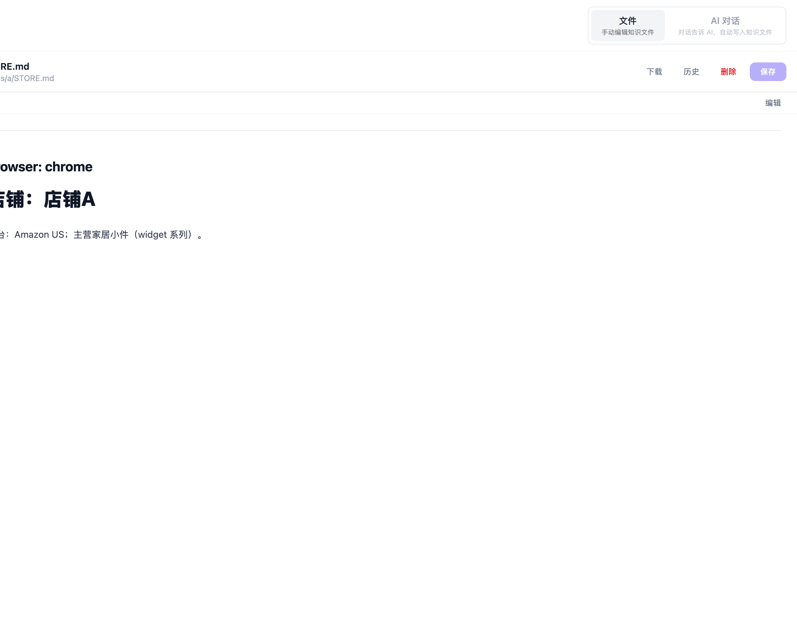
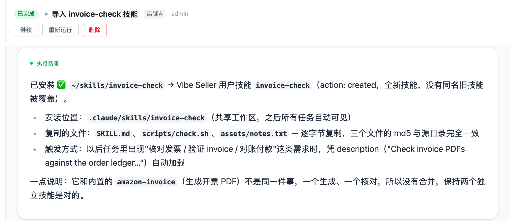
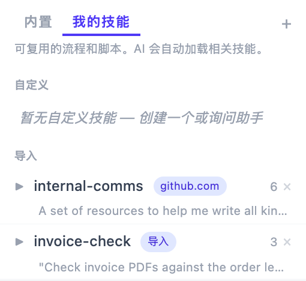

# 知识库与 Skill

AI 执行任务时不是从零开始的：它记得你店的发货方式、上次广告调到什么水位、哪个平台
页面怎么操作。这些记忆**全部保存在你自己机器上的纯 markdown 文件里**——你能查看、
能修改、能拷贝到另一台机器，没有任何内容锁在程序内部。侧栏「知识库」页面就是
这套记忆的管理界面。

页面有两种模式（在顶部切换）：「文件」用于直接浏览和编辑知识文件；
「AI 对话」把工作区的助手当记事本使用，跟它说就行，它替你写进对应文件。

## 三层知识

从侧栏的文件分区看，知识分三层（也就是磁盘上的三个目录）：

| 层 | 界面里叫 | 位置（服务器本机） | 谁能修改 |
|---|---|---|---|
| 内置 | **项目知识** | `~/.vibe-seller/knowledge/project/` | 只读 |
| 跨店 | **本地知识** | `~/.vibe-seller/knowledge/` | 你和 AI 都可以 |
| 店铺 | 店铺下的**文件** | `~/.vibe-seller/stores/<店铺>/` | 你和 AI 都可以 |

各层存放的内容：**项目知识**是官方预置的平台操作知识和通用规则，随版本更新；
**本地知识**放跨店铺共享的规则和技巧，例如跟卖关系、共享品牌和供应商、你的通用 SOP；
**店铺文件**只属于这一家店，包括店铺资料、运营笔记、物流、各平台各站点的具体经验。

使用时的几点须知：

- 店铺的知识**互相隔离**：AI 执行 A 店任务时只看得到 A 店文件，不会读到其他店铺；
- 「项目知识」标注为内置、只读，会定期从云端自动更新，修改也会被覆盖。想沉淀自己的
  经验，请写「本地知识」或店铺文件；
- 「本地知识」和店铺文件永远不会被云端覆盖，完全属于你自己；
- 每个文件都有「历史」，可以恢复到之前的版本。

**推荐用「AI 对话」模式来积累知识**：直接告诉助手“我们美国站用 FedEx 发货，
国际件用 DHL”，或者“店铺A的卖家账号邮箱是 ops@example.com”，它会记住并写进
对应文件，之后所有相关任务都会用上。不想让 AI 代笔的文件，切到「文件」模式自己
编辑即可。

## 店铺笔记与参数覆盖

店铺目录创建时会自带几个文件：`STORE.md`（店铺资料）、`notes.md`（运营笔记）、
`logistics.md`（物流）。之后 AI 会在执行任务的过程中自行添加更细的笔记，比如某个
平台某个站点的页面操作经验。

`notes.md` 除了记录文字，还有一层**配置**作用：某些内置能力（目前主要是亚马逊广告）
的默认阈值，可以在这个文件里按店铺改写，一行一个 `键: 值`，**同一个键最后一次出现的
行生效**。

广告审计和调优的默认阈值如下，都可以在 `notes.md` 里覆盖。格式上键值之间用等号或
冒号都可以，键不区分大小写；值后面可以跟一句解释，用破折号或括号隔开。

| 键 | 默认值 | 含义 |
|---|---|---|
| `acos_no_lower` | 25 | ACOS 低于这个百分比的词组 |
| `scale_roas` | 5 | ROAS 高于这个数的行 |
| `change_cooldown_days` | 7 | 距上次改动的天数 |
| `cpc_floor_multiplier` | 1.1 | 压价下限相对实际 CPC 的倍数 |
| `reconcile_tolerance` | 0.15 | 报表对账允许的偏差比例 |
| `noon_reconcile_floor` | 0.85 | Noon 搜索词花费覆盖率的下限 |

各键的具体规则：ACOS 低于 `acos_no_lower` 的词组，不建议降低竞价；ROAS 高于
`scale_roas` 的行，要标记为「维持」必须写明理由；距上次改动不足 `change_cooldown_days`
天的目标默认不再调整；压价不能低于该行实际 CPC 的 `cpc_floor_multiplier` 倍——再低就
低于已经在赢的出价，广告反而会失去流量。

例如你家客单价低、允许更激进的降价，就在该店 `notes.md` 里加一行
`acos_no_lower: 20`。注意只有**店铺根目录的 `notes.md`** 会被读作参数覆盖，
写在子目录笔记里不生效；没有单独成行、混在句子中间的一句话也不算，必须是
一行一条的 `键: 值`。

毛利（`margin`）不是服务器校验的规则，而是 AI 计算盈亏线的输入：不告诉它毛利时，
它按 25% 假设并在报告里注明；在 `notes.md` 里写 `margin: 40`，它会按你的真实毛利
重新推算目标 ACOS 和止损线。**你在任务里明确给出的指令永远优先于这些默认值**——
参数覆盖是给一家店长期不变的设定使用的。

## 运行数据

任务产出的报表、导出文件和抓取文件属于**产物**，不属于知识。店铺任务的重要产物由
AI 归档在 `~/.vibe-seller/store-data/<店铺>/` 下，按月份分桶；知识库页面的每个店铺
下有一个「运行数据」分区，可以直接浏览和下载。AI 下次需要同批数据时，会先读取
这里已有的文件，而不是重新一页页抓取——报表类任务越执行越快的原因就在这里。

## Skill：让 AI 学会你的流程

Skill 是一份写给 AI 的操作手册（markdown 步骤说明，可以附带脚本）。AI 执行任务时
会自动加载相关的 Skill，按你沉淀好的流程执行，而不是每次从零摸索。

知识库页面的技能分两个标签：「内置」和「我的技能」。

**内置 Skill** 随官方维护、只读：亚马逊（广告调优、Listing、报表导出、FBA 建仓、
税票下载、商品图）、Noon、千牛（淘宝、天猫）、评价收集、浏览器自动化等，开箱就能
使用——这也是它无需额外引导就能工作的基础。内置 Skill 默认**每天自动从官方仓库同步**
更新，开关在「设置 → 通用 → Skills → 自动从官方仓库同步 Skills」（默认开启）。
关闭后固定使用本地版本，仍然可以在技能面板手动点击「同步内置技能」。

「我的技能」分两类：「自定义」是你或助手创建的；「导入」是从 URL 或压缩包
安装的第三方技能。添加自己的技能有三条路：

1. **让 AI 自己记录**——最推荐：带它把一套流程执行一遍，然后说“把这套流程存成
   技能，下次照这个做”，它会写成技能文件，之后的同类任务都按你的习惯来；
2. **在知识库的 AI 对话里说**——比如“创建一个检查被下架的 Listing 的技能”，
   助手会边询问细节边写出来；
3. **在技能面板点击「创建技能」自己写**——就是一个 markdown 文件：开头写明技能
   名称和一句话描述（AI 靠这句话决定什么时候使用它），下面是操作步骤，越具体越好：
   进入哪个页面、点击什么、怎么判断结果。

「导入」的技能在本地编辑后可能与原始来源不再同步，面板里会标注。

### 导入已有的 Skill

如果你已经在 Codex、Claude Code 等工具中编写了 Skill，可以直接导入 Vibe Seller，
无需重新编写。导入后的 Skill 显示在「我的技能」中，后续任务会自动加载。

支持两种导入方式：

**通过任务导入**

适用于 Skill 文件夹位于运行 Vibe Seller 的电脑上。新建一个任务（「全部店铺」或任一
店铺均可），在描述中写明 Skill 的路径，例如：

> 把 ~/.codex/skills/invoice-check 导入 Vibe Seller。

任务会完整导入整个文件夹，包括其中的脚本、模板和图片等文件。

导入后，「我的技能」里能看到它，带「导入」标记：

**通过 MCP 导入**

适用于已[接入 MCP](mcp.md) 的 AI 工具，如 Codex、WorkBuddy。在该工具的对话中发送：

“把本地的 invoice-check skill 导入 Vibe Seller。”

AI 工具会将 Skill 文件夹打包上传。这种方式不要求 Skill 与 Vibe Seller 在同一台电脑上。

**导入规则**

- 文件夹根目录需包含 `SKILL.md`，Skill 名称以其中的 `name` 为准；
- 「我的技能」中已有同名 Skill 时，会先征求你的确认，再进行替换；
- 不能与内置 Skill 同名（内置 Skill 为只读），请更换名称后再导入。

此外，也可以在知识库的「AI 对话」中发送公开 Skill 的链接，由助手从该链接安装。

## 限制与注意

- 知识目录在你的部署机器上（默认 `~/.vibe-seller/`）：备份和迁移就是拷贝这几个
  文件夹；
- 内置内容（项目知识、内置技能）只读，并且会被官方更新覆盖。你的积累请放在本地
  知识、店铺文件和「我的技能」里，这些内容永远不会被改动；
- AI 的记忆只有这些文件：数据库里并没有另一份存给 AI 的记忆。文件写对了，AI 的认知就对了；
  发现知识过时，直接修改文件即可。
