# Configure AI Models

!!! note "These are your model provider's keys"
    This page is about API keys from **model providers** such as DeepSeek or Claude. You enter them under Settings → AI so Vibe Seller can call the model.
    They are not the Vibe Seller API keys generated under Settings → Integrations → API keys — those let external AI tools such as Claude or Codex connect to Vibe Seller; see [MCP Setup](mcp.md).

Vibe Seller itself is free; the AI model doing the work runs on **your own API
key**. Think of it as a password plus billing account the model provider gives
you: Vibe Seller uses it to call the model, and the cost lands on your account
with that provider.

This page covers three things for each provider: **where to sign up, where to
click to create the key, and which preset to pick in Vibe Seller**. New to all
this? Start with "Which provider?" below.

**Contents**

- [Which provider?](#which-provider)
- [The general flow](#the-general-flow)
- Getting a key, provider by provider:
    - [DeepSeek](#deepseek)
    - [Kimi](#kimi)
    - [MiniMax](#minimax)
    - [Zhipu GLM](#zhipu-glm)
    - [Qwen (Alibaba Cloud Model Studio)](#qwen-alibaba-cloud-model-studio)
    - [Xiaomi MiMo](#xiaomi-mimo)
    - [Claude](#claude)
- [FAQ](#faq)

## Which provider?

| Your situation | Suggestion |
|---|---|
| First time, just want to try it | **DeepSeek**: sign up, top up a small amount, pay per use, no monthly fee |
| Claude Code on this machine is already signed in to a Claude subscription | **No key needed** — reuse it, see [Claude](#claude) |
| Running every day, heavy usage, want it cheaper | Buy a **plan** (Token Plan / Coding Plan / M Plan) from one provider |
| Your account is outside mainland China | Kimi, MiniMax, GLM, Qwen and MiMo all have international versions — just pick the "International" option (for MiMo: Singapore / Europe) |

### Pay-as-you-go vs. a plan

- **Pay-as-you-go**: top up, then pay for the tokens (the text the model reads
  and writes) you actually use.
- **Plan** (Token Plan / Coding Plan / M Plan, etc.): a fixed monthly price for
  a quota, usually capped by both a rolling 5-hour window and a weekly limit;
  cheaper per token if you use a lot.
- **A plan key and a pay-as-you-go key are different keys**, from different
  pages in the console, and they are not interchangeable. Where Vibe Seller has
  a preset with "Plan" in its name, a plan key needs that preset.

## The general flow

Every provider follows these steps; the sections below only cover what differs:

1. **Sign up** on the provider's site (mainland-China platforms usually want a
   phone number and may require real-name verification before you pay).
2. **Top up** (pay-as-you-go) or **buy a plan**.
3. **Create an API key** in the console and **copy it right away** — many
   providers show it in full only once.
4. In Vibe Seller: `Settings → AI`, then click **Create Profile** in the top
   right of "AI Profiles".
5. Under "Environment Presets", click the provider. Every provider except
   DeepSeek opens a second row of options (China / International,
   pay-as-you-go / plan) — pick the one that matches your key.
6. Paste the key into **API Key**. Model, endpoint and the rest are filled in
   by the option you picked — **no need to change them**.
7. Keep **Use as my default after creating** on, and click **Create**.

When you click Create, Vibe Seller first **tests the connection** (the button
says "Testing connection…") by sending one tiny real request with your key. It
saves only if that works; otherwise it shows "Connection test failed" plus the
provider's reason — see the [FAQ](#faq).

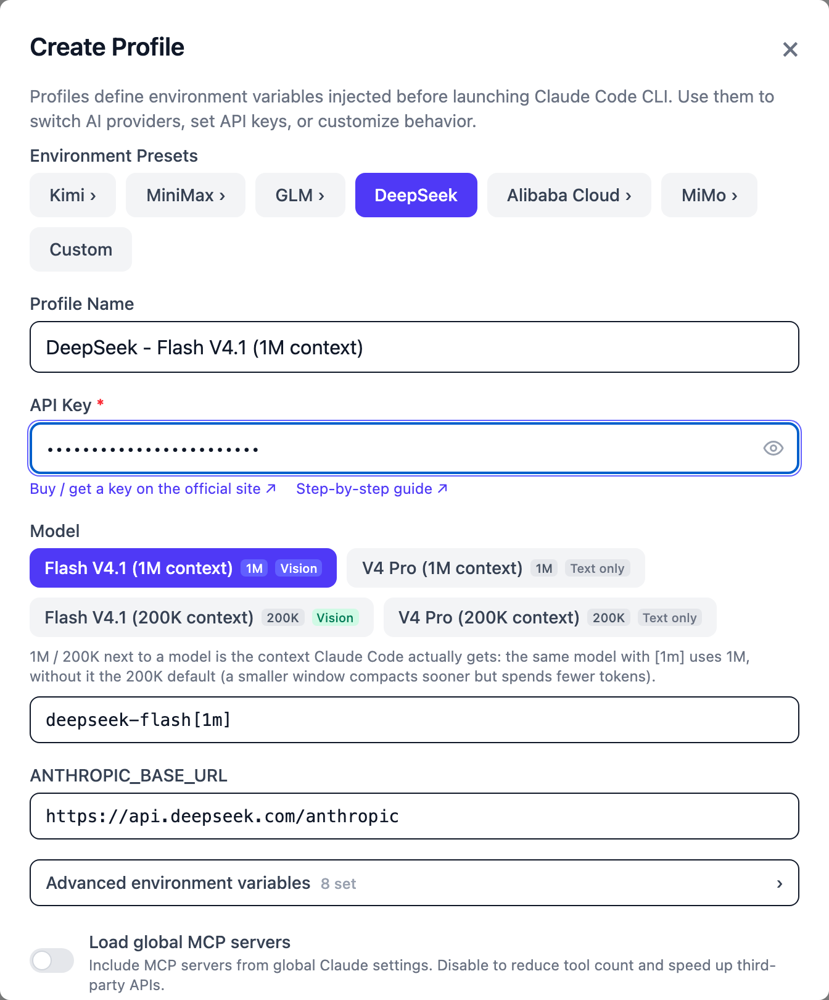

Clicking a provider opens its second row — Alibaba Cloud, for example:

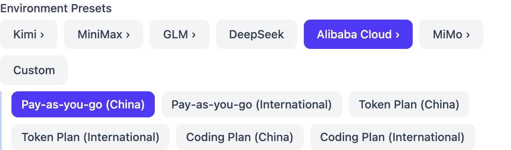

Which option goes with which key:

| Provider | Pay-as-you-go key → pick | Plan key → pick |
|---|---|---|
| DeepSeek | `DeepSeek` | (no plan) |
| Kimi (China) | `Kimi › Pay-as-you-go (China)` | `Kimi › Kimi Code (membership)` |
| Kimi (international) | `Kimi › Pay-as-you-go (International)` | `Kimi › Kimi Code (membership)` |
| MiniMax (China) | `MiniMax › China` | `MiniMax › China` — same option; paste the key that matches how you pay |
| MiniMax (international) | `MiniMax › International` | `MiniMax › International` — same |
| Zhipu GLM (China) | `GLM › China` | `GLM › China` — same option; paste the matching key |
| Z.AI (GLM international) | `GLM › International` | `GLM › International` — same |
| Qwen (China) | `Alibaba Cloud › Pay-as-you-go (China)` | `Alibaba Cloud › Coding Plan (China)` or `Token Plan (China)` — **whichever you bought** |
| Qwen (international) | `Alibaba Cloud › Pay-as-you-go (International)` | `Alibaba Cloud › Coding Plan (International)` or `Token Plan (International)` |
| Xiaomi MiMo | `MiMo › Pay-as-you-go` | `MiMo › Token Plan (China cluster)`; Singapore / Europe accounts pick `Singapore cluster` / `Europe cluster` |
| Claude | the built-in `Claude` profile | the built-in `Claude` profile |

## DeepSeek

**Pay-as-you-go only — DeepSeek has no plan.** Good for a first try for a few
dollars.

**Pay-as-you-go:**

1. Open the [DeepSeek Platform](https://platform.deepseek.com/), sign up and log
   in. If it asks for identity verification, follow the prompts.
2. In the left menu click **充值** (Top up — [top-up page](https://platform.deepseek.com/top_up)),
   pick an amount and a payment method, then click 去支付 (Pay).

    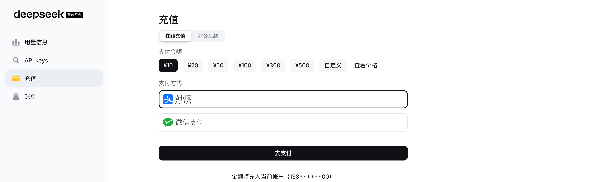

3. In the left menu click **API keys** ([API Keys page](https://platform.deepseek.com/api_keys)),
   then **创建 API key** (Create API key) in the top right.

    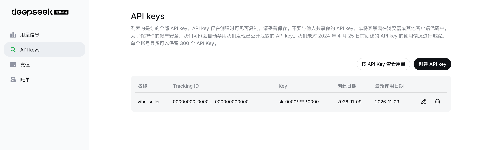

4. Give the key a name (e.g. `vibe-seller`), click **创建** (Create), and
   **copy it right away** — DeepSeek only shows the key when it is created.

    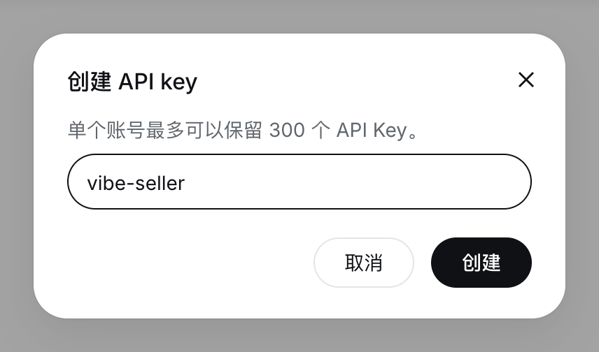

5. In Vibe Seller pick the **DeepSeek** preset, paste the key, create.

**Pitfall**: an empty balance returns `402 Insufficient Balance` — top up again.
Official docs: [error codes](https://api-docs.deepseek.com/quick_start/error_codes).

## Kimi

Kimi has both, but **the two keys come from two different platforms**, so
clicking **Kimi ›** in Vibe Seller shows three options.

**Plan (Kimi Code, part of a Kimi membership):**

1. Get a membership on the [Kimi membership page](https://www.kimi.com/membership/pricing).
   **Not every tier includes Kimi Code** — check the page before buying.
2. Open the [Kimi Code Console](https://www.kimi.com/code/console), click
   **Create API Key**, enter a name, confirm, and **copy it immediately** — once
   the dialog closes, the full key can't be shown again.
3. In Vibe Seller pick **Kimi › Kimi Code (membership)**, paste the key,
   create.

**Pay-as-you-go (Kimi API Platform):**

1. Sign up on the [Kimi API Platform](https://platform.kimi.ai/), top up, and
   create and copy a key on the [API Keys](https://platform.kimi.ai/console/api-keys)
   page (China accounts: [platform.kimi.com](https://platform.kimi.com/console/api-keys)).
2. In Vibe Seller pick **Kimi › Pay-as-you-go (International)** (China
   accounts: **Pay-as-you-go (China)**), paste the key, create.

**Pitfall**: the key and the option must come from the same platform — a Kimi
Code key only works with `Kimi Code (membership)`, a platform key only with
`Pay-as-you-go`, and a China-platform key with China, an international one with
International. On a 401, check this first.

## MiniMax

MiniMax has both; its plan is called **M Plan** (formerly Token Plan). **The two
keys live on different console pages and are not interchangeable.** They use
the same endpoint, though, so in Vibe Seller both go into the same option
(**MiniMax › China** for China accounts) — the key you paste decides how you're
billed. China accounts sign up on the [MiniMax Open Platform](https://platform.minimax.cn/).

**Pay-as-you-go:**

1. Top up under **费用管理 → 账户钱包** (Billing → Wallet —
   [balance page](https://platform.minimax.cn/user-center/payment/balance)).
2. Go to **API 管理 → API Key** ([API Key page](https://platform.minimax.cn/user-center/basic-information/interface-key)),
   click **创建 API Key** (Create API Key) in the top right, and copy it.

    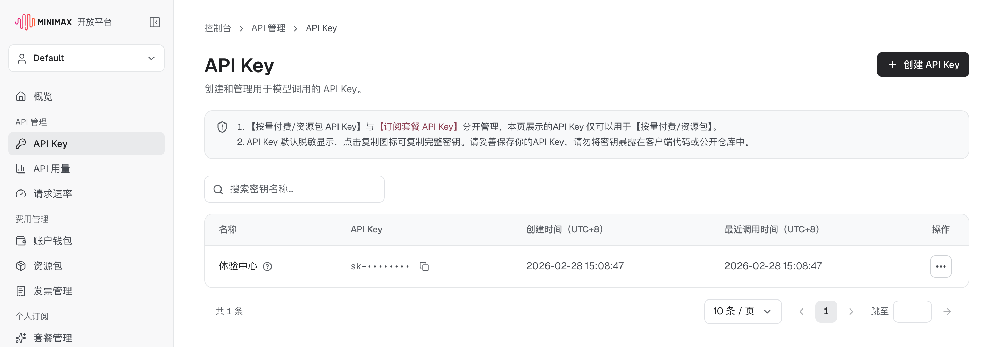

3. In Vibe Seller pick **MiniMax › China**, paste, create.

**Plan (M Plan):**

1. Choose a tier and pay on the [plan details page](https://platform.minimax.cn/console/plan).
2. Open **个人订阅 → 套餐管理** (Subscription → Plan management). The
   **订阅 Key** (Subscription Key) at the bottom is your plan key: one per
   account, shown masked; use the copy icon to copy it, and **重置 Key** (Reset
   Key) if it ever leaks. The page itself says a Subscription Key and a
   pay-as-you-go API key are not interchangeable.

    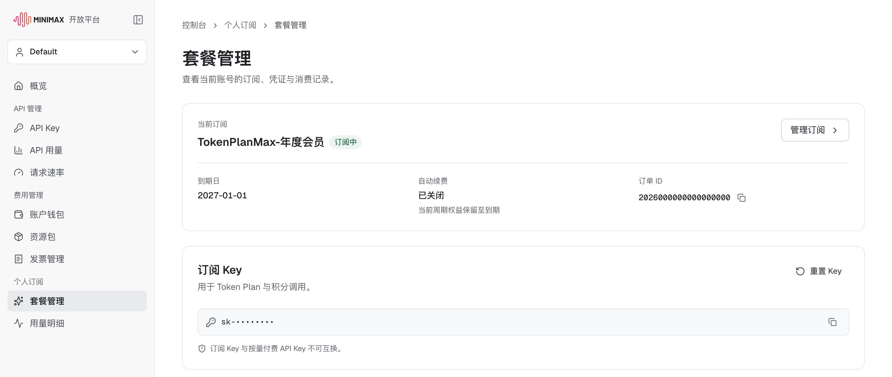

3. In Vibe Seller pick the same **MiniMax › China**, paste the Subscription
   Key, create.

**International accounts**: sign up at [platform.minimax.io](https://platform.minimax.io/);
the menus are `API Keys > Create new secret key` (pay-as-you-go) and
`Billing > M Plan` (plan). International keys only work on the international
endpoint, so for either key pick **MiniMax › International**.

Official docs: [Prerequisites](https://platform.minimax.io/docs/guides/quickstart-preparation).

## Zhipu GLM

China users use the **Zhipu BigModel platform** (preset `GLM › China`); users
outside China use **Z.AI** (preset `GLM › International`). Both have
pay-as-you-go and a GLM Coding Plan. **The two keys come from different pages
and aren't interchangeable**; in Vibe Seller both go into the same preset, and
the key you paste decides what it bills against.

### China: Zhipu BigModel

Click "Register/Login" in the top right of [Zhipu BigModel](https://open.bigmodel.cn).
Real-name verification isn't required to call the API, but Zhipu recommends
[doing it](https://open.bigmodel.cn/usercenter/auth).

**Pay-as-you-go:** top up, then on the [standard API key page](https://bigmodel.cn/usercenter/proj-mgmt/apikeys)
click **新建API Key** (New API Key) in the top right. The notice at the top of
that page says keys created there are for the standard (pay-as-you-go) API only.

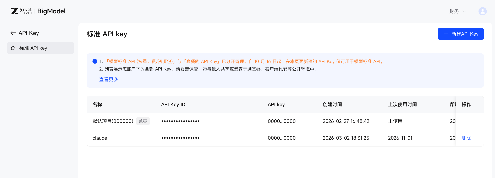

**Plan (GLM Coding Plan):** buy it with **立即订阅** (Subscribe now) under
**Coding Plan → 套餐概览** (Plan Overview); after subscribing, create a key under
**Personal Coding Plan → Plan Overview** (team members: **Team Coding Plan → My
Plan**).

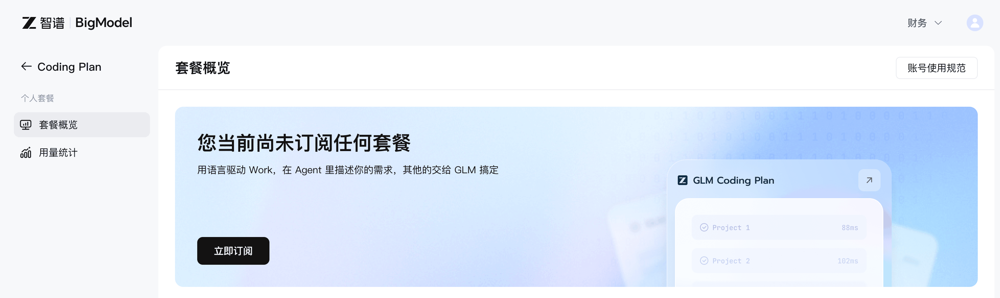

Either key: in Vibe Seller click **GLM ›**, then **China**, paste, create.

### International: Z.AI

Register or log in on the [Z.AI Open Platform](https://z.ai/model-api).

**Pay-as-you-go:** create a key under **Standard API Key** on the
[API Keys](https://z.ai/manage-apikey/apikey-list) page.

**Plan (GLM Coding Plan):** subscribe on the [plan page](https://z.ai/subscribe),
then create a key under **Personal Coding Plan** on the
[API Keys](https://z.ai/manage-apikey/apikey-list) page (team plan:
[Team Coding Plan → My Plan](https://z.ai/manage-apikey/coding-plan/team/my-plan)).

Either key: in Vibe Seller click **GLM ›**, then **International**, paste, create.

## Qwen (Alibaba Cloud Model Studio)

Model Studio (Bailian) has pay-as-you-go and two plans (Coding Plan, Token
Plan), each on the China site and the international (Singapore) site. **Each
kind of key has its own page and its own endpoint, and they must match**, so
clicking **Alibaba Cloud ›** in Vibe Seller shows six options: three ways to
pay × China / International.

**Pay-as-you-go:**

1. Open [Bailian console → API Key](https://bailian.console.aliyun.com/cn-beijing/model/settings/api-key)
   and **pick the right region in the top bar first** (e.g. 华北2（北京）,
   North China 2 (Beijing) — keys don't work across regions).
2. In the 按量付费 (pay-as-you-go) section click **创建API-KEY** (Create
   API key), leave owner account and workspace at their defaults, set
   permissions to **All**, click **OK**.

    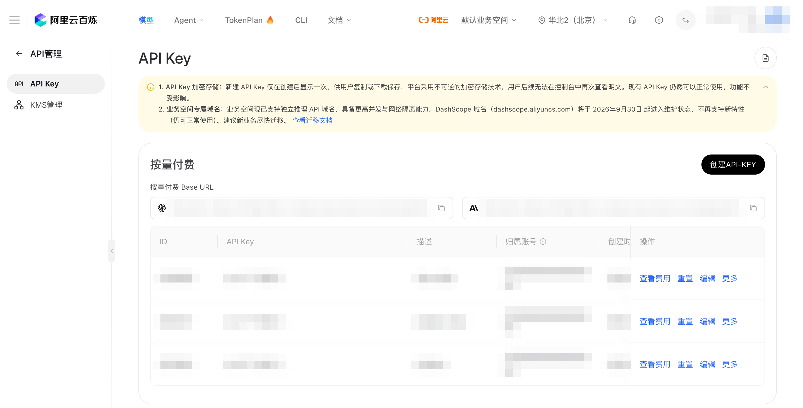

3. **Copy or download it now** — new keys are shown in full only once. The key
   starts with `sk-`.
4. In Vibe Seller click **Alibaba Cloud ›**, pick **Pay-as-you-go (China)**,
   paste, create. International (Singapore) accounts create the key on the API
   Key page of the international [Model Studio console](https://modelstudio.console.alibabacloud.com/),
   and pick **Pay-as-you-go (International)**.

**Plan (Coding Plan):** buy it on the [Coding Plan page](https://bailian.console.aliyun.com/cn-beijing/subscription/coding-plan);
the dedicated key (starting with `sk-sp-`) is on the same page. In Vibe Seller
pick **Alibaba Cloud › Coding Plan (China)**. International site: buy it on the
[ap-southeast-1 Coding Plan page](https://modelstudio.console.alibabacloud.com/ap-southeast-1/subscription/coding-plan)
and pick **Coding Plan (International)**.

**Plan (Token Plan):** buy it from **TokenPlan** in Bailian's top navigation
(personal or team edition). After buying, use "Create or view API Key" on the
[Token Plan personal page](https://bailian.console.aliyun.com/cn-beijing/subscription/token-plan/personal);
for teams an admin assigns a seat in [member management](https://bailian.console.aliyun.com/cn-beijing/subscription/uac-admin/organization/members/list).
In Vibe Seller pick **Alibaba Cloud › Token Plan (China)**. International site:
get the key on the [Token Plan personal page](https://modelstudio.console.alibabacloud.com/subscription/token-plan/personal)
and pick **Token Plan (International)**.

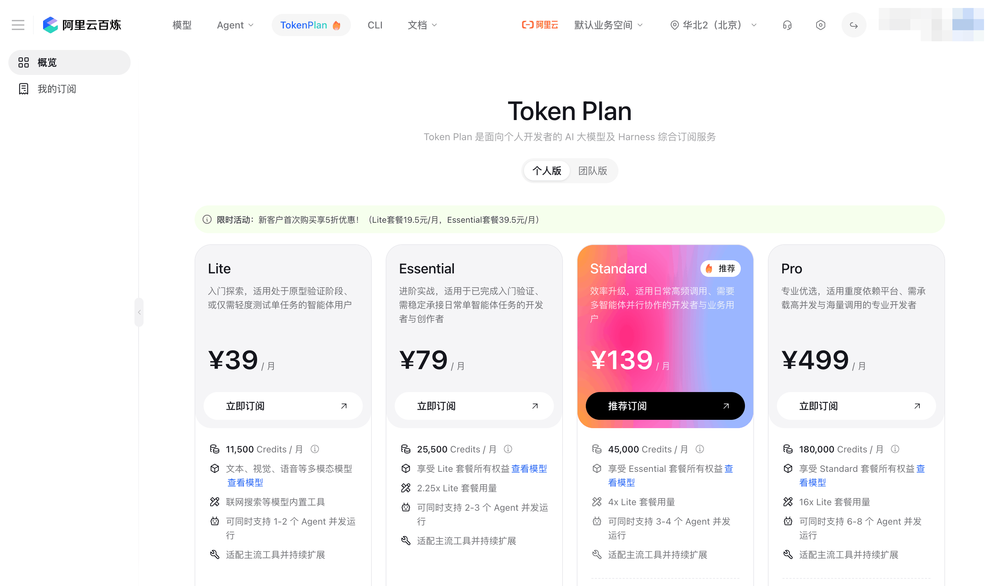

**Pitfalls**:

- **`401 invalid_api_key` almost always means the key and option don't
  match** — e.g. a Coding Plan `sk-sp-` key on a pay-as-you-go option, or an
  international key on a China option. Create the profile again with the
  matching option.

Official docs: [Get an API key (zh)](https://help.aliyun.com/zh/model-studio/get-api-key).

## Xiaomi MiMo

MiMo has both. **The two keys aren't interchangeable and use different
endpoints**, and the Token Plan is split into China, Singapore and Europe
clusters, so clicking **MiMo ›** in Vibe Seller shows four options. Log in to the
[MiMo API Platform](https://platform.xiaomimimo.com/) with a Xiaomi account (you
can register from the login page). **Users in mainland China must complete
real-name verification** (personal or business) before topping up or buying a
plan.

**Pay-as-you-go:**

1. Top up under **账户余额** (Account Balance — [balance page](https://platform.xiaomimimo.com/#/console/balance);
   overseas: Apple Pay, Google Pay, cards).
2. Under **API Keys** ([API Keys page](https://platform.xiaomimimo.com/#/console/api-keys))
   click **新建 API Key** (New API Key) in the top right — the key starts with
   `sk-`.

    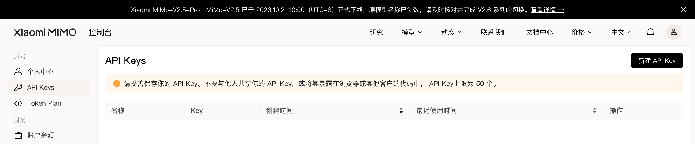

3. In Vibe Seller pick **MiMo › Pay-as-you-go**, paste, create.

**Plan (Token Plan):**

1. Under **Token Plan** in the left menu, choose the personal or team edition
   and a tier, and click 立即订阅 (Subscribe now). Account balance can't pay for
   a Token Plan; it's bought separately.

    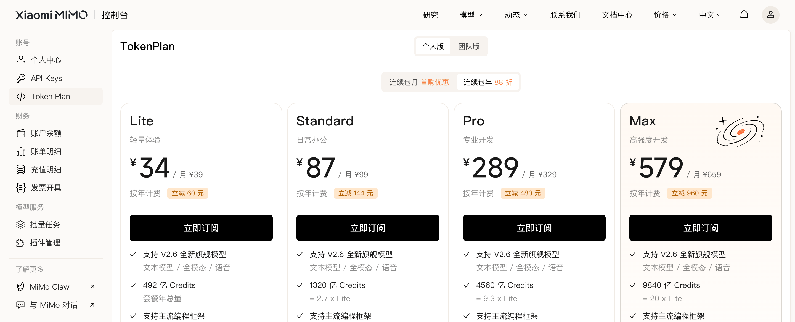

2. Get your dedicated key on the [Token Plan management page](https://platform.xiaomimimo.com/#/console/plan-manage)
   (`tp-` for individual, `ttp-` for team; team plans need a seat assigned
   first). The same page shows your Base URL: `token-plan-cn` is the China
   cluster, `token-plan-sgp` Singapore, `token-plan-ams` Europe.
3. In Vibe Seller pick your cluster's option — **MiMo › Token Plan (China
   cluster)** / **Token Plan (Singapore cluster)** / **Token Plan (Europe
   cluster)** — paste, create.

**Pitfalls**:

- `sk-` pay-as-you-go keys and `tp-`/`ttp-` plan keys can't be swapped — pick
  the matching option; a Token Plan key on the wrong cluster won't connect
  either.

Official docs: [First API call](https://mimo.mi.com/docs/quick-start/summary/first-api-call).

## Claude

Either way, you **sign in to Claude Code on this
machine** and Vibe Seller's built-in **Claude** profile ("System default
environment") uses that sign-in — **no key is pasted into Vibe Seller**.

**Pay-as-you-go (Claude Console):** sign up on the [Claude Console](https://platform.claude.com/)
and add credit under [Billing](https://platform.claude.com/settings/billing)
(keys live on the [API keys](https://platform.claude.com/settings/keys) page).
The simplest route is to choose the Console account at step 2 below; Claude Code
handles the key for you.

**Plan (Claude Pro / Max subscription):** subscribe on the [pricing page](https://claude.com/pricing),
then sign in with your claude.ai account at step 2 below.

Signing in:

1. Run `claude` in a terminal (Vibe Seller's installers set Claude Code up
   alongside it); a browser login page opens. Choose the claude.ai account or
   the Console account, depending on how you pay.
2. When the terminal shows `Login successful`, you're done.
3. Back in Vibe Seller, `Settings → AI`: if the "Claude" row has no
   **★ Default** mark, click **Set as Default**.

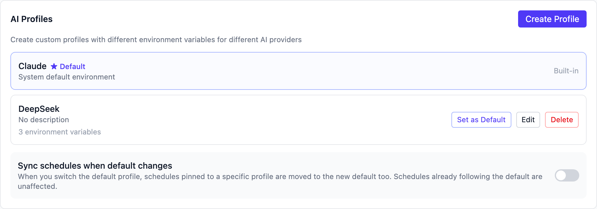

**Pitfalls**:

- Claude is available only in [supported countries and regions](https://platform.claude.com/docs/en/api/supported-regions);
  check before signing up.
- If you use cc-switch or a similar tool, or have `ANTHROPIC_API_KEY` set in
  your environment, Claude Code uses that instead of your sign-in.

## FAQ

<b>The key was shown only once and I didn't copy it</b>

You can't get it back, and you don't need to. **Delete** that key in the
provider's console, **create a new one**, and copy it this time.

<b>I accidentally shared my key / pasted it in a group chat</b>

Immediately **delete (or disable / reset) that key** in the provider's console
and create a new one. Then in Vibe Seller `Settings → AI`, find the profile
using it, click **Edit**, paste the new key into **API Key**, and click **Save**.
A leaked key lets anyone spend your money — don't wait.

<b>The connection test says 401 / authentication failed</b>

Check in this order:

1. The key was copied completely (no extra spaces, nothing cut off).
2. The key hasn't been deleted or expired.
3. **The key matches the preset** — most common: a plan key on a pay-as-you-go
   preset, or an international key on a China preset.

<b>Insufficient balance (402) / quota exhausted (429)</b>

- **Insufficient balance**: the pay-as-you-go account is empty — top up.
- **429**: too many requests, or **your plan quota is used up** (the 5-hour or
  weekly cap). Wait for it to come back, or upgrade; if it's urgent, create a
  profile for another provider in Vibe Seller to cover in the meantime.

<b>I picked the wrong preset for my plan key</b>

An existing profile can't switch presets when you edit it. Click **Create
Profile**, pick the **right** preset, paste the key, create, then delete the
wrong one.

<b>Where is the key stored? Is it safe?</b>

The key stays inside Vibe Seller on your own machine, encrypted, and is never
uploaded anywhere; your machine sends it straight to the provider when calling
the model.

