# 获取 API Key

Vibe Seller 本身免费，干活的 AI 模型要用你自己的 **API Key**——可以理解成
模型供应商发给你的「密码 + 账单号」：Vibe Seller 拿着它去调用模型，费用记在
你的供应商账户上。

这一页按供应商讲清楚三件事：**去哪注册、在哪点出 Key、在 Vibe Seller 里选哪
个预设**。第一次用、不知道怎么选的话，先看下面的「先选哪家」。

> 各家控制台改版很勤快。本文按 **2026 年 11 月** 各家官方文档整理，
> 每一节都附了官方链接；界面和文中对不上时，以官方页面为准。

**目录**

- [先选哪家](#先选哪家)
- [通用流程](#通用流程)
- 各家怎么拿 Key：
    - [DeepSeek](#deepseek)
    - [Kimi](#kimi)
    - [MiniMax](#minimax)
    - [智谱 GLM](#智谱-glm)
    - [通义千问（阿里云百炼）](#通义千问阿里云百炼)
    - [小米 MiMo](#小米-mimo)
    - [Claude](#claude)
- [常见问题](#常见问题)

## 先选哪家

| 你的情况 | 建议 |
|---|---|
| 第一次用，想先试试 | **DeepSeek**：注册、充 15–20 块就能跑，按用量扣钱，没有月费 |
| 这台电脑上的 Claude Code 已经登录了 Claude 订阅 | **不用拿 Key**，直接复用，见 [Claude](#claude) |
| 天天在跑、用量大，想省钱 | 买一家的**套餐**（Token Plan / Coding Plan / M Plan），见下面各家 |
| 公司或账号在海外 | Kimi、MiniMax、GLM、通义、MiMo 都有国际版，预设里选对应的「国际」子选项就行（MiMo 按集群选「新加坡集群」/「欧洲集群」的子选项） |

### 按量付费 vs 套餐

- **按量付费**：先充值，按实际用掉的 token（模型读写的文字量）扣钱。
- **套餐**（Token Plan / Coding Plan / M Plan 等）：每月固定价格换一份额度，
  通常同时有「滚动 5 小时」和「每周」两道用量上限；用得多的话折算下来每个
  token 更便宜。
- **套餐 Key 和按量 Key 是两把不同的 Key**，在控制台的不同页面拿，不能混用。
  Vibe Seller 里有带「Plan」字样预设的，套餐 Key 要选那个。

## 通用流程

每一家都是这几步，下面各节只讲每家不一样的地方：

1. 在供应商官网**注册**账号（国内平台通常要手机号，充值前可能要求实名认证）。
2. **充值**（按量付费）或**购买套餐**。
3. 在控制台**创建 API Key**，**马上复制**——很多家只完整显示一次。
4. 打开 Vibe Seller：`设置 → AI`，在「AI 配置文件」右上角点 **创建配置文件**。
5. 在「环境预设」里点对应的供应商。除了 DeepSeek，每家点了以后都会再展开一排
   子选项（国内 / 国际、按量 / 套餐），选和你的 Key 对应的那个。
6. 把 Key 粘到 **API 密钥** 一栏。模型、连接地址等都由子选项填好，**不用改**。
7. 保持勾选 **创建后设为我的默认 AI**，点 **创建**。

点「创建」时 Vibe Seller 会先**测试连接**（按钮显示「正在测试连接…」），用你的
Key 真的向供应商发一条很短的请求。通过了才会保存；不通过会显示「连接测试失败」
和供应商返回的原因，对照下面的[常见问题](#常见问题)改。

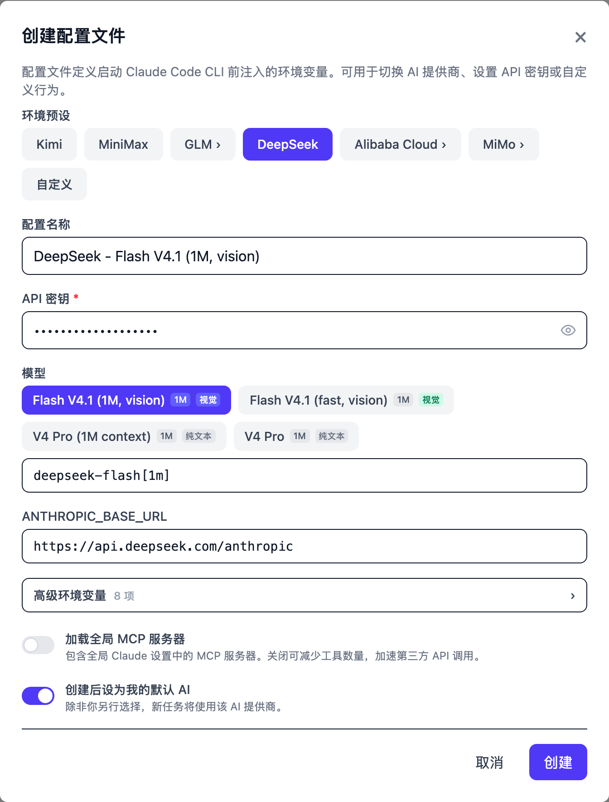

点开一家后会多出一排子选项，例如阿里云：

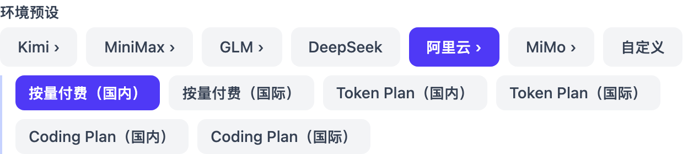

哪种 Key 选哪个预设，一览：

| 供应商 | 按量付费的 Key → 选 | 套餐的 Key → 选 |
|---|---|---|
| DeepSeek | `DeepSeek` | （没有套餐） |
| Kimi（国内） | `Kimi › 按量付费（国内）` | `Kimi › Kimi Code（会员）` |
| Kimi（海外） | `Kimi › 按量付费（国际）` | `Kimi › Kimi Code（会员）` |
| MiniMax（国内） | `MiniMax › 国内` | `MiniMax › 国内`——同一个子选项，按付费方式粘对应的 Key |
| MiniMax（海外） | `MiniMax › 国际` | `MiniMax › 国际`——同上 |
| 智谱 GLM（国内） | `GLM › 国内` | `GLM › 国内`——同一个子选项，按付费方式粘对应的 Key |
| Z.AI（GLM 海外） | `GLM › 国际` | `GLM › 国际`——同上 |
| 通义千问（国内） | `阿里云 › 按量付费（国内）` | `阿里云 › Coding Plan（国内）` 或 `Token Plan（国内）`，**按你买的那种选** |
| 通义千问（海外） | `阿里云 › 按量付费（国际）` | `阿里云 › Coding Plan（国际）` 或 `Token Plan（国际）` |
| 小米 MiMo | `MiMo › 按量付费` | `MiMo › Token Plan（国内集群）`；新加坡、欧洲集群选 `Token Plan（新加坡集群）` / `Token Plan（欧洲集群）` |
| Claude | 内置的 `Claude` 配置 | 内置的 `Claude` 配置 |

## DeepSeek

**只有按量付费，没有套餐。** 适合第一次用、想先花十几块钱试试。

**按量付费：**

1. 打开 [DeepSeek 开放平台](https://platform.deepseek.com/)，注册并登录。
   页面如果要求实名认证，按提示完成。
2. 左侧点 **充值**（[充值页](https://platform.deepseek.com/top_up)），选金额和
   支付方式，点「去支付」。

    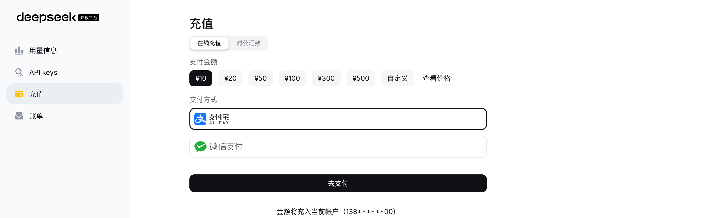

3. 左侧点 **API keys**（[API Keys 页](https://platform.deepseek.com/api_keys)），
   点右上角 **创建 API key**。

    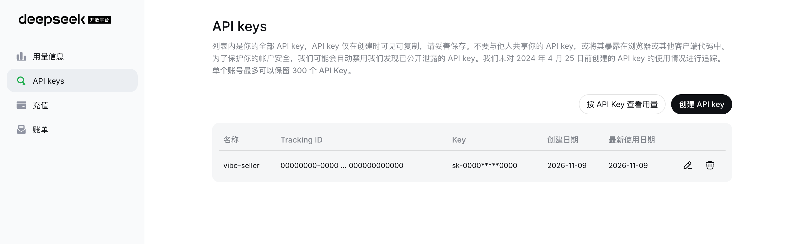

4. 给 Key 起个名字（比如 `vibe-seller`），点 **创建**，然后**马上复制保存**——
   DeepSeek 的 Key 只在创建时能看到。

    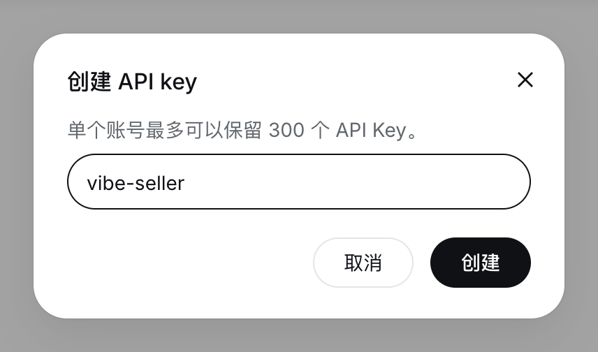

5. Vibe Seller 里选预设 **DeepSeek**，粘贴 Key，创建。

**常见坑**：余额用完会报 `402 余额不足`，去充值页补上就行。
官方说明：[接入 Claude Code](https://api-docs.deepseek.com/zh-cn/quick_start/agent_integrations/claude_code)、
[错误码](https://api-docs.deepseek.com/zh-cn/quick_start/error_codes)。

## Kimi

Kimi 两种都有，但 **Key 在两个不同的平台**，所以 Vibe Seller 里点 **Kimi ›** 后有
三个子选项。

**套餐（Kimi 会员的 Kimi Code 权益）：**

1. 在 [Kimi 会员页](https://www.kimi.com/membership/pricing) 开通会员。
   **不是每个档位都含 Kimi Code 权益**，购买前看清页面说明。
2. 打开 [Kimi Code 控制台](https://www.kimi.com/code/console)，点
   **新建 API Key**，输入名字确认，**立刻复制**——关掉弹窗后就看不到完整的 Key 了。
3. Vibe Seller 里选 **Kimi › Kimi Code（会员）**，粘贴 Key，创建。

**按量付费（Kimi API 开放平台）：**

1. 在 [Kimi API 开放平台](https://platform.kimi.com/) 注册登录并充值，到
   [API Keys](https://platform.kimi.com/console/api-keys) 页面创建并复制 Key
   （海外账号用 [platform.kimi.ai](https://platform.kimi.ai/console/api-keys)）。
2. Vibe Seller 里选 **Kimi › 按量付费（国内）**（海外账号选**按量付费（国际）**），
   粘贴 Key，创建。

**常见坑**：Key 和子选项必须是同一个平台的——Kimi Code 的 Key 只能配
`Kimi Code（会员）`，开放平台的 Key 只能配`按量付费（国内）` /
`按量付费（国际）`，按你的账号在哪个平台选对应的那个。测试连接报 401 时先检查这一点。
官方说明：[Kimi Code 在 Claude Code 中使用](https://www.kimi.com/code/docs/third-party-tools/claude-code.html)、
[开放平台快速开始](https://platform.kimi.com/docs/get-api-key)、
[开放平台在 Claude Code 中使用 Kimi](https://platform.kimi.com/docs/guide/claude-code-kimi)。

## MiniMax

MiniMax 两种都有，套餐叫 **M Plan**（以前叫 Token Plan）。**两把 Key 在控制台的
不同页面，不可互换**；但它们连的是同一个地址，所以 Vibe Seller 里都用同一个子选项
（国内账号 **MiniMax › 国内**），粘哪把 Key 就按哪种方式计费。国内账号在
[MiniMax 开放平台](https://platform.minimax.cn/) 注册登录。

**按量付费：**

1. 左侧 **费用管理 → 账户钱包** 充值（[余额页](https://platform.minimax.cn/user-center/payment/balance)）。
2. 左侧 **API 管理 → API Key**（[API Key 页](https://platform.minimax.cn/user-center/basic-information/interface-key)），
   点右上角 **创建 API Key**，复制。

    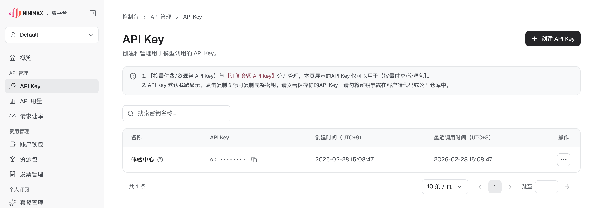

3. Vibe Seller 里选 **MiniMax › 国内**，粘贴，创建。

**套餐（M Plan）：**

1. 在 [套餐详情](https://platform.minimax.cn/console/plan) 选档位付款。
2. 左侧 **个人订阅 → 套餐管理**，页面下方的 **订阅 Key** 就是套餐 Key：每个账号
   一把，默认打码显示，点右边的复制图标复制；泄露了点 **重置 Key** 换一把。
   页面上也写着：**订阅 Key 与按量付费 API Key 不可互换**。

    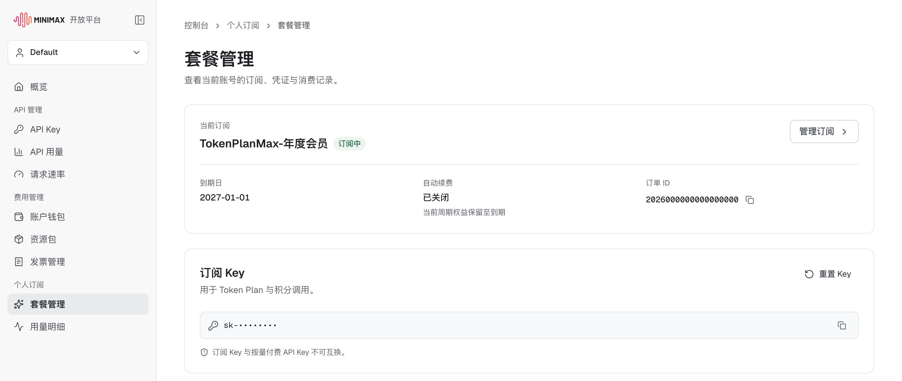

3. Vibe Seller 里同样选 **MiniMax › 国内**，粘贴订阅 Key，创建。

**海外账号**：在 [platform.minimax.io](https://platform.minimax.io/) 注册，菜单是
`API Keys > Create new secret key`（按量）和 `Billing > M Plan`（套餐）。海外账号的
Key 只能连海外地址，两种 Key 都选 **MiniMax › 国际**。

官方说明：[前置准备](https://platform.minimax.cn/docs/guides/quickstart-preparation)、
[开通 M Plan](https://platform.minimaxi.com/docs/m-plan/quickstart)、
[M Plan 常见问题](https://platform.minimaxi.com/docs/m-plan/faq)、
[Claude Code 接入](https://platform.minimax.cn/docs/token-plan/claude-code)。

## 智谱 GLM

国内用户用 **智谱开放平台**（预设 `GLM › 国内`），海外用户用 **Z.AI**（预设
`GLM › 国际`）。两边都有按量付费和 GLM Coding Plan 套餐，**两种 Key 在
不同页面、互不通用**；Vibe Seller 里按量和套餐用同一个预设，粘哪把 Key 就扣哪边。

> 2026 年 10 月 16 日起，智谱 / Z.AI 把「标准 API Key」（按量 / 资源包）和
> 「Coding Plan 套餐 Key」分开管理。之前建的老 Key 不用换，系统已自动归类。

### 国内：智谱开放平台

在 [智谱开放平台](https://open.bigmodel.cn) 右上角「注册/登录」。调 API 不强制
实名，但官方建议做 [实名认证](https://open.bigmodel.cn/usercenter/auth)。

**按量付费：** 充值后，到 [标准 API Key 页面](https://bigmodel.cn/usercenter/proj-mgmt/apikeys)
点右上角 **新建API Key**。页面顶部的提示也写明：这里新建的 Key 只能用于标准 API（按量）。

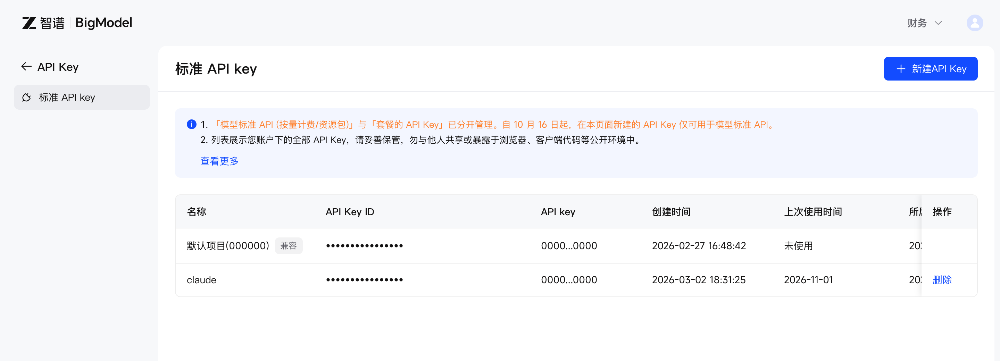

**套餐（GLM Coding Plan）：** 在 **Coding Plan → 套餐概览** 点 **立即订阅** 买套餐；
订阅后在 **个人编程套餐 → 套餐概览** 新建 Key（团队版成员在 **团队编程套餐 → 我的套餐**）。

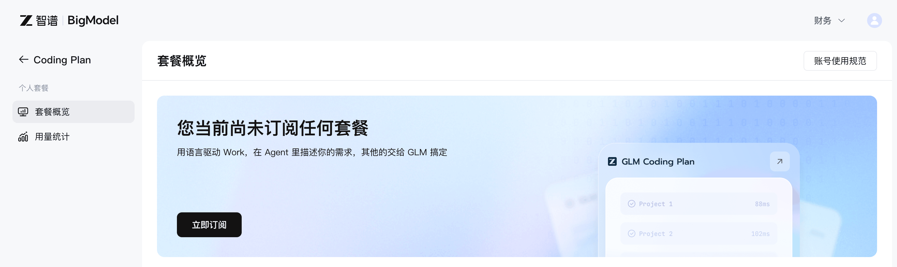

两种 Key 都是：Vibe Seller 里点 **GLM ›**，再选**国内**，粘贴，创建。

### 海外：Z.AI

在 [Z.AI 开放平台](https://z.ai/model-api) 注册登录。

**按量付费：** 在 [API Keys](https://z.ai/manage-apikey/apikey-list) 页的
**Standard API Key** 下创建。

**套餐（GLM Coding Plan）：** 在 [订阅页](https://z.ai/subscribe) 买套餐后，在
[API Keys](https://z.ai/manage-apikey/apikey-list) 页的 **Personal Coding Plan** 下创建
（团队版在 [Team Coding Plan → My Plan](https://z.ai/manage-apikey/coding-plan/team/my-plan)）。

两种 Key 都是：Vibe Seller 里点 **GLM ›**，再选**国际**，粘贴，创建。

官方说明：[API Key 分类管理说明](https://docs.bigmodel.cn/cn/coding-plan/notice/api-key-management)、
[Coding Plan 快速开始](https://docs.bigmodel.cn/cn/coding-plan/quick-start)、
[Z.AI API Key Management Guide](https://docs.z.ai/devpack/notice/api-key-management)、
[Z.AI Quick Start](https://docs.z.ai/devpack/quick-start)。

## 通义千问（阿里云百炼）

百炼有按量付费和两种套餐（Coding Plan、Token Plan），国内站、国际站（新加坡）各一套。
**每种 Key 都有自己的页面和连接地址，必须配套**，所以 Vibe Seller
里点**阿里云 ›**后有六个子选项：三种付费方式 × 国内 / 国际。

**按量付费：**

1. 打开 [百炼控制台 → API Key](https://bailian.console.aliyun.com/cn-beijing/model/settings/api-key)，
   **先在顶部选对地域**（比如「华北2（北京）」，Key 不能跨地域用）。
2. 在「按量付费」一栏点 **创建API-KEY**，「归属账号」「归属业务空间」保持默认，
   「权限」选 **全部**，点 **确定**。

    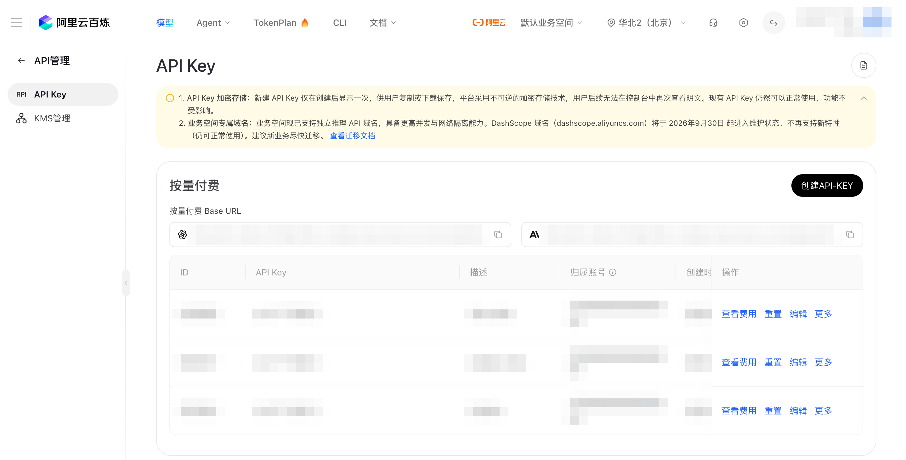

3. **立刻复制或下载**——新版 Key 只在创建成功时完整显示一次。Key 是 `sk-` 开头。
4. Vibe Seller 里点**阿里云 ›**，选**按量付费（国内）**，粘贴，创建。
   国际站（新加坡）账号在国际站 [Model Studio](https://modelstudio.console.alibabacloud.com/)
   的 API Key 页创建，选**按量付费（国际）**。

**套餐（Coding Plan）：** 在 [Coding Plan 页](https://bailian.console.aliyun.com/cn-beijing/subscription/coding-plan)
购买，同一页拿专属 Key（`sk-sp-` 开头）。Vibe Seller 选**阿里云 › Coding Plan（国内）**；
国际站在 [ap-southeast-1 的 Coding Plan 页](https://modelstudio.console.alibabacloud.com/ap-southeast-1/subscription/coding-plan)
购买，选 **Coding Plan（国际）**。

**套餐（Token Plan）：** 在百炼顶部导航的 **TokenPlan** 购买（分个人版 / 团队版），
买好后到 [Token Plan 个人版页](https://bailian.console.aliyun.com/cn-beijing/subscription/token-plan/personal)
「创建或查看 API Key」；团队版由管理员在 [成员管理](https://bailian.console.aliyun.com/cn-beijing/subscription/uac-admin/organization/members/list)
「分配坐席并获取 API Key」。Vibe Seller 选**阿里云 › Token Plan（国内）**；
国际站在 [Token Plan 个人版页](https://modelstudio.console.alibabacloud.com/subscription/token-plan/personal)
拿 Key，选 **Token Plan（国际）**。

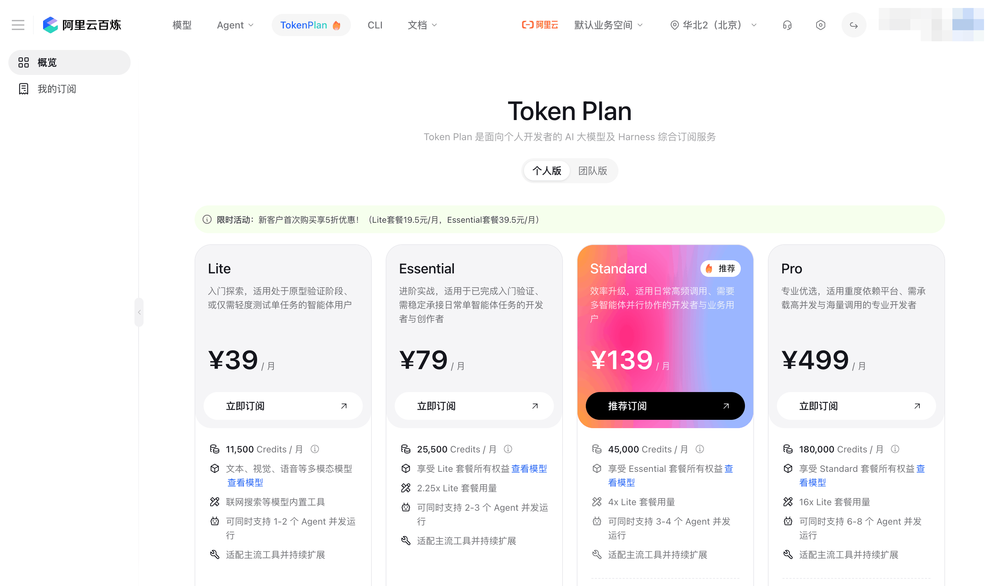

**常见坑**：

- **报 `401 invalid_api_key` 基本都是 Key 和子选项没配对**，比如拿 Coding Plan 的
  `sk-sp-` Key 选了按量的子选项，或者国际站的 Key 选了 China。换成对应的子选项
  重新创建即可。

官方说明：[获取 API Key](https://help.aliyun.com/zh/model-studio/get-api-key)、
[Claude Code 接入（含四种方式对照）](https://help.aliyun.com/zh/model-studio/claude-code)、
[Coding Plan](https://help.aliyun.com/zh/model-studio/coding-plan)、
[国际站 Claude Code 接入](https://www.alibabacloud.com/help/en/model-studio/claude-code)。

## 小米 MiMo

MiMo 两种都有，**两把 Key 不通用、连接地址也不同**；Token Plan 还分国内、新加坡、
欧洲三个集群，所以 Vibe Seller 里点 **MiMo ›** 后有四个子选项。
先用小米账号登录 [MiMo 开放平台](https://platform.xiaomimimo.com/)（没有账号可以在
登录页注册）。**国内用户充值或买套餐前必须完成实名认证**（个人或企业都行）。

**按量付费：**

1. 左侧 **账户余额**（[余额页](https://platform.xiaomimimo.com/#/console/balance)）
   充值，支持微信、支付宝、小米支付。
2. 左侧 **API Keys**（[API Keys 页](https://platform.xiaomimimo.com/#/console/api-keys)）
   点右上角 **新建 API Key**，Key 是 `sk-` 开头。

    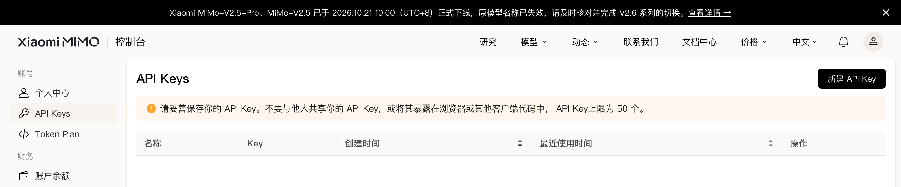

3. Vibe Seller 选 **MiMo › 按量付费**，粘贴，创建。

**套餐（Token Plan）：**

1. 左侧 **Token Plan**，选个人版 / 团队版和套餐，点「立即订阅」。Token Plan 不能用
   账户余额抵扣，要单独购买。

    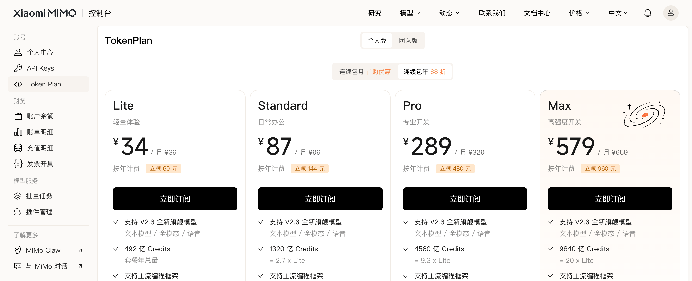

2. 订阅后到 [Token Plan 管理页](https://platform.xiaomimimo.com/#/console/plan-manage)
   拿专属 Key（个人版 `tp-` 开头，团队版 `ttp-` 开头；团队版要先分配席位）。同一页
   也显示你的 Base URL：`token-plan-cn` 开头是国内集群，`token-plan-sgp` 是新加坡，
   `token-plan-ams` 是欧洲。
3. Vibe Seller 选对应集群的子选项：**MiMo › Token Plan（国内集群）** /
   **Token Plan（新加坡集群）** / **Token Plan（欧洲集群）**，粘贴，创建。

**常见坑**：

- `sk-` 的按量 Key 和 `tp-`/`ttp-` 的套餐 Key 不能混用，子选项要选对；Token Plan
  选错集群也会连不上。
- Token Plan 北京时间 0–8 点调用按 0.8 倍扣额度。

官方说明：[首次调用 API](https://mimo.mi.com/docs/quick-start/summary/first-api-call)、
[Token Plan 快速接入](https://mimo.mi.com/docs/tokenplan/Token%20Plan/quick-access)、
[Claude Code 配置](https://mimo.mi.com/docs/zh-CN/tokenplan/integration/claudecode)。

## Claude

Claude 能力上限最高。两种方式都是**先让这台电脑上的 Claude Code 登录**，Vibe Seller
内置的 **Claude** 配置（「系统默认环境」）直接用这个登录，**不需要在 Vibe Seller 里
粘 Key**。

**按量付费（Claude Console）：** 在 [Claude Console](https://platform.claude.com/)
注册，到 [Billing](https://platform.claude.com/settings/billing) 充值（Key 在
[API keys](https://platform.claude.com/settings/keys) 页）。最省事的用法是下面第 2 步
登录时选 Console 账号，Claude Code 会自己处理 Key。

**套餐（Claude Pro / Max 订阅）：** 在 [订阅页](https://claude.com/pricing) 订阅，
下面第 2 步用 claude.ai 账号登录。

登录步骤：

1. 按 [官方安装文档](https://code.claude.com/docs/en/setup) 装好 Claude Code。
2. 在终端运行 `claude`，浏览器会弹出登录页，按你的付费方式选 claude.ai 账号或
   Console 账号。
3. 终端显示 `Login successful` 就好了。
4. 回到 Vibe Seller：`设置 → AI`，「Claude」那一行如果没有 **★ 默认** 标记，
   点 **设为默认**。

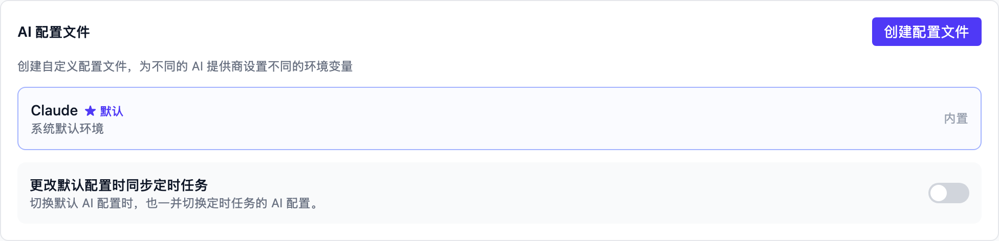

**常见坑**：

- Claude 只在[部分国家和地区](https://platform.claude.com/docs/en/api/supported-regions)
  提供服务，注册前先确认。
- 电脑上装了 cc-switch 之类的工具，或者环境变量里设了 `ANTHROPIC_API_KEY`，
  Claude Code 会优先用它们而不是你的登录。可以在 Claude Code 里输入 `/status`
  看当前用的是哪种登录。

官方说明：[Claude Code 登录方式](https://code.claude.com/docs/en/authentication)、
[Claude API 概览](https://platform.claude.com/docs/en/api/overview)。

## 常见问题

<b>Key 只显示一次，我没复制下来怎么办？</b>

找不回来，也不需要找回。到供应商控制台把那个 Key **删掉**，再**新建一个**，
这次马上复制。

<b>Key 不小心发给别人 / 贴到群里了怎么办？</b>

立刻到供应商控制台**删除（或禁用、重置）这个 Key**，再新建一个。然后在 Vibe Seller
`设置 → AI` 里，找到用这个 Key 的配置，点 **编辑**，把新 Key 粘进
**API 密钥**，点 **保存**。Key 泄露了别人就能花你的钱，不要犹豫。

<b>测试连接报 401 / 认证失败</b>

按顺序检查：

1. Key 是否完整复制（前后没有多余空格，没有少一截）。
2. Key 是不是已经被删除或过期。
3. **Key 和预设是否配对**——最常见：套餐 Key 选了按量预设，或者国际站的 Key
   选了国内预设。

<b>报余额不足（402）/ 配额用完（429）</b>

- **余额不足**：按量付费账户没钱了，去充值页充值。
- **429**：请求太快，或者**套餐额度用完了**（5 小时或每周上限）。等额度恢复，或者
  升级套餐；急用的话可以在 Vibe Seller 里新建一个其他家的配置先顶上。

<b>套餐 Key 选错了预设，怎么改？</b>

已经创建好的配置，编辑时不能再换预设。直接 **创建配置文件**，重新选**对的**
预设、粘 Key、创建，再把错的那个删掉。

<b>Key 存在哪里？安全吗？</b>

Key 只存在你自己电脑上的 Vibe Seller 里，加密保存，不会上传到任何地方；
调用模型时由你的电脑直接发给对应的供应商。

