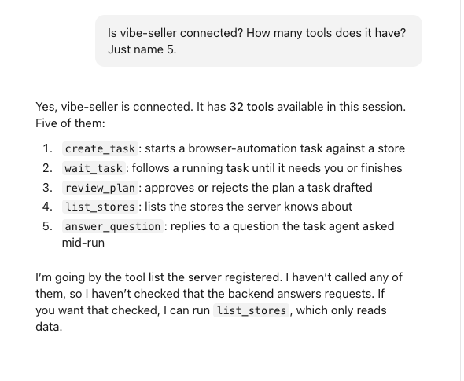
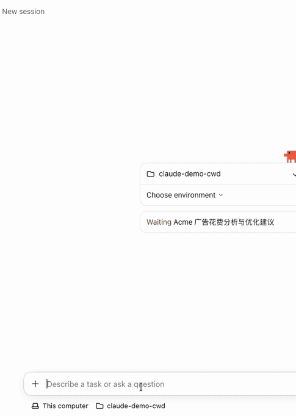

# Connect Vibe Seller to Claude

Once it's connected, you can ask Claude to create Vibe Seller tasks, follow
their progress and answer their questions.

Two things to get ready first:

1. An API key — see [First: create an API key](mcp.md#first-create-an-api-key).
   Right after you create it, the dialog shows your server address and a
   ready-made Claude command;
2. Claude installed.

## Connect

The **Code tab** of the Claude desktop app is Claude Code, and both read the
same config. Run the command from the dialog's **Command line / config file**
tab in a terminal — copy it as one line — and the app and the CLI both work:

```bash
# Connects to this machine; if Vibe Seller runs elsewhere, use its address instead of localhost
claude mcp add --scope user --transport http vibe-seller http://localhost:7777/api/mcp --header "Authorization: Bearer vst_…"
```

An optional `vibe-seller` **plugin** makes the agent use the tools better — it
ships instructions on when to plan first, how to follow a task, and to report
only results the task really produced
([how to install it](agents.md)).

## Check it works

Open a new Code session and ask “how many stores are in vibe-seller right
now?”. If it names your stores, you're connected. From a terminal,
`claude mcp list` should show `vibe-seller` with `✓ Connected`.



## Change or remove

To change the address or the key, run `claude mcp remove vibe-seller` in a
terminal, then run the `claude mcp add` command above again with the new
config.

## Next

See [What you can ask](mcp.md#what-you-can-ask) for what to say once you're
connected, and [Examples](examples.md) for full walkthroughs.


