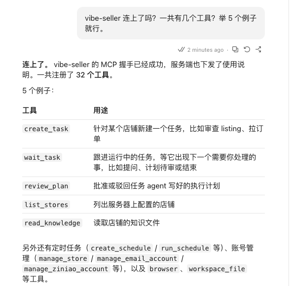
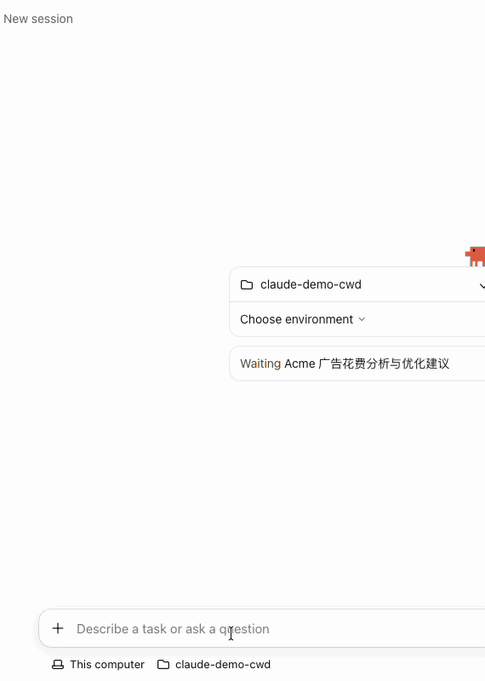

# 在 Claude 里接入 Vibe Seller

接好之后，在 Claude 的对话里就能让 Vibe Seller 建任务、跟进进度、回答提问。

需要准备两样东西：

1. 一个 API Key：见[第一步：创建 API Key](mcp.md#第一步创建-api-key)。创建
   成功后弹出的窗口（下文称「弹窗」）里有你的服务器地址和 Claude 的现成
   命令；
2. 已经安装 Claude：从 [claude.com/download](https://claude.com/download)
   下载。

## 接入

Claude 桌面版的「Code」标签页用的就是 Claude Code，两边读同一份配置。在
终端里执行弹窗「命令行 / 配置文件」标签给的这条命令，一整行原样复制，
桌面版和命令行就都能用了：

```bash
# 默认连本机；Vibe Seller 在另一台电脑上时，把 localhost 换成那台电脑的地址
claude mcp add --scope user --transport http vibe-seller http://localhost:7777/api/mcp --header "Authorization: Bearer vst_…"
```

推荐再安装 `vibe-seller` **插件**（安装方法见[连接外部 Agent](agents.md)）：
它带一份使用说明，教 AI 什么时候先出计划、怎么跟进任务、只汇报任务真实
执行出的结果，绝不编造。

## 确认接好了

新开一个 Code 会话，问「现在 vibe-seller 里有几个店铺？」，它把你的店铺
列出来就接好了。在终端里执行 `claude mcp list`，`vibe-seller` 后面显示
`✓ Connected` 也算连上。



## 修改或移除

要改地址或换 Key，在终端里先执行 `claude mcp remove vibe-seller`，再用
新配置执行一次上面那条 `claude mcp add`。

## 接下来

接入之后怎么用，见[可以这样用](mcp.md#可以这样用)；一步步的完整示例见
[使用示例](examples.md)。


