# Connect Vibe Seller to Codex

Once it's connected, you can ask Codex to create Vibe Seller tasks, follow
their progress and answer their questions.

Two things to get ready first:

1. An API key — see [First: create an API key](mcp.md#first-create-an-api-key).
   Right after you create it, the dialog shows your server address and a
   ready-made Codex config;
2. Codex itself, installed from [chatgpt.com/codex](https://chatgpt.com/codex).

## Connect

=== "In the app"

    1. Click the gear in the bottom-left corner and choose **Settings**.

        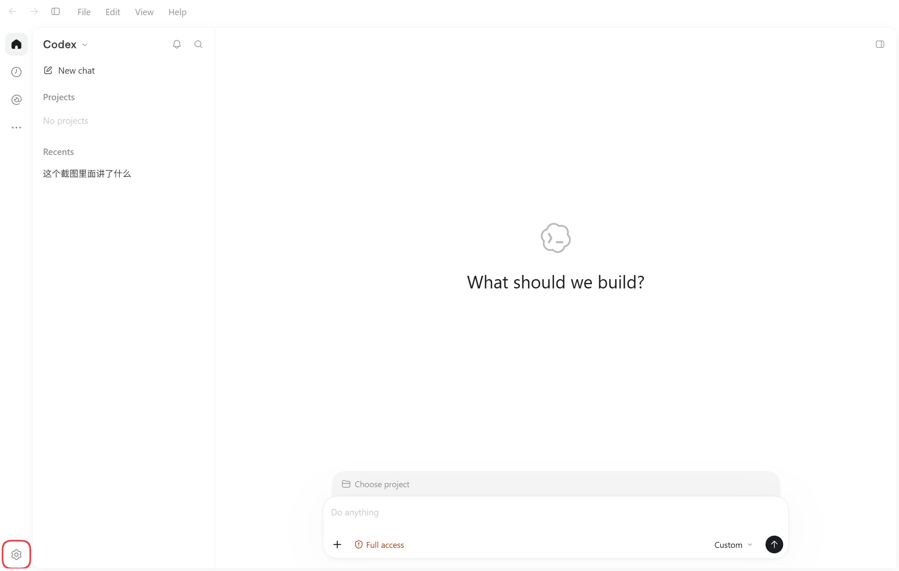

        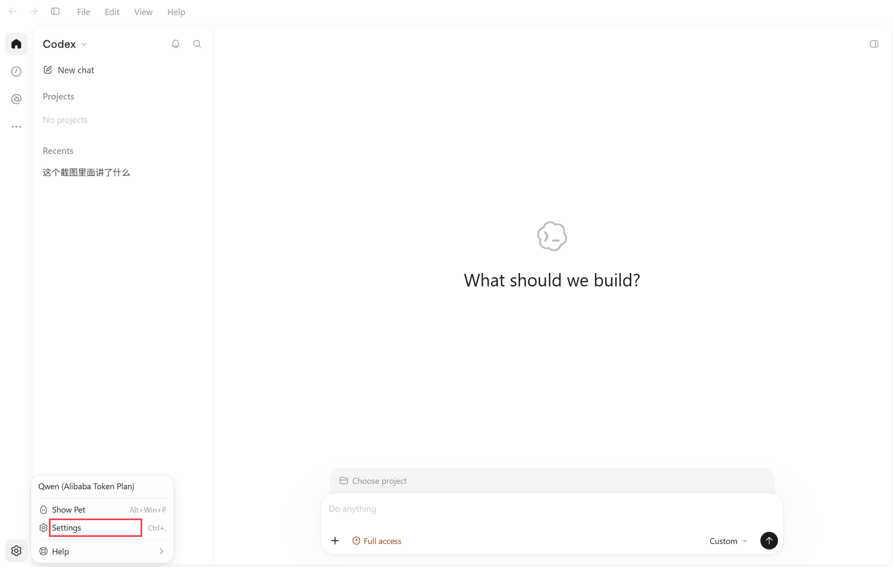

    2. In the left column of Settings pick **Plugins**, then click
       **Add → Add MCP server** at the top right.

        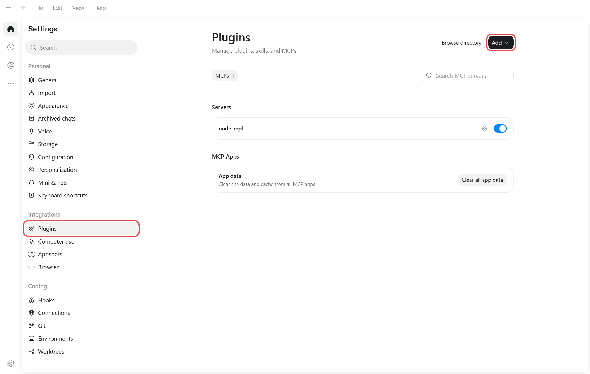

        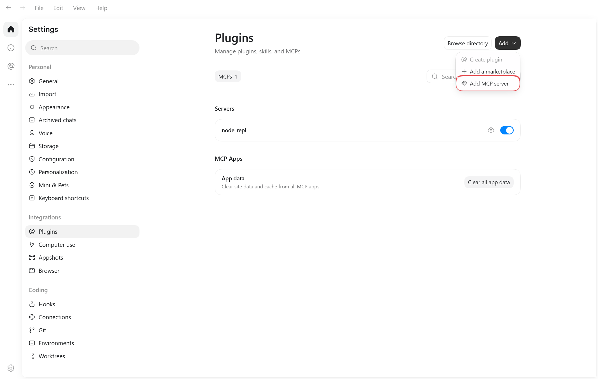

    3. Fill in the form as below. Every value to copy is in the dialog's
       **In the app** tab — click **Copy** next to it and paste, no typing.

        | Field in the Codex form | What to enter | Example (fake) |
        |---|---|---|
        | Name | the dialog's **Name** | `vibe-seller` |
        | Type | choose **Streamable HTTP** | — |
        | URL | the dialog's **URL** | `http://192.168.1.10:7777/api/mcp` |
        | Headers · key (left) | the dialog's **Header name** | `Authorization` |
        | Headers · value (right) | the dialog's **Header value** | `Bearer vst_AbC123xYz` |
        | Bearer token env var, Headers from environment variables | leave empty | — |

        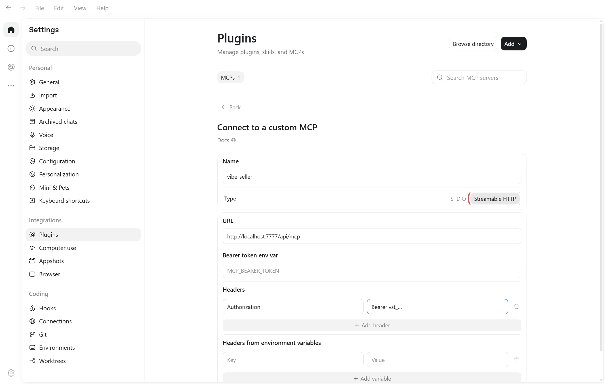

    4. Save. The list now shows `vibe-seller` with its switch on, and it
       takes effect immediately.

        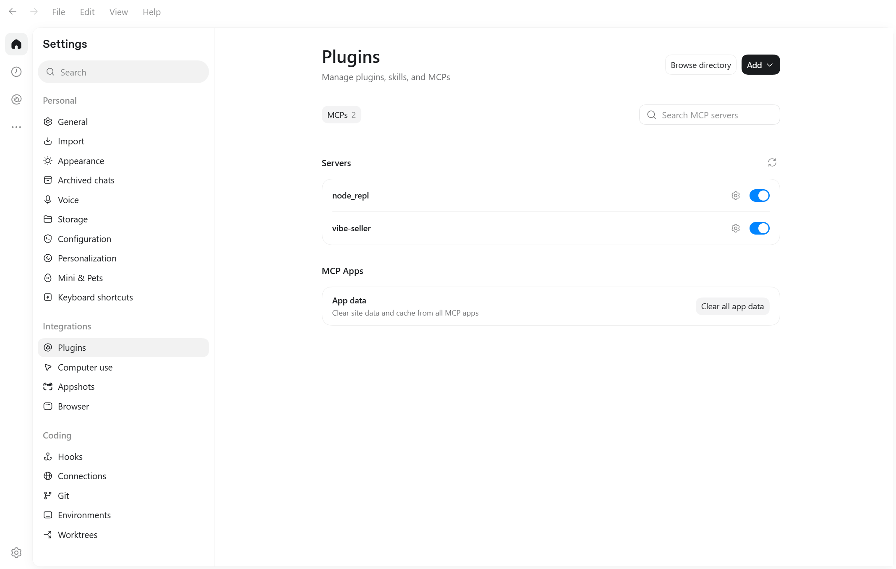

=== "Command line / config file"

    The file is `~/.codex/config.toml` — on Windows
    `C:\Users\<your-username>\.codex\config.toml`. You can also open it from
    **Settings → Configuration → Open config.toml**.

    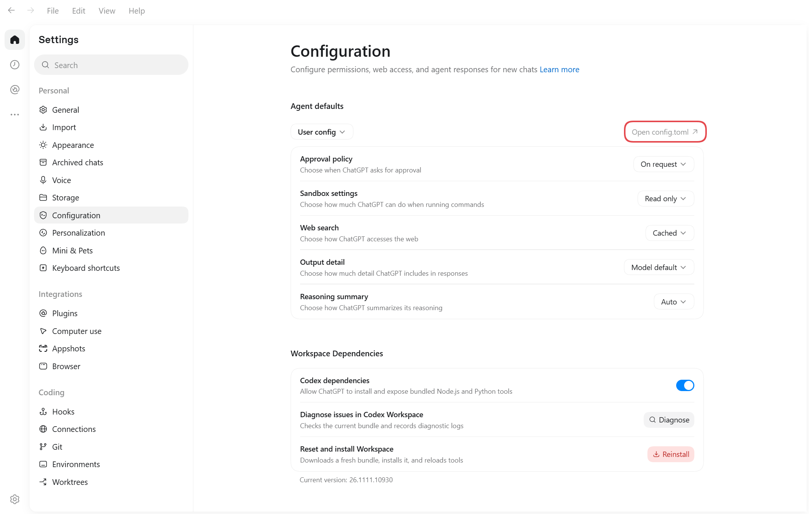

    Paste the block from the dialog's **Command line / config file** tab at
    the very end of the file, save, then quit Codex completely and reopen it.
    The block looks like this:

    ```toml
    [mcp_servers.vibe-seller]
    # Connects to this machine; if Vibe Seller runs elsewhere, use its address instead of localhost
    url = "http://localhost:7777/api/mcp"
    http_headers = { "Authorization" = "Bearer vst_…" }
    ```

    !!! warning "Don't paste the block twice"
        Two `[mcp_servers.vibe-seller]` sections invalidate the whole
        `config.toml`.

## Check it works

Start a new chat and ask “how many stores are in vibe-seller right now?”. If
it calls the tool and names your stores, you're connected.

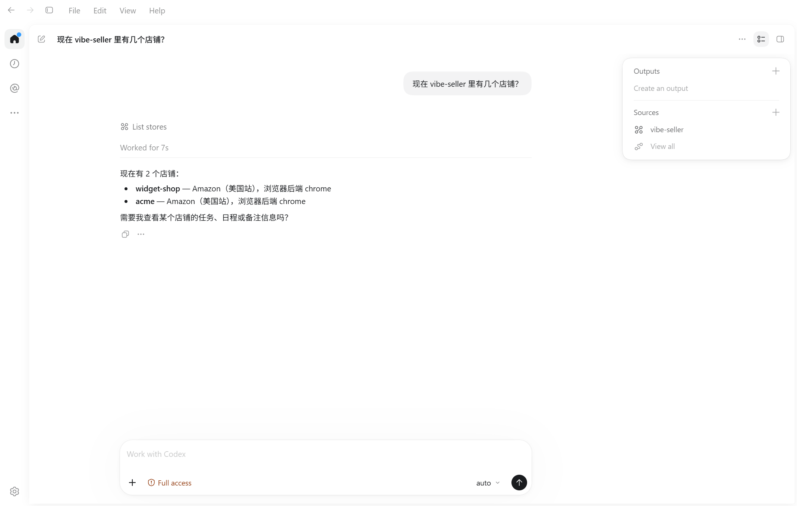

## Change or remove

To change the address or swap the key, click the gear on the `vibe-seller` row
under **Settings → Plugins** and edit the URL or the headers on that page.
**Uninstall** removes the server — there's no confirmation step.

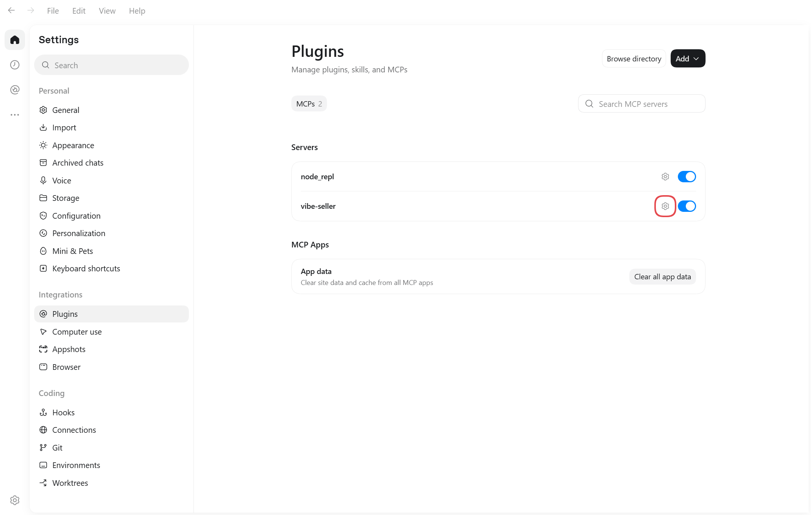

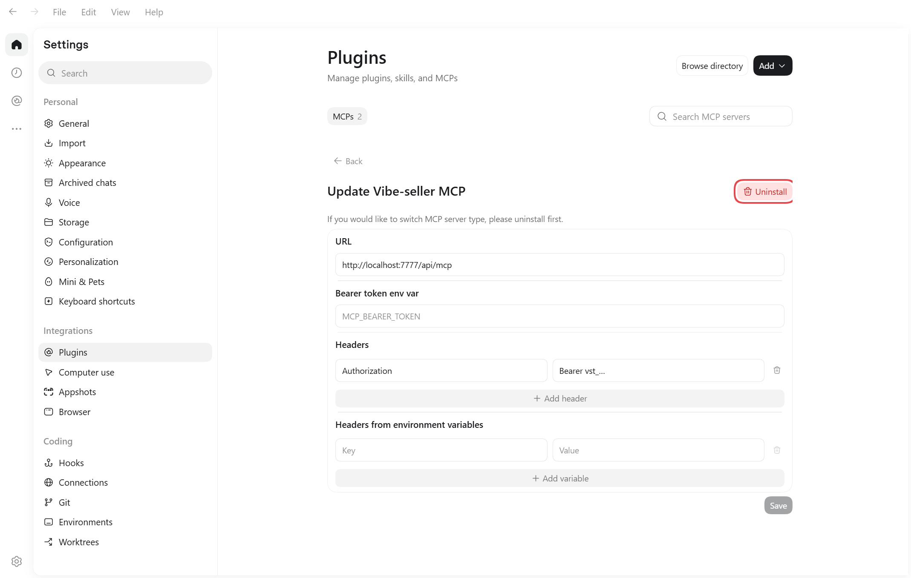

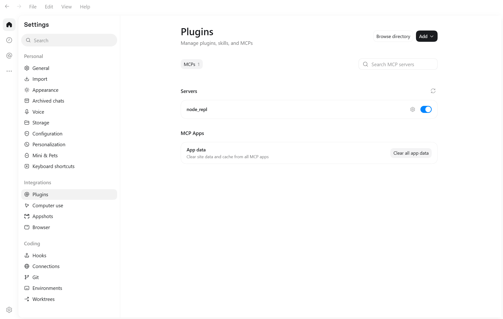

## Next

See [What you can ask](mcp.md#what-you-can-ask) for what to say once you're
connected, and [Examples](examples.md) for full walkthroughs.

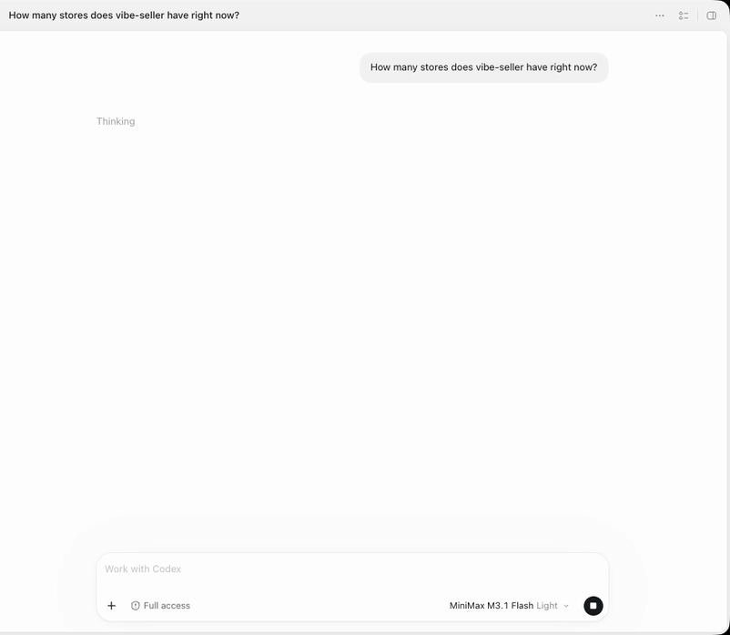
