# 在 Codex 里接入 Vibe Seller

接好之后，在 Codex 的对话里就能让 Vibe Seller 建任务、跟进进度、回答提问。

需要准备两样东西：

1. 一个 API Key：见[第一步：创建 API Key](mcp.md#第一步创建-api-key)。创建
   成功后弹出的窗口（下文称「弹窗」）里有你的服务器地址和 Codex 的现成
   配置；
2. 已经安装 Codex：从 [chatgpt.com/codex](https://chatgpt.com/codex) 下载。

## 接入

=== "界面操作"

    1. 点左下角的齿轮，在菜单里选「设置」。

        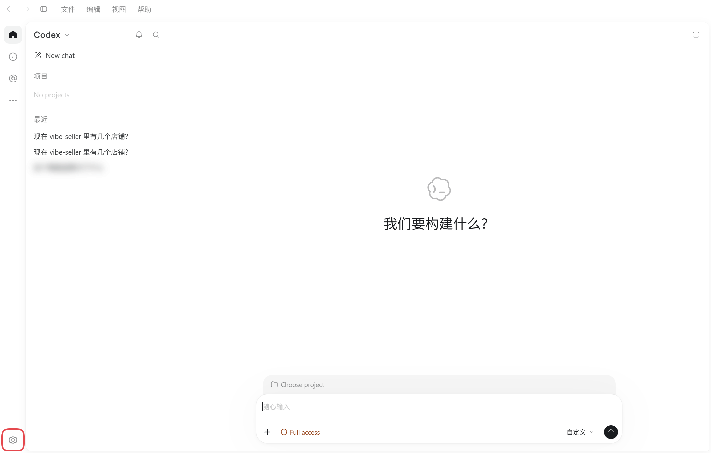

        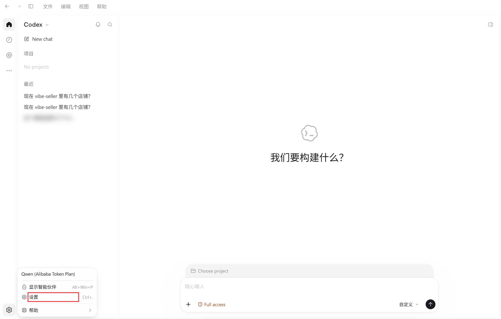

    2. 在设置左侧选「插件」，再点右上角「添加」→「添加 MCP 服务器」。

        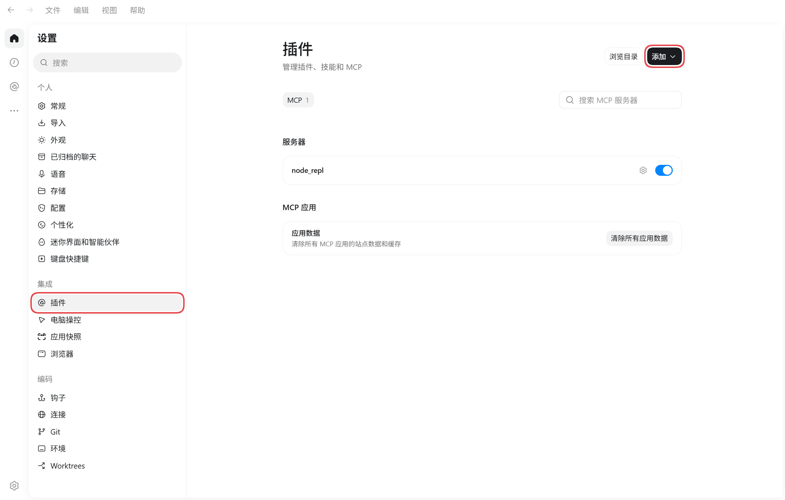

        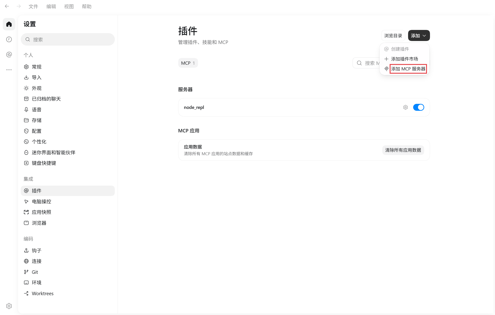

    3. 照下表填写表单。要复制的值都在弹窗「界面操作」标签里，点旁边的
       「复制」再粘贴，不用手打。

        | Codex 表单里的字段 | 填什么 | 示例（假的） |
        |---|---|---|
        | 名称 | 弹窗里的「名称」 | `vibe-seller` |
        | 类型 | 选「流式 HTTP」 | — |
        | URL | 弹窗里的「URL」 | `http://192.168.1.10:7777/api/mcp` |
        | 标头 · 左边的键 | 弹窗里的「请求头名称」 | `Authorization` |
        | 标头 · 右边的值 | 弹窗里的「请求头值」 | `Bearer vst_AbC123xYz` |
        | Bearer 令牌环境变量、来自环境变量的标头 | 留空 | — |

        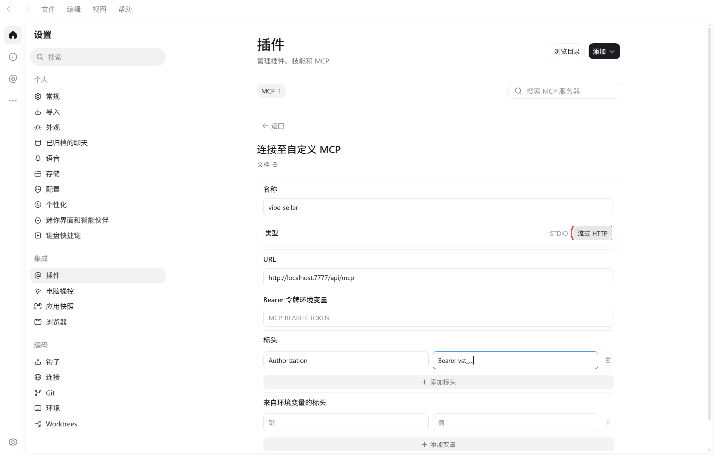

    4. 保存后，列表里出现 `vibe-seller`，开关已经打开，立即生效。

        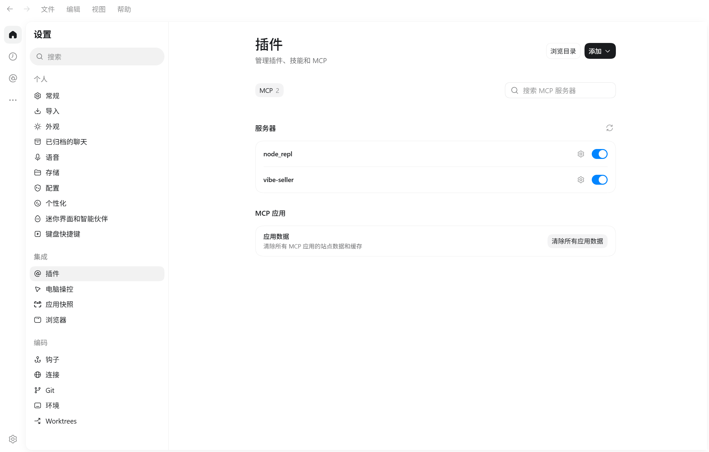

=== "命令行 / 配置文件"

    配置文件是 `~/.codex/config.toml`（Windows 上在
    `C:\Users\<你的用户名>\.codex\config.toml`）。也可以从「设置 → 配置」
    点「打开 config.toml」直接打开它。

    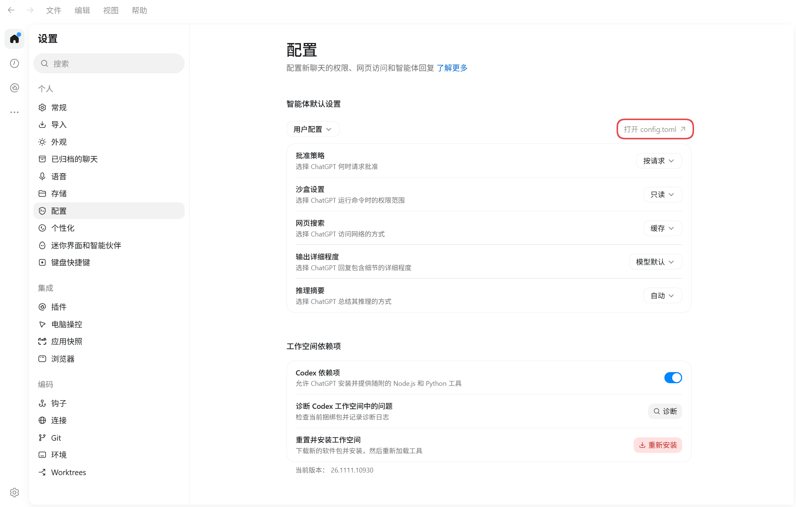

    把弹窗「命令行 / 配置文件」标签里那段粘贴到文件末尾，保存，然后彻底
    退出 Codex 再重新打开。这一段长这样：

    ```toml
    [mcp_servers.vibe-seller]
    # 默认连本机；Vibe Seller 在另一台电脑上时，把 localhost 换成那台电脑的地址
    url = "http://localhost:7777/api/mcp"
    http_headers = { "Authorization" = "Bearer vst_…" }
    ```

    !!! warning "同一段配置不要粘贴两次"
        文件里出现两个 `[mcp_servers.vibe-seller]`，整个 `config.toml`
        都会失效。

## 确认接好了

新建一个对话，问“现在 vibe-seller 里有几个店铺？”。它调用工具把你的店铺
列出来，就接好了。

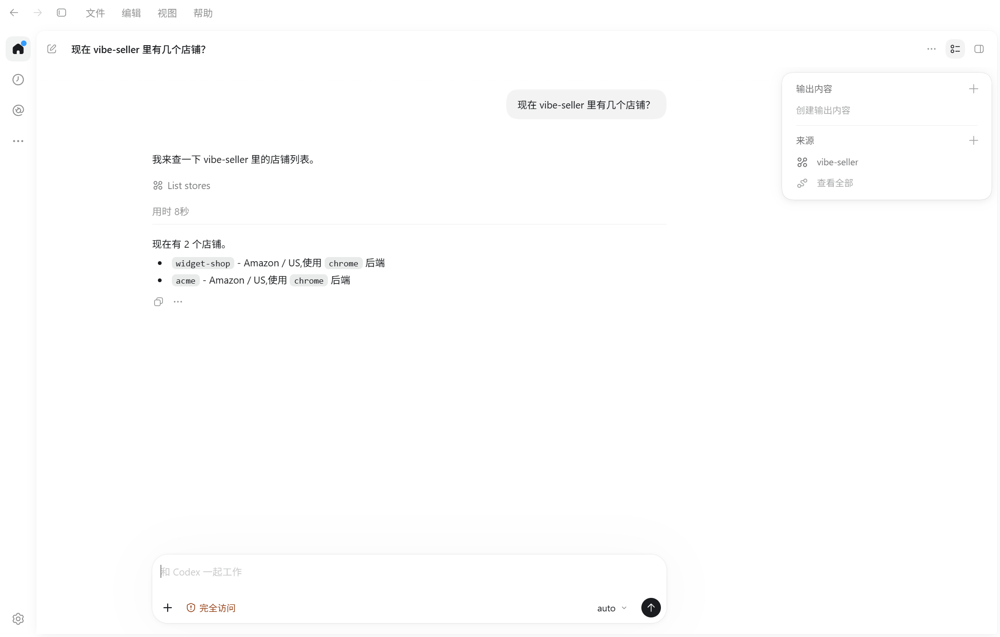

## 修改或移除

要改地址或换 Key，在「设置 → 插件」的列表里点 `vibe-seller` 那一行的齿轮，
进详情页改「URL」或「标头」；点「卸载」就是删除，没有二次确认。


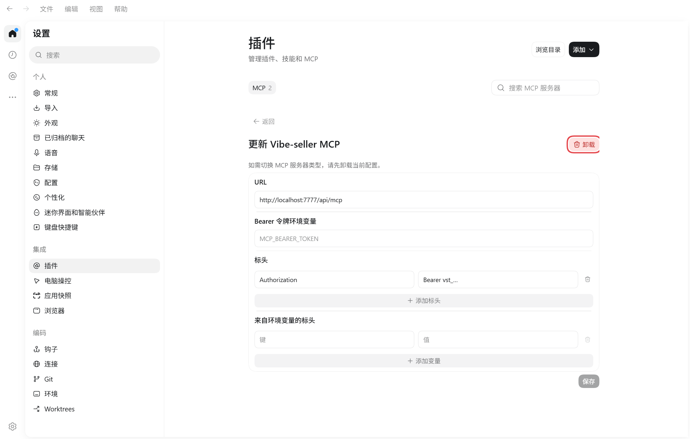

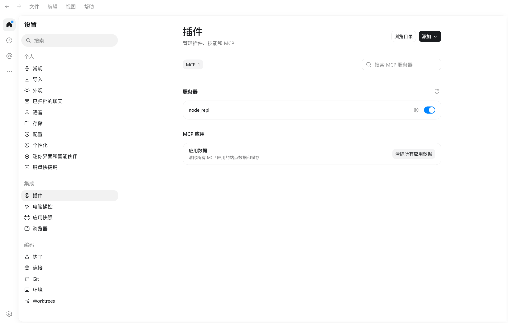

## 接下来

接入之后怎么用，见[可以这样用](mcp.md#可以这样用)；一步步的完整示例见
[使用示例](examples.md)。

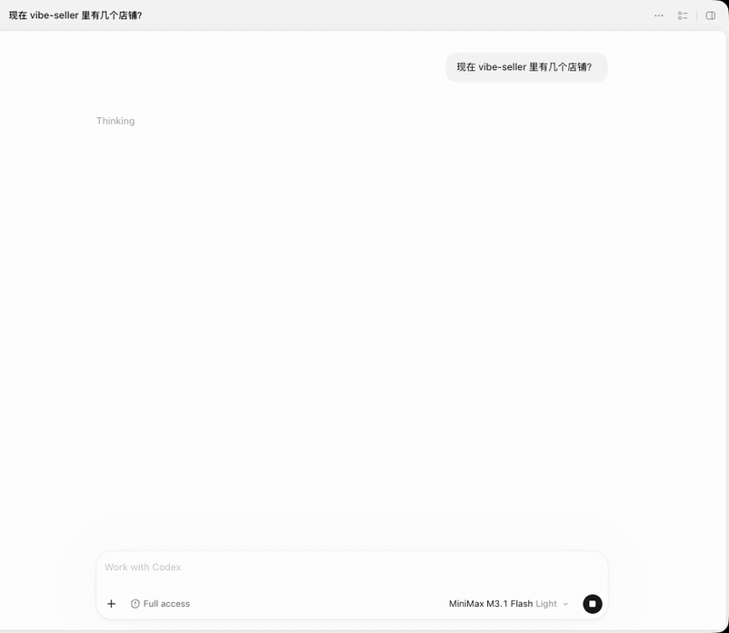
