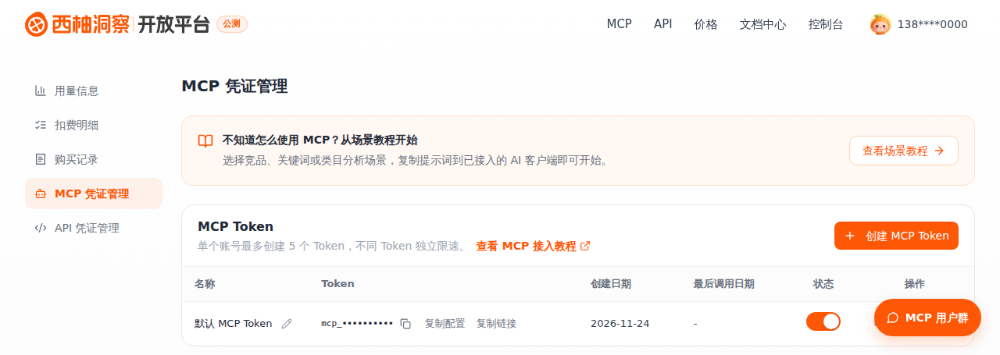
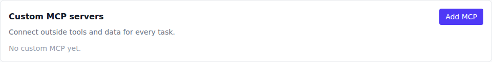
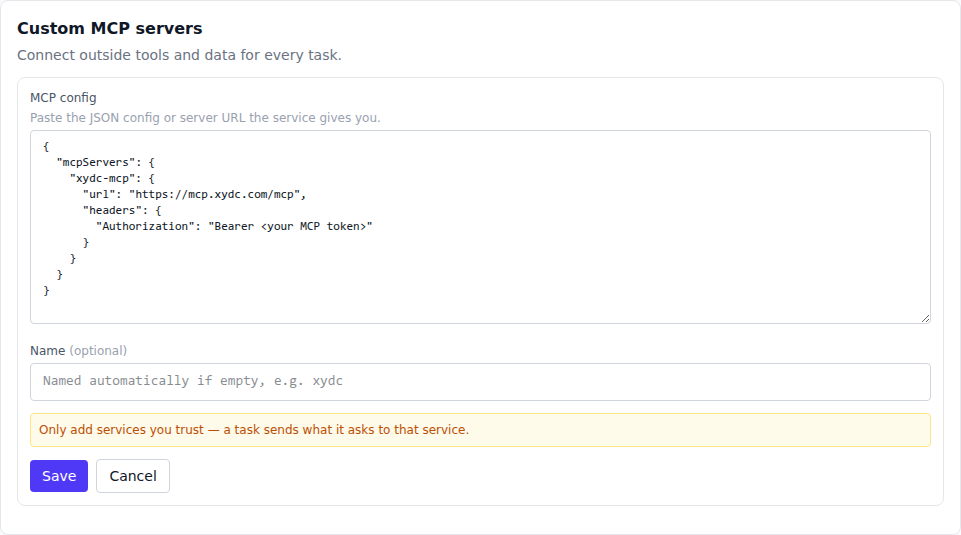
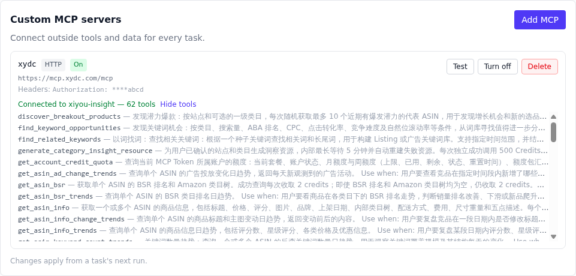
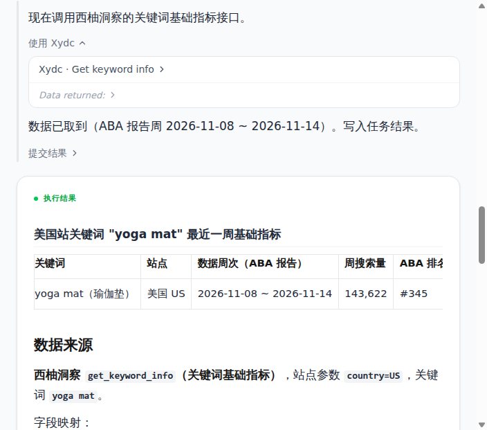

# Add a Custom MCP Server

Many data services offer MCP (a common way for an AI to call outside
tools): keyword and competitor data, category research, translation,
your own internal systems… Add such a service as a **custom MCP
server** and every task in Vibe Seller can call its tools. With Xiyou
Insight (西柚洞察) added, for example, you just say "use Xiyou to look up
last week's search volume for *yoga mat* in the US" and the AI calls
Xiyou's keyword tool to fetch it.

## Two directions — don't mix them up

Vibe Seller works with MCP in two directions, set up in different places:

| | Add a custom MCP server (this page) | [MCP setup](mcp.md) |
|---|---|---|
| Who calls whom | Vibe Seller's tasks **call an outside service** | An outside AI tool **calls Vibe Seller** |
| Example | A task pulls keyword data from Xiyou Insight | Codex asks Vibe Seller to create a task |
| Where to set it up | Settings → Integrations → Custom MCP servers | Settings → Integrations → API Key, then in the outside tool |
| What you need | The service's MCP config (with its token) | A Vibe Seller API key (starts with `vst_`) |

In one line: **to give Vibe Seller a new ability, add a custom MCP
server; to drive Vibe Seller from another AI tool, see MCP setup.**

## Example: Xiyou Insight

### Step 1: Copy the MCP config from the service

Sign in to the [Xiyou Insight platform](https://platform.xydc.com/docs/mcp-access)
and open Console → MCP credentials (MCP 凭证管理). Create an MCP token if
you have none, then click **复制配置** (copy config) on its row:



What you copy is a block of JSON like:

```json
{
  "mcpServers": {
    "xydc-mcp": {
      "url": "https://mcp.xydc.com/mcp",
      "headers": { "Authorization": "Bearer <your MCP token>" }
    }
  }
}
```

Other services work the same way: look for an "MCP setup", "MCP config"
or "Claude Code config" page and copy the `{"mcpServers": …}` block.

### Step 2: Paste it into Vibe Seller

In Vibe Seller open **Settings → Integrations**, scroll to the **Custom
MCP servers** card at the bottom and click **Add MCP**:



Paste what you copied and click **Save**:



- A whole "install this MCP for me, here is my token {…}" blurb is fine —
  the text around the JSON is ignored.
- **The name is optional**: left empty, the server is named after its
  URL's domain — `https://mcp.xydc.com/mcp` → `xydc`. Pasting just the
  URL (Xiyou's 复制链接) works too.

### Step 3: Saving checks the connection

**Save** connects to the service first. It is saved only if it
connects, and then shows "Connected to xiyou-insight — 62 tools"; if it
can't connect you see why and nothing is saved. **Show tools** lists
everything the service offers:



### Step 4: Use it in a task

Just say so when you create a task:

> Use Xiyou Insight to look up last week's search volume, ABA rank and
> suggested bid (CPC) for the keyword *yoga mat* in the US, put them in
> a small table, and say which Xiyou tool the data came from.

While it runs, the conversation shows a "Used Xydc" step; open it to
see which of its tools ran (here, Get keyword info):



## Good to know

- Only an admin can add, turn off or delete servers.
- Once added, every user's tasks can use it, scheduled ones included;
  changes apply from a task's next run.
- **Turn off** a server to pause it — no need to delete it.
- Only add services you trust: when a task calls one of its tools, what
  the call carries (keywords, say) goes to that service and is billed by
  its rules.

## FAQ

**Saving says "the token is wrong or no longer valid"**

The token is mistyped, deleted or switched off. Check it in the
service's console, copy the config again and paste it.

**It says a header still has the sample text**

You pasted the sample from the service's docs, with its "your token here"
text still in place. Copy the config with your real token from the
service's console.

**It says the service needs an OAuth sign-in**

Tasks run on their own, so nobody is there to authorize. Use the
token / API key option the service offers instead.

**It says the config has a `${…}` variable**

Replace the `${…}` with the real token and save again.

**Changing the token**

Copy the config from the service again, click **Add MCP** and paste it;
when asked about the existing name, choose to replace.

**A task doesn't use it**

Name the service in the task ("use Xiyou Insight…").
