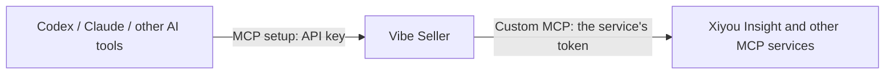

# Add a Custom MCP Server

Many data services offer MCP (a common way for an AI to call outside
tools): keyword and competitor data, category research, translation,
your own internal systems… Add such a service as a **custom MCP
server** and every task in Vibe Seller can call its tools. With Xiyou
Insight (西柚洞察) added, for example, you just say "use Xiyou to look up
last week's search volume for *yoga mat* in the US" and the AI calls
Xiyou's keyword tool to fetch it.

## Two directions — don't mix them up

Vibe Seller works with MCP in two directions, set up in different places:

| | Add a custom MCP server (this page) | [MCP setup](mcp.md) |
|---|---|---|
| Who calls whom | Vibe Seller's tasks **call an outside service** | An outside AI tool **calls Vibe Seller** |
| Example | A task pulls keyword data from Xiyou Insight | Codex asks Vibe Seller to create a task |
| Where to set it up | Settings → Integrations → Custom MCP servers | Settings → Integrations → API Key, then in the outside tool |
| What you need | The service's MCP config (with its token) | A Vibe Seller API key (starts with `vst_`) |



In one line: **to give Vibe Seller a new ability, add a custom MCP
server; to drive Vibe Seller from another AI tool, see MCP setup.**

## Example: Xiyou Insight

### Step 1: Copy the MCP config from the service

Sign in to the [Xiyou Insight platform](https://platform.xydc.com/docs/mcp-access)
and open Console → MCP credentials (MCP 凭证管理). Create an MCP token if
you have none, then click **复制配置** (copy config) on its row:


What you copy is a block of JSON like:

```json
{
  "mcpServers": {
    "xydc-mcp": {
      "url": "https://mcp.xydc.com/mcp",
      "headers": { "Authorization": "Bearer <your MCP token>" }
    }
  }
}
```

Other services work the same way: look for an "MCP setup", "MCP config"
or "Claude Code config" page and copy the `{"mcpServers": …}` block.

### Step 2: Paste it into Vibe Seller

In Vibe Seller open **Settings → Integrations**, scroll to the **Custom
MCP servers** card at the bottom and click **Add MCP**:


Paste what you copied and click **Save**:


The paste can be loose:

- A whole "install this MCP for me, here is my token {…}" blurb is fine —
  the text around the JSON is ignored;
- A bare server URL works too (Xiyou's 复制链接 gives
  `https://mcp.xydc.com/mcp?mcp_token=…`) — then fill in a **Name**, such
  as `xydc-mcp`;
- Names use letters, digits, `-` and `_`.

### Step 3: Check that it connected

Saving runs a connection test on its own. "Connected to xiyou-insight —
62 tools" means the token works. **Show tools** lists everything the
service offers:


Once saved, only the token's last 4 characters are ever shown — to
anyone, the admin included. To change the token, copy the config from
the service again, **Add MCP**, paste it and choose to replace.

### Step 4: Use it in a task

Just say so when you create a task:

> Use Xiyou Insight to look up last week's search volume, ABA rank and
> suggested bid (CPC) for the keyword *yoga mat* in the US, put them in
> a small table, and say which Xiyou tool the data came from.

While it runs, the conversation shows a "Used Xydc Mcp"
step; open it to see which of its tools ran (here, Get keyword info):


Naming the service in the request ("use Xiyou…") is the surest way; the
AI will also reach for it on its own when the task needs that data.

## Which MCP servers can be added

| Kind | What the config looks like | Notes |
|---|---|---|
| Remote (HTTP) | `"url": "https://…/mcp"` | The common case. No `type` needed — it is detected |
| Remote (SSE) | `"url": "https://…/sse"` | The older interface; the URL usually ends in `/sse` |
| Local command | `"command": "npx", "args": [...]` | Starts a program on the computer Vibe Seller runs on; install the command first (e.g. Node.js for `npx`) |

These are refused, with the reason shown:

- **Services that need a browser sign-in (OAuth).** Tasks run on their
  own, so nobody is there to click "authorize". Use the token / API key
  option the service offers instead.
- **Configs with a `${VARIABLE}` in place of the token.** In a task the
  variable would be filled from the AI's own environment (which holds
  your model key), so paste the real value.
- **Names like `vibe-seller`, `ticktick`, `playwright`, `browser-use`.**
  Vibe Seller uses these itself — pick another.

## Who can set it up, and who gets it

- **Admins only** can add, test, turn off and delete servers; members see
  the list, so they know what their tasks can use. An API key cannot add
  one.
- **Shared by the whole instance**: once added, every task of every user
  (scheduled ones included) can use it. The workspace assistant does not.
- **From the next run on**: a new task, a follow-up, a retry or a
  scheduled run reads the current list; a task already running keeps
  what it started with. **Turn off** a server instead of deleting it if
  you only want to pause it.

## Security notes

- Only add services you trust. When a task calls one of its tools, what
  the call carries (keywords, ASINs…) goes to that service and is billed
  by its rules — Xiyou's tool descriptions say how many credits each
  call costs.
- Vibe Seller stores the token encrypted and only ever shows its last 4
  characters. At task start it is written to a file only the current
  user can read, handed to the AI program, and deleted as soon as that
  program has read it.
- A local-command server runs the vendor's program on this computer — the
  same as installing software on it. Add only ones from a source you
  trust.

## FAQ

**The connection test says 401 / 403**

The token is wrong, deleted or switched off. Check it in the service's
console, copy the config again and paste it once more (choose replace).

**The test passes, but the task doesn't use it**

Name the service in the task ("use Xiyou Insight…"). Also check the
server is **On**, and that the task started after you added it.

**Lots of tools — is that a problem?**

Every enabled server brings its tool descriptions into each task, so
more servers and more tools mean more of the task's context in use. A
service with a few dozen tools, like Xiyou Insight, is fine; turn off
servers you are not using.

**How does this relate to the API key under MCP setup?**

It doesn't — they are opposite directions; see the table at the top.
