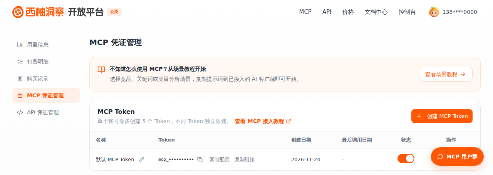
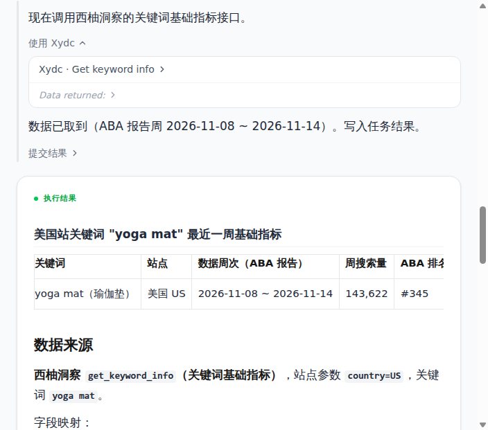

# 添加自定义 MCP

很多数据服务都提供 MCP（一种让 AI 调用外部工具的通用接口）：关键词和竞品
数据、类目分析、翻译、内部系统……把这样的服务添加为**自定义 MCP** 之后，
Vibe Seller 里的每个任务都能直接调用它的工具。例如接入西柚洞察后，你只要说
“用西柚洞察查一下美国站 yoga mat 最近一周的搜索量”，AI 就会自己调用西柚的
关键词工具把数据取回来。

## 先分清两个方向

Vibe Seller 和 MCP 打交道有两个方向，配置的地方也不一样：

| | 添加自定义 MCP（本页） | [MCP 接入](mcp.md) |
|---|---|---|
| 谁调用谁 | Vibe Seller 的任务**调用外部服务** | 外部 AI 工具**调用 Vibe Seller** |
| 例子 | 任务用西柚洞察查关键词数据 | 在 Codex 里让 Vibe Seller 建任务 |
| 在哪里配置 | 「设置 → 集成 → 自定义 MCP」 | 「设置 → 集成 → API Key」，再到外部工具里填 |
| 你要准备 | 服务商给的 MCP 配置（含它的 Token） | Vibe Seller 的 API Key（`vst_` 开头） |

一句话：**想让 Vibe Seller 多一样本事，就添加自定义 MCP；想在别的 AI 工具里
指挥 Vibe Seller，就看 MCP 接入。**

## 以西柚洞察为例

### 第一步：在服务商那里复制 MCP 配置

登录[西柚洞察开放平台](https://platform.xydc.com/docs/mcp-access)，进入
「控制台 → MCP 凭证管理」。没有 Token 就先点「创建 MCP Token」，然后在
Token 那一行点 **复制配置**：



复制出来的是一段 JSON，形如：

```json
{
  "mcpServers": {
    "xydc-mcp": {
      "url": "https://mcp.xydc.com/mcp",
      "headers": { "Authorization": "Bearer 你的 MCP Token" }
    }
  }
}
```

其他服务商也大同小异：找「MCP 接入 / MCP 配置 / Claude Code 配置」之类的
页面，复制那段 `{"mcpServers": …}`。

### 第二步：粘贴到 Vibe Seller

打开 Vibe Seller 的「设置 → 集成」，滚到最下面的 **自定义 MCP** 卡片，点击
**添加 MCP**：


把刚才复制的内容粘贴进去，点 **保存**：


- 西柚「复制接入」给的整段文字（「帮我安装西柚洞察 MCP……」）直接贴就行，
  多出来的文字会被忽略。
- **名称可以不填**：不填就用服务地址里的域名，例如
  `https://mcp.xydc.com/mcp` → `xydc`。只粘贴西柚「复制链接」给的网址也行。

### 第三步：保存时自动检查连接

点 **保存** 后会先连接这个服务：连得上才保存，并显示「已连接 xiyou-insight，
共 62 个工具」；连不上会提示原因，不会保存。点 **查看工具** 可以看到全部工具：


### 第四步：在任务里使用

新建任务时直接说要用它：

> 用西柚洞察查一下美国站关键词 yoga mat 最近一周的搜索量、ABA 排名和建议
> 竞价（CPC），整理成一个小表格，并注明数据来自西柚洞察的哪个工具。

任务执行时，对话里会出现「使用 Xydc」这一步，展开能看到调用了它的哪个
工具（这里是 Get keyword info）：



## 使用须知

- 只有管理员能添加、停用和删除。
- 添加后所有人的任务都能用，包括定时任务；改动从任务下次运行开始生效。
- 暂时不用可以点 **停用**，不必删除。
- 只添加你信任的服务：任务调用它的工具时，会把相关内容（例如关键词）发给它，
  并按服务商的规则计费。

## 常见问题

**保存时提示「Token 不对或已失效」**

Token 填错、已删除或已停用。到服务商控制台检查 Token，重新复制配置再粘贴。

**提示「请求头里还是示例文字」**

粘贴的是文档里的示例，「请改成您的 MCP Token」还没换。到服务商控制台复制
带真实 Token 的配置。

**提示需要 OAuth 登录**

任务在后台运行，没人能点授权。改用服务商提供的 Token / API Key 接入方式。

**提示配置里有 `${…}` 变量**

把 `${…}` 换成真实的 Token 再保存。

**怎么换 Token**

从服务商重新复制配置，点 **添加 MCP** 粘贴；提示同名时选择替换。

**任务没有用它**

在任务描述里点名服务，例如“用西柚洞察……”。
