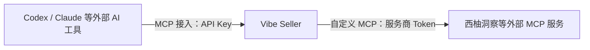
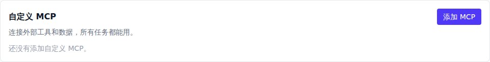
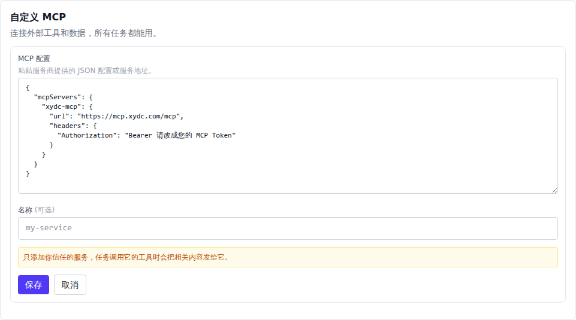
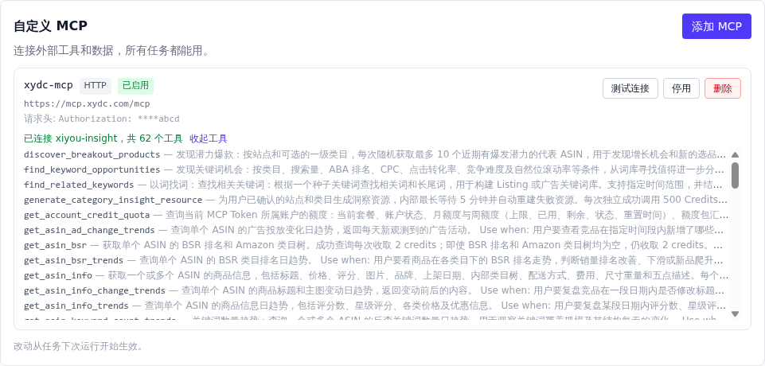

# 添加自定义 MCP

很多数据服务都提供 MCP（一种让 AI 调用外部工具的通用接口）：关键词和竞品
数据、类目分析、翻译、内部系统……把这样的服务添加为**自定义 MCP** 之后，
Vibe Seller 里的每个任务都能直接调用它的工具。例如接入西柚洞察后，你只要说
“用西柚洞察查一下美国站 yoga mat 最近一周的搜索量”，AI 就会自己调用西柚的
关键词工具把数据取回来。

## 先分清两个方向

Vibe Seller 和 MCP 打交道有两个方向，配置的地方也不一样：

| | 添加自定义 MCP（本页） | [MCP 接入](mcp.md) |
|---|---|---|
| 谁调用谁 | Vibe Seller 的任务**调用外部服务** | 外部 AI 工具**调用 Vibe Seller** |
| 例子 | 任务用西柚洞察查关键词数据 | 在 Codex 里让 Vibe Seller 建任务 |
| 在哪里配置 | 「设置 → 集成 → 自定义 MCP」 | 「设置 → 集成 → API Key」，再到外部工具里填 |
| 你要准备 | 服务商给的 MCP 配置（含它的 Token） | Vibe Seller 的 API Key（`vst_` 开头） |



一句话：**想让 Vibe Seller 多一样本事，就添加自定义 MCP；想在别的 AI 工具里
指挥 Vibe Seller，就看 MCP 接入。**

## 以西柚洞察为例

### 第一步：在服务商那里复制 MCP 配置

登录[西柚洞察开放平台](https://platform.xydc.com/docs/mcp-access)，进入
「控制台 → MCP 凭证管理」。没有 Token 就先点「创建 MCP Token」，然后在
Token 那一行点 **复制配置**：


复制出来的是一段 JSON，形如：

```json
{
  "mcpServers": {
    "xydc-mcp": {
      "url": "https://mcp.xydc.com/mcp",
      "headers": { "Authorization": "Bearer 你的 MCP Token" }
    }
  }
}
```

其他服务商也大同小异：找「MCP 接入 / MCP 配置 / Claude Code 配置」之类的
页面，复制那段 `{"mcpServers": …}`。

### 第二步：粘贴到 Vibe Seller

打开 Vibe Seller 的「设置 → 集成」，滚到最下面的 **自定义 MCP** 卡片，点击
**添加 MCP**：



把刚才复制的内容粘贴进去，点 **保存**：



粘贴时不用挑挑拣拣：

- 西柚「复制接入」按钮给的那种「帮我安装西柚洞察 MCP，以下是我的 MCP Token
  {…}」整段文字也可以直接贴，前后的说明文字会被忽略；
- 只有一个服务地址（例如西柚的「复制链接」，
  `https://mcp.xydc.com/mcp?mcp_token=…`）也可以，这时在「名称」里填一个
  名字，例如 `xydc-mcp`；
- 名称只能用字母、数字、`-` 和 `_`。

### 第三步：确认连接成功

保存后会自动测试一次连接，显示「已连接 xiyou-insight，共 62 个工具」就说明
Token 有效。点 **查看工具** 可以看到这个服务提供的全部工具：



Token 保存后只显示末尾 4 位，任何人（包括管理员自己）都看不到完整内容。以后
想换 Token，从服务商那里重新复制配置，再「添加 MCP」粘贴一次，选择替换
即可。

### 第四步：在任务里使用

新建任务时直接说要用它：

> 用西柚洞察查一下美国站关键词 yoga mat 最近一周的搜索量、ABA 排名和建议
> 竞价（CPC），整理成一个小表格，并注明数据来自西柚洞察的哪个工具。

任务执行时，对话里会出现「使用 Xydc Mcp」这一步，展开能看到调用了它的哪个
工具（这里是 Get keyword info）：


句子里点名服务（“用西柚洞察……”）最稳妥；不点名时，AI 也会在需要相应数据时
自己选用。

## 能接哪些 MCP 服务

| 类型 | 配置里的样子 | 说明 |
|---|---|---|
| 远程服务（HTTP） | `"url": "https://…/mcp"` | 最常见。配置里不写 `type` 也可以，会自动识别 |
| 远程服务（SSE） | `"url": "https://…/sse"` | 旧式接口，地址通常以 `/sse` 结尾 |
| 本地命令 | `"command": "npx", "args": [...]` | 在运行 Vibe Seller 的这台电脑上启动一个程序，需要先装好对应命令（如 Node.js 的 `npx`） |

下面几种配置会被拒绝，页面会说明原因：

- **需要在浏览器里登录授权（OAuth）的服务**：任务在后台自动运行，没有人能
  去点授权。请改用服务商提供的 Token / API Key 方式。
- **用 `${变量名}` 代替 Token 的配置**：任务里的变量会取自 AI 自己的运行环境
  （其中有你的模型密钥），所以必须直接粘贴真实的值。
- **`vibe-seller`、`ticktick`、`playwright`、`browser-use` 等名字**：这些是
  Vibe Seller 自己在用的名字，换一个即可。

## 谁能配置，对谁生效

- **只有管理员**能添加、测试、停用和删除；普通成员能看到列表，知道任务能用
  哪些服务。API Key 不能添加自定义 MCP。
- **整台实例共用**：添加后，所有用户的所有任务（包括定时任务）都能使用。
  工作区助手不使用自定义 MCP。
- **从下一次运行开始生效**：新建任务、继续对话、重试和定时运行都会读取最新
  列表；已经在运行的任务不受影响。暂时不想用，可以点「停用」，不必删除。

## 安全须知

- 只添加你信任的服务。任务调用它的工具时，相关内容（例如关键词、ASIN）会
  发送给这个服务，并按服务商的规则计费——西柚洞察的工具说明里写有每次调用
  消耗多少额度。
- Token 在 Vibe Seller 里加密保存，页面上只显示末尾 4 位；任务启动时会临时
  写入一个只有本机当前用户能读的文件，交给 AI 程序读取后立即删除。
- 「本地命令」类型会在这台电脑上运行服务商的程序，等同于在这台电脑上安装
  软件，请只添加来源可靠的。

## 常见问题

**测试连接提示 401 / 403**

Token 不对、已删除或已停用。到服务商控制台检查 Token 状态，重新复制配置后
再粘贴一次（选择替换）。

**测试成功，但任务没有用它**

在任务描述里点名服务，例如“用西柚洞察……”。另外确认这个服务处于「已启用」
状态，并且任务是在添加之后才开始运行的。

**工具很多，有影响吗？**

每个启用的服务都会把它的工具说明带进任务，服务越多、工具越多，任务的上下文
占用就越大。西柚洞察这样几十个工具的服务没有问题；暂时用不上的服务，停用
即可。

**和「MCP 接入」里的 API Key 有什么关系？**

没有关系，方向正好相反，见本页开头的对比表。
