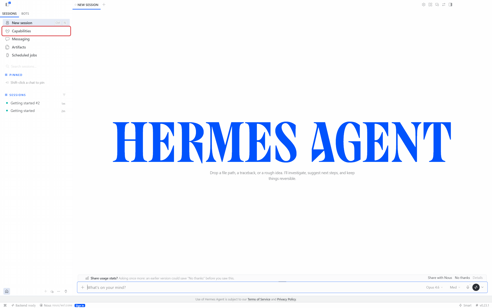
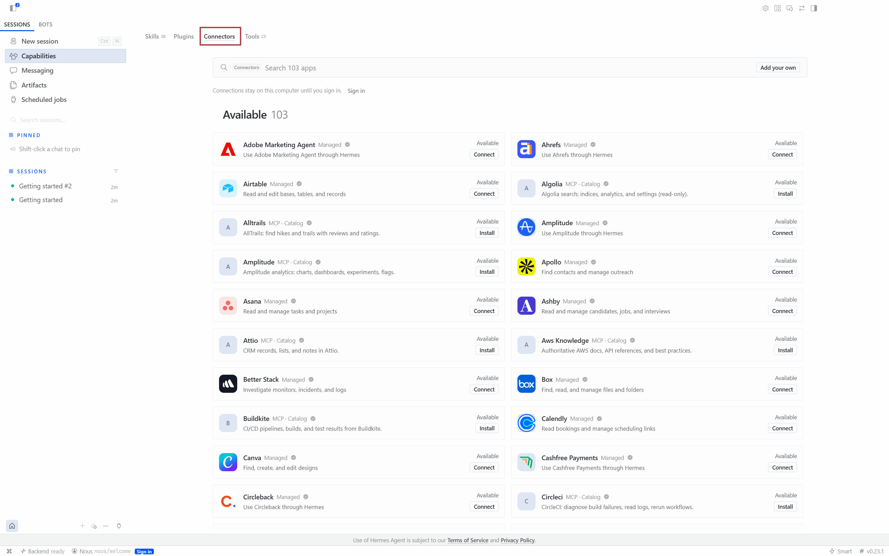
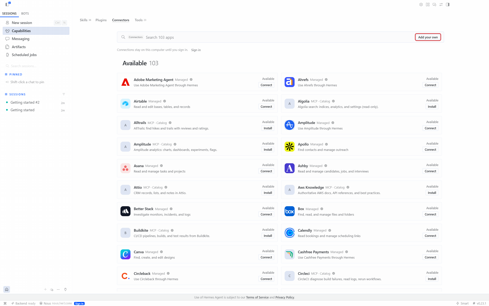
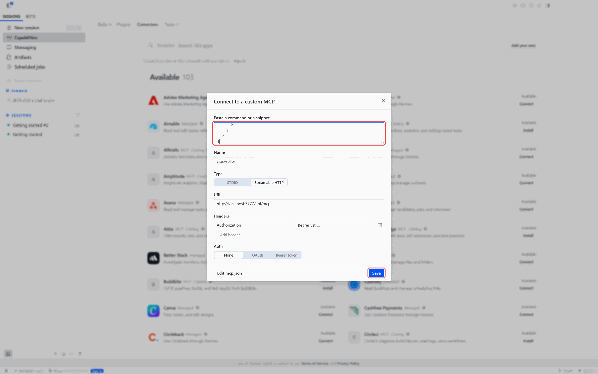
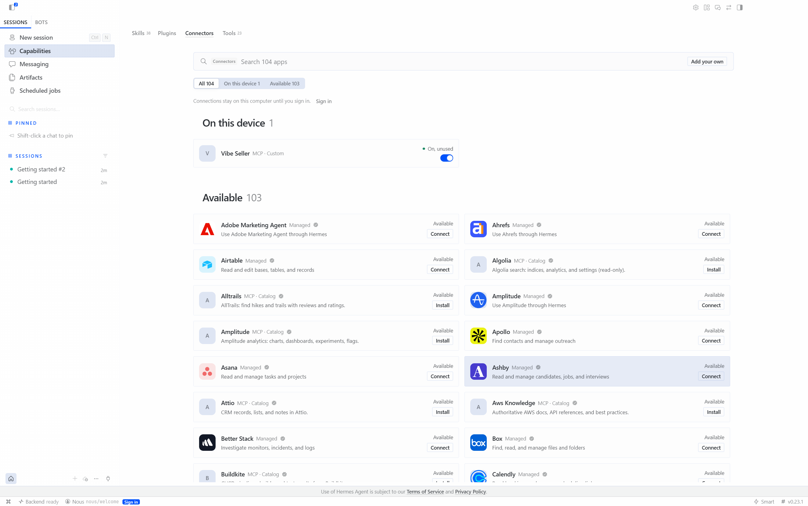
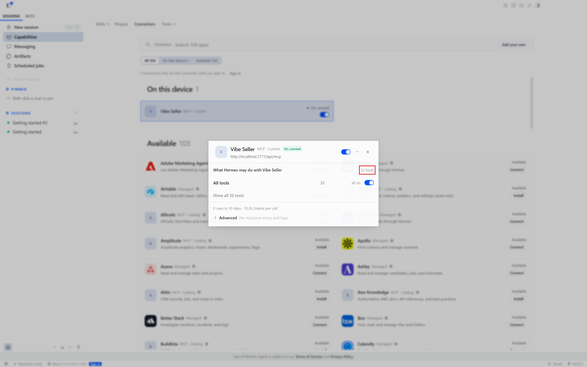
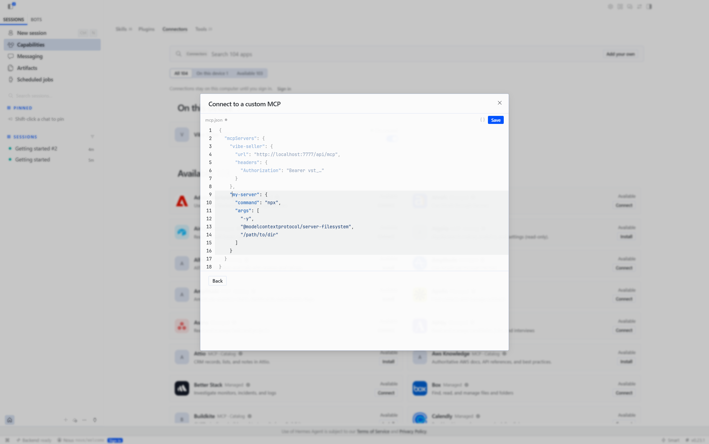
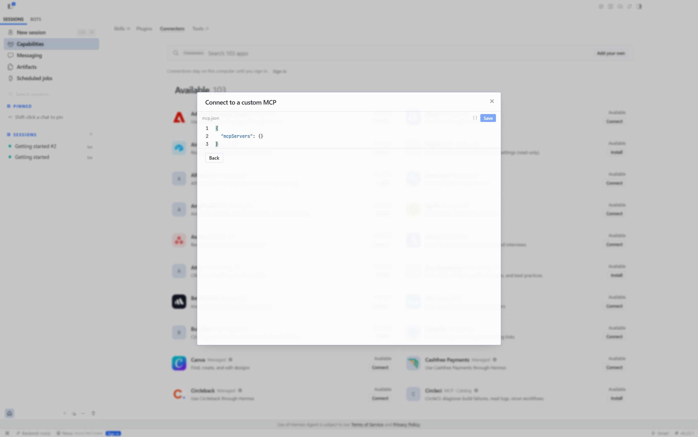

# Connect Vibe Seller to Hermes Agent

Once it's connected, you can ask Hermes to create Vibe Seller tasks, follow
their progress and answer their questions.

Two things to get ready first:

1. An API key — see [First: create an API key](mcp.md#first-create-an-api-key).
   Right after you create it, the dialog shows your server address and a
   ready-made Hermes config;
2. Hermes Agent itself, installed by following the
   [official installation guide](https://hermes-agent.nousresearch.com/docs/getting-started/installation).

## Connect

=== "In the app"

    1. Open **Capabilities** in the left column and switch to the
       **Connectors** tab.

        

        

    2. Click **Add your own** at the top right.

        

    3. Copy the JSON from the dialog's **In the app** tab and paste it into
       **Paste a command or a snippet** at the top of the dialog. The name,
       type (Streamable HTTP), URL and header fill themselves in — check
       them, then click **Save**.

        

        !!! warning "This box only takes JSON"
            The YAML block from the **Command line / config file** tab is not
            recognised here: every field lands empty and the type stays on
            STDIO. That one belongs in the file.

    4. Save, and the connector appears under **On this device**.

        

=== "Command line / config file"

    The file is `~/.hermes/config.yaml`, under the `mcp_servers` key — on a
    native Windows install it is `%LOCALAPPDATA%\hermes\config.yaml`. Add the
    block from the dialog's **Command line / config file** tab; if the file
    already has `mcp_servers:`, put just the `vibe-seller:` entry under it.
    Save, then run `/reload-mcp` in a Hermes session, or restart Hermes. The
    block looks like this:

    ```yaml
    mcp_servers:
      vibe-seller:
        # Connects to this machine; if Vibe Seller runs elsewhere, use its address instead of localhost
        url: "http://localhost:7777/api/mcp"
        headers:
          Authorization: "Bearer vst_…"
    ```

## Check it works

Start a new chat and ask "how many stores are in vibe-seller right now?". If it
names your stores, you're connected. Before you have a model configured, open
the Vibe Seller card: the details show the right URL and all 32 tools on, which
means the connection works.



## Change or remove

The card's "…" menu has no delete — only refresh tools and opening the
connector admin. To change or remove the entry, click **Add your own** again
→ **Edit mcp.json**, edit the `vibe-seller` entry in the editor, and delete it
plus **Save** to remove the server.





!!! warning "This editor shows the key in plain text"
    **Edit mcp.json** displays the full key. Mask anything starting with
    `vst_` before you share a screenshot.

## Next

See [What you can ask](mcp.md#what-you-can-ask) for what to say once you're
connected, and [Examples](examples.md) for full walkthroughs.
